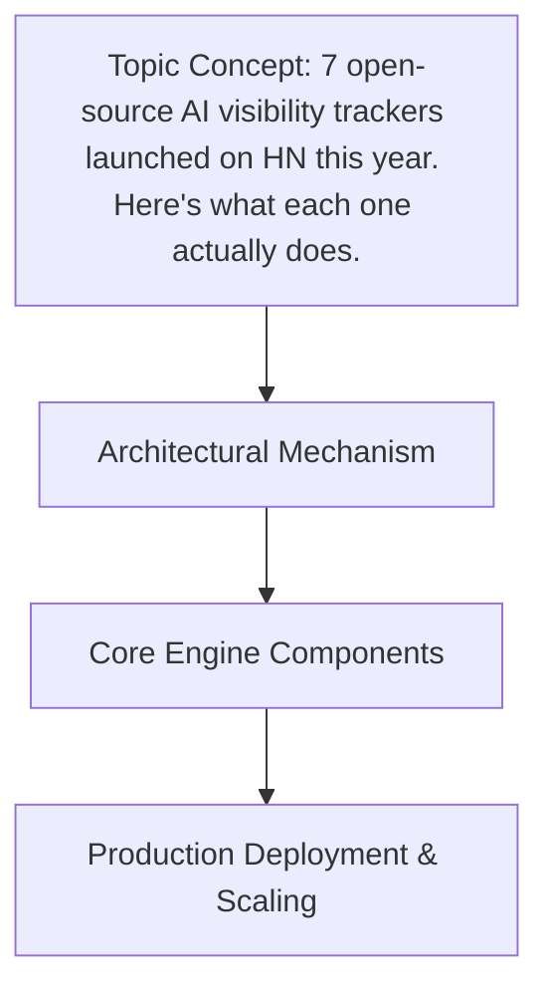

# 7 open-source AI visibility trackers launched on HN this year. Here's what each one actually does.

## Introduction

Large language models are opaque by design. You send a prompt, wait a few seconds, and receive text. What happens inside—the token probabilities, retrieval hops, tool calls, and retries—is invisible to standard application monitoring. Traditional APM tools tell you that an HTTP request took 800 milliseconds; they do not tell you that 600 of those milliseconds were spent waiting on a re-ranking model, or that the final answer was generated from a hallucinated citation.

When you move from a single `chat.completion` call to a multi-step agent, the opacity compounds. A user complaint about a wrong answer becomes a forensic investigation across vector databases, embedding services, and LLM providers. AI visibility trackers exist to close that gap. They instrument model calls, capture token-level metadata, and stitch distributed traces together so engineers can answer three questions in production: what did the model do, why did it cost that much, and where did it go wrong.

## Why This Matters

Software engineers and architects should care because AI workloads introduce failure modes that classic observability does not cover.

First, cost is non-linear. A single prompt can trigger a chain of tool calls, each with its own token consumption. Without visibility, you discover budget overruns at the end of the month, not when the expensive path is first taken.

Second, latency is distributed. A RAG pipeline might call an embedding service, query Milvus, rerank results, and then stream a response from

## How It Works

