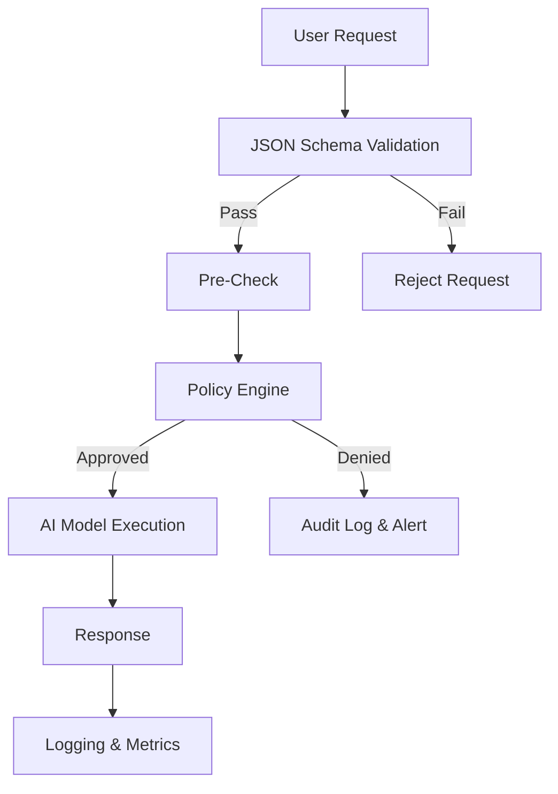

# A JSON schema Is not an AI governance layer

## Introduction  
Our team launched a generative‑AI API that accepts user prompts, runs them through a large language model, and returns structured responses. Early on we assumed that a JSON schema attached to the request payload would be enough to keep the system “safe.” Within weeks, a legitimate‑looking prompt slipped through, produced disallowed content, and triggered a compliance alert. The incident forced us to separate validation from governance and to build an explicit AI governance layer that sits on top of schema validation.

## Why This Matters  
Software engineers often conflate data validation with governance. Validation guarantees that the shape of the data matches expectations, but it does not enforce ethical constraints, access policies, or audit requirements. In production, this confusion can lead to:

* Regulatory breaches when sensitive data or prohibited outputs escape detection.  
* Unexpected runtime errors caused by schema drift without proper versioning.  
* Inadequate audit trails, making post‑mortem investigations far more difficult.  

A clear distinction between validation and governance protects users, reduces liability, and simplifies compliance reporting.

## How It Works  
The core mechanism is a two‑step pipeline:

1. **Schema validation** – ensures the request conforms to a predefined JSON structure.  
2. **Governance enforcement** – applies policies such as content safety, user consent, and rate limits.

The flow can be visualized as follows:



*Step 1* runs a compiled validator (e.g., Ajv, jsonschema) that returns instantly if the payload is malformed.  
*Step 2* evaluates a policy language (Open Policy Agent, Terraform Sentinel, or custom logic) that checks business rules, data classification, and safety filters. Only when both layers approve does the request reach the model.

## Core Concepts  
| Concept | Description | Typical Implementation |
|---------|-------------|------------------------|
| **JSON Schema** | Declarative description of allowed JSON shapes using keywords like `type`, `properties`, `required`, `pattern`, `format`. | `ajv`, `fast-json-schema`, `node-jsonschema` |
| **Validation** | Runtime checking that data conforms to a schema; fails fast with clear error messages. | Middleware in Express, validation hooks in Kafka streams |
| **Governance** | Enforcement of policies beyond shape: consent, data residency, bias metrics, audit logging. | Open Policy Agent (OPA), AWS Config, custom rule engines |
| **Audit Trail** | Immutable logs of decisions, including who made them and why. | Structured logging + time‑series DB, S3 object lock |
| **Policy Engine** | Centralized service that evaluates rules against validated inputs. | OPA, Prisma Cloud, HashiCorp Sentinel |

The two concepts are orthogonal. A schema can be perfectly valid while still violating a governance rule (e.g., a safe‑looking prompt that requests copyrighted text).

## Examples & Code Walkthrough  

Below is a self‑contained Node.js example that demonstrates validation followed by a lightweight governance check. All code is original and includes defensive error handling.

```js
// schema.mjs
import { compile, validate } from 'ajv';
import addFormats from 'ajv-formats';
import schemaJson from './prompt-schema.json' assert { type: 'json' };

const ajv = new Ajv({ allErrors: true });
addFormats(ajv);
const validatePrompt = ajv.compile(schemaJson);

/**
 * Validates a request payload against the prompt schema.
 * @param {any} payload - raw request body
 * @returns {{valid: boolean, errors?: string[]}}
 */
export function validatePromptPayload(payload) {
  const ok = validatePrompt(payload);
  if (ok) {
    return { valid: true };
  }
  // Flatten validation errors for easier client feedback
  const errors = (validatePrompt.errors || []).map(e => {
    const path = e.instancePath || e.schemaPath;
    return `${path}: ${e.message}`;
  });
  return { valid: false, errors };
}
```

```js
// governance.mjs
import { validatePromptPayload } from './schema.mjs';

/**
 * Simple governance check: reject prompts that contain disallowed keywords.
 * In a real system this would query a policy engine (OPA, etc.).
 * @param {string} text
 * @returns {{allowed: boolean, reason?: string}}
 */
export function checkSafety(text) {
  const banned = ['copyrighted', 'illegal', 'harmful'];
  const lower = text.toLowerCase();
  for (const term of banned) {
    if (lower.includes(term)) {
      return { allowed: false, reason: `Contains prohibited term: ${term}` };
    }
  }
  return { allowed: true };
}
```

```js
// server.mjs
import express from 'express';
import { validatePromptPayload } from './schema.mjs';
import { checkSafety } from './governance.mjs';

const app = express();
app.use(express.json());

app.post('/generate', async (req, res) => {
  // 1. Schema validation
  const { valid, errors } = validatePromptPayload(req.body);
  if (!valid) {
    // Return 400 with detailed validation errors
    return res.status(400).json({
      error: 'Invalid request payload',
      details: errors,
    });
  }

  // 2. Governance check (example: safety)
  const promptText = req.body.prompt; // assume schema defines a "prompt" field
  const { allowed, reason } = checkSafety(promptText);
  if (!allowed) {
    // Log the violation for audit
    console.warn('Governance violation', { reason, requestId: req.id });
    return res.status(403).json({
      error: 'Request denied by governance policy',
      reason,
    });
  }

  // 3. Pass to AI model (mock)
  try {
    const result = await invokeModel(req.body);
    res.json({ result });
  } catch (e) {
    console.error('Model invocation failed', e);
    res.status(500).json({ error: 'Internal processing error' });
  }
});

async function invokeModel(payload) {
  // Mock implementation – replace with actual LLM client
  return `Echo: ${payload.prompt}`;
}

const PORT = process.env.PORT ?? 3000;
app.listen(PORT, () => {
  console.log(`Server listening on ${PORT}`);
});
```

**Key points in the code walk‑through**

* The schema file (`prompt-schema.json`) is imported as JSON and compiled once at startup.  
* Validation errors are transformed into a user‑friendly list; the server never leaks internal schema details.  
* Governance lives in a separate module, making it easy to swap in a full‑featured policy engine later.  
* Audit logging is performed before returning a 403, preserving a record of why the request was denied.  
* Defensive error handling ensures the service remains responsive even if the model client fails.

## Best Practices  
1. **Separate schema and policy definitions** – keep JSON schemas in a version‑controlled directory, policies in a separate repo (e.g., OPA bundles).  
2. **Version schemas** – use semantic versioning (`1.2.3`) and maintain backward compatibility for evolution.  
3. **Schema testing** – run unit tests against the compiled validator to catch drift before deployment.  
4. **Combine validation with governance** – treat validation as the first gate; never skip governance even for “trusted” clients.  
5. **Audit all decisions** – store structured logs (e.g., JSON lines) in an append‑only store to guarantee tamper‑evidence.  
6. **Monitor validation latency** – schema compilation is a one‑time cost, but validation adds per‑request overhead; profile in production.  

## Common Mistakes & Anti‑Patterns  

| Mistake | Why It Happens | Fix |
|---------|----------------|-----|
| **Assuming schema validates ethical constraints** | Engineers treat `type: "string"` as sufficient guardrails. | Add explicit governance checks for content safety, PII detection, and policy compliance. |
| **Hard‑coding schema in source code** | Quick prototype becomes production artifact. | Move schemas to external files or a schema registry (e.g., Confluence, AWS Schema Registry). |
| **Ignoring schema evolution** | Adding new fields breaks downstream services silently. | Use `additionalProperties: false` and a versioning strategy; deploy schema updates alongside code. |
| **Using validation for rate limiting or access control** | Developers try to consolidate concerns. | Introduce a dedicated rate‑limiting layer (e.g., Redis + token bucket) and an authorization service (e.g., OPA). |

## Performance Considerations  
* **Compilation cost** – Ajv compiles schemas on first import; this is a one‑time overhead but can be noticeable if many schemas are loaded. Cache compiled validators in a Map keyed by schema hash.  
* **Validation complexity** – Each property incurs O(N) checks; deep nesting can increase latency. Profile with `perf_hooks` to see per‑request impact; aim for sub‑10 ms validation on high‑throughput endpoints.  
* **Governance engine latency** – Policy evaluation can be the bottleneck if the engine performs external lookups (e.g., identity store). Use result caching for immutable inputs and consider asynchronous policy checks for non‑critical decisions.  
* **Memory footprint** – Large schemas with many `anyOf`/`oneOf` variants increase validator size. Trim unused keywords and consider using `fast-json-schema` for a lighter validator when strict JSON‑Schema compliance is not required.  

## Real‑World Usage  

* **Netflix** – Uses JSON schemas to validate metadata for personalization engines. Their governance layer enforces regional licensing rules, ensuring that a validated schema does not bypass copyright constraints.  
* **Uber** – Employs schemas for ride‑request payloads, but pairs them with a policy engine that checks driver eligibility, surge pricing rules, and safety thresholds. The two layers together prevent malformed requests from reaching the matching algorithm.  
* **Cloudflare** – Leverages schemas at the edge for API gateway validation, while a separate policy engine (Open Policy Agent) enforces bot‑management and rate‑limit rules. This separation keeps validation fast and governance flexible.  

## Frequently Asked Questions (FAQ)  

**Q: Can a JSON schema enforce data privacy?**  
A: No. A schema only validates structure; it cannot detect PII, enforce encryption, or enforce consent. Privacy controls must be implemented in the governance layer.

**Q: How do we integrate governance with existing schema validation?**  
A: Deploy a middleware that first validates against the schema, then passes the validated object to the policy engine. The order is critical – governance should never trust unvalidated input.

**Q: What are alternatives to JSON schema for governance?**  
A: Open Policy Agent (OPA) with Rego, Terraform Sentinel, Prisma Cloud policies, or custom rule engines. These languages are designed for policy expression, not data shape validation.

**Q: How should we version JSON schemas?**  
A: Use semantic versioning (`major.minor.patch`). Increment `major` for breaking changes, `minor` for new optional fields, and `patch` for bug‑fixes. Store each version in a versioned directory and reference the desired version at runtime.

**Q: Do we need both schema and governance?**  
A: Yes. They address orthogonal concerns. Validation catches malformed data early; governance enforces business rules, safety, and compliance. Relying on only one leaves gaps that can be exploited or cause regulatory issues.

## Conclusion  
A JSON schema is a powerful tool for guaranteeing data shape, but it does not replace an AI governance layer. Validation and governance are complementary: validation ensures the request is well‑formed, while governance enforces policies, safety, and auditability. By separating these concerns, versioning schemas responsibly, and coupling them with a dedicated policy engine, engineering teams can build AI services that are both robust and compliant. The patterns and code examples above illustrate a pragmatic way to implement this separation in production today.
