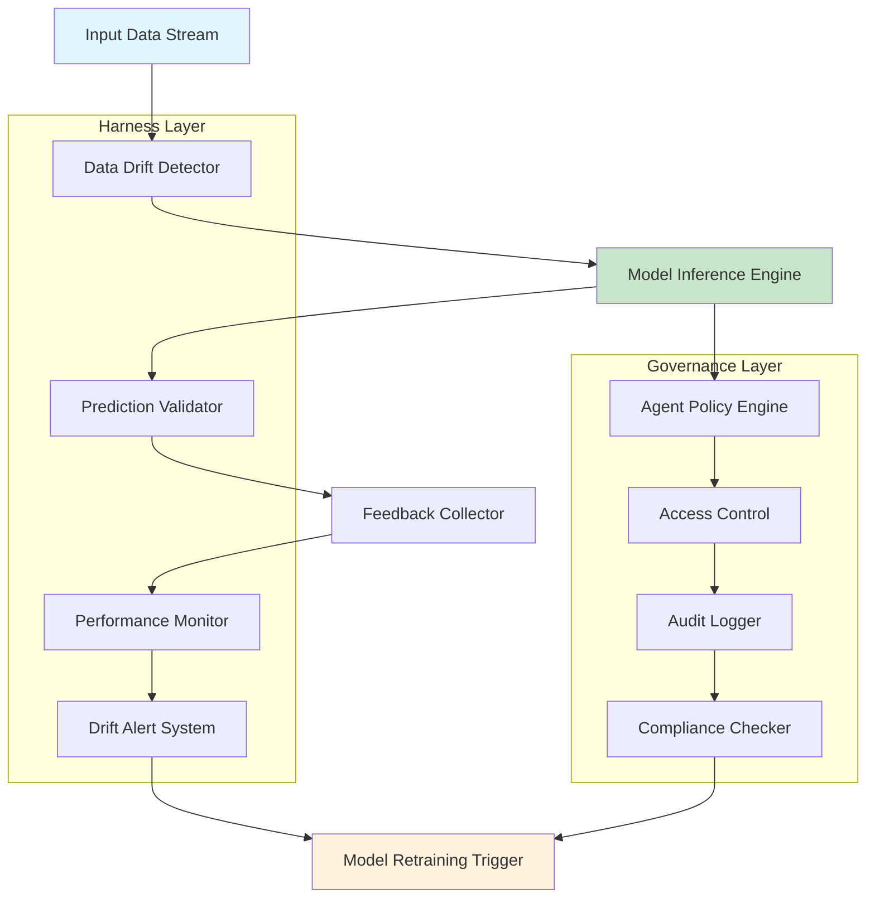

# AI in Production: Panellists Highlight Silent Failures, Harness Engineering, and Agent Governance

## Introduction

Production AI systems don't fail dramatically. They fail quietly. A recommendation model that suddenly starts favoring low-cost items because it learned a spurious correlation between price and engagement. An anomaly detector that stops flagging critical infrastructure alerts after a subtle data drift. These aren't edge cases—they're the norm.

At a recent industry panel on AI reliability, three themes emerged as the most pressing concerns for engineering teams: silent failures that evade traditional monitoring, the need for robust harness engineering around model deployment, and the urgent requirement for agent governance frameworks that can keep pace with autonomous AI systems.

## Why This Matters

Software engineers and architects should care because AI systems introduce failure modes that traditional observability tools weren't designed to catch. Unlike conventional code, where a bug either crashes the process or produces obviously wrong output, AI models can degrade gracefully while making subtly harmful decisions.

Consider a fraud detection system that reduces false positives by 20%—sounds good until you realize it's now missing 15% more actual fraud cases. Or a content moderation pipeline that starts misclassifying legitimate political discourse as hate speech during election season. These failures compound over time, eroding user trust and creating regulatory exposure.

The cost isn't just reputational. In high-stakes domains like healthcare, finance, or autonomous systems, silent AI failures can result in life-threatening decisions, financial losses measured in millions, or regulatory penalties under frameworks like the EU AI Act.

## How It Works

The core challenge lies in bridging the gap between model training environments and production realities. Traditional MLOps pipelines optimize for deployment velocity, not operational resilience. A production-grade AI system needs three layers working in concert:



The harness layer continuously monitors input distributions, validates prediction quality, and tracks performance metrics. When drift exceeds thresholds, it triggers automated retraining workflows. The governance layer enforces policies around agent behavior, access control, and compliance requirements.

## Core Concepts

**Silent Failure Detection**: Traditional accuracy metrics assume stationary data distributions. In production, we need statistical tests that can detect concept drift, covariate shift, and label shift without requiring ground truth labels.

**Harness Engineering**: This involves building infrastructure components that wrap ML models with circuit breakers, fallback mechanisms, and gradual rollout capabilities. Think of it as defensive programming for machine learning systems.

**Agent Governance**: As AI systems become more autonomous, we need frameworks that can enforce behavioral constraints, audit decision-making processes, and ensure compliance with evolving regulations.

Key data structures include:

- **Drift Windows**: Sliding time windows of input features used for distribution comparison
- **Prediction Confidence Histograms**: Binned confidence scores that reveal model uncertainty shifts
- **Decision Logs**: Structured records of agent actions with context and outcomes
- **Policy Rules**: Declarative constraints that govern acceptable system behavior

## Examples & Code Walkthrough

Here's a production-ready implementation of a drift detection component:

```python
import numpy as np
from scipy import stats
from typing import Dict, List, Optional, Tuple
import logging
from dataclasses import dataclass
from datetime import datetime, timedelta

logger = logging.getLogger(__name__)

@dataclass
class DriftAlert:
    """Represents a detected data drift event"""
    feature_name: str
    drift_score: float
    timestamp: datetime
    severity: str  # 'warning' or 'critical'
    affected_volume: int

class StatisticalDriftDetector:
    """
    Monitors feature distributions for statistical drift using 
    Kolmogorov-Smirnov tests and population stability indices.
    
    Production considerations:
    - Uses exponentially weighted moving averages for reference distributions
    - Implements batch processing to reduce computational overhead
    - Handles missing data gracefully with configurable thresholds
    """
    
    def __init__(
        self,
        reference_window_hours: int = 24,
        drift_threshold: float = 0.1,
        critical_threshold: float = 0.25,
        min_samples: int = 100
    ):
        self.reference_window = timedelta(hours=reference_window_hours)
        self.drift_threshold = drift_threshold
        self.critical_threshold = critical_threshold
        self.min_samples = min_samples
        
        # Store reference distributions by feature
        self.reference_distributions: Dict[str, np.ndarray] = {}
        self.current_batch: Dict[str, List[float]] = {}
        self.last_update = datetime.min
        
    def update_reference(self, feature_name: str, values: np.ndarray) -> None:
        """
        Update reference distribution with new data points.
        Uses EWMA to give more weight to recent observations.
        """
        if len(values) < self.min_samples:
            logger.warning(f"Insufficient samples for {feature_name}: {len(values)}")
            return
            
        if feature_name in self.reference_distributions:
            # Exponentially weighted update (alpha=0.3 for balance)
            alpha = 0.3
            current_ref = self.reference_distributions[feature_name]
            new_ref = np.concatenate([current_ref, values])
            # Trim to maintain reasonable size
            if len(new_ref) > 10000:
                # Keep recent 80% + new 20%
                keep_idx = int(len(new_ref) * 0.8)
                new_ref = np.concatenate([new_ref[-keep_idx:], values])
            self.reference_distributions[feature_name] = new_ref
        else:
            self.reference_distributions[feature_name] = values.copy()
            
    def _calculate_psi(self, expected: np.ndarray, actual: np.ndarray) -> float:
        """
        Calculate Population Stability Index between two distributions.
        PSI > 0.1 indicates significant drift.
        """
        # Create bins based on expected distribution
        breakpoints = np.percentile(expected, [0, 10, 20, 30, 40, 50, 60, 70, 80, 90, 100])
        
        # Ensure unique breakpoints
        breakpoints = np.unique(breakpoints)
        if len(breakpoints) < 3:
            return 0.0
            
        # Calculate percentage of samples in each bin
        expected_pct = np.histogram(expected, breakpoints)[0] / len(expected)
        actual_pct = np.histogram(actual, breakpoints)[0] / len(actual)
        
        # Avoid division by zero
        expected_pct = np.where(expected_pct == 0, 0.0001, expected_pct)
        actual_pct = np.where(actual_pct == 0, 0.0001, actual_pct)
        
        # Calculate PSI
        psi_values = (actual_pct - expected_pct) * np.log(actual_pct / expected_pct)
        return np.sum(psi_values)
        
    def check_drift(self, feature_name: str, current_values: np.ndarray) -> Optional[DriftAlert]:
        """
        Check for drift in a specific feature.
        Returns None if no significant drift detected.
        """
        if feature_name not in self.reference_distributions:
            logger.info(f"No reference data for {feature_name}, updating reference")
            self.update_reference(feature_name, current_values)
            return None
            
        if len(current_values) < self.min_samples:
            return None
            
        reference = self.reference_distributions[feature_name]
        
        # Calculate PSI score
        psi_score = self._calculate_psi(reference, current_values)
        
        # Also perform KS test for additional validation
        try:
            ks_statistic, _ = stats.ks_2samp(reference[:1000], current_values[:1000])
            combined_score = max(psi_score, ks_statistic)
        except Exception as e:
            logger.warning(f"KS test failed for {feature_name}: {e}")
            combined_score = psi_score
            
        # Determine severity
        if combined_score > self.critical_threshold:
            severity = 'critical'
        elif combined_score > self.drift_threshold:
            severity = 'warning'
        else:
            return None
            
        alert = DriftAlert(
            feature_name=feature_name,
            drift_score=combined_score,
            timestamp=datetime.utcnow(),
            severity=severity,
            affected_volume=len(current_values)
        )
        
        logger.warning(f"Drift detected in {feature_name}: score={combined_score:.3f}, severity={severity}")
        return alert
        
    def process_batch(self, features_data: Dict[str, np.ndarray]) -> List[DriftAlert]:
        """
        Process a batch of feature data and return any drift alerts.
        """
        alerts = []
        
        for feature_name, values in features_data.items():
            if len(values) == 0:
                continue
                
            alert = self.check_drift(feature_name, values)
            if alert:
                alerts.append(alert)
                
            # Update reference distribution
            self.update_reference(feature_name, values)
            
        return alerts

# Usage example in a production inference pipeline
def inference_pipeline_with_drift_detection(
    model_endpoint: str,
    input_features: Dict[str, np.ndarray],
    drift_detector: StatisticalDriftDetector
) -> Tuple[List[float], List[DriftAlert]]:
    """
    Production inference pipeline with integrated drift detection.
    
    Args:
        model_endpoint: URL of deployed model service
        input_features: Dictionary of feature arrays
        drift_detector: Initialized drift detector instance
        
    Returns:
        Tuple of (predictions, drift_alerts)
    """
    import requests
    
    # Check for drift before inference
    drift_alerts = drift_detector.process_batch(input_features)
    
    # If critical drift detected, consider fallback model
    critical_alerts = [a for a in drift_alerts if a.severity == 'critical']
    if critical_alerts:
        logger.critical(f"Critical drift detected, using fallback model: {[a.feature_name for a in critical_alerts]}")
        # Implement fallback logic here
        return [], drift_alerts
    
    # Proceed with normal inference
    try:
        response = requests.post(
            model_endpoint,
            json={'features': {k: v.tolist() for k, v in input_features.items()}},
            timeout=30
        )
        response.raise_for_status()
        predictions = response.json()['predictions']
        return predictions, drift_alerts
        
    except requests.RequestException as e:
        logger.error(f"Inference request failed: {e}")
        # Return empty predictions and let caller handle
        return [], drift_alerts
```

For agent governance, here's a policy enforcement framework:

```python
from enum import Enum
from typing import Any, Callable, Dict, List, Optional
import json
import hashlib
from datetime import datetime

class ActionType(Enum):
    READ = "read"
    WRITE = "write"
    DELETE = "delete"
    EXECUTE = "execute"

class PolicyViolation(Exception):
    """Raised when an agent action violates governance policies"""
    pass

class AgentGovernanceFramework:
    """
    Enforces governance policies on autonomous AI agents.
    
    Key features:
    - Action approval workflows
    - Resource access control
    - Audit logging with cryptographic integrity
    - Real-time policy evaluation
    """
    
    def __init__(self):
        self.policies: Dict[str, Callable] = {}
        self.audit_log: List[Dict[str, Any]] = []
        self.approved_actions: Dict[str, set] = {}
        
    def register_policy(self, policy_name: str, policy_func: Callable[[Dict], bool]) -> None:
        """
        Register a new governance policy.
        
        Args:
            policy_name: Unique identifier for the policy
            policy_func: Function that takes action context and returns True if allowed
        """
        self.policies[policy_name] = policy_func
        logger.info(f"Registered policy: {policy_name}")
        
    def log_action(self, agent_id: str, action_type: ActionType, 
                   resource: str, context: Dict[str, Any], approved: bool) -> None:
        """
        Log an agent action with cryptographic integrity.
        """
        log_entry = {
            'timestamp': datetime.utcnow().isoformat(),
            'agent_id': agent_id,
            'action_type': action_type.value,
            'resource': resource,
            'context': context,
            'approved': approved,
            'decision_reasons': []
        }
        
        # Create hash for integrity verification
        log_str = json.dumps(log_entry, sort_keys=True)
        log_entry['hash'] = hashlib.sha256(log_str.encode()).hexdigest()
        
        self.audit_log.append(log_entry)
        
        # In production, persist to secure storage
        if len(self.audit_log) > 10000:
            self._flush_audit_log()
            
    def evaluate_action(self, agent_id: str, action_type: ActionType,
                       resource: str, context: Dict[str, Any]) -> bool:
        """
        Evaluate whether an agent action should be approved.
        
        Args:
            agent_id: Identifier of the agent requesting action
            action_type: Type of action being requested
            resource: Target resource identifier
            context: Additional context about the action
            
        Returns:
            True if action is approved, False otherwise
        """
        approved = True
        reasons = []
        
        # Check all registered policies
        for policy_name, policy_func in self.policies.items():
            try:
                if not policy_func({
                    'agent_id': agent_id,
                    'action_type': action_type,
                    'resource': resource,
                    'context': context
                }):
                    approved = False
                    reasons.append(policy_name)
            except Exception as e:
                logger.error(f"Policy evaluation failed for {policy_name}: {e}")
                # Fail closed on policy evaluation errors
                approved = False
                reasons.append(f"{policy_name}_error")
                
        # Log the decision
        self.log_action(agent_id, action_type, resource, context, approved)
        
        if reasons:
            logger.warning(f"Action denied for agent {agent_id}: reasons={reasons}")
            
        return approved
        
    def _flush_audit_log(self) -> None:
        """Flush audit log to persistent storage"""
        # Implementation depends on storage backend
        logger.info(f"Flushing {len(self.audit_log)} audit entries")
        self.audit_log.clear()

# Example policy implementations
def rate_limit_policy(context: Dict) -> bool:
    """Prevent agents from making too many requests"""
    agent_id = context['agent_id']
    # In production, check against rate limiting service
    return True  # Simplified for example

def resource_access_policy(context: Dict) -> bool:
    """Ensure agents only access permitted resources"""
    agent_id = context['agent_id']
    resource = context['resource']
    action_type = context['action_type']
    
    # Example: restrict delete operations
    if action_type == ActionType.DELETE:
        # Only allow deletion of temporary files
        if not resource.startswith('/tmp/'):
            return False
            
    return True

# Usage example
governance = AgentGovernanceFramework()
governance.register_policy('rate_limit', rate_limit_policy)
governance.register_policy('resource_access', resource_access_policy)

# Check action before execution
if governance.evaluate_action(
    agent_id='ai-assistant-001',
    action_type=ActionType.WRITE,
    resource='/production/database/users',
    context={'reason': 'update_user_profile', 'user_id': 'user_123'}
):
    # Proceed with action
    pass
else:
    raise PolicyViolation("Action not approved by governance framework")
```

## Best Practices

1. **Implement defense in depth**: Don't rely on a single monitoring signal. Combine statistical tests, business metric tracking, and human-in-the-loop validation.

2. **Design for graceful degradation**: When drift is detected, fall back to simpler models or rule-based systems rather than failing completely.

3. **Version everything**: Track model versions, data schemas, feature definitions, and policy rules with the same rigor as application code.

4
