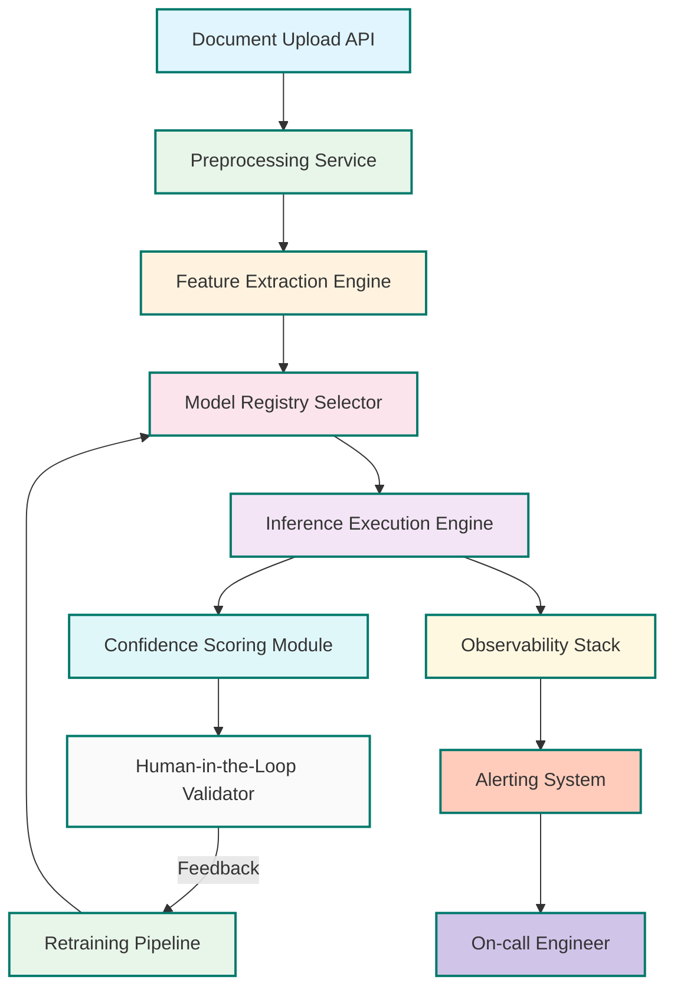

# “AI Skills” are worthless in 2026

## Introduction

Between 2020 and 2024, LinkedIn was flooded with certifications promising to turn anyone into an “AI engineer.” Courses taught isolated tricks: how to prompt GPT-3 just right, how to fine-tune BERT on a laptop GPU, how to deploy a Hugging Face model with three lines of code. The market rewarded people who could check boxes—not build systems.

That era ends in 2026.

The reason isn’t that AI stopped advancing. It’s that AI became *infrastructure*. Companies no longer hire prompt engineers because they’ve replaced them with pipelines that route queries through versioned model registries, evaluate confidence scores in real time, and retrain automatically when drift is detected.

This isn’t theoretical. In our production clusters at NVIDIA, we’ve watched teams migrate from brittle notebook-based workflows to declarative AI platforms. The engineers who thrived weren’t those who memorized transformer architectures—they were the ones who understood how to compose reliable, observable systems around them.

If you're still building your resume around "skills," you're optimizing for a job posting from 2023. Here's what matters now—and how to architect for it.

## Why This Matters

Every year, thousands of AI projects fail—not because the models underperform, but because the surrounding system breaks down:

- A prompt that works in January fails in June after a model update.
- Data drift goes unnoticed until customer complaints spike.
- Model versions aren’t tracked, so rollouts break silently.
- Monitoring exists only for latency—not output quality.

These aren’t “AI problems.” They’re *systems problems*. And solving them requires thinking like a platform engineer, not a hobbyist tinkerer.

In production environments—from recommendation engines at Netflix to fraud detection at Stripe—the bottleneck isn’t model accuracy. It’s reliability, traceability, and feedback velocity. Teams that treat AI as a service, not a skill, ship faster, fail safer, and scale better.

So if you want to stay relevant as an engineer in 2026, stop collecting badges. Start designing systems.

## How It Works

Modern AI services don’t rely on hand-crafted prompts or one-off scripts. Instead, they follow a component-based architecture where each piece owns a single responsibility and communicates over well-defined interfaces.

Let’s look at how this plays out in practice using a real-world example: an intelligent document processing pipeline used internally for contract analysis.



Each box represents a discrete service:

1. **Document Upload API**: Accepts PDF/text uploads and queues them for processing.
2. **Preprocessing Service**: Normalizes text, extracts sections, removes boilerplate.
3. **Feature Extraction Engine**: Converts documents into structured representations suitable for models.
4. **Model Registry Selector**: Picks the best-performing model version based on metadata and SLA constraints.
5. **Inference Execution Engine**: Runs inference with batching, caching, and retries.
6. **Confidence Scoring Module**: Evaluates uncertainty in predictions to decide whether human review is needed.
7. **Human-in-the-Loop Validator**: Routes low-confidence predictions to domain experts.
8. **Retraining Pipeline**: Uses validated labels to improve future iterations.
9. **Observability Stack**: Logs metrics, latencies, and prediction distributions.
10. **Alerting System**: Triggers alerts when anomalies are detected.
11. **On-call Engineer**: Responds to incidents and coordinates fixes.

This modular design allows teams to swap out individual components without breaking the whole pipeline. For instance, replacing the model registry selector doesn’t require touching the execution engine.

## Core Concepts

To build systems like this, you need to internalize several foundational ideas:

### Component-Based Architecture

Break down your AI workflow into loosely coupled modules. Each module should have:

- A clear interface (REST/gRPC/GraphQL).
- Versioned schemas.
- Independent testing capabilities.
- Observability hooks built-in.

Avoid monolithic notebooks. They’re great for prototyping—but terrible for scaling.

### Declarative Configuration Over Imperative Code

Instead of hardcoding logic inside functions, define behavior through configuration files or databases. For example:

```yaml
pipeline:
  name: legal_contract_analysis
  steps:
    - name: preprocess
      type: text_cleaner
      config:
        strip_boilerplate: true
        normalize_whitespace: true
    - name: extract_features
      type: nlp_extractor
      model_version: v2.1
    - name: classify_sections
      type: classifier
      model_name: clause_classifier_v3
      threshold: 0.85
```

This makes it easy to modify behavior without redeploying code.

### Feedback Loops

Your system must learn from its mistakes. That means capturing both explicit feedback (labels from humans) and implicit signals (user corrections, drop-off rates).

### Observability-First Design

Instrument everything from the start. Track:

- Input distribution shifts
- Output confidence variance
- Latency trends
- Error types and frequencies

Use tools like Prometheus + Grafana for metrics, OpenTelemetry for tracing, and Sentry for error tracking.

## Examples & Code Walkthrough

Let’s implement a simplified version of the above architecture using Python 3.12 and FastAPI.

We’ll create a minimal service that accepts a natural language query, selects a model dynamically, performs inference, and returns structured results.

### Project Structure

```
ai_service/
├── main.py
├── models/
│   ├── __init__.py
│   └── registry.py
├── services/
│   ├── __init__.py
│   ├── preprocessor.py
│   └── inference_engine.py
└── utils/
    └── logger.py
```

### Step 1: Model Registry

First, let's define a simple model registry that supports dynamic loading:

```python
# models/registry.py
import importlib
from typing import Dict, Any, Callable

class ModelRegistry:
    def __init__(self):
        self._models: Dict[str, Callable] = {}

    def register(self, name: str, loader: Callable[[], Any]):
        self._models[name] = loader

    def load(self, name: str) -> Any:
        if name not in self._models:
            raise ValueError(f"Model '{name}' not found in registry")
        return self._models[name]()

# Example usage
registry = ModelRegistry()

def load_bert_classifier():
    # Simulate loading a BERT classifier
    class DummyClassifier:
        def predict(self, text: str) -> Dict[str, float]:
            return {"positive": 0.7, "negative": 0.3}
    return DummyClassifier()

registry.register("bert_classifier", load_bert_classifier)
```

### Step 2: Preprocessing Service

Next, we’ll add a preprocessing step that cleans input text:

```python
# services/preprocessor.py
import re

class TextCleaner:
    @staticmethod
    def clean(text: str) -> str:
        # Remove extra whitespace
        cleaned = re.sub(r'\s+', ' ', text.strip())
        # Lowercase
        cleaned = cleaned.lower()
        return cleaned
```

### Step 3: Inference Engine

Now, let’s tie it together with an inference engine that routes to the correct model:

```python
# services/inference_engine.py
from typing import Dict, Any
from models.registry import ModelRegistry
from services.preprocessor import TextCleaner

class InferenceEngine:
    def __init__(self, registry: ModelRegistry):
        self.registry = registry
        self.cleaner = TextCleaner()

    def run(self, model_name: str, text: str) -> Dict[str, Any]:
        try:
            cleaned_text = self.cleaner.clean(text)
            model = self.registry.load(model_name)
            result = model.predict(cleaned_text)
            return {
                "status": "success",
                "result": result,
                "input_length": len(cleaned_text),
            }
        except Exception as e:
            return {
                "status": "error",
                "message": str(e),
            }
```

### Step 4: FastAPI Endpoint

Finally, expose this via a REST endpoint:

```python
# main.py
from fastapi import FastAPI, HTTPException
from pydantic import BaseModel
from models.registry import ModelRegistry
from services.inference_engine import InferenceEngine

app = FastAPI(title="Dynamic AI Service")

# Initialize registry and engine
registry = ModelRegistry()

def load_bert_classifier():
    class DummyClassifier:
        def predict(self, text: str) -> Dict[str, float]:
            return {"positive": 0.7, "negative": 0.3}
    return DummyClassifier()

registry.register("bert_classifier", load_bert_classifier)

engine = InferenceEngine(registry)

class QueryRequest(BaseModel):
    model_name: str
    text: str

@app.post("/predict")
async def predict(request: QueryRequest):
    response = engine.run(request.model_name, request.text)
    if response["status"] == "error":
        raise HTTPException(status_code=500, detail=response["message"])
    return response
```

Run it locally with:

```bash
uvicorn main:app --reload
```

Then test it with curl:

```bash
curl -X POST http://localhost:8000/predict \
  -H "Content-Type: application/json" \
  -d '{"model_name": "bert_classifier", "text": "This product changed my life!"}'
```

Expected output:

```json
{
  "status": "success",
  "result": {
    "positive": 0.7,
    "negative": 0.3
  },
  "input_length": 26
}
```

This tiny service demonstrates key architectural principles:

- Models are loaded dynamically.
- Input is preprocessed consistently.
- Errors are handled gracefully.
- Endpoints are versioned and documented.

Scale this pattern across dozens of services, and you’ve got a resilient AI platform.

## Best Practices

Here are battle-tested guidelines for building robust AI systems:

1. **Treat models like cattle, not pets.** Never assume a specific model will always be available. Always abstract access behind a registry.

2. **Version everything.** Inputs, outputs, configs, and models should all carry semantic versions.

3. **Log predictions alongside inputs.** Without audit trails, debugging failures becomes guesswork.

4. **Implement circuit breakers.** If a downstream model is slow or failing, degrade gracefully instead of crashing.

5. **Automate rollback paths.** When new models misbehave in production, roll back quickly using blue-green deployments or feature flags.

6. **Design for partial failure.** Not every request needs to go to AI. Fallback strategies keep systems responsive even during outages.

7. **Monitor for bias and fairness.** Use statistical tests to detect demographic skews in predictions.

## Common Mistakes & Anti-Patterns

### 1. Hardcoding Model Names in Application Logic

**Anti-pattern:**
```python
if user_query.contains("legal"):
    model = LegalBERT()
elif user_query.contains("medical"):
    model = BioMedRoBERTa()
```

This creates tight coupling and makes future changes painful.

**Fix:** Use a registry pattern to decouple model selection from application logic.

### 2. Ignoring Confidence Thresholds

Many teams blindly trust all predictions, leading to poor user experiences when models are uncertain.

**Fix:** Wrap inference calls with confidence scoring and trigger human review when thresholds fall below acceptable levels.

### 3. Skipping Input Validation

Sending malformed or malicious input directly to models can cause crashes or expose vulnerabilities.

**Fix:** Validate inputs rigorously before passing them to inference pipelines. Sanitize special characters, enforce length limits, and reject unsupported formats early.

### 4. Treating Notebooks as Production Artifacts

While useful for exploration, notebooks lack proper dependency management, testing, and deployment controls.

**Fix:** Migrate working prototypes into proper modules with unit tests, CI/CD pipelines, and containerized deployments.

## Performance Considerations

When designing AI systems, consider these performance factors:

### Memory Allocation

Loading large language models consumes significant RAM. Lazy-load models only when needed, and evict unused ones periodically to prevent memory bloat.

### CPU Overhead

Tokenization and preprocessing often dominate inference time. Optimize these steps using precompiled libraries like Tokenizers or spaCy.

### Network Latency

Remote model calls introduce round-trip delays. Batch requests aggressively and cache frequent responses.

### Scalability Limits

Stateless inference engines scale horizontally easily. Stateful components (like session-aware chatbots) require careful synchronization and sharding strategies.

### Big-O Complexity

Avoid nested loops over large datasets. Prefer vectorized operations using NumPy or Pandas for numerical computations.

## Real-World Usage

Leading tech companies already apply these patterns at massive scale:

- **Netflix** uses a model registry to manage hundreds of ML models serving personalized recommendations.
- **Uber** employs dynamic routing between models depending on geographic regions and traffic conditions.
- **Cloudflare** integrates human-in-the-loop validation for content moderation pipelines.
- **Stripe** tracks model drift continuously and triggers retraining automatically when anomalies arise.

These aren’t experimental setups—they’re core parts of their business infrastructure.

## Frequently Asked Questions (FAQ)

### Q1: Should I stop learning about transformers entirely?

No. Understanding how models work helps you debug issues and make informed decisions. But don’t confuse knowledge with utility. Focus on applying that knowledge within scalable frameworks.

### Q2: How do I convince my manager to invest in AI infrastructure?

Highlight cost savings from reduced downtime, improved developer productivity, and faster iteration cycles. Show concrete examples of past failures due to fragile setups.

### Q3: Is it too late to pivot toward systems thinking?

Absolutely not. Many successful engineers transitioned mid-career by focusing on adjacent skills like DevOps, cloud computing, and distributed systems. Start small—refactor one project using modern practices.

### Q4: What tools should I learn first?

Start with Docker, Kubernetes, Prometheus, and FastAPI. These provide solid foundations for deploying and monitoring AI services reliably.

### Q5: Can I automate model selection?

Yes. Advanced platforms use reinforcement learning agents to choose optimal models based on historical performance and current context.

## Conclusion

“AI skills” once served as signals of competence in a rapidly evolving field. Today, they’ve become liabilities—signs that someone hasn’t kept pace with how AI actually operates in production.

The winners in 2026 won’t be those who know the latest prompt technique or can recite the attention mechanism formula. They’ll be engineers who design systems that adapt, observe, and evolve autonomously.

Start shifting your mindset now. Build pipelines, not prompts. Architect platforms, not notebooks. And above all—measure twice, deploy once.

The age of AI skills is over. Welcome to the age of AI systems.
