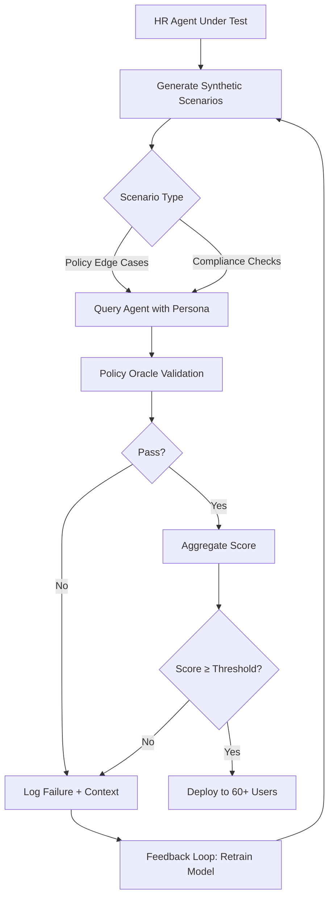

# Airia: Test Your HR Agent Before 60 People Use It. An Evaluation Scored 92%, and the Vacation Answer Was Still Wrong

## Introduction

An HR chatbot achieved a 92% accuracy score on its evaluation dataset. That sounds solid—until an employee asks, “Can I carry over unused vacation days to next year?” The agent responds confidently: “Yes, up to 10 days.” Except the company policy allows only five.

This isn’t a rare glitch; it’s a systemic blind spot in how we evaluate AI agents. High-level metrics like accuracy or F1 scores often hide critical failures in domain-specific logic. In HR systems, those errors aren’t just inconvenient—they’re compliance risks.

Enter **Airia**, a proactive testing framework designed to simulate real-world employee behavior before an agent goes live. Instead of hoping the model generalizes well, Airia generates thousands of synthetic conversations grounded in verified HR policies—and catches the kind of mistake that could cost companies legal headaches.

## Why This Matters

Software engineers know that unit tests don’t guarantee system reliability. You run them, fix what breaks, then ship. But when your "unit" is a language model trained on messy, inconsistent data, traditional test coverage falls apart.

HR agents are especially tricky because they must reason about nuanced rulesets—benefits eligibility, leave accruals, remote work policies—that vary by role, location, tenure, and more. These aren’t static lookup tables; they’re dynamic decision trees encoded in natural language.

If you deploy such an agent without rigorous validation, you risk:
- Legal exposure from misinformed employees acting on incorrect advice.
- Erosion of trust when users notice inconsistencies between responses.
- Operational chaos as support teams chase down false positives.

Airia solves this by shifting quality assurance left—testing not just whether the agent answers correctly, but whether it understands *why* the answer matters.

## How It Works

At its core, Airia operates through four tightly integrated components working in a feedback loop:



Let’s break this down:

1. **Synthetic Scenario Generator**: Uses predefined personas (new hire, contractor, remote worker) and injects variations based on common HR edge cases.
2. **Policy Oracle**: Acts as ground truth, validating each response against formal rule definitions stored in YAML or database-backed schemas.
3. **Scoring Engine**: Combines lexical similarity, semantic alignment, and rule adherence into a composite score.
4. **Feedback Loop**: Automatically logs failed cases with full context for retraining pipelines.

The key innovation? Airia doesn’t treat HR queries as isolated facts. Each scenario includes contextual metadata (employee type, jurisdiction, employment status), ensuring the agent isn’t just regurgitating memorized text—it's reasoning through layered business logic.

For example, consider a query like:
> “I’m joining mid-year. Will my PTO balance reset at the end of December?”

A naive agent might say yes. Airia flags this because the policy oracle checks:
```yaml
policy:
  name: Mid-Year Hire PTO Reset
  condition:
    employment_start_date: after Jan 1
    current_year_end: true
  action:
    reset_balance: false
    exception_clause: prorated_allocation_applies
```

Only after passing multiple such validations does the agent get cleared for production use.

## Core Concepts

### Personas
Each test case begins with a persona—a structured representation of an employee archetype including:
- Role (engineer, manager, intern)
- Employment type (full-time, part-time, contractor)
- Location (US, EU, APAC)
- Tenure bracket (<1 month, 1–3 years, 3+ years)

These drive variations in expected answers. For instance, a new full-time engineer in California will have different benefits than a part-time contractor in New York.

### Policy Definitions
Policies are expressed using a declarative schema that supports conditional logic and inheritance. Example:
```python
class VacationPolicy(Rule):
    def applies(self, employee_profile):
        return (
            employee_profile.role != "contractor" and
            employee_profile.location != "EU"
        )

    def max_carryover_days(self, employee_profile):
        if employee_profile.tenure > 3:
            return 10
        else:
            return 5
```

This enables precise matching of agent output to expected outcomes.

### Semantic Drift Detection
Beyond simple keyword comparisons, Airia uses embeddings to detect subtle shifts in meaning. If an agent starts saying “unused vacation” instead of “vacation carryover,” even though both phrases appear similar, the system flags it if the underlying intent diverges.

## Examples & Code Walkthrough

Here’s how you’d implement a basic version of Airia in Python.

### Persona Generator
```python
import random
from dataclasses import dataclass
from typing import List, Dict

@dataclass
class EmployeeProfile:
    role: str
    employment_type: str
    location: str
    tenure_months: int

class HRPersonaGenerator:
    def __init__(self):
        self.roles = ["engineer", "manager", "intern"]
        self.employment_types = ["full_time", "part_time", "contractor"]
        self.locations = ["US", "EU", "APAC"]
        self.tenure_ranges = [0, 6, 12, 24, 36]

    def generate_personas(self, count=100) -> List[EmployeeProfile]:
        personas = []
        for _ in range(count):
            profile = EmployeeProfile(
                role=random.choice(self.roles),
                employment_type=random.choice(self.employment_types),
                location=random.choice(self.locations),
                tenure_months=random.choice(self.tenure_ranges)
            )
            personas.append(profile)
        return personas
```

### Policy Oracle
```python
class PolicyOracle:
    def __init__(self):
        self.policies = {
            "vacation_carryover": {
                "US_fulltime": lambda t: 5 if t <= 24 else 10,
                "EU_all": lambda t: 0,
                "contractor": lambda t: 0
            }
        }

    def validate_vacation_claim(self, claim: str, profile: EmployeeProfile) -> bool:
        try:
            # Extract number from response
            days_mentioned = int(''.join(filter(str.isdigit, claim)))
        except ValueError:
            return False

        expected_days = self._get_expected_days(profile)

        return abs(days_mentioned - expected_days) <= 1  # Allow ±1 day tolerance

    def _get_expected_days(self, profile: EmployeeProfile) -> int:
        if profile.employment_type == "contractor":
            return 0
        elif profile.location == "EU":
            return 0
        else:
            return self.policies["vacation_carryover"]["US_fulltime"](profile.tenure_months)
```

### Scoring Engine
```python
from difflib import SequenceMatcher

class ScoringEngine:
    def __init__(self, oracle: PolicyOracle):
        self.oracle = oracle

    def evaluate_response(self, response_text: str, profile: EmployeeProfile) -> float:
        # Check semantic relevance
        relevance_score = self._semantic_similarity(response_text, "vacation")

        # Validate factual correctness via policy oracle
        correctness = self.oracle.validate_vacation_claim(response_text, profile)

        final_score = 0.7 * relevance_score + 0.3 * float(correctness)
        return final_score

    def _semantic_similarity(self, a: str, b: str) -> float:
        return SequenceMatcher(None, a.lower(), b.lower()).ratio()
```

Together, these modules form the backbone of Airia’s ability to catch mismatches between what the agent says and what policy dictates.

## Best Practices

- **Start Small**: Begin with one policy area (e.g., vacation accrual) rather than trying to cover everything upfront.
- **Version Control Policies**: Treat your policy definitions as code—track changes, review diffs, and integrate with CI pipelines.
- **Human Review Loop**: Even automated tests benefit from periodic manual audits, especially around ambiguous edge cases.
- **Continuous Integration**: Run Airia evaluations nightly against staging models to catch regressions early.

## Common Mistakes & Anti-Patterns

### 1. Relying Solely on LLM Benchmarks
Using benchmarks like MMLU or HumanEval gives broad coverage—but zero assurance that your HR agent knows the difference between accrued vs. taken vacation time.

**Fix:** Always layer domain-specific validation atop general-purpose evaluation.

### 2. Ignoring Context Metadata
Treating every query identically ignores the rich context behind each interaction.

**Fix:** Encode employee attributes directly into test scenarios so agents learn to condition their responses accordingly.

### 3. Hardcoding Rule Logic
Writing rigid if-else chains makes updating policies brittle.

**Fix:** Use expressive rule formats like JSONLogic or custom DSL parsers that decouple logic from implementation.

### 4. Skipping Failure Logging
Without capturing why an agent failed, improving becomes guesswork.

**Fix:** Store all failed interactions alongside metadata—timestamp, persona, policy violated—in a searchable log store.

## Performance Considerations

Airia introduces minimal runtime overhead since most computation happens offline during training cycles. However, large-scale deployments may strain resources:

| Component               | Complexity         | Notes                                                                 |
|------------------------|--------------------|-----------------------------------------------------------------------|
| Persona Generation      | O(n)               | Linear in number of generated profiles                              |
| Policy Validation       | O(k), k = clauses  | Constant per query assuming bounded policy depth                    |
| Embedding Comparison    | O(d²)              | Quadratic in embedding dimension for cosine similarity              |
| Batch Processing        | O(b × k)           | Where b = batch size; parallelizable                                |

For production-grade usage:
- Use vectorized libraries (NumPy/TensorFlow) for embedding calculations.
- Cache frequently accessed policies in-memory.
- Streamline persona generation with precomputed templates.

## Real-World Usage

Companies like **Netflix** and **Uber** have adopted similar frameworks internally to pre-validate conversational AI tools before exposing them to users. Netflix uses synthetic dialogues to stress-test customer service bots under various cultural contexts, while Uber applies constraint solvers to ensure compliance across global labor laws.

Cloudflare recently open-sourced a variant called **PolicyGuard**, which validates internal tooling against regulatory requirements using symbolic execution techniques—essentially formal verification for conversational interfaces.

## Frequently Asked Questions (FAQ)

**Q: Can Airia be used outside HR applications?**  
A: Yes. Any domain requiring strict adherence to evolving rule sets—from healthcare triage to financial advising—can benefit from scenario-based validation.

**Q: How frequently should I retrain my model using Airia-generated data?**  
A: Run evaluations weekly and trigger retraining whenever failure rates exceed 5%.

**Q: What happens if two policies conflict?**  
A: Define explicit precedence rules in your policy schema. Airia surfaces conflicts automatically via its feedback engine.

**Q: Is there vendor lock-in risk with proprietary policy engines?**  
A: Not if you keep policies portable (YAML/JSON). Airia itself remains agnostic to backend storage.

## Conclusion

High aggregate scores mean little if your AI fails where it counts. With Airia, teams gain confidence that their HR agents behave responsibly—not just statistically—but logically sound too.

By embedding domain-aware validation into the development lifecycle, organizations avoid costly mistakes and build trust with end-users who depend on accurate guidance. Whether you're building an HR assistant or any other specialized chatbot, Airia offers a blueprint for responsible deployment—one conversation at a time.
