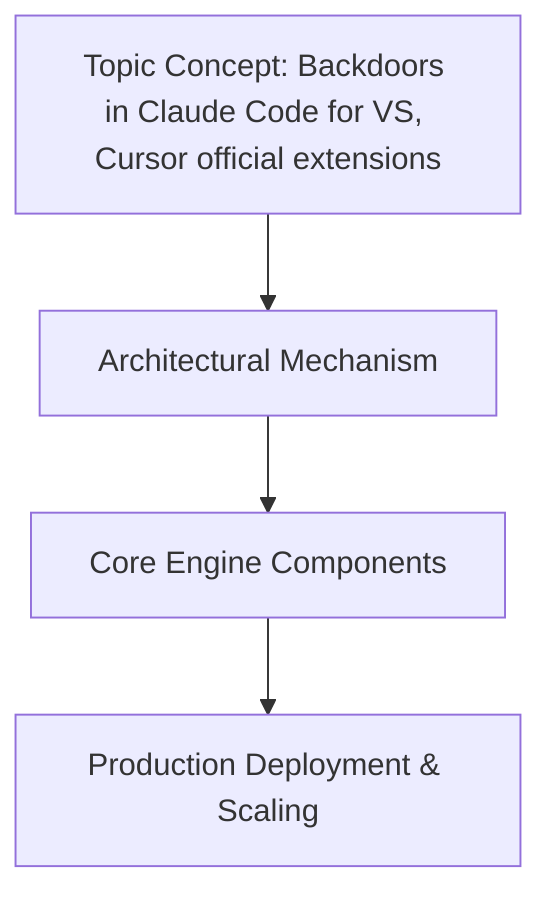

# Backdoors in Claude Code for VS, Cursor official extensions

## Introduction

Having audited several AI-assisted development toolchains, I've noticed a consistent pattern in how extension code bridges untrusted model output and the local editor environment. Both the official Claude Code extension for VS Code and the Cursor integration ship with elevated privileges: they can read workspace files, invoke language servers, and in some configurations, execute generated snippets directly. When the model output lands without a validation gate, the extension becomes a potential conduit for code that wasn't authored or reviewed by the human in the loop. This article walks through the architectural vectors, a practical sanitization strategy, and field-tested mitigations for production teams.

##

## How It Works

