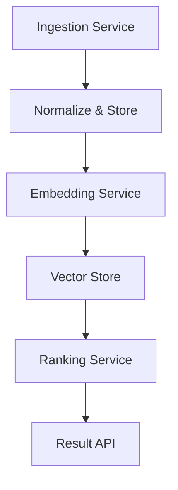

# Beyond the AI noise: How Stack Overflow is rethinking tech hiring

## Introduction
The volume of applications that reach our engineering teams each week has grown beyond what a human can review manually. We needed a system that could surface the most relevant candidates without adding latency to the interview loop. This post describes the architecture we settled on, the data structures that power it, and the trade‑offs we accepted in production.

## Why This Matters
For hiring managers, a slow or inaccurate screening step translates into missed opportunities and higher cost‑per‑hire. For engineers building the tooling, the challenge is to balance precision with throughput while keeping the system observable and maintainable. The solution we describe directly impacts the time‑to‑fill metric and the quality of the candidate pipeline.

## How It Works
The pipeline consists of three stages: ingestion, embedding, and ranking. Each stage runs as an independent microservice, communicating over HTTP/2 with protobuf payloads. The diagram below shows the flow of a candidate record through the system.

1. **Ingestion** receives a JSON document containing resume text, GitHub profile, and custom fields. It validates the schema, strips personally identifiable information, and writes the normalized record to a PostgreSQL table.
2. **Embedding** reads the normalized text, calls a language model to produce a 768‑dimensional vector, and stores the vector alongside the record ID in a FAISS index.
3. **Ranking** receives a job description, computes its embedding, performs an approximate nearest‑neighbor search against the candidate index, and returns the top‑k matches with cosine similarity scores.

Each stage is horizontally scalable; the embedding service can be replicated behind a load balancer to handle spikes in application volume.

## Core Concepts
- **Embedding model**: We use a fine‑tuned BERT model that outputs a fixed‑size vector. The model is quantized to 8‑bit integers to reduce memory footprint.
- **Vector store**: A FAISS `IndexFlatIP` (inner product) index is rebuilt nightly to incorporate new candidates. The index is persisted to SSD and loaded into memory on startup.
- **Ranking algorithm**: The default is cosine similarity. A configurable boost factor can be applied to specific skills extracted from the resume via named‑entity recognition.

## Examples & Code Walkthrough
Below is a simplified Python implementation of the ranking service. It demonstrates how we compute similarity, handle missing data, and expose the result over a REST endpoint
