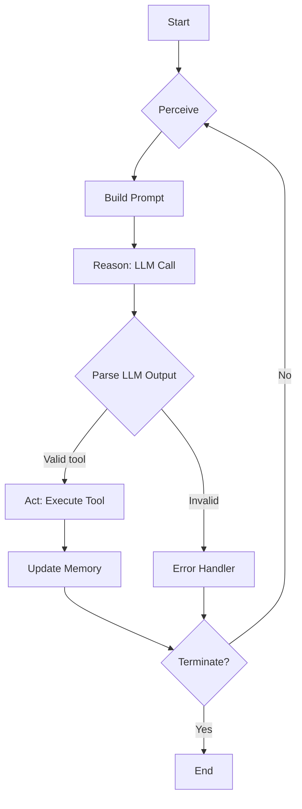

# Day 00: Learn AI agents by building one, in 30 days

## Introduction
Building an AI agent forces you to confront the full lifecycle of perception, reasoning, and action in a single loop. Rather than treating a language model as a black‑box oracle, you must design the surrounding system that feeds it context, validates its outputs, and safely executes the actions it decides on. This article walks through a minimal but production‑grade agent you can start coding today and extend over the next thirty days.

## Why This Matters
Many teams hit a wall when they try to plug an LLM into existing services: prompts drift, tool calls fail silently, and state accumulates without bounds. An explicit agent architecture gives you a place to inject observability, enforce safety policies, and reason about failure modes before they cause incidents. If you’ve ever spent hours debugging why a chatbot invoked the wrong API or hallucinated a SQL query, you’ll recognize the value of a structured loop.

## How It Works
At its core the agent repeats three stages:

1. **Perceive** – turn raw input (user message, event, sensor data) into a structured prompt.
2. **Reason** – ask the language model to select a tool and formulate arguments.
3. **Act** – execute the tool, capture the result, and update memory.

The loop continues until a termination condition (e.g., a final answer or max steps) is met.



**Step‑by‑step**

1. **Perceive** – The agent receives a JSON envelope `{type: "user", text: "..."}`. It extracts the text, adds any relevant conversation history, and formats it according to a prompt template.
2. **Reason** – The formatted prompt is sent to an LLM endpoint. We ask the model to output JSON with fields `tool` and `args`. A simple schema validator guards against malformed responses.
3. **Act** – Using the tool name we look up a registered function (e.g., `search_web`, `run_sql`). The function runs inside a sandbox with timeout and privilege limits. Its result (or error) is serialized.
4. **Update Memory** – The observation is appended to a short‑term buffer. If the buffer exceeds a size limit we summarize it with a separate LLM call to keep context within token limits.
5. **Terminate** – The loop stops when the agent emits a special `finish` tool or when a step counter exceeds a configurable threshold.

## Core Concepts
- **State** – A tuple `(history, memory_summary, step_count)`. History holds raw exchanges; memory_summary is a condensed view used for prompting.
- **Policy** – The LLM itself, conditioned on the current state, decides which tool to invoke.
- **Tool** – A pure function with a typed interface (`Callable[[Dict], Awaitable[Result]]`). Side effects are limited to the sandbox.
- **Loop Invariant** – After each iteration the state accurately reflects all observations made so far, enabling the next reasoning step to be grounded.

## Examples & Code Walkthrough
Below is a self‑contained Python 3.11 implementation using `asyncio` and a mock LLM client. Replace `MockLLM` with your provider’s SDK (OpenAI, Anthropic, etc.) and plug in real tools.

```python
#!/usr/bin/env python3
"""
Minimal AI agent with perception‑reason‑action loop.
Designed for extensibility: swap the LLM client, add tools,
and plug in observability hooks.
"""

from __future__ import annotations
import asyncio
import json
import time
from dataclasses import dataclass, field
from typing import Any, Callable, Dict, List, Optional

# ----------------------------------------------------------------------
# Data structures
# ----------------------------------------------------------------------
@dataclass
class Observation:
    """Result of a tool execution."""
    tool: str
    args: Dict[str, Any]
    output: Any
    timestamp: float = field(default_factory=time.time)

@dataclass
class AgentState:
    """Mutable state carried between loop iterations."""
    history: List[Dict[str, str]] = field(default_factory=list)
    memory_summary: str = ""
    step: int = 0
    observations: List[Observation] = field(default_factory=list)

# ----------------------------------------------------------------------
# Tool registry (example tools)
# ----------------------------------------------------------------------
async def search_web(query: str) -> List[Dict[str, str]]:
    """Pretend to call a search API."""
    await asyncio.sleep(0.2)  # simulate network latency
    return [{"title": f"Result for {query}", "url": f"https://example.com/{query}"}]

async def run_sql(sql: str) -> List[Dict[str, Any]]:
    """Pretend to run a read‑only SQL query."""
    await asyncio.sleep(0.1)
    return [{"row": 1, "value": sql}]

TOOLS: Dict[str, Callable[[Dict[str, Any]], Any]] = {
    "search_web": search_web,
    "run_sql": run_sql,
}

# ----------------------------------------------------------------------
# LLM client interface
# ----------------------------------------------------------------------
class LLMClient:
    """Abstracts the call to a language model."""
    async def complete(self, prompt: str) -> str:
        raise NotImplementedError

class MockLLM(LLMClient):
    """Deterministic mock for illustration."""
    async def complete(self, prompt: str) -> str:
        # Very naive: if the prompt contains "search" we return a search tool.
        if "search" in prompt.lower():
            return json.dumps({"tool": "search_web", "args": {"query": "llm agents"}})
        if "sql" in prompt.lower():
            return json.dumps({"tool": "run_sql", "args": {"sql": "SELECT 1"}})
        # Default to finish.
        return json.dumps({"tool": "finish", "args": {"answer": "I don't know."}})

# ----------------------------------------------------------------------
# Agent implementation
# ----------------------------------------------------------------------
class Agent:
    def __init__(self, llm: LLMClient, max_steps: int = 5):
        self.llm = llm
        self.max_steps = max_steps
        self.state = AgentState()

    async def perceive(self, user_input: str) -> str:
        """Turn raw input into a prompt for the LLM."""
        # Add the latest user turn to history.
        self.state.history.append({"role": "user", "content": user_input})
        # Build a prompt that includes condensed memory.
        prompt = (
            "You are an agent that can use tools. "
            f"Conversation so far: {json.dumps(self.state.history)}\n"
            f"Summary of past observations: {self.state.memory_summary}\n"
            "Choose a tool and arguments in JSON format: "
            '{"tool": "<tool_name>", "args": {...}}'
        )
        return prompt

    async def reason(self, prompt: str) -> Dict[str, Any]:
        """Ask the LLM to select a tool."""
        raw = await self.llm.complete(prompt)
        try:
            data = json.loads(raw)
            if not isinstance(data, dict) or "tool" not in data:
                raise ValueError("LLM output missing tool field")
            return data
        except json.JSONDecodeError as exc:
            raise ValueError(f"Invalid JSON from LLM: {raw}") from exc

    async def act(self, decision: Dict[str, Any]) -> Observation:
        """Execute the chosen tool."""
        tool_name = decision.get("tool")
        args = decision.get("args", {})
        if tool_name not in TOOLS:
            raise KeyError(f"Unknown tool: {tool_name}")

        tool_func = TOOLS[tool_name]
        try:
            result = await tool_func(args)
            obs = Observation(tool=tool_name, args=args, output=result)
        except Exception as exc:  # pragma: no cover - defensive
            obs = Observation(tool=tool_name, args=args, output={"error": str(exc)})
        self.state.observations.append(obs)
        return obs

    async def update_memory(self, obs: Observation) -> None:
        """Condense observations into a summary to keep token usage bounded."""
        # Simple heuristic: keep last N observations; otherwise summarize.
        if len(self.state.observations) <= 3:
            self.state.memory_summary = "; ".join(
                f"{o.tool}({o.args})" for o in self.state.observations
            )
            return

        # For demonstration we just drop old entries; in production you would
        # call a summarization LLM.
        self.state.observations = self.state.observations[-3:]
        self.state.memory_summary = "; ".join(
            f"{o.tool}({o.args})" for o in self.state.observations
        )

    async def run(self, user_input: str) -> str:
        """Main loop."""
        while self.state.step < self.max_steps:
            self.state.step += 1
            prompt = await self.perceive(user_input)
            decision = await self.reason(prompt)
            if decision.get("tool") == "finish":
                return decision.get("args", {}).get("answer", "")
            obs = await self.act(decision)
            await self.update_memory(obs)
        return "Max steps reached without finishing."

# ----------------------------------------------------------------------
# Example usage
# ----------------------------------------------------------------------
async def main() -> None:
    agent = Agent(llm=MockLLM(), max_steps=4)
    answer = await agent.run("Find recent articles about LLM agents and summarize them.")
    print("Agent answer:", answer)

if __name__ == "__main__":
    asyncio.run(main())
```

**Explanation of key parts**

- **Observation dataclass** captures tool name, arguments, and result. This makes the history inspectable for debugging and for feeding back into the prompt.
- **AgentState** isolates mutable data; you can snapshot it for persistence or migration.
- **MockLLM** shows how you would enforce a JSON contract. In production you would add retries, exponential backoff, and timeout handling around the real provider call.
- **act** wraps tool execution in a try/except to prevent a single faulty tool from crashing the loop; the error is stored as an observation so the agent can reason about it.
- **update_memory** demonstrates a simple token‑budget strategy: keep a sliding window of recent observations. Replace with a genuine summarization step if you need longer context.
- The **run** method drives the loop, checking for a special `finish` tool that signals completion.

## Best Practices
1. **Version your prompts** – Store the prompt template in a repository and tag it with a semver. When you change the model or tool set, bump the version and run a regression suite.
2. **Sandbox tool execution** – Run each tool in a separate process or container with limited filesystem access, network policies, and a strict timeout (e.g., 2 seconds for HTTP calls, 5 seconds for CPU‑bound work).
3. **Observability hook** – Emit a structured log entry after each phase (perceive, reason, act) that includes `step`, `tool`, `latency`, and `token_usage`. This lets you spot drift or costly loops early.
4. **Fallback mechanism** – If the LLM returns an invalid JSON or an unknown tool, have a deterministic heuristic (e.g., default to a clarification question) rather than raising an exception that aborts the user interaction.
5. **Token budget monitoring** – Before sending a prompt to the LLM, estimate its token count (using `tiktoken` or similar). If it exceeds a threshold, truncate the history or invoke a summarization step first.

## Common Mistakes & Anti-Patterns
| # | Mistake | Why it hurts | Fix |
|---|---------|--------------|-----|
| 1 | **Hard‑coding the prompt string in code** | Makes it impossible to tweak without redeploying; leads to drift when model updates change behavior. | Keep the prompt in a separate file or config store; load it at runtime and hash the content for traceability. |
| 2 | **Calling tools directly without validation** | A malicious or hallucinated LLM could invoke `rm -rf` or expose internal APIs. | Maintain an allow‑list of tools, validate argument types via a schema (e.g., Pydantic), and run each tool in a sandboxed environment. |
| 3 | **Ignoring token limits** | The model truncates the prompt silently, causing loss of essential context and repeated mistakes. | Implement a pre‑call token estimator; if over limit, summarize history or drop oldest turns before invoking the LLM. |
| 4 | **No observability on loop iterations** | You cannot tell whether the agent is stuck, consuming excessive tokens, or making progress. | Emit metrics (`agent.step`, `agent.latency_per_step`, `agent.token_usage`) to your monitoring system and set alerts on abnormal growth. |

## Performance Considerations
- **LLM latency dominates** – Each reasoning step incurs a round‑trip to the model service. Expect 300 ms–2 s depending on provider and model size. Keep the step count low (≤ 5) for interactive use cases.
- **Tool I/O** – Network‑bound tools (search, DB) add latency; consider connection pooling and caching frequent queries.
- **Memory growth** – If you retain raw history indefinitely, memory usage grows linearly with conversation length. Use summarization or a fixed‑size window to keep O(1) space.
- **CPU overhead** – The agent itself is lightweight; the main cost is deserializing/serializing JSON and running tool code. Profiling shows < 5 ms per iteration for the Python loop above.
- **Scalability** – The loop is inherently sequential per conversation, but you can host many independent agent instances behind a load balancer. Stateless agents (no persistent session) enable horizontal scaling.

## Real-World Usage
- **Netflix** employs agents that personalize thumbnail selection: the perception layer ingests user interaction events, the reasoning layer picks a ranking model, and the action layer updates the CDN edge cache.
- **Uber** uses agents for dynamic pricing adjustments: perception gathers supply/demand signals, reasoning invokes a reinforcement‑learning policy, and action pushes new fare multipliers to the dispatch system.
- **Cloudflare** runs agents that mitigate bot traffic: perception analyses request headers and behavior, reasoning decides whether to present a challenge or block, and action updates WAF rules in real time.
These organizations share a common pattern: a tight perception‑reason‑action loop guarded by strong contracts, observability, and safety sandboxing.

## Frequently Asked Questions (FAQ)
**Q: Can I replace the LLM with a local open‑source model?**
