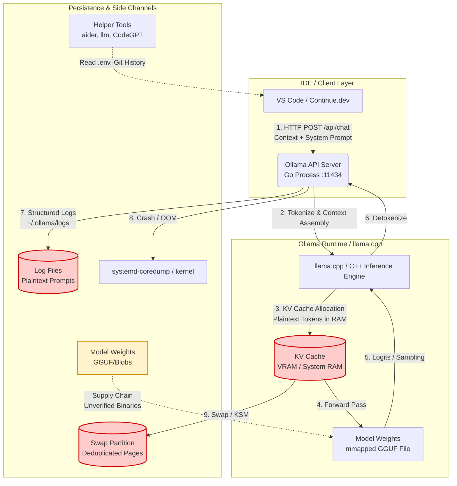

# Do local LLMs stop coding data leakage? What running Ollama does and doesn't protect

## Introduction

Last quarter, my team ran a tabletop exercise: "An engineer pastes an AWS secret key into a prompt asking the local model to write a boto3 wrapper. Where does that key exist 24 hours later?"

Running `ollama run codellama` feels like an air gap. `tcpdump` shows silence on the wire. The dopamine hit is real—you have a reasoning engine on your laptop with zero network egress. But "local" is not a security model. It is a deployment topology. And topology shifts the trust boundary; it doesn't erase it.

When you move inference from `api.openai.com` to `localhost:11434`, you trade a vendor's SOC2 report for your own kernel's memory manager. You trade TLS termination for `mmap`ed model weights. You trade a Data Processing Addendum for a `systemd` unit file running as your user. This article traces exactly where your code goes when it hits a local runner, where it persists, and what a hardened stack actually looks like.

## Why This Matters

Enterprise adoption of local LLMs has accelerated past the "hobbyist" phase. I see `ollama serve` running in CI runners, on developer laptops connected to corporate VPNs, and on shared GPU boxes in the office. The threat model has shifted:

1.  **Regulatory:** GDPR Article 28 and Schrems II make cross-border data transfer a legal liability. Local inference solves the *jurisdiction* problem instantly.
2.  **IP Leakage:** Proprietary algorithms, unreleased API schemas, and infrastructure-as-code are now context-window fodder.
3.  **Supply Chain:** We pull `gguf` files from Hugging Face like `npm` packages—unsigned, unaudited, often quantized by anonymous users.

The industry narrative says "Local = Private." The engineering reality says "Local = You Own the Breach." If you treat Ollama as a drop-in replacement for the OpenAI SDK without hardening the host, you have not reduced risk. You have just moved the attack surface from Microsoft's security team to your platform team.

## How It Works

To understand the leakage vectors, we have to trace the request lifecycle. It is not a black box. It is a standard Linux process tree with specific memory behaviors.



### Step-by-Step Data Flow

1.  **Ingress (IDE → Ollama API):** Your IDE plugin (Continue, CodeGPT, custom script) sends a JSON payload to `http://localhost:11434/api/chat`. This payload contains the system prompt, the full conversation history, and the current file context. **This is the first plaintext copy.**
2.  **Tokenization & Assembly (Go → C++):** The Go API server tokenizes the input. It constructs the `llama_batch` structure. The raw string bytes are now in Go heap *and* C++ heap.
3.  **KV Cache Population (The Radioactive Waste):** `llama.cpp` allocates the Key-Value cache. For a 32k context window on a 7B model (q4_k_m), this is roughly 2–4 GB of VRAM/RAM. **Every token of your secret, your proprietary logic, your PII sits here in plaintext float16/int8 arrays.** It stays there until the context is evicted or the process dies.
4.  **Weight Access (mmapped GGUF):** The model weights are memory-mapped (`mmap`) from `~/.ollama/models/blobs/`. The OS pages them in on demand. If the binary is malicious (poisoned weights), it executes inside *your* process context.
5.  **Egress (Response Stream):** Tokens stream back via Server-Sent Events (SSE) over the same localhost socket. The IDE plugin receives them.
6.  **Side Channels (The Leaks):**
    *   **Logs:** Ollama defaults to structured JSON logging to `~/.ollama/logs/`. Default level often captures the full request body.
    *   **Crash Dumps:** An OOM kill or segfault triggers `systemd-coredump`. The core file contains the full process virtual memory—including the KV cache.
    *   **Swap/KSM:** If the host swaps, KV cache pages hit disk. Kernel Same-page Merging (KSM) might deduplicate your secret string into a page shared with another process.

## Core Concepts

### The Trust Boundary Shift
| Dimension | Cloud API (OpenAI/Anthropic) | Local (Ollama/llama.cpp) |
| :--- | :--- | :--- |
| **Network** | TLS 1.3, Certificate Pinning | Unix Domain Socket / Loopback (Unencrypted) |
| **Compute** | Vendor H100s (Shared Tenancy) | Your GPU/CPU (Dedicated) |
| **Persistence** | Vendor Logs (30-day retention typical) | **Your Disk, Your Logs, Your Swap** |
| **Model Integrity** | Vendor Signed/Versioned | **Unsigned GGUF from HF/Registry** |
| **Legal** | DPA, SCCs, SOC2 | **Your Policy, Your Liability** |

### The KV Cache is Radioactive Waste
The Key-Value cache stores the projected Key and Value vectors for every layer, for every token in the context window.
*   **It is not encrypted.** `llama.cpp` does not encrypt RAM.
*   **It is not ephemeral by default.** It lives for the duration of the `keep_alive` timeout (default 5m) or the session.
*   **It is large.** 32k context * 32 layers * 2 (K+V) * 128 dim * 2 bytes ≈ 500MB+ per request.

### Model Weights are Executable Binaries
A GGUF file contains tensor data *and* metadata (tokenizer config, architecture). When `llama.cpp` loads it, it executes code paths determined by that metadata. A malformed GGUF can trigger parser bugs (CVEs exist in `ggml` tensor loading). A "poisoned" model can emit specific tokens when triggered (backdoor behavior). There is no Sigstore/cosign verification standard for GGUFs yet.

## Examples & Code Walkthrough

We need a guardrail that sits *between* the IDE and the Ollama socket. Something that enforces policy *before* the prompt hits the KV cache. Below is a production-grade Go wrapper: `secure-llm`. It runs as a local proxy (`localhost:11435`), scans for secrets, enforces an allowlist of models, and spawns a hardened `ollama serve` child process with a `seccomp` filter and a `tmpfs` log directory.

### `cmd/secure-llm/main.go`

```go
package main

import (
	"bufio"
	"context"
	"crypto/sha256"
	"encoding/hex"
	"encoding/json"
	"errors"
	"flag"
	"fmt"
	"io"
	"log"
	"net/http"
	"os"
	"os/exec"
	"path/filepath"
	"regexp"
	"runtime"
	"strings"
	"syscall"
	"time"

	"github.com/seccomp/libseccomp-golang"
)

// Config holds runtime configuration loaded from flags/env.
type Config struct {
	ListenAddr    string
	OllamaBin     string
	ModelAllowlist map[string]struct{} // sha256:tag
	SecretPatterns []*regexp.Regexp
	TmpfsSize     string
	KeepAlive     time.Duration
}

// PolicyDecision is the result of scanning a prompt.
type PolicyDecision struct {
	Allow  bool
	Reason string
	Redacted string // Prompt with secrets masked for logging
}

// ChatRequest mirrors the Ollama /api/chat payload subset we care about.
type ChatRequest struct {
	Model    string    `json:"model"`
	Messages []Message `json:"messages"`
	Stream   bool      `json:"stream"`
	Options  map[string]interface{} `json:"options,omitempty"`
}

type Message struct {
	Role    string `json:"role"`
	Content string `json:"content"`
}

func main() {
	cfg := parseFlags()

	// 1. Setup Hardened Runtime Environment
	runtimeDir, cleanup, err := setupHardenedRuntime(cfg)
	if err != nil {
		log.Fatalf("Failed to setup hardened runtime: %v", err)
	}
	defer cleanup()

	// 2. Start Ollama Child Process with Seccomp
	ollamaCmd, err := startOllamaServer(cfg, runtimeDir)
	if err != nil {
		log.Fatalf("Failed to start ollama: %v", err)
	}
	defer func() {
		_ = ollamaCmd.Process.Signal(syscall.SIGTERM)
		_ = ollamaCmd.Wait()
	}()

	// 3. Wait for Ollama to be ready
	if err := waitForHealthy("http://localhost:11434", 10*time.Second); err != nil {
		log.Fatalf("Ollama health check failed: %v", err)
	}

	// 4. Start Policy Proxy
	proxy := &PolicyProxy{
		cfg:       cfg,
		upstream:  "http://localhost:11434",
		client:    &http.Client{Timeout: 0}, // No timeout for streaming
	}

	log.Printf("secure-llm proxy listening on %s (forwarding to hardened ollama)", cfg.ListenAddr)
	if err := http.ListenAndServe(cfg.ListenAddr, proxy); err != nil {
		log.Fatalf("Proxy server failed: %v", err)
	}
}

// parseFlags handles configuration.
func parseFlags() *Config {
	cfg := &Config{
		ListenAddr:    getEnv("SECURE_LLM_ADDR", "127.0.0.1:11435"),
		OllamaBin:     getEnv("OLLAMA_BIN", "ollama"),
		TmpfsSize:     getEnv("SECURE_LLM_TMPFS", "512M"),
		KeepAlive:     5 * time.Minute,
		ModelAllowlist: make(map[string]struct{}),
		SecretPatterns: defaultSecretPatterns(),
	}

	flag.StringVar(&cfg.ListenAddr, "addr", cfg.ListenAddr, "Proxy listen address")
	flag.StringVar(&cfg.OllamaBin, "ollama-bin", cfg.OllamaBin, "Path to ollama binary")
	flag.StringVar(&cfg.TmpfsSize, "tmpfs-size", cfg.TmpfsSize, "Size of tmpfs for logs/runtime")
	flag.DurationVar(&cfg.KeepAlive, "keep-alive", cfg.KeepAlive, "Model keep alive duration")

	// Allowlist format: sha256:tag,sha256:tag
	allowlistStr := flag.String("allowlist", "", "Comma separated list of allowed model digests (sha256:tag)")
	flag.Parse()

	if *allowlistStr != "" {
		for _, entry := range strings.Split(*allowlistStr, ",") {
			cfg.ModelAllowlist[strings.TrimSpace(entry)] = struct{}{}
		}
	}
	return cfg
}

func getEnv(key, fallback string) string {
	if v := os.Getenv(key); v != "" {
		return v
	}
	return fallback
}

// defaultSecretPatterns returns a baseline set of high-entropy/secret regexes.
// In production, extend this with your internal token formats (e.g., internal-api-[a-z0-9]{32}).
func defaultSecretPatterns() []*regexp.Regexp {
	patterns := []string{
		// AWS
		`AKIA[0-9A-Z]{16}`,
		`aws_secret_access_key\s*[=:]\s*[A-Za-z0-9/+=]{40}`,
		// GitHub
		`gh[opsu]_[A-Za-z0-9_]{36,}`,
		// Generic High Entropy (Base64 32+ chars, Hex 64+ chars)
		`[A-Za-z0-9+/]{40,}={0,2}`,
		`[a-fA-F0-9]{64,}`,
		// Private Keys
		`-----BEGIN (RSA |EC |OPENSSH )?PRIVATE KEY-----`,
		// JWT
		`eyJ[A-Za-z0-9_-]+\.eyJ[A-Za-z0-9_-]+\.[A-Za-z0-9_-]+`,
	}
	compiled := make([]*regexp.Regexp, 0, len(patterns))
	for _, p := range patterns {
		re, err := regexp.Compile(p)
		if err != nil {
			log.Printf("WARN: invalid secret pattern %q: %v", p, err)
			continue
		}
		compiled = append(compiled, re)
	}
	return compiled
}

// setupHardenedRuntime creates a tmpfs mount for Ollama's working directory
// to prevent logs/swap from hitting persistent disk.
func setupHardenedRuntime(cfg *Config) (string, func(), error) {
	// Create a temporary directory for the mount point
	baseDir, err := os.MkdirTemp("", "secure-llm-runtime-*")
	if err != nil {
		return "", nil, fmt.Errorf("mkdir temp: %w", err)
	}

	// Mount tmpfs. Requires root/CAP_SYS_ADMIN usually.
	// In production, do this via systemd Mount unit or entrypoint script with privileges.
	// Here we attempt it; if it fails (no perms), we fallback to disk with a loud warning.
	if err := syscall.Mount("tmpfs", baseDir, "tmpfs", 0, "size="+cfg.TmpfsSize+",mode=0700,nosuid,nodev,noexec"); err != nil {
		log.Printf("WARN: Failed to mount tmpfs (need CAP_SYS_ADMIN): %v. Falling back to disk at %s", err, baseDir)
		// Fallback: just use the dir on disk, but ensure perms
		_ = os.Chmod(baseDir, 0700)
	}

	// Symlink model blobs from real ~/.ollama into our tmpfs jail so Ollama finds them
	realModels := filepath.Join(os.Getenv("HOME"), ".ollama", "models")
	jailedModels := filepath.Join(baseDir, "models")
	if err := os.Symlink(realModels, jailedModels); err != nil && !os.IsExist(err) {
		return "", nil, fmt.Errorf("symlink models: %w", err)
	}

	cleanup := func() {
		_ = syscall.Unmount(baseDir, 0)
		_ = os.RemoveAll(baseDir)
	}
	return baseDir
