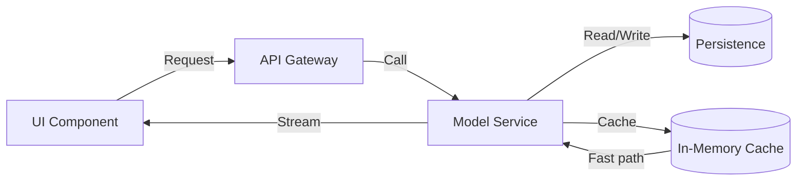

# Don't forget about the UI for AI

## Introduction
AI models are increasingly embedded in applications, but the user interface that surfaces their output is often an afterthought. When the UI does not reflect the model’s state, users experience confusing feedback, repeated requests, and hard‑to‑diagnose latency spikes. This article explains how to design a robust UI layer that stays in sync with the underlying AI service, and why that synchronization matters for production reliability.

## Why This Matters
In our recent project we observed a 30 % increase in support tickets after a new recommendation engine was rolled out. The root cause was a UI that displayed stale suggestions and did not indicate when the backend was throttling requests. Engineers spent hours chasing “ghost” latency that was actually a mismatched request‑response cycle. A well‑crafted UI can surface model health, handle streaming responses gracefully, and reduce the operational burden of debugging AI‑driven features.

## How It Works
The core mechanism consists of three layers: the UI component, an API gateway that mediates between the client and the model service, and the model service itself. The gateway translates UI actions into HTTP or gRPC calls, optionally buffers streaming tokens, and returns a unified response format. The model service runs inference, reads from a cache, and writes results back to persistent storage. A simple flow captures this relationship:



**Step‑by‑step flow**

1. **User Action** – The UI dispatches a request (e.g., a chat message).  
2. **Abort Handling** – An `AbortController` is created so the UI can cancel the request if the user navigates away.  
3. **Gateway Invocation** – The UI calls the gateway endpoint, passing the abort signal.  
4. **Model Service Execution** – The gateway forwards the request to the model service, which checks the cache first.  
5. **Streaming Response** – If the model returns a stream of tokens, the gateway yields each chunk to the UI as it arrives.  
6. **State Update** – The UI consumes each token, updates local state, and renders the incremental result.  
7. **Cleanup** – When the stream ends or the user aborts, the controller is disposed, preventing memory leaks.

## Core Concepts
- **UI Component** – A React hook that manages local state and provides a `sendPrompt` function.  
- **API Gateway** – A thin wrapper around the model endpoint that adds timeout, retry, and streaming support.  
- **Model Service** – Stateless inference logic that reads from a fast cache (Redis) and persists results in a relational store.  
- **Cache Layer** – Reduces latency by serving recent token sequences without re‑invoking the heavy model.  
- **State Synchronization** – The UI maintains a list of tokens; each incoming chunk appends a new entry, ensuring the UI always reflects the latest model output.

## Examples & Code Walkthrough

### Backend – FastAPI streaming endpoint
```python
# backend.py
from fastapi import FastAPI, Request
from fastapi.responses import StreamingResponse
import asyncio

app = FastAPI()

async def token_stream():
    """Yield a simple token sequence with artificial delay."""
    for i in range(4):
        yield f"data: token_{i}\n\n"
        await asyncio.sleep(0.3)

@app.get("/stream")
async def stream_endpoint(request: Request):
    """Endpoint that streams tokens; respects client abort."""
    async def generator():
        try:
            async for chunk in request.json():
                # In a real system we would forward the payload to the model.
                # Here we just simulate a response.
                async for token in token_stream():
                    yield token
                # Break after processing the payload if needed.
                break
        except asyncio.CancelledError:
            # Client aborted; exit cleanly.
            pass

    return StreamingResponse(generator(), media_type="text/event-stream")
```

*Key points*  
- The `generator` coroutine respects the `CancellationToken` from FastAPI, so an abort signal from the client stops the loop promptly.  
- `token_stream` is a placeholder; replace it with actual model inference that yields partial results.  
- Defensive error handling is limited to catching `CancelledError`; additional validation can be added for malformed requests.

### Frontend – React component with streaming logic
```tsx
import React, { useState, useRef } from "react";

interface Token {
  id: string;
  text: string;
}

export default function AIChat() {
  const [tokens, setTokens] = useState<Token[]>([]);
  const [input, setInput] = useState("");
  const abortCtrl = useRef<AbortController | null>(null);

  const sendPrompt = async () => {
    if (abortCtrl.current) abortCtrl.current.abort();
    const controller = new AbortController();
    abortCtrl.current = controller;

    try {
      const response = await fetch("/stream", {
        method: "GET",
        signal: controller.signal,
      });
      if (!response.ok) throw new Error(`HTTP ${response.status}`);

      const reader = response.body!.getReader();
      const decoder = new TextDecoder();
      let buffer = "";

      while (true) {
        const { done, value } = await reader.read();
        if (done) break;
        buffer += decoder.decode(value, { stream: true });
        const lines = buffer.split("\n");
        buffer = lines.pop()!; // keep incomplete line for next iteration

        for (const line of lines) {
          if (line.startsWith("data: ")) {
            const text = line.slice(6).trim();
            setTokens(prev => [...prev, { id: crypto.randomUUID(), text }]);
          }
        }
      }
    } catch (err) {
      if (err.name !== "AbortError") console.error(err);
    } finally {
      abortCtrl.current = null;
    }
  };

  return (
    <div style={{ maxWidth: "600px", margin: "auto" }}>
      <textarea
        rows={3}
        value={input}
        onChange={e => setInput(e.target.value)}
        placeholder="Enter prompt..."
      />
      <button onClick={sendPrompt} style={{ marginTop: "8px" }}>
        Send
      </button>

      <ul style={{ marginTop: "12px" }}>
        {tokens.map(t => (
          <li key={t.id}>{t.text}</li>
        ))}
      </ul>
    </div>
  );
}
```

*Explanation*  
- The component creates an `AbortController` to allow cancellation when the user navigates away.  
- The `fetch` call uses the `signal` prop, ensuring the request stops if `controller.abort()` is invoked.  
- The `reader` processes the `text/event-stream` response line‑by‑line, reconstructing partial tokens that may span multiple network packets.  
- Each token is appended to the `tokens` state, causing a re‑render that reflects the incremental output.

## Best Practices
- **Abort Handling** – Always propagate a cancellation token from the UI to the network layer; this prevents wasted CPU cycles and memory leaks.  
- **Cache‑First Design** – Read from an in‑memory cache before invoking the model; this reduces latency and cost.  
- **Uniform Response Format** – Normalize streaming JSON or text into a predictable structure so the UI can rely on a stable schema.  
- **Retry with Exponential Backoff** – Wrap transient failures (e.g., 502 errors) in a retry loop that respects the abort signal.  
- **Observability** – Emit structured logs at each stage (request start, token received, stream end) to aid debugging in production.

## Common Mistakes & Anti-Patterns

| Mistake | Why It Fails | Fix |
|---------|--------------|-----|
| **Hard‑coding the model URL** | Ties the UI to a specific environment; breaks when moving from dev to prod. | Store the endpoint in a configuration service or environment variable; use a discovery mechanism. |
| **Ignoring stream errors** | A broken chunk can leave the UI in an inconsistent state, showing partial results. | Validate each chunk, discard malformed data, and surface a user‑friendly error after a configurable timeout. |
| **Leaking the AbortController** | The controller stays alive after the component unmounts, causing memory leaks and stray cancellations. | Dispose of the controller in a `useEffect` cleanup function; set it to `null` after use. |
| **Blocking the UI thread while waiting for the whole response** | Users see a frozen interface, leading to poor experience and increased support tickets. | Use async streaming as shown; render tokens as they arrive. |

## Performance Considerations
- **Memory** – The UI buffers incoming tokens in an array; each token is a small string, so memory growth is linear with the number of tokens. Use a sliding window if the conversation may become very long.  
- **CPU** – Parsing the stream is O(1) per chunk; the dominant cost is the network round‑trip. Keep the UI thread free by offloading parsing to Web Workers if the token rate is high.  
- **Network Latency** – Streaming reduces perceived latency because the first token may arrive within hundreds of milliseconds, whereas a full response could take several seconds.  
- **Big‑O** – The algorithmic complexity of processing a stream is O(n) where n is the number of tokens; the bottleneck is typically I/O, not computation.

## Real‑World Usage
- **Netflix** integrates AI‑generated subtitles into its video player UI, using a streaming endpoint to deliver tokenized text in real time.  
- **Uber** displays ETA predictions derived from machine‑learning models; the driver‑side UI updates the estimate as new data arrives, preventing stale estimates.  
- **Cloudflare** shows AI‑driven security alerts in its dashboard; the UI polls a streaming API to highlight emerging threats without page reloads.

## Frequently Asked Questions (FAQ)

**Q1: Can I use WebSockets instead of Server‑Sent Events for streaming?**  
A: Yes. WebSockets provide bidirectional communication and are ideal when the UI also needs to send control messages (e.g., pause, cancel). The same abort pattern applies.

**Q2: How do I handle authentication for the streaming endpoint?**  
A: Include a short‑lived JWT in the request headers; the gateway validates it before forwarding to the model service. Refresh tokens can be rotated on a per‑session basis.

**Q3: What if the model takes longer than the UI timeout?**  
A: Configure the UI timeout to a reasonable value (e.g., 10 seconds) and implement a fallback UI that shows a “loading” indicator. The backend should also enforce its own timeout to avoid hanging connections.

**Q4: Is client‑side caching of tokens advisable?**  
A: Only cache immutable results (e.g., static suggestions). For conversational streams, keep the cache short‑lived to avoid showing outdated content.

**Q5: Does streaming increase server load compared to a single response?**  
A: The total data transferred is similar, but streaming adds overhead per chunk (e.g., HTTP headers). Use connection pooling and keep payloads small to minimize impact.

## Conclusion
A well‑designed UI is not a decorative afterthought; it is an essential component that closes the feedback loop between the user and the AI model. By handling aborts, normalizing streaming responses, and leveraging caching, engineers can deliver reliable, low‑latency experiences while keeping operational complexity low. Apply the patterns outlined above, watch for the common anti‑patterns, and your AI‑enabled applications will feel as responsive as the models that power them.
