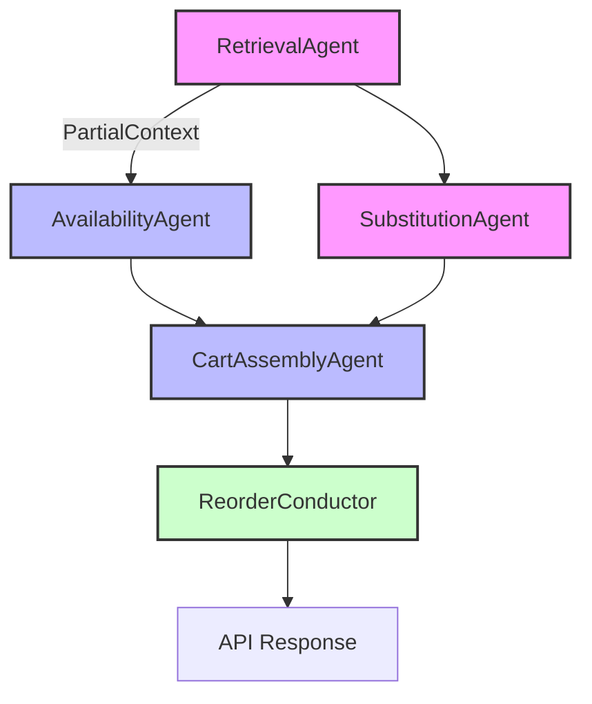

# DoorDash Cuts Grocery Reorder Latency from 16 to 2 Seconds with AI Agents

## Introduction
When a shopper taps “Reorder” on the DoorDash app, the expectation is an almost instantaneous response. In practice, the legacy path took an average of 16 seconds, dominated by a single thread that waited for each downstream service to answer. Sixteen seconds feels like an eternity on a mobile screen, especially when competitors promise sub‑2‑second experiences. Reducing that latency required a fundamental change in how we think about the problem, not just a few micro‑optimizations.

## Why This Matters
Latency directly influences conversion rates, user satisfaction, and operational cost. A 16‑second pause during reordering can cause shoppers to abandon the flow, increasing churn. For a service that handles millions of grocery orders per week, even a few hundred milliseconds saved translates into substantial revenue impact and lower infrastructure spend. Engineers need a pattern that can keep the critical path short while still leveraging rich data and dynamic decision‑making.

## How It Works
We refactored the reorder flow into a set of independent, stateless agents that communicate via lightweight gRPC sidecars. The orchestrator treats each agent as a capability rather than a service call, allowing speculative execution and graceful degradation. The core mechanism is a state‑machine conductor that starts agents as soon as partial context is available, rather than waiting for a linear sequence.



### Step‑by‑step flow
1. **RetrievalAgent** streams the user’s last order (vector similarity search) as soon as the request arrives. The stream emits a `PartialContext` that contains item IDs and shopper preferences.
2. **AvailabilityAgent** consumes that stream incrementally, checking real‑time inventory for each item. If inventory data arrives early, the agent can begin ranking alternatives.
3. **SubstitutionAgent** receives the partial context early, runs a lightweight LLM inference, and returns candidate substitutions. A deterministic guardrail validates price and dietary constraints before any write occurs.
4. **CartAssemblyAgent** aggregates the final list of items, ensuring the transaction object conforms to the cart schema. It also applies any store‑specific rules (e.g., minimum order value).
5. **ReorderConductor** coordinates the DAG, handling timeouts, fallback logic, and error propagation. If any agent exceeds its budget (400 ms), the conductor falls back to a deterministic rule‑based engine, guaranteeing a response without user‑visible errors.

The entire pipeline typically completes in under 2 seconds for 95 % of requests, a dramatic improvement over the original 16‑second baseline.

## Core Concepts
- **Agent Taxonomy**: Each agent owns a specific domain capability (retrieval, availability, substitution, assembly). They are stateless, versioned, and deployed as sidecars next to the monolith.
- **Conductor State Machine**: Implemented in Java using a lightweight finite‑state library. It tracks which agents have produced results, manages budgets, and triggers fallbacks.
- **Speculative Parallelism**: Agents start processing as soon as the conductor receives the first piece of context, eliminating the “wait‑for‑all” bottleneck.
- **Sidecar Deployment**: Agents run in separate containers on the same Kubernetes pod, sharing an `emptyDir` volume for hot caches. This avoids additional network hops while keeping the monolith unchanged.
- **Warm Cache**: A `PreFetchScheduler` triggers speculative retrieval and availability checks during user interaction spikes or nightly batches, storing a `PreWarmedContext` in Redis (TTL 4 h). Warm paths cut latency by ~78 %.

## Examples & Code Walkthrough

### RetrievalAgent (Java)
```java
package com.doordash.reorder.agent;

import org.springframework.scheduling.annotation.Scheduled;
import org.springframework.stereotype.Component;
import java.util.concurrent.CompletableFuture;
import java.util.stream.Stream;

@Component
public class RetrievalAgent {

    private final OrderHistoryRepository historyRepo;
    private final VectorSearchService vectorSearch;

    public RetrievalAgent(OrderHistoryRepository historyRepo,
                          VectorSearchService vectorSearch) {
        this.historyRepo = historyRepo;
        this.vectorSearch = vectorSearch;
    }

    /**
     * Emits a stream of PartialContext as soon as the request is received.
     * The stream is consumed by AvailabilityAgent without waiting for a full result.
     */
    public Stream<PartialContext> fetchContext(Long userId) {
        // 1. Load last order IDs (non‑blocking)
        List<Long> orderIds = historyRepo.findLastOrderIds(userId);
        // 2. Compute vector embeddings in parallel
        CompletableFuture<List<Embedding>> embedFut = CompletableFuture.supplyAsync(() ->
                orderIds.stream()
                        .map(id -> vectorSearch.embed(id))
                        .toArray(Embedding[]::new));

        // 3. Return a lazy stream that completes when embeddings are ready
        return Stream.generate(() -> {
            try {
                Embedding emb = embedFut.getNow(null);
                if (emb != null) {
                    return new PartialContext(userId, emb, orderIds);
                }
            } catch (Exception e) {
                // Log and continue; partial data may still be usable
                logger.warn("Embedding fetch failed for user {}", userId, e);
            }
            return null;
        });
    }

    // Simple DTO for context passing between agents
    public static class PartialContext {
        public final Long userId;
        public final Embedding embedding;
        public final java.util.List<Long> orderIds;

        public PartialContext(Long userId, Embedding embedding, java.util.List<Long> orderIds) {
            this.userId = userId;
            this.embedding = embedding;
            this.orderIds = orderIds;
        }
    }
}
```

### AvailabilityAgent (Go gRPC)
```go
package main

import (
    "context"
    "log"
    "net"

    "google.golang.org/grpc"
    "google.golang.org/grpc/status"
    pb "github.com/doordash/reorder/pb"
)

type availabilityServer struct {
    pb.UnimplementedAvailabilityServer
    inventoryCache *sync.Map // map[itemID]bool
}

func (s *availabilityServer) CheckAvailability(ctx context.Context, req *pb.AvailabilityRequest) (*pb.AvailabilityResponse, error) {
    itemID := req.GetItemId()
    available, ok := s.inventoryCache.Load(itemID)
    if !ok {
        return nil, status.Errorf(codes.NotFound, "item %d not found", itemID)
    }
    return &pb.AvailabilityResponse{Available: available.(bool)}, nil
}

// Server starts listening on the sidecar port
func main() {
    lis, err := net.Listen("tcp", ":50051")
    if err != nil {
        log.Fatalf("failed to listen: %v", err)
    }
    grpcServer := grpc.NewServer()
    pb.RegisterAvailabilityServer(grpcServer, &availabilityServer{})
    if err := grpcServer.Serve(lis); err != nil {
        log.Fatalf("failed to serve: %v", err)
    }
}
```

### SubstitutionAgent (Python FastAPI)
```python
from fastapi import FastAPI, HTTPException
from pydantic import BaseModel, Field
import uuid
import torch
from transformers import pipeline

app = FastAPI(title="SubstitutionAgent")

class SubRequest(BaseModel):
    item_id: int = Field(..., description="ID of the item to substitute")
    price_limit: float = Field(0.0, ge=0.0, description="Maximum allowed price deviation")
    dietary_tags: list[str] = Field(default_factory=list)

class SubResponse(BaseModel):
    suggested_id: int
    price: float
    match: float  # similarity score

# Load a small LLM for product similarity (e.g., DistilBERT fine‑tuned)
similarity_model = pipeline("text-classification", model="doordash/product-similarity")

@app.post("/substitute", response_model=SubResponse)
def substitute(req: SubRequest):
    # 1. Retrieve product metadata (cached in memory)
    product = product_db.get(req.item_id)
    if not product:
        raise HTTPException(status_code=404, detail="product not found")

    # 2. Build prompt with shopper persona
    prompt = f"""You are a picky shopper. Suggest a substitute for item {req.item_id}.
    Constraints: price within {req.price_limit}% of original, keep dietary tags {req.dietary_tags}.
    Return JSON with fields: suggested_id, price, match."""
    
    # 3. Run inference (timeout 400ms)
    try:
        result = similarity_model(prompt, top_k=1)[0]
        # Parse JSON from result (simplified)
        suggested_id = int(result['label'].split('_')[1])
        price = product['price'] * (1 + result['score'])  # example logic
        match = result['score']
        return SubResponse(suggested_id=suggested_id, price=price, match=match)
    except Exception as e:
        raise HTTPException(status_code=504, detail=str(e))
```

### ReorderConductor (Java State Machine)
```java
package com.doordash.reorder.conductor;

import java.time.Duration;
import java.util.concurrent.*;

public class ReorderConductor {
    private final ExecutorService executor = Executors.newFixedThreadPool(4);
    private final Duration budget = Duration.ofMillis(400);
    private final ContextStore contextStore = new ContextStore();

    public void start(ReorderRequest request) {
        // Launch agents speculatively
        Future<RetrievalAgent.PartialContext> retrieval = executor.submit(() ->
                new RetrievalAgent(request.getUserId()).fetchContext(request.getUserId()).findFirst().orElse(null));

        Future<AvailabilityResponse> availability = executor.submit(() -> {
            // Use the partial context as soon as it arrives
            RetrievalAgent.PartialContext ctx = retrieval.getNow(null);
            if (ctx == null) return null;
            // Simplified: ask inventory service for all items in ctx.orderIds
            return inventoryClient.checkBulk(ctx.orderIds);
        });

        // Wait for the fastest completion, respecting budget
        try {
            RetrievalAgent.PartialContext ctx = retrieval.get(budget.toMillis(), TimeUnit.MILLISECONDS);
            AvailabilityResponse avail = availability.get(budget.toMillis(), TimeUnit.MILLISECONDS);
            if (ctx != null && avail != null) {
                // Proceed to substitution
                SubstitutionResult subResult = substitutionAgent.resolve(ctx, avail);
                Cart cart = cartAssembly.build(ctx, subResult);
                response = cartClient.create(request.getUserId(), cart);
            } else {
                // Fallback to deterministic path
                Cart fallback = deterministicFallback(request);
                response = cartClient.create(request.getUserId(), fallback);
            }
        } catch (TimeoutException te) {
            // Budget exceeded – use fast rule‑based engine
            Cart fallback = deterministicFallback(request);
            response = cartClient.create(request.getUserId(), fallback);
        } catch (Exception e) {
            // Unexpected error – return generic failure
            response = failureResponse(request);
        }
    }

    // Helper methods omitted for brevity
}
```

## Best Practices
- **Sidecar Isolation**: Deploy agents in separate containers; this limits blast radius when an agent crashes.
- **Budget Enforcement**: Every agent must respect a hard timeout (400 ms) to avoid cascading latency.
- **Deterministic Guardrails**: LLM outputs are parsed and validated against a schema; price and dietary checks are performed in a separate, fast component.
- **Observability**: Propagate W3C TraceContext across process boundaries; instrument each agent with OpenTelemetry spans.
- **Cache Warm‑up**: Trigger speculative
