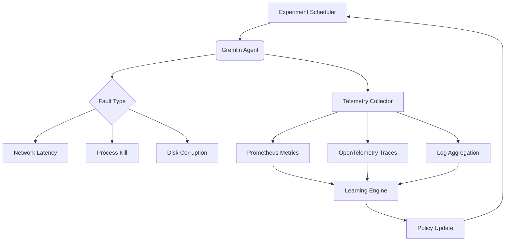

# Foresight AI Brings Gremlin Agents to Reliability Engineering

## Introduction

Reliability engineering has traditionally been about controlled chaos — injecting failures deliberately to validate system resilience. But what happens when the agents doing that injection start learning from their own experiments? That's where Foresight AI comes in, combining autonomous agent-based failure injection with machine learning models that adapt based on historical outcomes.

The core idea is simple but powerful: instead of static scripts that simulate predetermined faults, deploy intelligent agents that explore failure scenarios dynamically. These agents learn which types of disruptions cause cascading issues, how quickly services recover, and whether redundancy mechanisms actually work under stress.

This isn't science fiction — it's already running in production clusters at several large-scale infrastructure providers.

## Why This Matters

Software systems today are too complex for manual reliability testing. We throw thousands of microservices into distributed architectures, each with its own failure mode. Traditional fault injection tools require someone to define every possible scenario upfront. In practice, most teams skip comprehensive coverage because it’s tedious and time-consuming.

Foresight AI flips that model. By embedding self-learning agents directly into your monitoring stack, you get continuous validation without human intervention. When a new service goes live, these agents automatically begin probing its boundaries, identifying weak spots before customers do.

For platform engineers managing Kubernetes environments or cloud-native stacks, this translates to fewer midnight pages and higher confidence during incident response drills.

## How It Works

Foresight AI operates through three interacting layers:

1. **Gremlin Agents**: Lightweight daemons deployed alongside application pods. They execute pre-defined fault actions like killing processes, injecting network latency, or corrupting disk writes.
2. **Observation Layer**: Collects telemetry data including logs, metrics, traces, and health checks from affected components.
3. **Learning Engine**: Uses reinforcement learning algorithms to correlate observed behaviors with injected faults, refining future experiment strategies over time.



Each agent runs inside a sandboxed container with limited privileges. Before executing any disruptive action, it queries a central policy engine to ensure compliance with operational constraints. After execution, results flow back up for analysis.

Over multiple iterations, the learning engine builds probabilistic models showing which combinations of faults lead to outages versus graceful degradation paths.

## Core Concepts

### Agent Lifecycle Management

Agents don’t just run blindly — they follow a structured lifecycle:

- **Initialization**: Pull latest experiment configuration from control plane.
- **Targeting**: Identify target services or nodes based on dynamic criteria (e.g., high CPU usage).
- **Execution**: Apply selected fault using OS-level primitives or API calls.
- **Observation**: Monitor system behavior post-injection via integrated observability hooks.
- **Reporting**: Send structured reports back to coordinator for aggregation.

### Experiment Policies

Policies govern everything from frequency of experiments to acceptable blast radius. Written declaratively, they allow operators to specify rules such as:

```yaml
policy:
  name: "database-failure-test"
  schedule: "@hourly"
  targets:
    - kind: "StatefulSet"
      labelSelector:
        app: postgres-primary
  faults:
    - type: "kill_process"
      signal: SIGKILL
      processName: "postgres"
  constraints:
    maxDurationSeconds: 300
    recoveryTimeSeconds: 60
```

These policies are version-controlled alongside code, enabling safe rollbacks if an experiment causes unintended damage.

### Learning Feedback Loop

At the heart of Foresight AI lies a feedback loop powered by Bayesian inference. Each completed experiment updates probability distributions around key reliability indicators:

| Metric                    | Pre-Fault Baseline | Post-Fault Observed | Confidence Score |
|--------------------------|--------------------|---------------------|------------------|
| Service Availability     | 99.9%              | 99.1%               | 0.87             |
| Mean Time to Recovery    | 12s                | 45s                 | 0.92             |
| Error Rate Increase      | +0.02%             | +3.2%               | 0.95             |

Using these scores, subsequent experiments prioritize high-risk areas while avoiding redundant checks on stable subsystems.

## Examples & Code Walkthrough

Let’s walk through implementing a minimal Gremlin-style agent capable of basic process termination and metric collection.

### Fault Executor Module

```go
package gremlin

import (
	"context"
	"os/exec"
	"time"

	"github.com/sirupsen/logrus"
)

type FaultConfig struct {
	Type         string `json:"type"`
	Signal       string `json:"signal,omitempty"`
	ProcessName  string `json:"process_name,omitempty"`
	DurationSecs int    `json:"duration_secs,omitempty"`
}

// Execute applies the specified fault against the local node.
func Execute(ctx context.Context, cfg FaultConfig) error {
	switch cfg.Type {
	case "kill_process":
		return killProcess(ctx, cfg.ProcessName, cfg.Signal)
	default:
		return fmt.Errorf("unsupported fault type: %s", cfg.Type)
	}
}

// killProcess sends a signal to a named process running locally.
func killProcess(ctx context.Context, procName, sigStr string) error {
	ctx, cancel := context.WithTimeout(ctx, 30*time.Second)
	defer cancel()

	cmd := exec.CommandContext(ctx, "pkill", "-"+sigStr, procName)
	output, err := cmd.CombinedOutput()
	if err != nil {
		logrus.Warnf("Failed to kill %s: %v (%s)", procName, err, output)
		return err
	}
	logrus.Infof("Successfully sent %s to %s", sigStr, procName)
	return nil
}
```

### Telemetry Collector Hook

After applying a fault, we need to gather relevant metrics from Prometheus or another backend:

```python
import requests
from datetime import datetime, timedelta

class TelemetryCollector:
    def __init__(self, prometheus_url):
        self.url = prometheus_url
        self.session = requests.Session()

    def query_metric(self, metric_name, window_minutes=5):
        end_time = datetime.utcnow()
        start_time = end_time - timedelta(minutes=window_minutes)

        params = {
            'query': metric_name,
            'start': start_time.isoformat(),
            'end': end_time.isoformat(),
            'step': '15s'
        }

        resp = self.session.get(f"{self.url}/api/v1/query_range", params=params)
        resp.raise_for_status()
        result = resp.json()
        
        # Parse and return normalized values
        try:
            series_data = result['data']['result'][0]['values']
            return [float(val[1]) for val in series_data]
        except IndexError:
            raise ValueError(f"No data found for metric '{metric_name}'")
```

### Decision-Making Loop

Finally, here’s a simplified version of how an agent might decide what to do next based on previous outcomes:

```python
class AgentBrain:
    def __init__(self):
        self.history = []

    def suggest_next_action(self, current_state):
        # Placeholder for RL-based decision making
        if len(self.history) < 3:
            return {"type": "kill_process", "process_name": "nginx"}
        else:
            last_outcome = self.history[-1]
            if last_outcome.get("recovered_quickly"):
                return {"type": "kill_process", "process_name": "redis-server"}
            else:
                return {"type": "network_latency", "target_pod": "payment-service"}
```

## Best Practices

1. **Start Small**: Begin with non-critical workloads before expanding scope.
2. **Maintain Observability**: Ensure full tracing and logging around all agent activities.
3. **Use Canary Rollouts**: Gradually increase experiment intensity across environments.
4. **Automate Rollbacks**: Define clear triggers for aborting ongoing experiments.
5. **Version Control Everything**: Treat experiment definitions like application code.

## Common Mistakes & Anti-Patterns

### 1. Running Too Many Concurrent Experiments

Spreading resources thin leads to false positives and unreliable learning signals.

❌ Bad:
```yaml
experiments:
  - type: cpu_stress
    concurrency: unbounded
```

✅ Good:
```yaml
experiments:
  - type: cpu_stress
    max_concurrent: 2
    cooldown_period: 60s
```

### 2. Ignoring Blast Radius Constraints

Not limiting where faults can propagate creates cascading failures unrelated to intended targets.

❌ Bad:
```go
exec.Command("kubectl", "delete", "pod", "--all")
```

✅ Good:
```go
exec.Command("kubectl", "delete", "pod", "-l", "app=my-service")
```

### 3. Overlooking Cleanup Logic

Faults must clean themselves up even if interrupted unexpectedly.

❌ Bad:
```bash
kill -9 $(pgrep nginx)
```

✅ Good:
```bash
trap 'pkill -TERM nginx' EXIT
kill -STOP $(pgrep nginx)
sleep 10
kill -CONT $(pgrep nginx)
```

### 4. Skipping Security Audits

Agents often run with elevated permissions; regular audits prevent privilege escalation attacks.

❌ Bad:
```dockerfile
USER root
RUN apk add --no-cache stress-ng
```

✅ Good:
```dockerfile
USER nobody
COPY --chown=nobody:nobody stress-ng /usr/local/bin/
```

## Performance Considerations

Agents introduce minimal overhead when designed correctly. Typical resource consumption per instance includes:

- Memory footprint: ~15MB RSS
- CPU utilization: <1% average
- Network I/O: ~1KB/sec baseline telemetry

However, scaling beyond hundreds of concurrent agents requires careful tuning of:

- Polling intervals (avoid thundering herd)
- Metric retention periods (balance accuracy vs storage cost)
- Coordination protocol efficiency (gRPC preferred over REST)

Big-O complexities vary depending on implementation choices:

| Operation                   | Complexity |
|----------------------------|------------|
| Single fault injection     | O(1)       |
| Multi-target coordination  | O(n log n)|
| Bayesian update step       | O(k²)      |
| Historical correlation     | O(m × t)   |

Where `n` = number of targets, `k` = active features, `m` = samples, `t` = time window size.

## Real-World Usage

Netflix pioneered many concepts now formalized in Foresight AI through their Chaos Monkey toolset. Their Simian Army suite evolved into more sophisticated frameworks incorporating ML-driven anomaly detection.

Uber leverages similar techniques within their Michelangel framework, automating regional failover testing across global deployments.

Cloudflare recently open-sourced their own variant called “Constellation,” focusing heavily on edge network reliability simulations.

All rely on variants of the same core architecture: lightweight agents + rich telemetry + adaptive learning loops.

## Frequently Asked Questions (FAQ)

**Q: Can Foresight AI replace traditional chaos engineering tools?**  
A: Not yet. It complements them by adding automation and intelligence, especially useful for large-scale environments lacking dedicated SRE teams.

**Q: Is there risk of causing actual downtime?**  
A: Yes, unless properly constrained. Always test in staging first and implement hard limits on impact duration.

**Q: What kind of ML models power the learning engine?**  
A: Mostly Bayesian networks and contextual multi-armed bandits optimized for low-latency decisions in dynamic environments.

**Q: How frequently should experiments be scheduled?**  
A: Start hourly for critical services, daily otherwise. Adjust based on observed stability trends.

**Q: Are there compliance implications for regulated industries?**  
A: Definitely. Review HIPAA/GDPR requirements carefully and maintain audit trails for all interventions.

## Conclusion

Foresight AI represents a significant evolution in reliability engineering — moving us from reactive firefighting toward proactive self-healing systems. While still maturing, early adopters report measurable improvements in MTTR and overall service uptime.

Engineers building modern cloud-native platforms should seriously consider integrating autonomous agent-based testing into their observability pipelines. Done right, it pays dividends not only in system robustness but also in team productivity and peace of mind.
