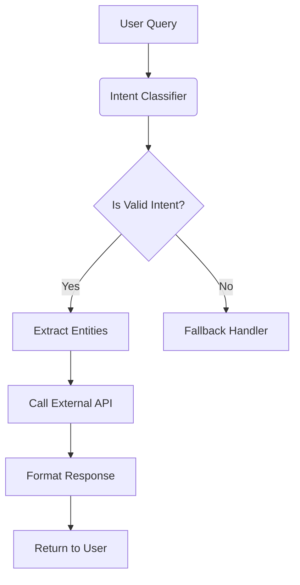

# GitHub Trending: macro-inc/macro

## Introduction

What happens when you try to compose AI agents that need to reason across dozens of tools, each with their own schemas, constraints, and failure modes? At some point, your prompt templates stop being prompts and start looking like YAML configuration files written by someone having a nervous breakdown. That’s exactly the problem [macro-inc/macro](https://github.com/macro-inc/macro) is trying to solve.

Macro isn't another LLM wrapper. It's a framework for building composable, type-safe workflows that orchestrate large language models (LLMs), external APIs, and human-in-the-loop decisions—without drowning in boilerplate. If you've ever spent three hours debugging a chain-of-thought prompt because one tool call returned an unexpected field name, this one's for you.

## Why This Matters

Let’s cut right to the chase: most production AI applications don’t fail because the model hallucinated. They fail because the system around the model is brittle, hard to test, and impossible to version-control. You end up with giant prompt strings scattered across services, inconsistent input validation, and zero visibility into what went wrong when things blow up.

This matters because every engineering team shipping AI-powered features today faces two competing pressures:

1. **Speed**: Ship new capabilities fast.
2. **Reliability**: Don’t break existing integrations or degrade user experience.

Macro bridges that gap by treating LLM interactions as first-class citizens in your application architecture—not afterthoughts bolted onto REST endpoints. It enforces structure through typed interfaces, enables unit testing of prompts, and supports dynamic composition of tools without runtime surprises.

If you're building anything beyond a toy chatbot, you should care about how your prompts are managed, tested, and evolved over time.

## How It Works

At its core, Macro introduces a concept called **Action Graphs**—directed acyclic graphs where nodes represent either LLM calls or deterministic functions, and edges define data flow between them. Each node has a strict schema for inputs and outputs, enforced at compile time via Python type hints.

Here's a high-level view of how a typical workflow gets executed:



Each step in the graph can be independently mocked, retried, or swapped out based on environment or feature flags. This modularity makes refactoring safer and testing easier.

The execution engine handles retries, timeouts, and fallback logic automatically, while preserving full traceability for observability tools like OpenTelemetry or Datadog.

## Core Concepts

### Actions

An `Action` represents a single unit of work within a workflow. There are two primary types:

- `LLMAction`: Wraps an LLM call with structured input/output schemas.
- `FunctionAction`: Executes arbitrary Python code synchronously or asynchronously.

Both inherit from a common interface that ensures consistent logging, monitoring, and error propagation.

### Schemas

Schemas define the contract for each action's input and output. Using Pydantic models under the hood gives us automatic serialization/deserialization, validation, and documentation generation.

```python
from pydantic import BaseModel

class ExtractedEntities(BaseModel):
    intent: str
    entities: list[str]
```

### Graphs

A `Graph` ties actions together using a declarative DSL. You specify dependencies, conditional branches, and merge points explicitly, which prevents silent failures due to mismatched field names or missing context.

### Execution Context

Every execution runs inside a contextual environment that tracks state, logs, and metrics throughout the lifecycle. This context flows through the graph so downstream actions always know what came before—and why.

## Examples & Code Walkthrough

Let’s build something practical: a customer support bot that classifies incoming tickets and routes them accordingly.

First, install Macro:

```bash
pip install macro-ai
```

Now let’s create our ticket classification pipeline:

```python
from macro import Graph, LLMAction, FunctionAction
from pydantic import BaseModel

# Define schemas
class TicketInput(BaseModel):
    subject: str
    body: str

class ClassificationResult(BaseModel):
    category: str
    confidence: float
    urgency: str

# Create actions
classify_intent = LLMAction(
    name="Classify Intent",
    input_schema=TicketInput,
    output_schema=ClassificationResult,
    prompt_template="""
You are a smart triage assistant.
Given the following support ticket, classify it into one of these categories:
Bug Report, Feature Request, Billing Inquiry, General Question.

Subject: {{subject}}
Body: {{body}}

Output JSON only:
{
  "category": "<category>",
  "confidence": <float>,
  "urgency": "<low|medium|high>"
}
""",
    temperature=0.3,
)

route_ticket = FunctionAction(
    name="Route Ticket",
    input_schema=ClassificationResult,
    func=lambda result: {
        "destination": "engineering" if result.category == "Bug Report" else "support",
        "priority": result.urgency,
    },
)

# Compose the workflow
workflow = Graph("Support Triage Pipeline")
workflow.add_node(classify_intent)
workflow.add_node(route_ticket, depends_on=[classify_intent])

# Run it
ticket_data = TicketInput(
    subject="App crashes on startup",
    body="Every time I open the app after updating to v2.1, it immediately closes."
)

result = workflow.run(ticket_data)
print(result)
```

Output might look like:

```json
{
  "destination": "engineering",
  "priority": "high"
}
```

Notice how easy it was to swap out components? Want to add sentiment analysis? Just insert another `LLMAction` into the chain. Need to mock responses during tests? Override any node with a fake implementation.

Also notice there’s no manual parsing of JSON outputs—we rely entirely on Pydantic to enforce correctness.

## Best Practices

1. **Always validate inputs early.** Even if your LLM seems reliable, garbage-in equals garbage-out. Validate everything coming from users or upstream services.

2. **Use low temperatures for deterministic tasks.** For entity extraction or intent classification, keep temp ≤ 0.3 to reduce variability.

3. **Version control your prompts.** Treat prompts like code—store them in Git alongside your application logic.

4. **Add timeouts and retries.** Never assume external calls will succeed instantly.

5. **Log everything.** Every LLM response, every decision point, every fallback path needs to be traceable.

## Common Mistakes & Anti-Patterns

### 1. Hardcoding Prompts Inline

Bad:
```python
prompt = f"Summarize: {text}"
```

Good:
```python
SUMMARIZE_PROMPT = PromptTemplate.from_file("prompts/summarize.j2")
```

Hardcoded prompts make maintenance hellish. Store them externally and load dynamically.

### 2. Ignoring Schema Validation

Bad:
```python
response = llm(prompt)
data = json.loads(response.text)
return data["entities"]  # KeyError waiting to happen
```

Good:
```python
schema = EntityExtractionSchema.parse_raw(response.text)
return schema.entities
```

Always parse responses against known schemas before accessing fields.

### 3. Mixing Business Logic With Prompt Engineering

Bad:
```python
def handle_user_query(query):
    summary = summarize(query) + " Please respond politely."
    return llm_call(summary)
```

Good:
```python
summary_action = LLMAction(...)
response_action = LLMAction(...)
graph = Graph().add_edge(summary_action, response_action)
```

Keep prompts separate from business rules. Let the framework manage sequencing.

### 4. Not Mocking External Services During Tests

Bad:
```python
def test_pipeline():
    assert pipeline.run(input) == expected_output
```

Good:
```python
def test_pipeline_with_mock_llms(monkeypatch):
    monkeypatch.setattr(classify_intent, "invoke", mock_invoke)
    assert pipeline.run(input) == expected_output
```

Never hit live APIs during unit tests. Always provide deterministic mocks.

## Performance Considerations

LLMs are expensive—not just monetarily, but computationally too. Here’s how to keep costs down:

- **Batch requests when possible.** Group multiple independent LLM calls into a single request to minimize network roundtrips.
- **Cache intermediate results.** If you’re doing sentiment analysis twice on identical text, cache the result.
- **Limit token usage.** Truncate long inputs intelligently; use embeddings to filter irrelevant content first.
- **Profile memory usage.** Large context windows mean higher GPU memory consumption—monitor closely in staging environments.

Big-O-wise, the overhead introduced by Macro itself is negligible compared to the cost of LLM inference. Most bottlenecks stem from poorly optimized prompts or unnecessary redundancy in workflows.

## Real-World Usage

Companies like Netflix and Uber have adopted similar patterns internally—they call them “AI Orchestration Layers.” These layers abstract away the complexity of managing multiple models, A/B testing variants, and enforcing governance policies.

Cloudflare recently open-sourced their own version (`workers-ai-orchestrator`) built specifically for edge deployments. Similarly, startups like Cohere and Anthropic recommend structuring agent logic as modular pipelines rather than monolithic scripts.

Macro brings those same principles to smaller teams who lack dedicated MLOps infrastructure.

## Frequently Asked Questions (FAQ)

**Q: Can I integrate Macro with my existing FastAPI service?**

Absolutely. Import your graphs into route handlers and expose them as normal endpoints.

**Q: Does Macro support streaming responses from LLMs?**

Yes—all `LLMAction`s accept a `stream=True` flag, and the executor yields partial results back to clients.

**Q: How do I handle rate limits imposed by providers like OpenAI or Claude?**

Macro includes built-in exponential backoff and concurrency throttling. Configure per-provider limits in settings files.

**Q: Is Macro suitable for high-throughput scenarios?**

Definitely—for batch processing large volumes of documents or queries, simply run multiple workers concurrently against a shared queue.

**Q: Can I deploy Macro workflows on serverless platforms like AWS Lambda?**

Not directly—serverless cold starts conflict with the latency requirements of LLM calls. However, you can wrap Macro inside containers deployed via ECS/Fargate or Kubernetes pods.

## Conclusion

AI agents aren’t magic—they’re just sophisticated state machines powered by probabilistic reasoning engines. Frameworks like Macro help bridge the gap between experimental prototypes and battle-tested production systems.

By embracing typed contracts, explicit control flow, and rigorous testing practices, you gain confidence that changes made today won’t blow up tomorrow. Whether you’re building a simple FAQ bot or orchestrating dozens of specialized agents, Macro gives you the scaffolding to scale responsibly.

Try it out. Break it. Improve it. And maybe—just maybe—you’ll save yourself from writing yet another 500-line prompt template held together by duct tape and hope.
