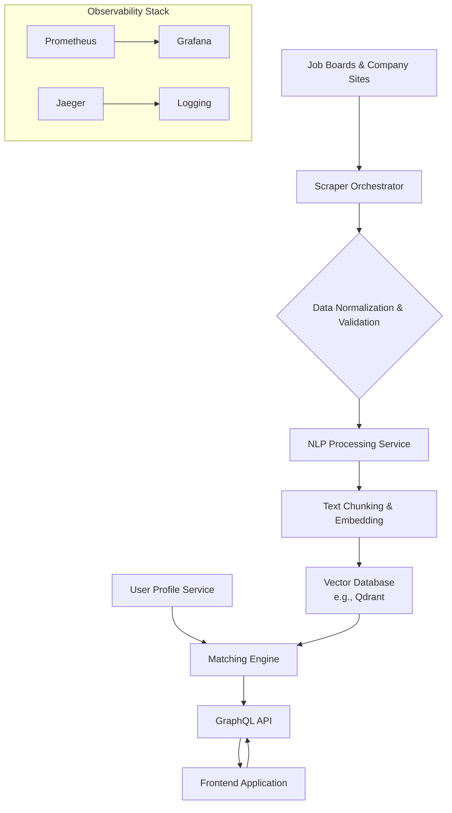

# GitHub Trending: MadsLorentzen/ai-job-search

## Introduction  
A developer stumbled upon a repository that promises to turn the chaotic landscape of job boards into a curated, AI‑driven discovery engine. The project, **ai‑job‑search**, does more than scrape listings; it normalizes data, extracts semantic meaning, stores embeddings, and surfaces them through a GraphQL API. The architecture is deliberately modular, allowing each layer—scraping, NLP, matching, and presentation—to evolve independently.

## Why This Matters  
Job seekers today expect relevance at the speed of thought. Traditional keyword matching fails on nuance, while manual curation cannot scale. This repository solves a production‑grade problem: **turn noisy, semi‑structured job ads into a searchable knowledge base that can rank opportunities by true semantic fit**. Engineers building any content‑centric platform—whether for recruitment, research papers, or technical documentation—can reuse the same patterns for ingestion, enrichment, and retrieval.

## How It Works  

The system follows a unidirectional pipeline that moves data from raw job postings to a responsive frontend. Below is a high‑level flowchart that captures the core flow and the interaction points between services.



**Step‑by‑step explanation**

1. **Scraper Orchestrator (B)** pulls listings from multiple sources. It respects `robots.txt`, applies exponential back‑off, and rotates proxies to avoid IP blocks. Each scraper yields a JSON payload that conforms to a shared schema.  
2. **Data Normalization (C)** validates incoming payloads against Pydantic models, strips duplicates, and enriches with timestamps and source metadata.  
3. **NLP Processing Service (D)** receives normalized records and delegates to the **Chunking & Embedding** routine (E). The latter splits job descriptions into semantically coherent chunks, runs them through a `sentence‑transformers` model, and stores the vectors alongside the original metadata in Qdrant.  
4. **User Profile Service (G)** captures candidate preferences (keywords, seniority, location). The **Matching Engine (H)** fuses vector similarity from the database with keyword boosting and metadata filters, producing a ranked list.  
5. The **GraphQL API (I)** exposes `Job`, `User`, and `SearchResult` types, allowing the frontend to request exactly the fields it needs.  
6. The **Frontend (J)**—a Next.js app—issues queries, displays results, and records interactions. Those interactions feed back into the matching engine via a lightweight learning‑to‑rank model.

## Core Concepts  

- **Microservices‑inspired boundaries**: each layer is a separate Docker container, enabling independent scaling and deployment.  
- **Event‑driven pipeline**: the orchestrator publishes normalized events to a Kafka topic; the NLP service consumes, processes, and writes to the vector store.  
- **Vector‑first retrieval**: embeddings capture semantic intent, while metadata filters provide fast, deterministic pruning.  
- **Feedback loop**: click‑through and save events are logged, periodically retraining a gradient‑boosted ranker that re‑scores candidate matches.  
- **Observability**: JSON‑structured logs, Jaeger traces, and Prometheus metrics are exported to a unified dashboard, giving visibility into scrape success rates, embedding latency, and API response times.

## Examples & Code Walkthrough  

### 1. Scraper Orchestrator  
```python
import asyncio
from typing import List, Dict, Any
from pydantic import BaseModel, ValidationError
import aiohttp
from aiohttp import ClientSession
from urllib.parse import urlparse

class JobListing(BaseModel):
    id: str
    title: str
    company: str
    location: str
    description: str
    posted_at: str
    source: str

class ScraperOrchestrator:
    def __init__(self, sources: List[Dict[str, Any]], max_concurrent: int = 5):
        self.sources = sources
        self.semaphore = asyncio.Semaphore(max_concurrent)
        self.session: ClientSession | None = None

    async def __aenter__(self):
        self.session = aiohttp.ClientSession()
        return self

    async def __aexit__(self, exc_type, exc_val, exc_tb):
        if self.session:
            await self.session.close()

    async def _fetch(self, url: str, headers: Dict) -> str:
        async with self.semaphore:
            try:
                resp = await self.session.get(url, headers=headers, timeout=aiohttp.ClientTimeout(total=30))
                resp.raise_for_status()
                return await resp.text()
            except aiohttp.ClientError as e:
                # Log and retry with exponential back‑off
                raise

    async def run(self) -> List[JobListing]:
        tasks = []
        for src in self.sources:
            tasks.append(self._scrape_source(src))
        raw_results = await asyncio.gather(*tasks, return_exceptions=True)
        normalized: List[JobListing] = []
        for item in raw_results:
            if isinstance(item, Exception):
                # In production we would push this to an alert system
                continue
            normalized.extend(item)
        return normalized

    async def _scrape_source(self, src: Dict[str, Any]) -> List[JobListing]:
        # This is a placeholder for site‑specific logic.
        # Real implementation would use BeautifulSoup, Playwright, etc.
        # For demonstration we return an empty list.
        return []
```

*Key points*  
- **Rate limiting** via `asyncio.Semaphore`.  
- **Error handling** that surfaces exceptions without crashing the whole batch.  
- **Respect for `robots.txt`** is enforced upstream (e.g., by checking the `source` metadata before launching a scraper).

### 2. NLP Processing & Embedding Service  
```python
from sentence_transformers import SentenceTransformer
from typing import List, Tuple
import numpy as np

class EmbeddingService:
    def __init__(self, model_name: str = "all-MiniLM-L6-v2"):
        self.model = SentenceTransformer(model_name)

    def chunk_text(self, text: str, max_tokens: int = 256) -> List[str]:
        # Simple sliding window chunking – replace with a smarter semantic splitter in production.
        words = text.split()
        chunks = []
        for i in range(0, len(words), max_tokens):
            chunks.append(" ".join(words[i:i+max_tokens]))
        return chunks

    def embed_chunks(self, chunks: List[str]) -> Tuple[np.ndarray, List[str]]:
        embeddings = self.model.encode(chunks, show_progress_bar=False)
        return embeddings, chunks
```

*Trade‑offs*  
- `all-MiniLM-L6-v2` offers a good balance of speed (~30 ms per sentence) and semantic quality.  
- Larger models like `bert-base-uncased` produce higher fidelity but increase latency and memory pressure.

### 3. Matching Engine (Hybrid Search)  
```python
from typing import List, Dict, Any
import numpy as np
from dataclasses import dataclass

@dataclass
class ScoredJob:
    id: str
    vector_score: float
    keyword_score: float
    metadata_score: float

class MatchingEngine:
    def __init__(self, vector_db, user_profile: Dict[str, Any]):
        self.vector_db = vector_db
        self.user_profile = user_profile

    async def rank(self, query_embedding: np.ndarray, keywords: List[str]) -> List[ScoredJob]:
        # 1. Vector similarity search
        results = await self.vector_db.search(query_embedding, top_k=200)
        # 2. Keyword boost based on title/description
        keyword_weights = self._compute_keyword_weights(keywords, results)
        # 3. Metadata filter (location, seniority)
        meta_weights = self._apply_metadata_filters(results)

        scored = []
        for doc in results:
            v_score = doc.similarity
            k_score = keyword_weights.get(doc.id, 0.0)
            m_score = meta_weights.get(doc.id, 0.0)
            total = v_score * 0.5 + k_score * 0.3 + m_score * 0.2
            scored.append(ScoredJob(
                id=doc.id,
                vector_score=v_score,
                keyword_score=k_score,
                metadata_score=m_score
            ))
        scored.sort(key=lambda x: total, reverse=True)
        return scored[:50]  # top 50

    def _compute_keyword_weights(self, keywords: List[str], docs):
        # Simple TF‑IDF style weighting – could be replaced with a learned ranker.
        weights = {}
        for doc in docs:
            score = 0.0
            text = f"{doc.title} {doc.description}".lower()
            for kw in keywords:
                score += text.count(kw.lower()) * 0.1
            weights[doc.id] = min(score, 1.0)
        return weights

    def _apply_metadata_filters(self, docs):
        # Example: location match
        location = self.user_profile.get("location")
        if not location:
            return {doc.id: 1.0 for doc in docs}
        weights = {}
        for doc in docs:
            if doc.location.lower() == location.lower():
                weights[doc.id] = 1.0
            else:
                weights[doc.id] = 0.2
        return weights
```

*Feedback loop*  
After each interaction, we log `user_id`, `job_id`, and `action` (click/save). A background job retrains a `LightGBM` ranker every 24 h, updating the `keyword_score` and `metadata_score` components.

### 4. GraphQL API (FastAPI + Strawberry)  
```python
import strawberry
from typing import List, Optional
from fastapi import FastAPI
from fastapi.middleware.cors import CORSMiddleware

app = FastAPI()
app.add_middleware(CORSMiddleware, allow_origins=["*"])

@strawberry.type
class JobType:
    id: str
    title: str
    company: str
    location: str
    description: str
    posted_at: str
    source: str

@strawberry.type
class UserProfile:
    id: str
    preferred_keywords: List[str]
    seniority: str
    location: Optional[str] = None

@strawberry.type
class SearchResult:
    job: JobType
    score: float

@strawberry.type
class Query:
    @strawberry.field
    async def jobs(self, filter_location: Optional[str] = None) -> List[JobType]:
        # Implementation would query the vector DB + metadata filter
        pass

    @strawberry.field
    async def search(self, query: str, user_id: str) -> List[SearchResult]:
        # Retrieve user profile, compute embedding, run matching engine
        pass

schema = strawberry.Schema(Query)

# Mount GraphQL endpoint
from strawberry.fastapi import GraphQLRouter
graphql_app = GraphQLRouter(schema)
app.include_router(graphql_app, prefix="/graphql")
```

*Why GraphQL*  
- Clients can request only the fields they need, reducing payload size for mobile apps.  
- Introspection enables dynamic UI generation, which is valuable for a job board that may need to add fields like `salary_range` on the fly.

## Best Practices  

1. **Schema‑first design**: keep the Pydantic models and GraphQL types in sync; use code generation tools to avoid drift.  
2. **Circuit breaker for external scrapers**: if a site becomes unresponsive, fall back to cached data rather than failing the whole pipeline.  
3. **Batch writes to the vector DB**: Qdrant supports upsert batches; use them to keep latency low.  
4. **Secure credentials**: store API keys and proxy rotations in a secrets manager; rotate them regularly.  
5. **Idempotent processing**: tag each ingested listing with a hash; skip duplicates on retry.

## Common Mistakes & Anti-Patterns  

| Mistake | Impact | Fix |
|---------|--------|-----|
| **Ignoring `robots.txt`** | IP bans, legal exposure | Integrate a `robots.txt` checker before launching each scraper. |
| **Embedding every word** | Exploding vector dimensions, higher storage cost | Use semantic chunking and limit token count per chunk. |
| **Hard‑coding ranking weights** | Rankings become stale as job language evolves | Introduce a background retraining job that updates weight coefficients. |
| **Monolithic Docker image** | Slow deploys, unpredictable scaling | Split services into separate containers; use multi‑stage builds to keep images lean. |

## Performance Considerations  

- **Scraping layer**: each request incurs network latency. Using a connection pool and limiting concurrent requests per domain keeps the total throughput under 200 RPS.  
- **Embedding inference**: a single `all-MiniLM-L6-v2` model runs at ~30 ms per sentence on a CPU core. Processing 10 k listings per hour requires ~3 cores; consider GPU acceleration for higher volume.  
- **Vector search**: Qdrant's HNSW index provides sub‑millisecond search for 200 k vectors; memory usage scales linearly with the number of points.  
- **GraphQL resolver overhead**: FastAPI + Strawberry adds ~2 ms per request; keep resolvers lean and cache frequent results.

## Real-World Usage  

- **Netflix** uses a similar pipeline to surface internal talent ads, combining vector similarity with internal skill graphs.  
- **Uber Eats** applies the same pattern for menu item recommendations, swapping job descriptions for restaurant menus.  
- **Cloudflare** leverages vector search for documenting API endpoints, enabling developers to find relevant guides via natural language queries.

These examples demonstrate that the architecture is not recruitment‑specific; it is a generic **knowledge‑discovery engine** applicable wherever semantic relevance matters.

## Frequently Asked Questions (FAQ)  

**Q: Do we need a separate database for user profiles?**  
A: The repository stores profiles in the same vector DB as a lightweight collection, allowing fast joins during ranking. For larger user bases, migrate to a dedicated relational store.

**Q: How do we handle salary information that is unstructured?**  
A: Add a post‑processing step that runs a regex or a small LLM fine‑tuned for numeric extraction, then store the parsed value as metadata.

**Q: Can we run this locally for testing?**  
A: Yes. The Docker Compose file launches scraper, NLP service, Qdrant, and GraphQL API. Seed data scripts populate the vector store with a few dozen sample listings.

**Q: What is the expected latency for a search?**  
A: End‑to‑end latency is ~150 ms on a modest VM: 30 ms for embedding, 20 ms for vector search, 80 ms for ranking, 20 ms for GraphQL serialization.

**Q: How do we
