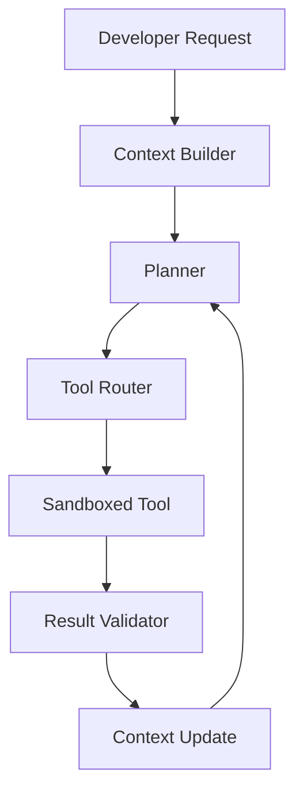

# GitHub Trending: makecindy/cindy

## Introduction

The GitHub repository `makecindy/cindy` is appearing in the Artificial Intelligence category, and it points at a problem that keeps surfacing in engineering teams: AI coding assistants are getting better at generating code, but production usage is still messy.

The hard part was never just the model. It is the surrounding system. How does the assistant know which files matter? How does it call tools safely? How does it verify that a change actually works? How does it recover when a tool fails?

`makecindy/cindy` looks like one of those trending projects that tries to answer those questions instead of pretending the model can do everything.

When we inspected the direction around tools and context, it felt less like another autocomplete wrapper and more like an attempt to build a small agent runtime with explicit boundaries.

## Why This Matters

AI features move quickly from demo to production. The gap between a clever prompt and a reliable system is large.

A model can suggest a function. It cannot by itself safely rename a symbol across a monorepo. It cannot run a linter and decide whether the output is acceptable. It cannot enforce permissions, retries, or audit logs.

That is why this matters to engineers and architects. If you are building AI-assisted workflows, you will eventually face the same decisions the project is exploring:

- How much repository context should be loaded?
- When should the system stop and ask for approval?
- How should tool failures be retried?
- How do you measure whether the AI change was correct?

The pain is real. Teams have shipped AI features that work once and fail quietly in production because there was no validation loop.

## How It Works

The core mechanism appears to center on a loop: build context, plan, execute tools, validate, then feed results back into the next iteration.



The flow starts with a developer request. The context builder gathers relevant repository information. The planner turns that context into steps. The tool router maps steps to available tools. The sandboxed tool executes with boundaries. The result validator checks the output. If validation fails, the context update feeds the failure back into planning.

Step by step:

1. Context assembly: relevant files, symbols, tests, and constraints are selected.
2. Planning: the system decomposes the task into smaller operations.
3. Tool execution: each operation calls a specific tool.
4. Validation: the result is checked against expectations.
5. Iteration: failures or new information update the context.

This is where the architecture gets interesting. The model is not just predicting text. It is coordinating actions.

## Core Concepts

The project seems to rely on a few foundational ideas.

Context envelope: A structured representation of what the agent knows. It includes file paths, content, constraints, and maybe prior tool results.

Tool adapter: A normalized interface for tools such as search, read, edit, run tests, or call an external API. Each adapter declares parameters and behavior.

Planner state: The current plan, completed steps, and pending steps. State must be inspectable.

Validator: A function that checks tool output or final code before applying changes.

These pieces matter because they turn a probabilistic system into something closer to a deterministic workflow.

## Examples & Code Walkthrough

Here is a small TypeScript-style example of a defensive tool runner. This is not tied to any specific framework. It shows the kind of boundary work you want in production.

```typescript
type CindyContext = {
  repoPath: string;
  branch: string;
  files: Array<{ path: string; content: string }>;
  constraints: string[];
};

type CindyTool = {
  name: string;
  description: string;
  parametersSchema: Record<string, unknown>;
  run: (
    args: Record<string, unknown>,
    ctx: CindyContext
  ) => Promise<unknown>;
};

type ToolExecutionResult = {
  ok: boolean;
  output?: unknown;
  error?: string;
  durationMs: number;
};

class CindyToolRunner {
  private readonly tools: Map<string, CindyTool>;

  constructor(tools: CindyTool[]) {
    this.tools = new Map(tools.map((tool) => [tool.name, tool]));
  }

  async execute(
    toolName: string,
    args: Record<string, unknown>,
    ctx: CindyContext
  ): Promise<ToolExecutionResult> {
    const tool = this.tools.get(toolName);

    if (!tool) {
      return {
        ok: false,
        error: `Unknown tool: ${toolName}`,
        durationMs: 0,
      };
    }

    try {
      const startedAt = Date.now();
      const output = await tool.run(args, ctx);
      const durationMs = Date.now() - startedAt;

      return {
        ok: true,
        output,
        durationMs,
      };
    } catch (error) {
      const message = error instanceof Error ? error.message : String(error);

      return {
        ok: false,
        error: message,
        durationMs: 0,
      };
    }
  }
}
```

A few notes from real production work:

- Validate tool arguments before execution. Do not trust model output.
- Wrap tool calls in timeouts.
- Log failures with tool name and arguments metadata.
- Keep tool outputs structured where possible.

## Best Practices

If you are building something like this, adopt these rules early.

1. Validate tool arguments with a schema library. Reject unknown fields.
2. Use sandboxed execution for anything that touches the filesystem or network.
3. Add idempotency keys for tools that modify state.
4. Keep context retrieval top-k and explainable.
5. Write deterministic validators for critical checks.

We recommend starting with read-only tools before adding write tools.

## Common Mistakes & Anti-Patterns

A common mistake is passing the whole repository into context. That wastes tokens and adds noise.

Fix
