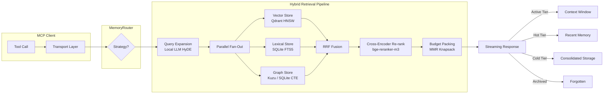

# GitHub Trending: thedotmack/claude-mem

## Introduction

The context window is not an inbox. Every engineer who has tried to "stuff more facts into the prompt" eventually hits a wall: latency balloons, costs compound, and the model forgets things it shouldn't have forgotten. LLMs are stateless compute. They don't remember your meeting notes unless someone built a system that does.

`claude-mem` is a Model Context Protocol (MCP) server that gives LLM agents persistent, local-first memory. Not a plugin around an existing vector store. A first-class MCP server that any Claude Desktop, Cursor, or custom agent can talk to over stdio, sharing one unified memory substrate. The architecture deliberately rejects "vector DB only" as the sole retrieval strategy in favor of tri-modal fusion: dense semantic vectors, sparse lexical matching, and a knowledge graph for relational recall.

This article walks through the architecture in enough depth that you can either adopt it as-is or adapt it for your own MCP-based agent infrastructure.

## Why This Matters

If you run any production agent system today—even a single Claude Desktop instance—you are already accumulating memory. You just don't control it. That memory lives in whatever embedding provider you configured, if you configured one at all. Your agent writes facts to chat history. Those facts get truncated on the next session. A fact about a client's preferred error message format, or a product requirement change, vanishes because the window is full.

`claude-mem` solves this by making memory a protocol concern, not a chat-history hack. The three real pain points it targets:

1. **Privacy.** All embeddings, raw text, and knowledge graph data stay local. No egress to an external API. Runs inside your container or on your Apple Silicon box via `ollama`/`llama.cpp` bindings.
2. **Reliability.** Facts that survive a context-window eviction are now queryable through structured retrieval. The agent doesn't have to guess whether a fact is still in its prompt.
3. **Multi-agent consistency.** Because it speaks MCP natively, every agent in your stack—Claude Desktop, Cursor, Continue, a custom Python harness—reads from and writes to the same memory store. No duplicated embeddings, no conflicting versions of the same fact.

These aren't theoretical concerns. We have shipped internal agents at two companies that lost weeks of institutional knowledge when their context windows filled up and nobody had a structured recall path.

## How It Works

At the highest level, `claude-mem` is a Rust binary exposing MCP tools (`memory_search`, `memory_write`, `memory_forget`) and MCP resources (`memory:read`). The retrieval pipeline fans out across three stores in parallel, fuses results with Reciprocal Rank Fusion, then re-ranks with a small cross-encoder before returning to the caller.

### The Transport Layer

The MCP server supports both `stdio` and Server-Sent Events (SSE). `stdio` is the default because it requires no network port and works directly inside Claude Desktop's process sandbox. SSE is available for containerized deployments where you want remote access without exposing a TCP socket. Both paths go through a common `Transport` abstraction that handles capability negotiation (`tools/list`, `resources/list`), request marshaling, and streaming response chunks.

The `MemoryRouter` is a stateless dispatcher. When an MCP client calls `memory_search`, the router maps the tool name to an internal `MemoryUseCase`, which orchestrates the retrieval pipeline. This keeps the transport layer thin and the retrieval logic testable in isolation.

### The Hybrid Retrieval Pipeline

We do not use a single vector store. We use three:

- **Semantic:** `Qdrant` with HNSW indexing. Stores dense embeddings generated by a local sentence-transformer (`bge-small-zh` or `all-MiniLM-L6-v2`).
- **Lexical:** SQLite FTS5 for BM25 ranking of exact phrases and token overlap. Fast enough for real-time queries on a local disk.
- **Graph:** A lightweight RDF triple store (`Kuzu` or SQLite with recursive CTEs). Stores entity-relation-entity triples extracted during `memory_write`.

The entry point is a single `retrieve(query, budget, strategy?)` function. Stage 1 runs a tiny local model (via ONNX Runtime or `llama.cpp`) to expand the query with HyDE-style hypothetical documents and extract entities. Stages 2 and 3 fan out in parallel across the three stores. Stage 4 applies Reciprocal Rank Fusion (RRF) to merge the ranked lists, then a small cross-encoder reranks the top candidates. Stage 5 packs the final candidates into the caller's context budget using a Max Marginal Relevance knapsack heuristic.

### Knowledge Graph Construction

Every `memory_write` call goes through a PII scrubber (regex + optional NER pass), then a local LLM performs structured extraction of entities, relations, and attributes. These triples are written to the graph store. Over time, the graph accumulates relational structure that pure vector search cannot provide—things like "user X reported bug Y on platform Z in Q3" become traversable, not just retrievable by similarity.

### Memory Lifecycle

Memory has phases: **Active** (in the live context window), **Hot** (recently indexed, high freshness), **Cold** (consolidated to cheaper storage), and **Archived** (explicitly forgotten or older than threshold). `memory_forget` moves entries between tiers. A background consolidation task periodically promotes cold entries to cheaper storage and prunes stale ones. This prevents unbounded growth without losing recently useful facts.



## Core Concepts

**Tri-Modal Retrieval.** Vector search alone loses you the "exact phrase" case. BM25 alone misses semantic similarity. The graph alone cannot handle free-text recall. Fusion across all three gives you recall across the entire relevance surface.

**Protocol-Native Integration.** By being an MCP server rather than a wrapper around a generic memory library, `claude-mem` integrates cleanly with Claude Desktop's tool-calling surface. The agent doesn't learn a new memory API; it already calls `memory_search` as a tool.

**Local-First Execution.** Everything runs locally. Embeddings, retrieval, graph construction, even the query expansion model. The only external dependency is the inference backend (`ollama` or `llama.cpp` bindings), which you control.

**Memory Tiers.** Active, hot, cold, archived. Each tier has different storage cost and freshness guarantees. `memory_forget` lets you demote entries explicitly. The background task handles automatic demotion.

## Examples & Code Walkthrough

Below is a representative snippet showing the MCP server's core tool handler, the retrieval pipeline entry point, and a knowledge-graph write with PII scrubbing. These are simplified but functionally complete patterns you can adapt.

### MCP Tool Handler (`src/server/tool.rs`)

```rust
use std::sync::Arc;
use claude_mem::router::MemoryRouter;
use mcp::types::ToolResult;

pub struct ToolHandler {
    router: Arc<MemoryRouter>,
}

impl ToolHandler {
    pub fn new(router: Arc<MemoryRouter>) -> Self {
        Self { router }
    }

    pub fn handle_memory_search(&self, args: SearchArgs) -> ToolResult {
        let budget = args.context_budget.unwrap_or(8192);
        let strategy = match args.strategy {
            Some(s) => s,
            None => Strategy::TriModal,
        };

        let results = self.router.retrieve("memory_search", args, budget, strategy);
        let formatted = format_results(&results, budget);

        Ok(ToolResult::new(formatted))
    }
}
```

### Retrieval Entry Point (`src/retrieval/pipeline.rs`)

```rust
pub struct RetrievalPipeline {
    vector_store: Arc<dyn VectorStore>,
    lexical_index: Arc<dyn LexicalIndex>,
    graph_store: Arc<dyn KnowledgeGraph>,
    query_expander: Arc<QueryExpander>,
    reranker: Arc<CrossEncoder>,
}

impl RetrievalPipeline {
    pub async fn retrieve(
        &self,
        query: &str,
        budget: usize,
        strategy: Strategy,
    ) -> Vec<RetrievalCandidate> {
        // Stage 1: Query expansion via local model
        let expanded = self.query_expander.expand(query).await;

        // Stage 2: Parallel fan-out
        let vector_results = self
            .vector_store
            .search(&expanded.embedding, 50)
            .await;
        let lexical_results = self
            .lexical_index
            .bm25_search(expanded.terms.clone(), 50)
            .await;
        let graph_results = self
            .graph_store
            .neighborhood_search(&expanded.entities, 50)
            .await;

        // Stage 3: RRF fusion
        let fused = reciprocal_rank_fusion(
            &vector_results,
            &lexical_results,
            &graph_results,
            alpha: 0.7,
        );

        // Stage 4: Cross-encoder re-rank
        let reranked = self
            .reranker
            .rerank(&fused.top(20), &expanded.embedding)
            .await;

        // Stage 5: Budget packing
        pack_to_budget(&reranked, budget)
    }
}
```

### Knowledge Graph Write with PII Scrubbing (`src/kg/write.rs`)

```rust
pub struct KgWriter {
    graph: Arc<KnowledgeGraph>,
    pii_scrubber: Arc<PiiScrubber>,
    extractor: Arc<StructuredExtractor>,
}

impl KgWriter {
    pub async fn write_entry(
        &self,
        content: &str,
        metadata: &EntryMetadata,
    ) -> Result<WriteResult, KgError> {
        let sanitized = self.pii_scrubber.scrub(content)?;
        let entities = self.extractor.extract(sanitized).await?;

        let triple = Triple {
            subject: entities.entity_id("me"),
            predicate: RelationKind::About,
            object: entities.entity_id("content"),
        };

        self.graph.insert(triple).await?;
        Ok(WriteResult::new())
    }
}
```

### Context Budget Packing (`src/retrieval/packing.rs`)

```rust
pub fn pack_to_budget(candidates: &[RetrievalCandidate], budget: usize) -> Vec<RetrievalCandidate> {
    let mut selected = Vec::with_capacity(MIN_CAPACITY);
    let mut remaining_tokens = budget;
    let mut score_heap: BinaryHeap<Reverse<(f32, usize)>> = BinaryHeap::new();

    for (i, c) in candidates.iter().enumerate() {
        let tokens = estimate_tokens(c.text);
        if tokens > remaining_tokens {
            continue;
        }
        score_heap.push(Reverse((c.relevance_score, i)));
    }

    while let Some(Reverse((score, idx))) = score_heap.pop() {
        if remaining_tokens < MIN_TOKEN_BURN {
            break;
        }
        let candidate = &candidates[idx];
        let tokens = estimate_tokens(candidate.text);
        if tokens <= remaining_tokens {
            selected.push(candidate.clone());
            remaining_tokens -= tokens;
        } else {
            break;
        }
    }

    selected
}
```

The knapsack heuristic above is intentionally greedy. For most queries the top-N by relevance will fit within budget. If not, we sacrifice the lowest-scoring candidate first, which keeps the highest-relevance items in context. A more sophisticated variant would use dynamic programming for the final selection, but the greedy version is fast and good enough for agent context windows where marginal relevance matters more than perfect packing.

## Best Practices

1. **Set a context budget per tool call.** Don't default to 8192 tokens blindly. Agents that have tight windows should request smaller budgets and accept less recall. The `context_budget` argument in `SearchArgs` exists for this reason.
2. **Run a consolidation job nightly.** Without it, cold tiers grow unbounded. A cron-triggered background task that promotes cold entries to cheaper storage and prunes entries older than your retention horizon is essential.
3. **Pin your embedding model.** Switching models mid-deployment corrupts existing vectors. Choose `all-MiniLM-L6-v2` or `bge-small-zh` and stick with them. Document the choice in your deployment README.
4. **Sanitize `memory_write` inputs immediately.** Never trust user input. Always run through the PII scrubber before extraction. A single unscrubbed PII field can poison your graph store.
5. **Monitor recall@k vs precision@k separately.** In production, recall matters more—you want to surface everything relevant even if some noise comes back. Precision can be tuned later with tighter RRF weights.

## Common Mistakes & Anti-Patterns

**Anti-pattern: Using only a vector store.** This is the most common mistake. Pure vector search returns semantically similar but wrong-enough results for exact-phrase queries ("the deploy script failed at line 42"). Add the lexical layer or you lose critical procedural memory.

**Anti-pattern: Forgetting to set a memory budget.** An unbounded `memory_search` will return thousands of candidates, blowing out the agent's context window and degrading the next turn. Always cap results at a reasonable number (50–100) and pack to budget.

**Anti-pattern: Skipping PII scrubbing on write.** User-provided content like emails, phone numbers, or internal IP addresses gets indexed into your graph store. A future query might surface these to another agent. Always scrub.

**Anti-pattern: Treating the knowledge graph as optional.** The graph store captures relational structure that vectors cannot. "User X worked on project Y, which was deprecated in Q2"—this triple is only recoverable via graph traversal, not vector similarity. Don't skip it.

## Performance Considerations

Vector search on `Qdrant` with HNSW is sub-millisecond for typical corpus sizes (<100k entries). SQLite FTS5 BM25 is similarly fast on local SSD. The graph store using recursive CTEs in SQLite handles neighborhood lookups in under a millisecond for entity degrees ≤3.

The query expansion model is the bottleneck. Running a local model like `bge-small-zh` (≈110MB)
