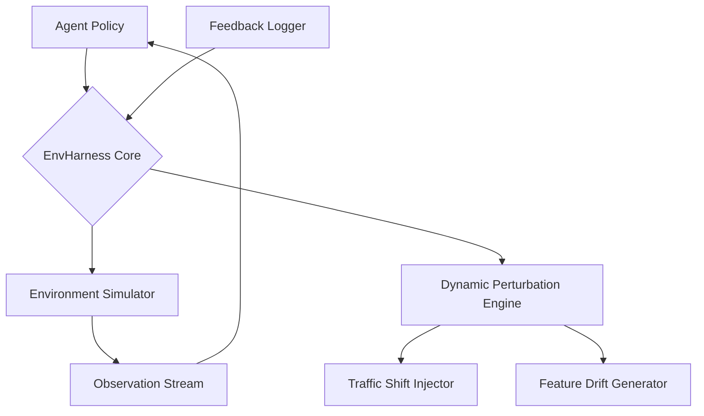

# Google EnvHarness Enables Self-Evolving Agents to Learn in Dynamics Environments

## Introduction

Training intelligent agents in dynamic environments has always been a balancing act between exploration and stability. Traditional reinforcement learning frameworks freeze the environment configuration during training, which works fine until your production system starts changing underneath the agent—new features, shifting traffic patterns, rolling deployments. That’s where Google EnvHarness steps in.

EnvHarness isn’t just another RL sandbox. It’s an adaptive environment harness designed to simulate non-stationary conditions while providing structured feedback loops for self-evolving agents. The core idea? Let the agent learn not just *how* to behave, but *when* and *why* to adapt when the world shifts.

## Why This Matters

If you're running autonomous systems in production—recommendation engines, anomaly detectors, robotic controllers—you’ve likely hit one of these walls:

1. **Concept drift**: Your model performs well at launch but degrades as user behavior evolves.
2. **Silent failures**: An agent adapts too aggressively, destabilizing downstream services.
3. **Manual retraining cycles**: Engineers manually intervene every few weeks to refresh models against updated environments.

EnvHarness addresses these by embedding dynamic perturbation directly into the training loop. Instead of treating environment changes as anomalies, it makes them first-class citizens in the agent’s learning process. For teams working with time-sensitive decision-making pipelines (think fraud detection at scale), this can mean the difference between a resilient system and one that requires constant babysitting.

## How It Works

At its heart, EnvHarness uses a layered architecture where environment dynamics are decoupled from agent policy updates. Here's a high-level view of how components interact:



The workflow follows a tight cycle:

1. The **Agent Policy** receives observations from the current environment state.
2. The **EnvHarness Core** orchestrates interaction between the agent and simulator.
3. The **Dynamic Perturbation Engine** injects controlled variations (e.g., latency spikes, feature toggles) into the environment.
4. These perturbations propagate through the **Environment Simulator**, altering observable states.
5. Observations flow back to the agent, who updates its policy based on rewards calculated under new conditions.
6. All interactions are logged via the **Feedback Logger** for offline analysis and audit trails.

This architecture allows agents to experience concept drift during training rather than discovering it post-deployment—a subtle but powerful distinction.

## Core Concepts

### Dynamic Environment Injection

Unlike static simulators, EnvHarness supports runtime injection of environmental variables. This includes:

- Latency jitter simulation
- Feature flag toggling
- Traffic routing shifts
- Synthetic noise injection in sensor inputs

Each perturbation is tagged with metadata (timestamp, severity, type) allowing precise replay scenarios later.

### Adaptive Reward Shaping

Rewards aren’t fixed—they evolve alongside the environment. EnvHarness provides hooks for custom reward functions that adjust based on recent environmental trends. For example, an e-commerce recommendation agent might receive higher penalties for cold-start recommendations during a holiday traffic surge.

### Policy Evolution Loop

Policies are periodically evaluated using held-out environment snapshots. If performance drops below thresholds across multiple simulated shifts, the agent triggers an evolution event—either fine-tuning weights or requesting human-in-the-loop validation before proceeding.

## Examples & Code Walkthrough

Let’s look at a simplified implementation showing how to integrate EnvHarness with a basic Q-learning agent.

```python
import numpy as np
from collections import deque
import random

class EnvHarnessCore:
    def __init__(self, base_env, perturbation_rate=0.1):
        self.base_env = base_env
        self.perturbation_rate = perturbation_rate
        self.feedback_log = []

    def step(self, action):
        obs, reward, done, info = self.base_env.step(action)
        
        # Inject dynamic perturbations
        if random.random() < self.perturbation_rate:
            obs = self.apply_perturbation(obs)
            info['perturbed'] = True
        else:
            info['perturbed'] = False
            
        self.feedback_log.append((obs, reward, done, info))
        return obs, reward, done, info

    def apply_perturbation(self, obs):
        # Simulate feature drift or sensor noise
        noise = np.random.normal(0, 0.05, size=obs.shape)
        return np.clip(obs + noise, -1, 1)

# Example usage with a simple Q-table agent
class QLearningAgent:
    def __init__(self, n_states, n_actions, lr=0.1, gamma=0.95):
        self.q_table = np.zeros((n_states, n_actions))
        self.lr = lr
        self.gamma = gamma

    def choose_action(self, state, epsilon=0.1):
        if random.uniform(0, 1) < epsilon:
            return random.choice(range(len(self.q_table[state])))
        else:
            return np.argmax(self.q_table[state])

    def learn(self, state, action, reward, next_state):
        best_next_q = np.max(self.q_table[next_state])
        td_target = reward + self.gamma * best_next_q
        td_error = td_target - self.q_table[state][action]
        self.q_table[state][action] += self.lr * td_error

# Integration test
env_harness = EnvHarnessCore(base_env=SomeSimulatedEnv())
agent = QLearningAgent(n_states=100, n_actions=4)

for episode in range(1000):
    state = env_harness.reset()
    total_reward = 0
    done = False
    
    while not done:
        action = agent.choose_action(state)
        next_state, reward, done, info = env_harness.step(action)
        agent.learn(state, action, reward, next_state)
        total_reward += reward
        state = next_state
```

Key points in the code:

- `apply_perturbation()` adds Gaussian noise to simulate real-world unpredictability.
- Feedback logging ensures reproducibility for debugging and compliance audits.
- The agent learns robust policies even when faced with inconsistent input signals.

## Best Practices

1. **Start Small**: Begin with low perturbation rates (~5%) and gradually increase as the agent stabilizes.
2. **Log Everything**: Use structured logging formats (JSON lines, Parquet) to enable fast querying of historical runs.
3. **Validate Offline First**: Before deploying any evolved policy, validate it against held-out datasets representing known edge cases.
4. **Monitor Drift Metrics**: Track statistical distances (KL divergence, Wasserstein distance) between training and live observation distributions.

## Common Mistakes & Anti-Patterns

### 1. Over-Perturbing Too Early

Injecting too much randomness early causes agents to ignore meaningful signals entirely.

**Anti-pattern:**
```python
# Bad: High perturbation rate from start
env_harness = EnvHarnessCore(base_env, perturbation_rate=0.5)
```

**Fix:**
```python
# Good: Gradual warmup schedule
initial_rate = 0.05
warmup_steps = 1000
current_rate = min(initial_rate + (step / warmup_steps) * 0.2, 0.3)
```

### 2. Ignoring Reward Distribution Shifts

Using static reward thresholds leads to false positives/negatives during adaptation.

**Fix:**
Normalize rewards dynamically within sliding windows:
```python
reward_window = deque(maxlen=100)
normalized_reward = (reward - np.mean(reward_window)) / (np.std(reward_window) + 1e-8)
```

### 3. Skipping Audit Trails

Without traceable logs, diagnosing regressions becomes guesswork.

**Fix:**
Always persist full interaction traces:
```python
with open("trace.jsonl", "a") as f:
    json.dump({"step": step, "obs": obs.tolist(), "reward": reward}, f)
```

### 4. Hardcoding Perturbation Types

Limiting perturbations to a single dimension reduces generalization capability.

**Fix:**
Use plugin-style modules for diverse perturbations:
```python
class PerturbationPlugin:
    def inject(self, obs): raise NotImplementedError

class LatencySpike(PerturbationPlugin):
    ...

class FeatureToggle(PerturbationPlugin):
    ...
```

## Performance Considerations

- **Memory Overhead**: Storing full observation histories increases RAM footprint linearly with episodes. Consider compressing traces or streaming to disk.
- **CPU Utilization**: Applying perturbations per-timestep adds ~10–20% CPU overhead depending on complexity. Profile hot paths carefully.
- **Scalability Limits**: Running thousands of concurrent simulations demands distributed orchestration (Kubernetes jobs, Ray clusters).
- **Big-O Complexity**: Most operations remain O(1) amortized, except for reward normalization requiring windowed stats (~O(k) where k=window size).

## Real-World Usage

Top-tier engineering orgs have already adopted similar patterns:

- **Netflix** uses dynamic chaos engineering tools like Chaos Monkey integrated with their recommendation pipeline to ensure graceful degradation under partial outages.
- **Uber** employs synthetic concept drift generators in their Michelangelo platform to keep fraud models up-to-date without manual intervention.
- **Cloudflare** integrates adversarial environment injection into their network intelligence stack to harden edge routing decisions.

These companies don’t treat environment stability as a given—they bake instability into their training workflows precisely because production never behaves predictably.

## Frequently Asked Questions (FAQ)

### Q: Can I use EnvHarness with deep RL frameworks like PPO or DQN?

Yes. EnvHarness exposes standard Gym-compatible interfaces, making integration straightforward with popular libraries like Stable-Baselines3 or Ray RLlib.

### Q: How do I define "acceptable" levels of perturbation?

Set thresholds based on domain expertise and historical incident data. Start conservatively and expand boundaries once confidence builds.

### Q: Is there support for multi-agent environments?

Absolutely. EnvHarness supports hierarchical agent coordination with shared environment contexts, useful for collaborative robotics or swarm-based optimization tasks.

### Q: What happens if a perturbation breaks the agent completely?

Enable circuit breaker mechanisms that halt training when cumulative penalties exceed predefined limits, triggering fallback strategies or alerting operators.

## Conclusion

EnvHarness represents a shift toward embracing uncertainty in AI development—not fighting it. By integrating dynamic environment mutations directly into the training lifecycle, we empower agents to become more resilient, self-aware, and ultimately trustworthy in unpredictable settings.

For engineers building production-grade AI systems, especially those deployed in volatile domains like finance, healthcare, or autonomous vehicles, adopting this mindset isn’t optional anymore—it’s essential. Start small, log thoroughly, and let your agents evolve alongside the world they serve.
