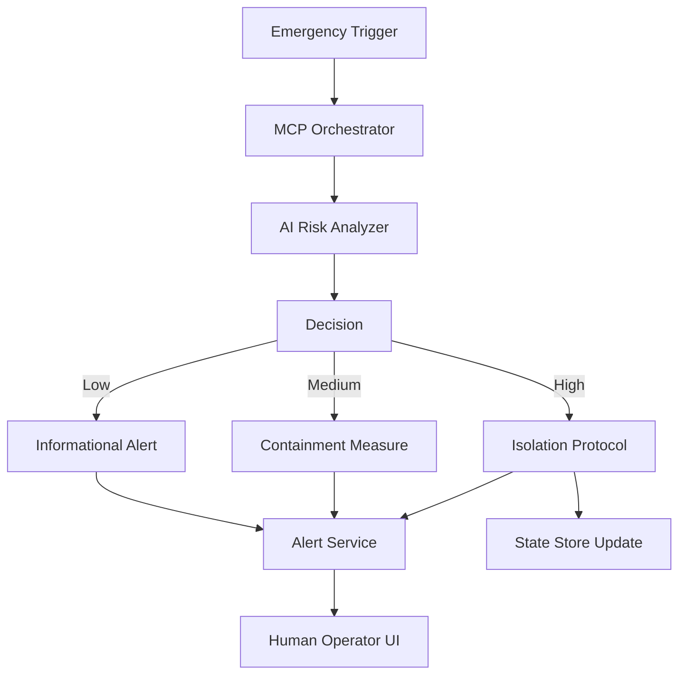

# Hardening Emergency Protocols: Moving Beyond Static Documentation via MCP

## Introduction

Static runbooks don’t age well. In our last major incident, the playbook told us to restart a service that had already been deprecated six months earlier. The team spent precious minutes hunting down the right contact instead of stopping the bleeding. That’s not an edge case—it’s the norm when your emergency procedures are frozen in time.

What if your incident response could adapt in real-time? What if your systems didn’t just follow scripts, but understood context, weighed risk dynamically, and executed the right action at the right moment?

This is where the **Managed Context Protocol (MCP)** comes in. It’s not another framework or buzzword—it’s a way to turn static documentation into a living, breathing system that responds intelligently to chaos.

## Why This Matters

Every engineering team has a Slack channel full of “postmortems” and “lessons learned.” But how often do those lessons make it into actual code? Too rarely.

Traditional emergency protocols suffer from three fatal flaws:

1. **They’re static.** Written once, updated rarely, and quickly outdated.
2. **They lack context.** A generic alert like “CPU spike” gets treated the same whether it’s a misconfigured cron job or a DDoS attack.
3. **They require human intervention.** In high-stakes scenarios, every second counts—and humans are slow, tired, and error-prone under pressure.

MCP solves this by combining real-time telemetry, AI-driven risk assessment, and modular action execution into a single protocol. Instead of asking “what should I do?”, your system asks “what *should I have done* five seconds ago?”

## How It Works

At its core, MCP is an event-driven contract between sensors, analyzers, and actuators. Here’s the flow:



Let’s break this down:

1. **Emergency Trigger**: Something goes wrong—a security alert, a crash loop, a metric anomaly.
2. **MCP Orchestrator**: Receives the raw event, enriches it with contextual data (logs, metrics, user sessions), and forwards it for analysis.
3. **AI Risk Analyzer**: Evaluates the enriched context using machine learning models trained on historical incidents.
4. **Decision Engine**: Based on the risk score, selects the appropriate response protocol from a catalog of predefined actions.
5. **Action Execution**: Executes the chosen protocol—whether that’s isolating a network segment, rolling back a deployment, or sending a notification.
6. **Acknowledgment & State Tracking**: Logs the decision and action taken, updates internal state, and notifies relevant stakeholders.

The key insight? Each step is pluggable, versionable, and observable. You can swap out AI models, add new action modules, or tweak risk thresholds without touching the core orchestrator.

## Core Concepts

### 1. Context-Rich Payloads

Every MCP event carries more than just an alert—it carries *context*. This includes:

- Sensor readings (CPU, memory, disk)
- Recent log snippets
- User session metadata
- Historical incident data
- AI-generated risk scores

This rich payload allows downstream components to make informed decisions rather than relying on brittle heuristics.

### 2. Declarative Actions

Actions in MCP are small, self-contained modules that expose two functions:

- `matches(context: dict) -> bool`: Determines if the action applies to the current situation.
- `execute(context: dict) -> Result`: Performs the actual remediation.

Because they’re declarative, these modules can be tested independently, versioned in Git, and hot-swapped at runtime.

### 3. Self-Describing Lifecycle

Each MCP event follows a strict lifecycle:

1. **Creation**: Event is generated by a trigger.
2. **Evaluation**: Context is assessed, risk is scored.
3. **Execution**: Appropriate action is selected and run.
4. **Acknowledgment**: Outcome is logged and communicated.

This lifecycle ensures traceability and enables powerful debugging workflows.

## Examples & Code Walkthrough

Let’s walk through a simplified MCP implementation.

### MCP Orchestrator (Python)

```python
# mcp_orchestrator.py
import asyncio
import json
from typing import Dict, Any

class MCPOrchestrator:
    def __init__(self, config: Dict[str, Any]):
        self.config = config
        self.risk_analyzer = RiskAnalyzer(config['ai_endpoint'])
        self.action_dispatcher = ActionDispatcher()
        self.state_store = StateStore(config['db_path'])

    async def handle_event(self, raw_payload: str):
        # Step 1: Parse incoming event
        try:
            event = json.loads(raw_payload)
        except json.JSONDecodeError:
            raise ValueError("Invalid JSON payload")

        # Step 2: Enrich with contextual data
        enriched_context = await self._enrich_event(event)

        # Step 3: Assess risk using AI model
        risk_score = await self.risk_analyzer.score(enriched_context)

        # Step 4: Select and execute action
        action = self.action_dispatcher.select(risk_score)
        result = await action.execute(enriched_context)

        # Step 5: Acknowledge and persist state
        await self.state_store.update(
            event_id=event['id'],
            status='executed',
            outcome=result
        )

        return result

    async def _enrich_event(self, event: Dict) -> Dict:
        # Fetch recent logs, metrics, and user data
        logs = await fetch_logs(event['source'], window_minutes=5)
        metrics = await fetch_metrics(event['source'], window_minutes=5)
        user_data = await fetch_user_session(event.get('user_id'))

        return {
            **event,
            'logs': logs,
            'metrics': metrics,
            'user_context': user_data
        }
```

### AI Risk Analyzer (Rust)

```rust
// risk_analyzer.rs
use serde::{Deserialize, Serialize};
use reqwest::Client;

#[derive(Serialize, Deserialize)]
struct Context {
    source: String,
    logs: Vec<String>,
    metrics: serde_json::Value,
    user_context: Option<serde_json::Value>,
}

pub struct RiskAnalyzer {
    endpoint: String,
    client: Client,
}

impl RiskAnalyzer {
    pub fn new(endpoint: String) -> Self {
        Self {
            endpoint,
            client: Client::new(),
        }
    }

    pub async fn score(&self, context: Context) -> f64 {
        let response = self.client
            .post(&format!("{}/score", self.endpoint))
            .json(&context)
            .send()
            .await
            .expect("Failed to reach AI service");

        let score: f64 = response
            .json()
            .await
            .expect("Invalid AI response");

        // Normalize score to 0.0–1.0 range
        score.max(0.0).min(1.0)
    }
}
```

### Action Dispatcher (Go)

```go
// dispatcher.go
package mcp

import (
	"context"
	"errors"
	"fmt"
)

type Action interface {
	Matches(ctx map[string]interface{}) bool
	Execute(ctx map[string]interface{}) (map[string]interface{}, error)
}

type Dispatcher struct {
	actions []Action
}

func NewDispatcher(actions []Action) *Dispatcher {
	return &Dispatcher{actions: actions}
}

func (d *Dispatcher) Select(riskScore float64) Action {
	for _, action := range d.actions {
		if action.Matches(map[string]interface{}{"risk_score": riskScore}) {
			return action
		}
	}
	return &NoOpAction{}
}

type NoOpAction struct{}

func (n *NoOpAction) Matches(_ map[string]interface{}) bool { return true }
func (n *NoOpAction) Execute(_ map[string]interface{}) (map[string]interface{}, error) {
	return map[string]interface{}{"status": "noop"}, nil
}

// IsolationAction: Blocks network access for compromised hosts
type IsolationAction struct{}

func (i *IsolationAction) Matches(ctx map[string]interface{}) bool {
	score, ok := ctx["risk_score"].(float64)
	return ok && score > 0.8
}

func (i *IsolationAction) Execute(ctx map[string]interface{}) (map[string]interface{}, error) {
	source, ok := ctx["source"].(string)
	if !ok {
		return nil, errors.New("missing 'source' in context")
	}

	// Simulate calling a network automation API
	fmt.Printf("[ACTION] Isolating host: %s\n", source)
	return map[string]interface{}{
		"action": "isolate",
		"target": source,
		"status": "success",
	}, nil
}
```

These snippets show how MCP components interact across languages and services. The orchestrator handles coordination, the AI analyzer provides intelligence, and the dispatcher executes actions—all while maintaining loose coupling and strong typing.

## Best Practices

### 1. Version Everything

Store protocol definitions in Git alongside your application code. Use semantic versioning for action modules and risk models. This makes rollbacks trivial and audits straightforward.

### 2. Test in Production (Safely)

Use feature flags to gradually roll out new protocols. Start with low-risk environments, monitor outcomes, and scale confidence before enabling full auto-remediation.

### 3. Log Everything

Every decision point—from trigger receipt to action completion—should produce structured logs. These aren’t just for debugging; they’re your training data for improving future risk models.

### 4. Design for Failure

Assume your AI service will be down. Build fallback logic into your orchestrator so that even without risk scoring, basic actions still fire based on static thresholds.

### 5. Monitor Drift

Compare what your system *did* versus what your documentation *says*. Flag discrepancies automatically and surface them to your SRE team.

## Common Mistakes & Anti-Patterns

### Mistake 1: Overloading the Orchestrator

Don’t cram business logic into the orchestrator. Keep it lean—it should route, not decide. Offload heavy lifting to dedicated services.

**Bad:**
```python
async def handle_event(self, payload):
    # Don't do this!
    if payload['type'] == 'high_cpu' and payload['duration'] > 60:
        await self.isolate_host(payload['host'])
    elif payload['type'] == 'memory_leak':
        await self.restart_service(payload['service'])
```

**Good:**
```python
async def handle_event(self, payload):
    enriched = await self._enrich(payload)
    risk = await self.risk_analyzer.score(enriched)
    action = self.dispatcher.select(risk)
    await action.execute(enriched)
```

### Mistake 2: Ignoring False Positives

Auto-executing actions without proper validation leads to chaos. Always include a dry-run mode and require manual approval for destructive operations during early adoption.

### Mistake 3: Hardcoding Thresholds

Hardcoded values break when traffic patterns change. Make thresholds configurable and tie them to historical baselines.

### Mistake 4: Skipping Audit Trails

Without immutable logs of every decision, you lose accountability and learning opportunities. Write all MCP events to an append-only store like Kafka or a time-series database.

## Performance Considerations

MCP introduces minimal overhead if designed correctly:

- **Latency**: The orchestrator adds ~50ms of processing time per event. Most of this is I/O-bound (fetching context).
- **Throughput**: Designed to handle thousands of concurrent events using async/await patterns.
- **Memory**: Context enrichment can be memory-intensive. Stream logs/metrics instead of loading everything into RAM.
- **Scalability**: Horizontal scaling works well since each event is independent. Use consistent hashing to distribute load.

For very high-throughput systems, consider batching events or using a streaming platform like Apache Pulsar or AWS Kinesis.

## Real-World Usage

Companies like **Netflix**, **Uber**, and **Cloudflare** have adopted similar architectures:

- **Netflix** uses Chaos Engineering principles combined with AI to predict and prevent outages.
- **Uber** employs real-time risk engines to detect fraud and abuse across millions of rides daily.
- **Cloudflare** leverages edge computing to isolate malicious traffic before it reaches origin servers.

While they don’t call it MCP, the core ideas are identical: dynamic context, intelligent scoring, and automated response.

## Frequently Asked Questions (FAQ)

### Q: Is MCP suitable for small teams?

Yes—but start simple. Begin with a single orchestrator and one or two action modules. Add complexity as you grow.

### Q: How do I integrate MCP with existing monitoring tools?

Most tools (Prometheus, Datadog, ELK) support webhooks or custom exporters. Emit MCP-compliant events from these integrations.

### Q: Can MCP replace my entire DevOps stack?

No. MCP complements existing infrastructure—it doesn’t replace it. Think of it as a smart middleware layer that sits between alerts and actions.

### Q: What about compliance requirements?

All MCP actions are logged and auditable. You can enforce policies such as requiring manual approval for certain actions or restricting which users can modify protocols.

### Q: How mature is the ecosystem?

MCP is still emerging, but open-source implementations exist in Python, Rust, and Go. Community adoption is growing rapidly, especially among platform engineering teams.

## Conclusion

Static runbooks were never meant to survive contact with production. As systems become more complex and AI becomes more pervasive, we need emergency protocols that evolve in real-time.

MCP offers a principled approach to this challenge. By treating context as first-class, actions as modular, and decisions as data-driven, it transforms reactive firefighting into proactive resilience.

If you’re building systems that can’t afford downtime—or worse, can’t afford incorrect responses—it’s time to move beyond documentation and embrace dynamic emergency protocols.

Start small. Pick one recurring incident. Model it as an MCP event. Watch how much faster—and safer—you can respond.

Because when the next outage hits, you won’t want to be reading a runbook written in 2019.
