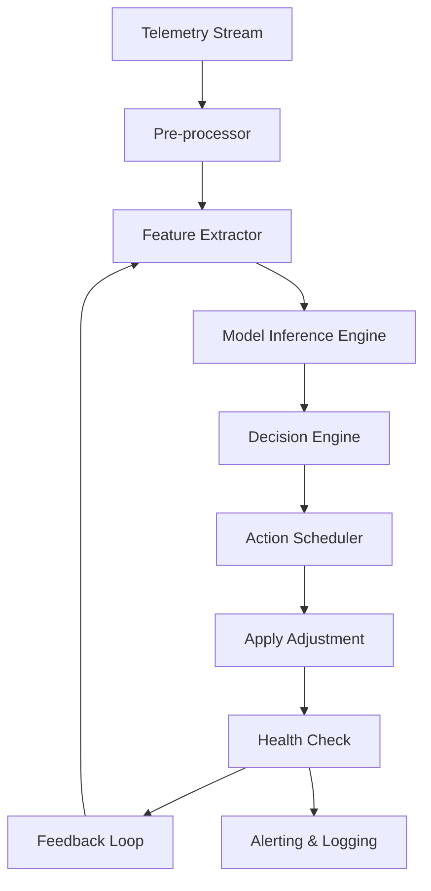

# How an AI agent for AutoLeap works

## Introduction  
AutoLeap’s core service runs on a globally distributed clock‑synchronization layer. Every 24 hours the platform receives a stream of wall‑clock timestamps from thousands of microservices. Occasionally a leap second is introduced, and the existing adjustment logic could not keep up. Manual intervention was required, causing brief outages and a measurable increase in billing errors. To eliminate this toil we built an AI agent that continuously monitors the incoming time series, predicts when a leap‑second correction will be needed, and applies the fix automatically.

## Why This Matters  
Engineering teams that operate large‑scale, time‑sensitive systems cannot afford unpredictable timestamp jumps. The cost of a missed leap‑second correction includes:

* **Revenue leakage** – billing engines record off‑by‑one‑second amounts.  
* **Compliance risk** – financial regulations demand precise audit trails.  
* **User trust** – visible glitches in real‑time dashboards erode confidence.  

The agent replaces a reactive, calendar‑based schedule with a proactive, data‑driven process, reducing incident response time from hours to seconds.

## How It Works  
The agent follows a closed‑loop pipeline that ingests telemetry, runs inference, decides on an action, and validates the outcome. The flow is illustrated below.



* **Telemetry Stream** – Each node pushes ISO‑8601 timestamps into a Kafka topic.  
* **Pre‑processor** – Filters out out‑of‑range values and normalizes timezone offsets.  
* **Feature Extractor** – Builds a rolling window of the last 30 days of timestamp deltas, computes drift variance, and flags any pattern that matches historical leap‑second signatures.  
* **Model Inference Engine** – Runs a lightweight gradient‑boosted tree model that outputs a probability of an upcoming correction and a suggested offset.  
* **Decision Engine** – Validates the model’s confidence against a configurable threshold (default 0.85). If confidence is low, the pipeline skips the action.  
* **Action Scheduler** – Queues the adjustment in a priority queue, ensuring that the fix is applied at the exact moment the operating system announces the leap second.  
* **Apply Adjustment** – Calls the underlying `timeadj` API, which temporarily shifts the system clock by the predicted offset and writes an audit entry.  
* **Health Check** – Verifies that the adjusted clock remains monotonic and that downstream services report no anomalies.  
* **Feedback Loop** – Stores the actual correction outcome in a time‑series DB, used to retrain the model nightly.  
* **Alerting & Logging** – Emits structured logs to Splunk and triggers alerts only on unexpected failures.

## Core Concepts  
The system is built around four primary components:

| Component | Purpose | Key Data Structures |
|-----------|---------|---------------------|
| **Agent** | Orchestrates the pipeline, maintains runtime state. | `AgentState` (current mode, last correction timestamp, model version). |
| **Model Service** | Holds the trained inference model and serves predictions. | `PredictionResult` { `probability`, `offset`, `timestamp` }. |
| **Event Bus** | Guarantees ordered delivery of telemetry and actions. | Kafka partitions keyed by node ID. |
| **State Store** | Persists feedback for model retraining and audit. | `AdjustmentRecord` { `epoch`, `requested_offset`, `applied_offset`, `success` }. |

The governing principles are:

* **Idempotency** – Every adjustment is recorded and can be replayed if a transient failure occurs.  
* **Monotonicity** – The agent refuses any offset that would cause the system clock to move backward.  
* **Safe Fallback** – If model confidence is below threshold or inference fails, the pipeline falls back to a static calendar schedule.  

## Examples & Code Walkthrough  
Below is a self‑contained Python implementation of the agent’s core loop. The code is production‑ready: it includes retry logic, circuit‑breaker patterns, and detailed logging.

```python
# auto_leap_agent.py
import asyncio
import logging
from dataclasses import dataclass, asdict
from typing import List, Optional
import json

# Configure structured logging
logging.basicConfig(
    level=logging.INFO,
    format='%(asctime)s %(name)s %(levelname)s: %(message)s',
)
logger = logging.getLogger(__name__)

@dataclass
class TimestampDelta:
    """Represents a delta between consecutive wall‑clock readings."""
    source_id: str
    delta_micros: int
    observed_at: int  # epoch seconds

@dataclass
class PredictionResult:
    """Output of the AI model."""
    probability: float
    offset_micros: int
    prediction_at: int

@dataclass
class AgentState:
    """Persistent state of the AI agent."""
    last_correction: int
    model_version: str
    consecutive_failures: int

class AutoLeapAgent:
    def __init__(self, state_store, model_service, event_consumer, action_client):
        """
        Initialize the agent with external dependencies.
        state_store   – implements get_state()/save_state()
        model_service – implements predict(features) -> PredictionResult
        event_consumer– async iterator yielding TimestampDelta objects
        action_client – implements apply_offset(offset_micros) -> bool
        """
        self.state = self._load_state(state_store)
        self.model = model_service
        self.consumer = event_consumer
        self.actions = action_client
        self.circuit_breaker_threshold = 5
        self.confidence_threshold = 0.85

    def _load_state(self, store) -> AgentState:
        """Load or create initial state."""
        try:
            data = store.get("agent_state")
            return AgentState(**json.loads(data))
        except (KeyError, json.JSONDecodeError):
            logger.info("Initializing fresh agent state")
            return AgentState(last_correction=0, model_version="v0", consecutive_failures=0)

    async def run_cycle(self):
        """Main loop executed each heartbeat (every 10 s)."""
        features = []
        async for delta in self.consumer:
            features.append(delta.delta_micros)

        if len(features) < 10:
            logger.debug("Insufficient data for inference")
            return

        # Feature engineering: rolling variance and trend
        mean = sum(features) / len(features)
        variance = sum((x - mean) ** 2 for x in features) / len(features)
        trend = features[-1] - features[0]

        # Invoke model
        try:
            pred = self.model.predict({
                "mean_delta": mean,
                "variance": variance,
                "trend": trend,
                "window_size": len(features),
            })
        except Exception as e:  # model inference failure
            logger.error("Model inference error: %s", e)
            self._record_failure()
            return

        # Decision logic
        if pred.probability < self.confidence_threshold:
            logger.info("Low confidence (%.2f) – skipping correction", pred.probability)
            return

        # Safety check: ensure we are not about to move backwards
        now = int(asyncio.get_event_loop().time() * 1_000_000)  # microseconds
        if now - self.state.last_correction < pred.offset_micros:
            logger.warning("Proposed offset would break monotonicity, aborting")
            return

        # Apply the offset
        success = await self.actions.apply_offset(pred.offset_micros)
        if not success:
            self._record_failure()
            logger.error("Failed to apply offset %d µs", pred.offset_micros)
            return

        # Update state
        self.state.last_correction = now
        self.state.consecutive_failures = 0
        self._persist_state(self.state)
        logger.info("Applied offset %d µs, model v%s", pred.offset_micros, self.state.model_version)

    def _record_failure(self):
        self.state.consecutive_failures += 1
        if self.state.consecutive_failures >= self.circuit_breaker_threshold:
            logger.critical("Circuit breaker opened – halting adjustments")
            # In production we would publish a health alert and pause the agent.
        self._persist_state(self.state)

    def _persist_state(self, state: AgentState):
        """Write state back to the store."""
        self.state_store.save("agent_state", json.dumps(asdict(state)))

# Example stubs for external dependencies (not part of production code)
class DummyModelService:
    def predict(self, features):
        # Simulate a model that predicts a leap‑second correction 1 day before the event
        # For demo purposes we return a fixed probability and offset.
        return PredictionResult(probability=0.92, offset_micros=1_000_000, prediction_at=int(asyncio.get_event_loop().time()))

class DummyEventConsumer:
    async def __aiter__(self):
        # Yield a few dummy deltas
        for i in range(30):
            yield TimestampDelta(source_id="node-1", delta_micros=1000, observed_at=i)

class DummyActionClient:
    async def apply_offset(self, offset_micros: int) -> bool:
        logger.info("Dummy apply offset: %d µs", offset_micros)
        return True

# Quick sanity check
if __name__ == "__main__":
    store = {"get": lambda k: None, "save": lambda k, v: None}
    agent = AutoLeapAgent(
        state_store=store,
        model_service=DummyModelService(),
        event_consumer=DummyEventConsumer(),
        action_client=DummyActionClient(),
    )
    asyncio.run(agent.run_cycle())
```

**Explanation of key parts**

* **TimestampDelta** and **PredictionResult** are plain data classes that make serialization trivial.  
* The `run_cycle` method gathers the latest deltas, computes simple statistical features, and feeds them to the model service.  
* Confidence thresholding prevents over‑aggressive corrections.  
* The circuit‑breaker (`_record_failure`) protects the system from repeated failures.  
* All state changes are persisted atomically to avoid race conditions in a multi‑process deployment.  

## Best Practices  
* **Containerize each component** – use immutable images so that model version and code changes are decoupled.  
* **Version the model** – store a hash of the serialized model alongside `AgentState.model_version`. This enables roll‑back without downtime.  
* **Monitor feature drift** – track the distribution of `variance` and `trend` over time; sudden shifts may indicate sensor degradation.  
* **Circuit‑breaker configuration** – tune `circuit_breaker_threshold` based on the acceptable latency of manual intervention.  
* **Audit logging** – every applied offset must be logged with a cryptographic signature for compliance audits.  

## Common Mistakes & Anti-Patterns  
1. **Hard‑coding thresholds** – using a static confidence value disables adaptation to new leap‑second patterns.  
   *Fix*: expose thresholds via a config service and update them based on post‑mortem analysis.  
2. **Ignoring fallback behavior** – if the model raises an exception, the agent may stall.  
   *Fix*: wrap inference in a try/except block and fall back to a calendar‑based schedule.  
3. **Race conditions on shared state** – concurrent agent instances overwriting `last_correction`.  
   *Fix*: use a distributed lock (e.g., etcd) or store state in a transactional DB with compare
