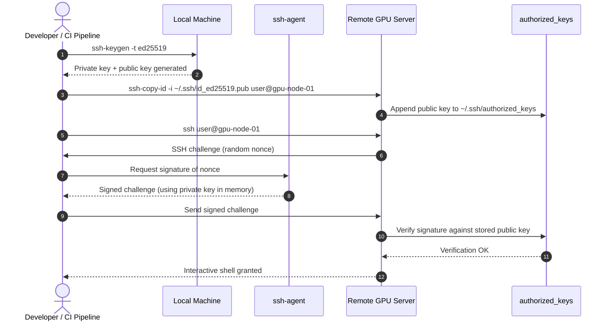

# How to Connect to Remote Servers Without Typing a Password

## Introduction

We run large-model training jobs on GPU clusters where nodes come and go automatically. Every time a new node joins the fleet, someone needs to SSH in to pull logs, restart a training process, or copy a checkpoint. If that SSH session requires typing a password, automation stops. CI pipelines can't deploy model weights at 3 a.m., and engineers waste minutes on repetitive authentication instead of debugging gradients or tuning hyperparameters.

Passwordless SSH using public-key authentication removes the interactive prompt entirely. It is not magic—it is standard OpenSSH behavior—but configuring it correctly for AI infrastructure involves trade-offs around key storage, agent forwarding, and host verification that often get overlooked until production breaks.

## Why This Matters

AI engineering is inherently distributed. Whether you are running PyTorch DDP across eight A100s, serving inference endpoints on spot instances, or managing a bastion host that gates access to a private training VPC, passwordless SSH is the substrate that makes orchestration possible.

The production pain usually shows up in three places:

1. **CI/CD pipelines cannot type passwords.** GitHub Actions, GitLab CI, or Jenkins needs to push a new model artifact to an inference node. Without key-based auth, teams resort to `sshpass` or `expect` scripts, which leak credentials in logs and break when password policies rotate.
2. **Distributed training frameworks assume passwordless access.** Tools like Ray, PyTorch Lightning, and MPI-based launchers SSH into worker nodes to start processes. If any node requires a password, the entire job fails to launch.
3. **Human toil is expensive.** A senior ML engineer typing passwords into twenty GPU boxes is not a good use of time, and it increases the risk of accidental keystrokes in production terminals.

Security is the other side of the coin. Password-based SSH is vulnerable to brute-force and credential-stuffing attacks. Public-key authentication eliminates password spraying entirely, provided you protect the private keys properly.

## How It Works

Passwordless SSH relies on asymmetric cryptography. The client generates a key pair: a private key that never leaves the local machine, and a public key that gets installed on the remote server. When the client connects, the server issues a cryptographic challenge. The client signs that challenge with its private key, and the server verifies the signature using the stored public key. If the signature is valid, the shell is granted—no password required.

Here is the sequence:



The critical detail is where the private key lives. If the key is encrypted with a passphrase, `ssh-agent` holds the decrypted key in memory so you do not have to type the passphrase on every connection. If the key has no passphrase, anyone who steals the file can impersonate you. We will cover how to manage that trade-off in the best practices section.

## Core Concepts

### Key pair

A modern SSH key pair typically uses the Ed25519 algorithm. It is smaller, faster, and more resistant to side-channel attacks than RSA. The private key (`id_ed25519`) must be protected with filesystem permissions (`600`) and, ideally, a passphrase. The public key (`id_ed25519.pub`) can be shared freely.

### authorized_keys

On the remote server, the `~/.ssh/authorized_keys` file contains one public key per line. When a client authenticates, OpenSSH checks this file for a matching public key. You can restrict what a key is allowed to do by prepending options to the key line, such as forcing a specific command or disabling port forwarding.

### ssh-agent

`ssh-agent` is a background daemon that caches decrypted private keys in memory. You add a key with `ssh-add`, and subsequent SSH connections use the cached key without prompting for a passphrase. Agent forwarding (`ForwardAgent yes`) lets a remote server use your local agent, but it introduces a security risk: anyone with root access to the remote host can potentially use your agent to authenticate elsewhere.

### ssh_config

The `~/.ssh/config` file lets you define host aliases, default users, identity files, and connection multiplexing. For AI clusters with dozens of nodes, this file prevents you from typing long hostnames and key paths repeatedly.

### known_hosts

The first time you connect to a new host, SSH stores its public key in `~/.ssh/known_hosts`. On subsequent connections, SSH verifies that the host key has not changed, protecting against man-in-the-middle attacks. Disabling this check (`StrictHostKeyChecking no`) is a common anti-pattern in automation.

### OpenSSH certificates

At scale, managing `authorized_keys` across hundreds of GPU nodes becomes unmanageable. OpenSSH supports certificate-based authentication, where a central CA signs short-lived user certificates. This is how large engineering organizations handle fleet-wide access without distributing thousands of public keys.

## Examples & Code Walkthrough

Below are two scripts we use in our ML infrastructure. The first provisions a passwordless SSH connection to a new GPU training node. The second executes a remote training command and streams output locally.

### Provisioning script

```bash
#!/usr/bin/env bash
#
# provision_ai_node.sh
# Sets up passwordless SSH access to a remote AI training node.
# Usage: ./provision_ai_node.sh <user> <hostname> [key_name]
#
set -euo pipefail

USER="${1:?Missing remote user}"
HOST="${2:?Missing remote hostname}"
KEY_NAME="${3:-ai_training}"
KEY_PATH="${HOME}/.ssh/${KEY_NAME}"

# Ensure the local .ssh directory exists with correct permissions.
mkdir -p "${HOME}/.ssh"
chmod 700 "${HOME}/.ssh"

# Generate an Ed25519 key if one does not already exist.
if [[ ! -f "${KEY_PATH}" ]]; then
    echo "[provision] Generating Ed25519 key at ${KEY_PATH}"
    ssh-keygen -t ed25519 -f "${KEY_PATH}" -N "" -C "${USER}@${HOST}"
else
    echo "[provision] Reusing existing key at ${KEY_PATH}"
fi

# Private keys must be unreadable by anyone except the owner.
chmod 600 "${KEY_PATH}"
chmod 644 "${KEY_PATH}.pub"

# Copy the public key to the remote server's authorized_keys.
# ssh-copy-id handles appending and permission fixing on the remote side.
echo "[provision] Installing public key on ${USER}@${HOST}"
ssh-copy-id -i "${KEY_PATH}.pub" "${USER}@${HOST}"

# Verify passwordless access works before exiting.
echo "[provision] Verifying passwordless SSH connection"
if ssh -i "${KEY_PATH}" -o BatchMode=yes -o ConnectTimeout=10 \
    "${USER}@${HOST}" "echo 'SSH provisioning succeeded'"; then
    echo "[provision] Passwordless SSH is ready."
else
    echo "[provision] ERROR: Passwordless SSH verification failed." >&2
    exit 1
fi
```

Defensive notes: `set -euo pipefail` ensures the script stops on any error or unset variable. `BatchMode=yes` forces SSH to fail immediately if a password is required, which prevents the script from hanging waiting for interactive input. `ConnectTimeout=10` avoids blocking indefinitely on unreachable nodes.

### Remote execution wrapper

```python
#!/usr/bin/env python3
"""
remote_gpu_exec.py
Execute a command on a remote GPU node via passwordless SSH and stream output.
Designed for MLOps workflows that launch distributed training jobs.
"""

from __future__ import annotations

import subprocess
import sys
from typing import List, Optional


def run_remote_command(
    host: str,
    user: str,
    key_path: str,
    command: List[str],
    timeout: Optional[int] = 3600,
) -> int:
    """
    Run a command on a remote host using passwordless SSH.

    Args:
        host: Remote hostname or IP address.
        user: SSH username.
        key_path: Path to the Ed25519 private key.
        command: Command and arguments to execute remotely.
        timeout: Maximum seconds to wait before aborting.

    Returns:
        The remote process exit code.

    Raises:
        subprocess.TimeoutExpired: If the command exceeds the timeout.
        File
