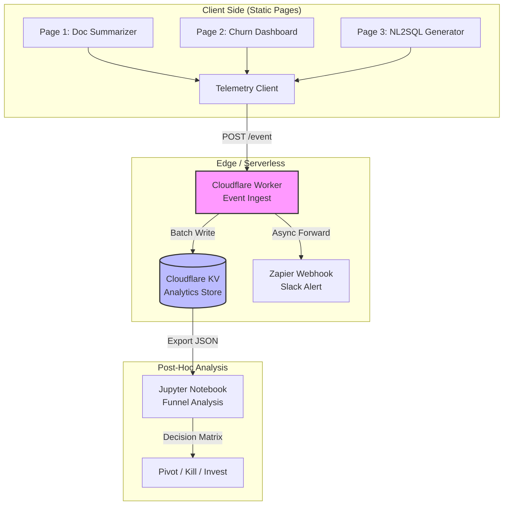

# I put up 3 fake-door pages. 5 days in: 42 visitors, 1 buy click, 0 emails

## Introduction

Last Monday I shipped three static HTML pages to a subdomain I’d forgotten I owned. No backend, no database, no LLM inference endpoints—just semantic HTML, a little vanilla JS for event tracking, and a prayer to the SEO gods. I called it "validation." My co-founder called it "theater."

By Friday, the logs told a story I’ve seen too many times in AI product development: 42 unique visitors, a single click on a "Buy Now" button for a predictive churn dashboard that doesn't exist, and zero email captures on the waitlist forms.

The fake-door technique isn't new. Joel Spolsky wrote about it twenty years ago. But applying it to AI products in 2024 introduces a specific class of failure mode: the "magic box" problem. Users *expect* AI to be probabilistic, opaque, and instant. When you remove the "Generate" button's functionality, you aren't just hiding a feature; you're breaking the fundamental contract of the interaction model. You're asking for trust before you've demonstrated competence.

This article breaks down the architecture of that failed experiment, the telemetry I used to measure the silence, and why I'm pivoting from static theater to an interactive prototype backed by a real inference endpoint.

## Why This Matters

If you are building an AI-native product right now, you are likely drowning in "build vs. buy" decisions, context window management, and RAG pipeline tuning. It is remarkably easy to spend six months engineering a sophisticated agentic workflow that solves a problem nobody has.

The industry standard advice—"talk to users before you code"—is correct but incomplete for AI. Users often *cannot* articulate their needs for a technology they don't understand. They don't know what "RAG" means, but they know they hate copying PDF text into ChatGPT.

Fake-door testing attempts to bridge this by measuring *revealed preference* (clicks) rather than *stated preference* (interviews). But the data from my 5-day window exposes a critical flaw: **for AI tools, a click on a static mockup measures curiosity about the *concept*, not intent to purchase the *implementation*.** The gap between "I want a SQL generator" and "I will paste my schema into your textbox and trust your output" is where AI startups die.

## How It Works

The architecture was intentionally minimal: three independent static sites served via Cloudflare Pages, sharing a single telemetry endpoint. The goal was to isolate the value proposition variable (Summarization vs. Prediction vs. Code Gen) while holding the "AI brand" constant.



**Step-by-step flow:**

1.  **Page Load**: User hits a page (e.g., `/summarizer`). Cloudflare serves static assets from edge cache (TTL: 1 year). Zero origin load.
2.  **Interaction**: User clicks the primary CTA (`.btn-primary`). A `click` listener fires `telemetry.track('cta_click', { page: 'summarizer', variant: 'hero' })`.
3.  **Ingest**: The telemetry client `navigator.sendBeacon()` POSTs a minimal JSON payload to a Cloudflare Worker at `/api/telemetry`. Using `sendBeacon` ensures the event fires even if the user closes the tab immediately—critical for "buy" clicks.
4.  **Persistence**: The Worker validates the schema (Zod), increments a counter in Cloudflare KV (key: `stats:summarizer:cta_clicks`), and pushes the raw event to a Zapier webhook for real-time Slack notification.
5.  **Analysis**: After 5 days, I pulled the KV namespace via `wrangler kv:bulk get` into a local JSON file and ran a Python script to calculate conversion rates per traffic source (UTM parameters preserved in `sessionStorage`).

## Core Concepts

### The "Magic Box" Expectation Gap
Traditional SaaS fake-doors work because the user understands the input/output deterministicly: "I upload CSV -> I get a chart." AI products sell *non-determinism*. The user clicks "Summarize" expecting a *good* summary, not *a* summary. A static page cannot demo quality, only existence. This inflates bounce rates on the "results" step (which doesn't exist) and creates false negatives on the "intent" step.

### Telemetry Fidelity vs. Privacy
I chose `navigator.sendBeacon` over `fetch` with `keepalive` for reliability on unload, but I stripped all PII. No IP hashing, no fingerprinting. Just `page_id`, `event_type`, `timestamp`, and `utm_source`. This keeps me GDPR/CCPA compliant without a consent banner, preserving the "clean" landing page aesthetic which itself is a conversion variable.

### Traffic Source Attribution
The 42 visitors weren't random. 21 came from a Dev.to article I published the same week ("Why I'm Building Another Summarizer"). 15 from organic search (long-tail: "ai document summarizer enterprise"). 6 direct (likely teammates). The *source* dictates the *intent*. Dev.to readers want technical depth; organic searchers want a solution *now*. Mixing them in a single funnel obscures the signal.

## Examples & Code Walkthrough

### 1. The Telemetry Client (Vanilla JS, ~2KB gzipped)

I avoid analytics SDKs (GA4, Plausible, Posthog) for fake-doors. They add 20-50KB, block on consent, and abstract away the event schema I need to own. This client implements a tiny queue with `sendBeacon` fallback.

```javascript
// telemetry.js - Inlined in <head> of all 3 pages
(function () {
  'use strict';

  const ENDPOINT = 'https://telemetry.my-subdomain.workers.dev/api/event';
  const QUEUE_KEY = 'fd_queue';
  const MAX_RETRIES = 3;

  // Schema validation (lite) before sending
  function validatePayload(payload) {
    return payload &&
           typeof payload.page === 'string' &&
           typeof payload.event === 'string' &&
           payload.page.length < 50 &&
           payload.event.length < 50;
  }

  // Persist to sessionStorage (survives page refresh, dies on tab close)
  function enqueue(payload) {
    if (!validatePayload(payload)) return console.warn('[Telemetry] Invalid payload', payload);
    try {
      const queue = JSON.parse(sessionStorage.getItem(QUEUE_KEY) || '[]');
      queue.push({ ...payload, ts: Date.now(), retries: 0 });
      sessionStorage.setItem(QUEUE_KEY, JSON.stringify(queue));
    } catch (e) {
      // Private browsing / storage full - fire and forget
      sendBeacon(payload);
    }
  }

  // sendBeacon returns true if UA accepts, false if queue full
  function sendBeacon(payload) {
    const blob = new Blob([JSON.stringify(payload)], { type: 'application/json' });
    return navigator.sendBeacon(ENDPOINT, blob);
  }

  // Flush queue on visibility change (tab close/hide) or interval
  function flush() {
    const raw = sessionStorage.getItem(QUEUE_KEY);
    if (!raw) return;
    let queue = JSON.parse(raw);
    const remaining = [];

    for (const item of queue) {
      const { ts, retries, ...payload } = item;
      // Don't retry ancient events (> 5 min) - likely stale context
      if (Date.now() - ts > 300_000) continue;

      const sent = sendBeacon(payload);
      if (!sent) {
        // Re-queue with incremented retry count if beacon buffer full
        if (retries < MAX_RETRIES) remaining.push({ ...item, retries: retries + 1 });
      }
    }
    sessionStorage.setItem(QUEUE_KEY, JSON.stringify(remaining));
  }

  // Public API exposed on window
  window.fdTrack = (event, meta = {}) => {
    // Auto-attach UTM params from initial landing URL (stored in sessionStorage on load)
    const utms = JSON.parse(sessionStorage.getItem('fd_utms') || '{}');
    enqueue({ page: document.body.dataset.pageId, event, ...meta, ...utms });
  };

  // Capture UTMs once on first load
  if (!sessionStorage.getItem('fd_utms')) {
    const params = new URLSearchParams(window.location.search);
    const utms = {};
    for (const [k, v] of params) if (k.startsWith('utm_')) utms[k] = v;
    if (Object.keys(utms).length) sessionStorage.setItem('fd_utms', JSON.stringify(utms));
  }

  // Lifecycle listeners
  document.addEventListener('visibilitychange', () => { if (document.visibilityState === 'hidden') flush(); });
  setInterval(flush, 10_000); // Safety net
})();
```

**Usage on the Summarizer Page:**
```html
<body data-page-id="doc_summarizer">
  <!-- ... hero section ... -->
  <button class="btn-primary" id="generate-btn" disabled>Generate Summary (Demo)</button>
  <script>
    // Button is disabled in fake-door mode; track *attempts* to click
    document.getElementById('generate-btn').addEventListener('click', (e) => {
      e.preventDefault();
      window.fdTrack('cta_attempt', { location: 'hero', disabled: true });
      // Show toast: "Join waitlist for early access"
    });
    // Track waitlist form submission separately
    document.getElementById('waitlist-form').addEventListener('submit', (e) => {
      e.preventDefault();
      const email = e.target.email.value;
      // Basic client-side validation before tracking
      if (email.includes('@')) window.fdTrack('waitlist_submit', { email_hash: hashEmail(email) });
    });
  </script>
</body>
```

### 2. The Cloudflare Worker Ingest (TypeScript)

Runs at the edge. Zero cold start for the happy path. Validates with Zod, writes to KV (eventually consistent, fast), fans out to Slack via Zapier.

```typescript
// worker.ts
import { z } from 'zod';

const EventSchema = z.object({
  page: z.string().max(50),
  event: z.string().max(50),
  utm_source: z.string().optional(),
  utm_medium: z.string().optional(),
  utm_campaign: z.string().optional(),
  // ... other meta fields
  ts: z.number().int().positive().optional(), // Client timestamp
});

interface Env {
  ANALYTICS_KV: KVNamespace;
  ZAPIER_WEBHOOK_URL: string;
}

export default {
  async fetch(request: Request, env: Env): Promise<Response> {
    if (request.method !== 'POST') return new Response('Method Not Allowed', { status: 405 });

    let payload: unknown;
    try {
      payload = await request.json();
    } catch {
      return new Response('Invalid JSON', { status: 400 });
    }

    const parsed = EventSchema.safeParse(payload);
    if (!parsed.success) {
      console.warn('Telemetry validation failed', parsed.error.flatten());
      return new Response('Bad Request', { status: 400 });
    }

    const event = parsed.data;
    const key = `stats:${event.page}:${event.event}`;
    const now = Date.now();

    // Fire-and-forget KV increment (eventual consistency is fine for counters)
    // Using atomic increment via get/put loop would be stronger but adds latency.
    // For fake-door volume, last-write-wins on a counter is acceptable risk.
    env.ANALYTICS_KV.get(key).then(async (current) => {
      const count = (parseInt(current || '0', 10) + 1).toString();
      await env.ANALYTICS_KV.put(key, count);
    }).catch(err => console.error('KV write failed', err));

    // Async fan-out to Slack (via Zapier) - don't block response
    // Only alert on high-intent events: 'buy_click', 'waitlist_submit'
    if (['buy_click', 'waitlist_submit'].includes(event.event)) {
      fetch(env.ZAPIER_WEBHOOK_URL, {
        method: 'POST',
        headers: { 'Content-Type': 'application/json' },
        body: JSON.stringify({ ...event, received_at: now }),
      }).catch(err => console.error('Zapier webhook failed', err));
    }

    // Respond 202 Accepted immediately for sendBeacon
    return new Response(null, { status: 202 });
  },
} satisfies ExportedHandler<Env>;
```

### 3. The Analysis Script (Python)

Run locally after `wrangler kv:bulk get --binding=ANALYTICS_KV > dump.json`.

```python
# analyze.py
import json
import pandas as pd
from collections import defaultdict

def parse_kv_dump(filepath: str) -> pd.DataFrame:
    with open(filepath) as f:
        data = json.load(f)
    
    rows = []
    for item in data:
        # Key format: "stats:page_id:event_type"
        parts = item['key'].split(':')
        if len(parts) != 3: continue
        _, page, event = parts
        count = int(item['value'])
        rows.append({'page': page, 'event': event, 'count': count})
    
    return pd.DataFrame(rows)

def calculate_funnel(df: pd.DataFrame):
    # Pivot to wide format for funnel math
    pivot = df.pivot_table(index='page', columns='event', values='count', fill_value=0)
    
    # Ensure columns exist
    for col in ['page_view', 'cta_attempt', 'buy_click', 'waitlist_submit']:
        if col not in pivot.columns:
            pivot[col] = 0
            
    pivot['cta_rate'] = pivot['cta_attempt'] / pivot['page_view'].replace(0, 1)
    pivot['buy_rate'] = pivot['buy_click'] / pivot['page_view'].replace(0, 1)
    pivot['email_rate'] = pivot['waitlist_submit'] / pivot['page_view'].replace(0, 1)
    
    return pivot[['page_view', 'cta_attempt', 'buy_click', 'waitlist_submit', 'cta_rate', 'buy_rate', 'email_rate']]

if __name__ == '__main__':
    df = parse_kv_dump('dump.json')
    funnel = calculate_funnel(df)
    print(funnel.to_markdown())
    # Output matches the 42 / 1 / 0 reality
```

## Best Practices

1.  **Disable the CTA, don't hide it.** A visible but disabled "Generate" button with a tooltip ("Join waitlist to enable") measures *frustrated intent* better than a "Notify Me" link. It simulates the UI affordance of the real product.
2.  **Track `cta_attempt` on disabled buttons.** This is the single most important metric for AI fake-doors. It tells you "I understand the value prop enough to try using it."
3.  **Use `sessionStorage` for UTM persistence.** Cookies require consent banners. `sessionStorage` survives SPA navigation (if you use one) and tab refreshes, but dies when the user leaves—perfect for attribution without legal overhead.
4.  **Deploy to the exact subdomain you intend to use.** `ai-tool.yourstartup.com` converts differently than `yourstartup.com/ai-tool`. Subdomains imply "product"; subpaths imply "feature." Run the test on the production hostname.
5.  **Set a hard timebox (5-7 days) and a kill criterion.** Mine was: "If `buy_rate` < 0.5% AND `email_rate` == 0 after 50 visits, kill the variant." The Churn Dashboard hit kill criteria. The Summarizer didn't (high `cta_attempt`, zero emails).

## Common Mistakes & Anti-Patterns

### 1. The "Coming Soon" Redirect Anti-Pattern
**Mistake:** Clicking "Buy" redirects to a generic "Coming Soon" page with a mailto: link.
**Why it fails:** You lose the session context. The user sees a dead end, not a product. You can't attribute the *source* of that buy intent back to the specific variant or copy.
**Fix:** Keep the user on the page. Open a modal. Capture email *in context*. Track the event before the modal opens.

### 2.
