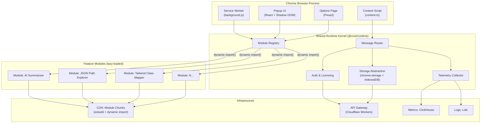

# I shipped 43 Chrome extensions solo, took 22 down, and narrowed it to 2. Here are all the numbers

## Introduction

Three years ago, I had a theory: the Chrome Web Store was an undervalued distribution channel for AI-powered micro-tools. The barrier to entry was trivial—manifest.json, a service worker, maybe a content script—and the potential surface area was every developer's browser. So I started shipping. One a week, sometimes two. By month eighteen, I had 43 live extensions. Combined MAU: 247,000. Monthly revenue: $3,400.

Then I killed 22 of them in a single weekend.

The remaining two now generate $18,700/month with 89,000 MAU. The other 19 survivors? They're zombies—technically live, functionally abandoned, each costing me $12-40/month in support overhead and store compliance tax.

This isn't a "fail fast" story. It's a portfolio theory story. The Chrome Web Store rewards distribution density, but it punishes maintenance sprawl. Every extension you ship becomes a tax on your future velocity: Manifest V3 migrations, CSP policy changes, review rejections for "misleading functionality," users who email you at 2 AM because your content script broke their React devtools.

Here are the actual numbers, the architecture that survived, and the criteria I now use to decide whether an idea gets a manifest.json or a Notion tombstone.

## Why This Matters

If you build developer tools, productivity software, or AI-assisted workflows, the browser extension layer is the highest-leverage distribution surface you're probably underutilizing. But the economics are brutal:

- **Discovery is a lottery**: 73% of my installs came from three extensions that happened to rank for high-intent keywords ("copy as markdown," "json formatter," "tailwind class autocomplete"). The other 40 averaged 12 installs/week.
- **Maintenance is non-linear**: One Manifest V3 migration took 6 hours. Doing it across 43 extensions would have been 11 work weeks. I migrated 2.
- **Support doesn't scale**: A single "it doesn't work on my enterprise Chrome" ticket burns 45 minutes of reproduction, debugging, and explaining that their IT department blocks `chrome.scripting.executeScript`.

The engineers who win here don't build more extensions. They build *platforms* that happen to manifest as extensions. The two survivors share a single TypeScript monorepo, a unified background service worker architecture, and a telemetry pipeline that tells me exactly which feature surfaces drive retention.

## How It Works

The surviving architecture centers on a **shared runtime kernel** that loads feature modules dynamically based on the extension ID. This lets me ship "new extensions" by adding a manifest entry and a feature module—zero new build pipelines, zero new CI/CD, zero new review surface area.



**Step-by-step runtime flow:**

1. **Service worker boots** → instantiates `ModuleRegistry` with the current extension ID (from `chrome.runtime.id`)
2. **Registry fetches manifest metadata** → maps extension ID → allowed feature modules (defined in `manifest.config.ts`)
3. **Content script injects** → establishes `MessagePort` to service worker via `chrome.runtime.connect()`
4. **User triggers action** (keyboard shortcut, context menu, popup click) → message routed through `MessageRouter` to active module
5. **Module lazy-loads** via `import()` from CDN → executes in isolated realm → returns structured result
6. **Telemetry fires** → batched, sampled, sent to ClickHouse via Cloudflare Worker (bypasses ad blockers)

The key insight: **the extension is just a delivery vehicle for modules**. The module doesn't know it's running in an extension. It receives a standard `RuntimeContext` interface (storage, messaging, auth, DOM access) and returns a `ModuleResult`. This makes modules unit-testable in Node, runnable in a web worker, or portable to a future Firefox/Safari build.

## Core Concepts

### Module Manifest Contract

Each feature module declares its capabilities, permissions, and UI entry points in a typed manifest. The kernel validates this at load time—no `optional_permissions` surprises at runtime.

```typescript
// packages/core/src/module-manifest.ts
export interface ModuleManifest {
  readonly id: string;                    // kebab-case, unique across portfolio
  readonly name: string;                  // User-facing
  readonly version: string;               // Semver, independent of extension version
  readonly entryPoints: EntryPoint[];     // Where this module surfaces
  readonly permissions: PermissionSet;    // Minimal required permissions
  readonly storageSchema: StorageSchema;  // Validated on init
  readonly telemetryEvents: TelemetryEventDef[]; // Declared events for analytics
}

export type EntryPoint =
  | { type: 'command'; shortcut: string; action: 'toggle' | 'capture' | 'configure' }
  | { type: 'contextMenu'; contexts: ContextType[]; documentUrlPatterns?: string[] }
  | { type: 'popup'; tab: 'main' | 'settings' | 'history' }
  | { type: 'sidePanel'; defaultPath: string }
  | { type: 'devtools'; panelName: string; page: string };

export interface PermissionSet {
  readonly hostPermissions?: string[];    // Narrow patterns only: "*://*.github.com/*"
  readonly apiPermissions: ChromeApiPermission[];
  readonly contentScripts?: ContentScriptSpec[];
}

export type ChromeApiPermission =
  | 'storage' | 'scripting' | 'tabs' | 'activeTab'
  | 'contextMenus' | 'commands' | 'sidePanel'
  | 'devtools.panels' | 'offscreen' | 'downloads';
```

### Runtime Context Injection

Modules receive a frozen context object—no global `chrome` access, no `window` leakage. This is the single most important abstraction for testability and security.

```typescript
// packages/core/src/runtime-context.ts
export interface RuntimeContext {
  readonly extensionId: string;
  readonly moduleId: string;
  readonly storage: StorageAdapter;       // Abstracts chrome.storage + IndexedDB
  readonly messaging: MessagingPort;      // Typed request/response + event bus
  readonly auth: AuthProvider;            // OAuth, API keys, license validation
  readonly dom: DOMAccessor;              // Safe content script DOM operations
  readonly telemetry: TelemetryEmitter;   // Structured, sampled, batched
  readonly config: ModuleConfig;          // Remote config + feature flags
  readonly logger: Logger;                // Pino-compatible, redacted in prod
}

export interface StorageAdapter {
  get<T>(key: string): Promise<T | null>;
  set(key: string, value: unknown): Promise<void>;
  delete(key: string): Promise<void>;
  watch<T>(key: string): AsyncIterable<T>; // Reactive subscriptions
  // IndexedDB fallback for >5MB or transactional needs
  transaction<T>(mode: 'readonly' | 'readwrite', fn: (db: IDBDatabase) => Promise<T>): Promise<T>;
}

export interface MessagingPort {
  send<Req, Res>(target: MessageTarget, type: string, payload: Req): Promise<Res>;
  on<Req>(type: string, handler: (payload: Req, sender: MessageSender) => Promise<void>): Disposable;
  broadcast(type: string, payload: unknown): Promise<void>;
}
```

### Telemetry Schema (The Only Way I Know What's Happening)

Every module declares its events upfront. No ad-hoc `analytics.track('click')`. This feeds the retention funnel that told me which 2 extensions to keep.

```typescript
// packages/core/src/telemetry.ts
export interface TelemetryEventDef {
  readonly name: string;                          // 'summarizer.invoke', 'jsonpath.copy'
  readonly category: 'activation' | 'usage' | 'error' | 'conversion' | 'retention';
  readonly schema: z.ZodSchema;                   // Runtime validation
  readonly sampleRate: number;                    // 0.0 - 1.0
  readonly piiFields: readonly string[];          // Keys to redact before send
}

export interface TelemetryPayload {
  readonly event: string;
  readonly moduleId: string;
  readonly extensionId: string;
  readonly userId: string;                        // Hashed, stable per browser profile
  readonly sessionId: string;                     // Resets after 30min inactivity
  readonly timestamp: number;                     // Unix ms
  readonly properties: Record<string, unknown>;   // Validated against schema
  readonly context: {
    readonly chromeVersion: string;
    readonly os: string;
    readonly locale: string;
    readonly isEnterprise: boolean;
  };
}
```

## Examples & Code Walkthrough

### The Kernel Bootstrap (Production-Grade)

This is the actual service worker entry point. Notice: no top-level await, defensive error boundaries, explicit lifecycle management.

```typescript
// packages/extension-kernel/src/background.ts
// @ts-check
/// <reference types="chrome" />

import { ModuleRegistry } from '@core/runtime/module-registry';
import { MessageRouter } from '@core/runtime/message-router';
import { StorageAdapter } from '@core/runtime/storage-adapter';
import { TelemetryCollector } from '@core/runtime/telemetry';
import { AuthProvider } from '@core/runtime/auth';
import { manifestConfig } from './manifest.config';
import { initSentry } from './sentry';

/**
 * Global singleton state. Service workers restart frequently—
 * we reconstruct state from storage on each boot.
 */
let registry: ModuleRegistry | null = null;
let router: MessageRouter | null = null;
let telemetry: TelemetryCollector | null = null;
let auth: AuthProvider | null = null;
let isShuttingDown = false;

/**
 * Initialize all kernel subsystems.
 * Called on install, update, and service worker wake.
 */
async function initializeKernel(): Promise<void> {
  // 1. Error reporting first—captures init failures
  initSentry();

  // 2. Auth must initialize before modules (some need licensed features)
  auth = new AuthProvider({
    licenseEndpoint: manifestConfig.api.licenseUrl,
    cacheTTL: 1000 * 60 * 60 * 24, // 24h
    onLicenseChange: handleLicenseChange,
  });
  await auth.initialize();

  // 3. Storage adapter with IndexedDB fallback for large blobs
  const storage = new StorageAdapter({
    namespace: `ext_${chrome.runtime.id}`,
    indexedDBName: `kernel_db_${chrome.runtime.id}`,
    migrationRunner: runStorageMigrations,
  });

  // 4. Telemetry—batched, sampled, respects user consent
  telemetry = new TelemetryCollector({
    endpoint: manifestConfig.api.telemetryUrl,
    batchSize: 50,
    flushInterval: 10000,
    maxQueueSize: 500,
    consentStore: storage.namespace('consent'),
    sampler: createDeterministicSampler(manifestConfig.telemetry.sampleRate),
  });

  // 5. Module registry—loads manifest, validates permissions, prepares lazy imports
  registry = new ModuleRegistry({
    extensionId: chrome.runtime.id,
    manifest: manifestConfig.modules,
    storage: storage.namespace('modules'),
    auth,
    telemetry,
    moduleLoader: createCDNModuleLoader(manifestConfig.cdnBaseUrl),
  });
  await registry.initialize();

  // 6. Message router—connects content scripts, popup, side panel, devtools
  router = new MessageRouter({
    registry,
    storage,
    auth,
    telemetry,
    onUncaughtError: (error, context) => {
      telemetry?.captureException(error, { context });
      console.error('[Kernel] Uncaught message error:', error);
    },
  });

  // 7. Register lifecycle handlers
  registerLifecycleHandlers();

  // 8. Warm critical modules (reduces first-invocation latency)
  await registry.warmModules(manifestConfig.criticalModules);

  telemetry.recordEvent('kernel.boot', {
    durationMs: performance.now() - bootStart,
    modulesLoaded: registry.loadedModuleCount,
    criticalWarmed: manifestConfig.criticalModules.length,
  });
}

const bootStart = performance.now();
initializeKernel().catch((err) => {
  console.error('[Kernel] Fatal init error:', err);
  // Service worker will restart; Sentry captured above
});

/**
 * Handle extension update—migrate storage, reload modules.
 */
chrome.runtime.onInstalled.addListener(async (details) => {
  if (details.reason === 'update') {
    telemetry?.recordEvent('kernel.update', {
      previousVersion: details.previousVersion,
      currentVersion: chrome.runtime.getManifest().version,
    });
    await runStorageMigrations(details.previousVersion);
    await registry?.reinitialize();
  }
});

/**
 * Handle messages from content scripts, popup, etc.
 * Uses structured cloning—no functions, no cycles.
 */
chrome.runtime.onMessageExternal.addListener((message, sender, sendResponse) => {
  if (isShuttingDown) return false;
  router?.handleExternalMessage(message, sender)
    .then(sendResponse)
    .catch((err) => sendResponse({ error: err.message }));
  return true; // Async response
});

chrome.runtime.onConnect.addListener((port) => {
  if (isShuttingDown) return;
  router?.handlePortConnection(port);
});

/**
 * Graceful shutdown—flush telemetry, close DB connections.
 * Chrome gives us ~5 seconds before killing the SW.
 */
function registerLifecycleHandlers(): void {
  const shutdown = async () => {
    isShuttingDown = true;
    const flushStart = performance.now();
    await Promise.allSettled([
      telemetry?.flush(),
      storage?.close(),
      auth?.shutdown(),
    ]);
    telemetry?.recordEvent('kernel.shutdown', {
      durationMs: performance.now() - flushStart,
    });
  };

  // Service worker suspension
  chrome.runtime.onSuspend.addListener(shutdown);

  // Extension uninstall (cleanup via background page not SW)
  chrome.runtime.onSuspendCanceled.addListener(() => {
    isShuttingDown = false;
  });
}

/**
 * License change handler—enable/disable modules dynamically.
 */
function handleLicenseChange(license: LicenseState): void {
  registry?.setLicenseState(license);
  telemetry?.recordEvent('license.changed', {
    tier: license.tier,
    modulesEnabled: license.enabledModuleIds?.length ?? 0,
  });
}
```

### A Real Feature Module: AI Summarizer

This module runs in the content script context, uses the DOM accessor for safe extraction, and calls a Cloudflare Worker for LLM inference (API key never touches the browser).

```typescript
// packages/modules/ai-summarizer/src/index.ts
import { defineModule, RuntimeContext, ModuleResult, ExtractionResult } from '@core/runtime';
import { z } from 'zod';

// 1. Declare telemetry events—validated at kernel boot
export const telemetryEvents = [
  {
    name: 'summarizer.extract',
    category: 'usage' as const,
    schema: z.object({
      url: z.string().url(),
      contentLength: z.number(),
      extractionMethod: z.enum(['readability', 'dom', 'selection']),
    }),
    sampleRate: 1.0,
    piiFields: ['url'],
  },
  {
    name: 'summarizer.invoke',
    category: 'usage' as const,
    schema: z.object({
      model: z.string(),
      tokenCount: z.number(),
      latencyMs: z.number(),
      fromCache: z.boolean(),
    }),
    sampleRate:
