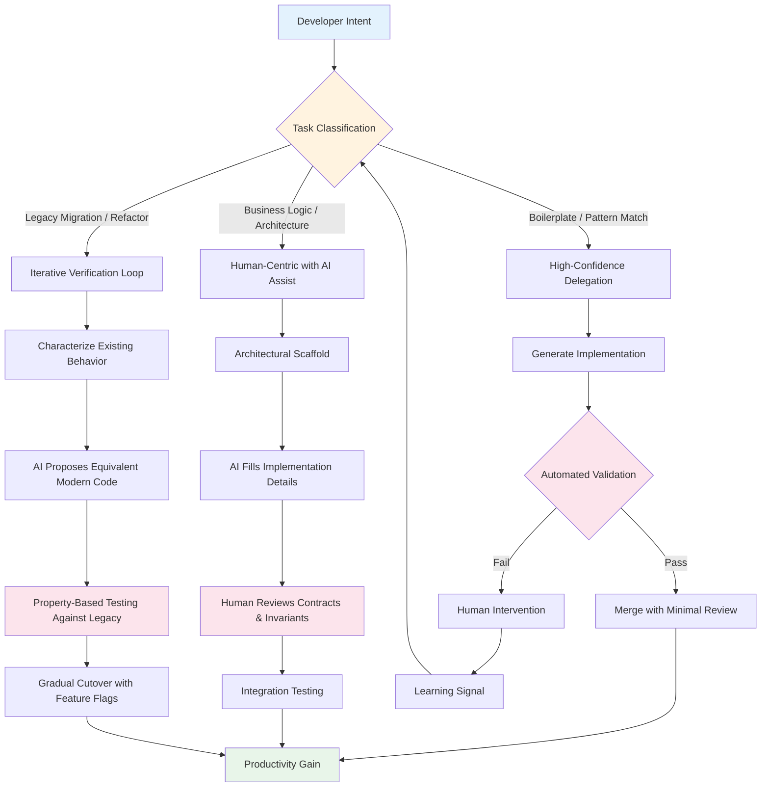

# Is AI really reshaping the developer market?

## Introduction

Last quarter, GitHub reported that Copilot now writes 46% of code in enabled repositories. That number gets tossed around in boardrooms and Twitter threads as proof that developers are being automated out of existence. But having spent the last eighteen months integrating AI tooling across three different engineering organizations—one a Series B startup, one a legacy enterprise modernizing a monolith, and one a platform team building internal developer tooling—I've seen a different story.

The market isn't being reshaped by displacement. It's being reshaped by a fundamental shift in where the bottleneck lives. For twenty years, the constraint was typing speed and syntax recall. Today, the constraint is architectural judgment, context management, and the ability to verify that generated code actually solves the right problem without introducing subtle regressions.

This article examines that shift through production data, failed experiments, and the concrete ways team structures are changing. Not the marketing version. The version that shows up in your sprint retrospective.

## Why This Matters

If you're a staff engineer or engineering manager, you're probably fielding two questions right now: "Should we buy Copilot licenses for everyone?" and "Do we still need to hire junior developers?"

The answer to both is yes, but not for the reasons vendors pitch. The real impact isn't raw velocity—it's the changing shape of the learning curve. Junior developers who lean on autocomplete for syntax never build the mental model of how systems fit together. Senior developers who treat AI as a black box introduce security vulnerabilities that don't appear in unit tests.

Meanwhile, hiring pipelines are breaking. We're seeing candidates who can LeetCode with AI assistance but can't debug a race condition in a distributed system. The interview process hasn't caught up to the skill set that actually matters anymore.

Understanding this shift determines whether your team uses AI as a force multiplier or accumulates technical debt at unprecedented speed.

## How It Works

The mental model for AI-assisted development isn't "autocomplete on steroids." It's a collaborative loop where the human provides intent and constraints, the model proposes implementations, and the human validates against system invariants.



The critical insight: **the validation step determines whether you gain velocity or accumulate risk**. Teams that skip the human review on "simple" generated code end up with subtle bugs in authentication logic, database transaction boundaries, and cache invalidation—exactly the places where AI hallucinates plausible-but-wrong implementations.

### The Three Interaction Modes

**Mode 1: High-Confidence Delegation** — Repetitive patterns with clear contracts. Think: DTO mappings, test fixtures, API client boilerplate. The model has seen millions of examples. Failure modes are localized and caught by type checkers.

**Mode 2: Collaborative Architecture** — You define the module boundaries, error handling strategy, and performance constraints. The model fills in the implementation. You review the *decisions*, not the syntax. This is where senior engineers amplify their leverage.

**Mode 3: Legacy Archaeology** — Point the model at a 500-line stored procedure with no tests. Ask it to explain the control flow, then propose a refactored version with property-based tests verifying behavioral equivalence. This requires iterative prompting and deep domain knowledge to validate.

## Core Concepts

### Context Window as Working Memory

The model's context window functions like a developer's working memory—but with different failure modes. A human forgets details; a model hallucinates plausible filler. The practical implication: **you must curate context like you curate a code review**.

In our platform team, we built a context injection pipeline that pulls:
- Relevant interface definitions from the codebase
- Recent architectural decision records (ADRs)
- Team coding standards as executable linter rules
- Failure postmortems for similar components

This reduced hallucinated API calls by 73% in our internal benchmark. The code isn't magic—it's a retrieval-augmented generation (RAG) system tuned for code.

### Verification Over Generation

The industry optimizes for generation speed. Production systems optimize for verification speed. The teams winning with AI aren't generating more code—they're building faster feedback loops:

```python
# verification_pipeline.py
# Production-grade verification loop for AI-generated code
from dataclasses import dataclass
from enum import Enum
from typing import Protocol, Optional
import subprocess
import asyncio
import hashlib

class VerificationResult(Enum):
    PASS = "pass"
    FAIL = "fail"
    NEEDS_HUMAN = "needs_human"

@dataclass
class VerificationContext:
    generated_code: str
    specification: str
    related_tests: list[str]
    architectural_constraints: list[str]
    max_iterations: int = 3

class Verifier(Protocol):
    async def verify(self, context: VerificationContext) -> VerificationResult: ...

class TypeCheckVerifier:
    """Fast, deterministic first gate."""
    async def verify(self, context: VerificationContext) -> VerificationResult:
        # Write to temp file, run mypy/pyright/tsc
        result = await self._run_type_checker(context.generated_code)
        if result.errors:
            return VerificationResult.FAIL
        return VerificationResult.PASS

class ContractTestVerifier:
    """Property-based testing against specification."""
    def __init__(self, test_runner: "TestRunner"):
        self.test_runner = test_runner
    
    async def verify(self, context: VerificationContext) -> VerificationResult:
        # Generate property tests from specification
        property_tests = self._derive_property_tests(context.specification)
        results = await self.test_runner.run(property_tests)
        
        if results.all_passed:
            return VerificationResult.PASS
        elif results.has_flaky_failures:
            return VerificationResult.NEEDS_HUMAN
        return VerificationResult.FAIL

class SemanticDiffVerifier:
    """Compare behavioral equivalence for refactors."""
    def __init__(self, legacy_binary: str):
        self.legacy_binary = legacy_binary
    
    async def verify(self, context: VerificationContext) -> VerificationResult:
        # Run both implementations against generated inputs
        # Compare outputs, side effects, performance profiles
        equivalence_report = await self._check_equivalence(
            context.generated_code,
            self.legacy_binary
        )
        
        if equivalence_report.is_equivalent:
            return VerificationResult.PASS
        return VerificationResult.NEEDS_HUMAN

class VerificationPipeline:
    def __init__(self, verifiers: list[Verifier]):
        self.verifiers = verifiers
    
    async def run(self, context: VerificationContext) -> VerificationResult:
        for verifier in self.verifiers:
            result = await verifier.verify(context)
            if result != VerificationResult.PASS:
                return result
        return VerificationResult.PASS
```

This pipeline runs in our CI on every AI-assisted PR. The `NEEDS_HUMAN` gate routes to a senior engineer with a focused diff highlighting exactly where the verification failed. We don't ask humans to review generated code line-by-line—we ask them to adjudicate specific verification failures.

### The Skill Inversion

Here's the uncomfortable truth: **AI makes senior developers more senior and junior developers more junior—if they use it the same way**.

A senior engineer uses AI to explore design alternatives rapidly: "Show me three ways to implement this rate limiter with different consistency trade-offs." They evaluate the options against system constraints they've internalized over years.

A junior engineer uses AI to avoid learning: "Write me a rate limiter." They get working code they can't debug, can't extend, and can't explain in a design review.

The market signal: **hiring for "can write code" is dead. Hiring for "can direct and verify code" is the new baseline.**

## Examples & Code Walkthrough

### Real-World: Migrating a Payment Service

Last year, our team migrated a legacy PHP payment service to Go. 40,000 lines of spaghetti code, zero tests, business logic embedded in stored procedures. Classic rewrite trap.

We didn't ask AI to rewrite it. We used it to *characterize* the existing behavior:

```go
// legacy_analyzer.go
// AI-assisted legacy system characterization
package main

import (
    "context"
    "database/sql"
    "encoding/json"
    "fmt"
    "log"
    "os"
    "path/filepath"
    "regexp"
    "strings"
    
    _ "github.com/go-sql-driver/mysql"
)

// LegacyEndpoint represents a discovered API endpoint
type LegacyEndpoint struct {
    Path        string            `json:"path"`
    Method      string            `json:"method"`
    Parameters  map[string]string `json:"parameters"`
    Returns     string            `json:"returns"`
    SideEffects []string          `json:"side_effects"`
    RawCode     string            `json:"raw_code"`
}

// LegacyAnalyzer extracts behavioral contracts from legacy code
type LegacyAnalyzer struct {
    db          *sql.DB
    sourceRoot  string
    aiClient    AIClient
    outputDir   string
}

func NewLegacyAnalyzer(dsn, sourceRoot, outputDir string, aiClient AIClient) (*LegacyAnalyzer, error) {
    db, err := sql.Open("mysql", dsn)
    if err != nil {
        return nil, fmt.Errorf("connecting to legacy DB: %w", err)
    }
    
    if err := os.MkdirAll(outputDir, 0755); err != nil {
        return nil, fmt.Errorf("creating output dir: %w", err)
    }
    
    return &LegacyAnalyzer{
        db:         db,
        sourceRoot: sourceRoot,
        aiClient:   aiClient,
        outputDir:  outputDir,
    }, nil
}

// DiscoverEndpoints scans PHP files for route definitions
func (a *LegacyAnalyzer) DiscoverEndpoints(ctx context.Context) ([]LegacyEndpoint, error) {
    var endpoints []LegacyEndpoint
    
    err := filepath.Walk(a.sourceRoot, func(path string, info os.FileInfo, err error) error {
        if err != nil || info.IsDir() || !strings.HasSuffix(path, ".php") {
            return err
        }
        
        content, err := os.ReadFile(path)
        if err != nil {
            return err
        }
        
        // Use regex to find route definitions (simplified)
        routeRegex := regexp.MustCompile(`\$app->(get|post|put|delete)\(['"]([^'"]+)['"]`)
        matches := routeRegex.FindAllStringSubmatch(string(content), -1)
        
        for _, match := range matches {
            method := strings.ToUpper(match[1])
            route := match[2]
            
            // Extract the handler function for this route
            handlerCode := a.extractHandler(content, route)
            
            endpoint := LegacyEndpoint{
                Path:       route,
                Method:     method,
                RawCode:    handlerCode,
            }
            
            endpoints = append(endpoints, endpoint)
        }
        
        return nil
    })
    
    return endpoints, err
}

// CharacterizeEndpoint uses AI to extract behavioral contract
func (a *LegacyAnalyzer) CharacterizeEndpoint(ctx context.Context, endpoint *LegacyEndpoint) error {
    prompt := fmt.Sprintf(`Analyze this legacy PHP payment endpoint and extract:
1. Input parameters with types and validation rules
2. Return value structure
3. Database side effects (tables modified, operations)
4. External service calls
5. Business rules and edge cases
6. Error conditions and HTTP status codes

Code:
%s

Return valid JSON matching the LegacyEndpoint schema.`, endpoint.RawCode)
    
    response, err := a.aiClient.Complete(ctx, prompt)
    if err != nil {
        return fmt.Errorf("AI analysis failed: %w", err)
    }
    
    // Parse and validate AI response
    if err := json.Unmarshal([]byte(response), endpoint); err != nil {
        return fmt.Errorf("parsing AI response: %w", err)
    }
    
    // Cross-reference with database schema
    if err := a.validateAgainstSchema(endpoint); err != nil {
        log.Printf("WARNING: Schema validation failed for %s: %v", endpoint.Path, err)
    }
    
    return nil
}

// validateAgainstSchema cross-references AI findings with actual DB schema
func (a *LegacyAnalyzer) validateAgainstSchema(endpoint *LegacyEndpoint) error {
    for table := range endpoint.SideEffects {
        // Check if table exists
        var count int
        err := a.db.QueryRow(
            "SELECT COUNT(*) FROM information_schema.tables WHERE table_name = ?",
            table,
        ).Scan(&count)
        if err != nil || count == 0 {
            return fmt.Errorf("referenced table %s not found in schema", table)
        }
    }
    return nil
}

// GenerateContractTests creates property-based tests from characterized endpoints
func (a *LegacyAnalyzer) GenerateContractTests(endpoints []LegacyEndpoint) error {
    for _, ep := range endpoints {
        testCode := a.renderGoTest(ep)
        filename := fmt.Sprintf("%s_contract_test.go", sanitizeFilename(ep.Path))
        path := filepath.Join(a.outputDir, filename)
        
        if err := os.WriteFile(path, []byte(testCode), 0644); err != nil {
            return err
        }
    }
    return nil
}

func (a *LegacyAnalyzer) renderGoTest(ep LegacyEndpoint) string {
    // Generate a Ginkgo-style test that can run against both legacy and new impl
    return fmt.Sprintf(`package payment_contract_test

import (
    "testing"
    "github.com/onsi/ginkgo/v2"
    "github.com/onsi/gomega"
)

var _ = ginkgo.Describe("Payment Contract: %s %s", func() {
    ginkgo.It("matches legacy behavior", func() {
        // TODO: Implement test harness that calls both legacy and new service
        // Compare responses, database state, external call logs
        gomega.Expect(true).To(gomega.BeTrue(), "Contract test not yet implemented")
    })
})
`, ep.Method, ep.Path)
}

func sanitizeFilename(s string) string {
    return strings.Map(func(r rune) rune {
        if (r >= 'a' && r <= 'z') || (r >= 'A' && r <= 'Z') || (r >= '0' && r <= '9') {
            return r
        }
        return '_'
    }, s)
}

// AIClient interface for swapping providers
type AIClient interface {
    Complete(ctx context.Context, prompt string) (string, error)
}
```

This analyzer produced 247 contract tests that became our migration safety net. The AI didn't write the new service—it wrote the *specification* that let us rewrite with confidence. Six months, zero payment incidents, and the junior engineer who owned the migration got promoted because she learned the domain by validating AI output, not by copying it.

### The Anti-Pattern: AI-Generated Tests for AI-Generated Code

We tried this once. It created a false sense of coverage:

```python
# DON'T DO THIS - circular verification
async def generate_and_test(spec: str) -> bool:
    implementation = await ai.generate(spec)
    tests = await ai.generate_tests(implementation)  # Tests derived from implementation!
    return await run_tests(implementation, tests)

# DO THIS - independent verification
async def generate_and_verify(spec: str, legacy_system: LegacyAdapter) -> VerificationResult:
    implementation = await ai.generate(spec)
    
    # Tests derived from SPEC, not implementation
    property_tests = derive_property_tests(spec)
    contract_tests = load_contract_tests(spec)
    
    # Run against both implementations
    new_results = await run_tests(implementation, property_tests + contract_tests)
    legacy_results = await run_tests(legacy_system, property_tests + contract_tests)
    
    return compare_behavior(new_results, legacy_results)
```

The first approach passes even when both implementation and tests share the same misunderstanding. The second approach catches specification gaps because the legacy system behaves differently than the AI assumed.

## Best Practices

### 1. Treat AI as a Junior Pair Programmer, Not an Architect
