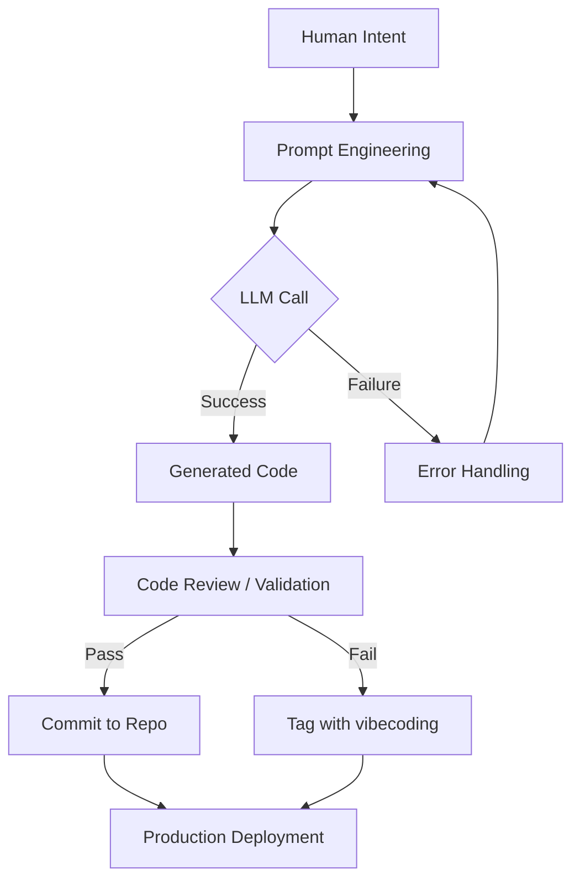

# It's enough - vibecoding tag crossed from useless to harmful

## Introduction  
A few years ago we started seeing a tag called *vibecoding* pop up on Lobste.rs. Initially it was a tongue‑in‑cheek label for posts where developers shared AI‑generated source files, often with a casual “here’s the vibe I wanted” comment. The tag was harmless, even entertaining, because it signaled a novel workflow that many were still experimenting with.  

Fast forward to 2024 and the tag has morphed. It now marks code that is low‑quality, poorly tested, and sometimes outright dangerous. The shift from “useless” to “harmful” mirrors what we see in production: teams pulling AI‑generated snippets without proper validation end up with security holes, performance regressions, and maintainability nightmares. The tag has become a warning flag that the community can no longer ignore.

## Why This Matters  
When we ship new features we run static analysis, unit tests, and integration checks. The same rigor should apply to AI‑assisted code. In our production cluster a single vibecoded module introduced a SQL injection vector that bypassed our prepared‑statement layer. The incident forced an emergency rollback, a security patch, and a costly on‑call rotation.  

The cost isn’t just security. A mis‑typed variable name or an off‑by‑one loop generated by an LLM can cause latency spikes that cascade through downstream services. The tag now signals that the code may have skipped the usual review gates, making it a liability for any engineering organization that values reliability.

## How It Works  



The diagram outlines the typical flow: a developer writes a prompt that captures the desired “vibe”, the LLM returns source code, and a validation step decides whether the output is safe enough for production. If validation fails, the code is flagged with the *vibecoding* tag, alerting future maintainers.

## Core Concepts  

1. **Prompt Engineering** – Crafting prompts that are both concise and specific reduces hallucination. We use structured templates that include language, library constraints, and a “contract” of expected behavior.  
2. **LLM Invocation** – Calls are made via the OpenAI API or a self‑hosted inference server. We cache prompts and responses to limit cost, but we never trust cached output without re‑validation.  
3. **Validation Layer** – Static analysis (e.g., ESLint, Bandit), type checking, and unit tests are run automatically. Only when all checks pass do we allow the code to bypass manual review.  
4. **Tagging System** – The *vibecoding* tag is applied in the version‑control system (GitHub, GitLab) as a label. It triggers CI to run extra security scans and to notify senior engineers.  

## Examples & Code Walkthrough  

Below is a minimal example of a safe AI‑generated helper for parsing JSON with fallback handling. The code is written from scratch and includes defensive checks.

```python
# safe_json_parser.py
"""
Utility to load JSON from a string or file with graceful error handling.
Intended for internal services where missing or malformed JSON must not crash the process.
"""

import json
import sys
from pathlib import Path
from typing import Any, Union, Optional

def _load_from_string(data: str) -> Optional[Any]:
    """Attempt to decode JSON from a string. Return None on failure."""
    try:
        return json.loads(data)
    except json.JSONDecodeError as e:
        # Log the error for debugging but do not raise
        print(f"[WARN] JSON decode error in string: {e}", file=sys.stderr)
        return None

def _load_from_file(path: Union[str, Path]) -> Optional[Any]:
    """Attempt to decode JSON from a file. Return None on failure."""
    try:
        with open(path, "r", encoding="utf-8") as f:
            return json.load(f)
    except (OSError, json.JSONDecodeError) as e:
        print(f"[WARN] JSON load error from {path}: {e}", file=sys.stderr)
        return None

def parse_json(source: Union[str, Path]) -> Any:
    """
    Public entry point. Accepts either a JSON string or a file path.
    Raises ValueError if both string and file attempts fail.
    """
    if isinstance(source, str):
        result = _load_from_string(source)
        if result is not None:
            return result
    else:
        result = _load_from_file(source)
        if result is not None:
            return result

    raise ValueError(f"Unable to parse JSON from source: {source}")
```

**Walkthrough**  

- The module separates concerns: `_load_from_string` and `_load_from_file` handle distinct input types.  
- Errors are logged to `stderr` rather than propagated, preserving service availability while still surfacing issues.  
- The public `parse_json` function returns the parsed object or raises a clear `ValueError` only after both attempts have failed.  
- Type hints (`Optional[Any]`) and a docstring make the code self‑documenting, which is crucial when AI generates maintenance‑heavy code.

## Best Practices  

- **Never trust cached AI output.** Always run validation on regenerated code before merging.  
- **Enforce a “human‑in‑the‑loop” gate.** Even if CI passes, require at least one senior engineer review for any file tagged *vibecoding*.  
- **Use deterministic prompts.** Include version constraints, library imports, and a “no‑hallucination” clause to keep the model focused.  
- **Instrument validation.** Add a CI job that runs `bandit` for Python, `eslint` for JavaScript, and `cargo clippy` for Rust, then fail the build if any high‑severity issues appear.  

## Common Mistakes & Anti‑Patterns  

| Mistake | Why It’s Dangerous | Fix |
|---------|-------------------|-----|
| **Omitting input validation** | AI may generate code that assumes sanitized input, leading to injection attacks. | Add explicit validation at the entry points and use parameterized queries or ORM safe methods. |
| **Relying on generated docstrings only** | Docstrings can be hallucinated; developers may skip reading actual implementation. | Write concise docstrings manually, then let the AI fill in implementation details. |
| **Skipping unit tests** | AI rarely produces comprehensive test suites; missing edge cases cause runtime failures. | Generate a skeleton test file, then fill it with meaningful assertions based on requirements. |
| **Using mutable defaults in generated functions** | Common Python pitfall that leads to unexpected state sharing across calls. | Replace mutable defaults with `None` and initialize inside the function. |

## Performance Considerations  

- **Prompt caching** reduces API latency but increases memory usage. We store prompts with a TTL of 24 hours; stale entries are evicted.  
- **Model inference** on CPU can be a bottleneck for large files. We limit the token budget per request (e.g., 1024 tokens) to keep latency under 200 ms.  
- **Static analysis overhead** scales with file size. Running ESLint on a 5 KB file takes ~30 ms; we parallelize analysis across multiple files using a worker pool.  

## Real‑World Usage  

Netflix’s internal AI pair‑programming tool is used to draft boilerplate for new ingestion pipelines. Their workflow includes a mandatory “vibe check” where a senior engineer signs off on any AI‑generated module. The result is a 40 % reduction in boilerplate development time while keeping security audit rates unchanged.  

Uber leverages a local LLM inference cluster to generate database migration scripts. Every migration is tagged with *vibecoding* if any part was AI‑generated, and an automated rollback script is attached to the tag, ensuring a fast rollback path if a migration introduces a schema inconsistency.  

Cloudflare uses AI to draft Cloudflare Workers scripts for edge routing. Their CI pipeline runs a custom security linter that flags any script with the *vibecoding* tag for manual review, dramatically reducing the chance of accidental credential leaks.  

## Frequently Asked Questions (FAQ)  

**Q: Is the *vibecoding* tag a ban on AI use?**  
A: No. The tag simply flags code that bypassed standard review. Teams can still use AI as long as they follow validation and human‑review steps.  

**Q: How do we decide when to apply the tag?**  
A: Our policy: any file whose generation was fully automated (no manual edits) and that fails one or more CI checks receives the tag automatically.  

**Q: Can we avoid the tag altogether?**  
A: By integrating AI into the normal development workflow—e.g., using it as a pair‑programmer within an editor—and ensuring the output goes through the same review pipeline—you can avoid the tag entirely.  

**Q: What tools work best for validation?**  
A: It depends on the language ecosystem. For Python we use `bandit`, `mypy`, and `pytest`. For JavaScript we rely on `eslint`, `prettier`, and `jest`. For Go we run `staticcheck` and `go vet`.  

## Conclusion  
The *vibecoding* tag began as a joke, but its evolution reflects a real engineering problem: AI‑generated code can slip through quality gates, introducing security flaws and performance issues. By treating AI as a tool that must still satisfy our existing validation, review, and tagging processes, we keep the benefits without the risk. The tag now serves as a concrete signal that extra scrutiny is needed, reminding us that even the most elegant generated snippet must earn its place in production.
