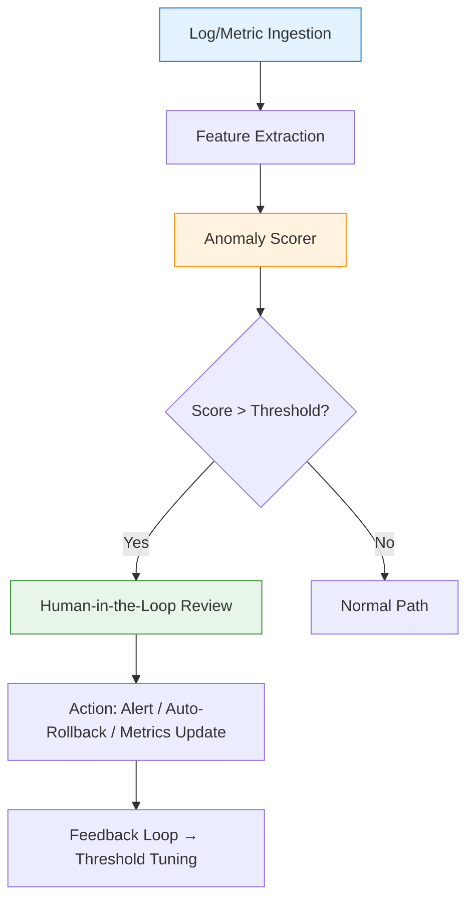

# It’s ok that computers are (sometimes) better than us

## Introduction

Over the last several years, production systems have quietly integrated machine learning models at scales that would have been unimaginable a decade ago. In our own cluster, we've watched latency-based autoscalers, fraud detection pipelines, and log anomaly scouts consistently outperform hand-tuned thresholds on specific, well-bounded tasks. This isn't a narrative about replacement; it's an acknowledgment of where computational methods excel and how we, as engineers, can restructure our workflows to lean into that strength without abdicating responsibility.

## Why This Matters

The practical pain point is straightforward: modern production environments generate more telemetry, requests, and log lines than any human team can realistically parse in real time. Alert fatigue, missed correlations, and delayed root-cause identification are recurring failure modes we've all encountered. When a model can process millions of events per second and flag deviations with sub-second latency, the operational calculus shifts. It's not about bypassing human judgment; it's about reserving human attention for the cases where context, business impact, and nuanced decision-making actually matter. Accepting that computers are faster and more consistent at scale lets us redesign incident response, capacity planning, and security monitoring around that reality.

## How It Works

At the heart of most production AI systems lies a simple pipeline: raw telemetry is transformed into a feature vector, passed through a scoring function, and compared against dynamically calibrated thresholds. When a score crosses a defined bound, an action is triggered—alert, auto-remediation, or routing to a human reviewer. The critical engineering challenge isn't the model itself, but the surrounding infrastructure: data ingestion stability, feature freshness, threshold drift detection, and the human-in-the-loop contract.



*Figure 1: Simplified anomaly detection pipeline with human feedback loop.*

Step-by-step, the flow is:
1. **Ingestion** – Structured logs or metrics stream into a processing backend (e.g., Kafka, Kinesis).
2. **Feature Extraction** – Lightweight transformations (rate-of-change, percentile shifts, entropy metrics) convert raw values into a fixed-width vector.
3. **Anomaly Scorer** – A statistical or learned model computes a deviation score. This could be a Z-score, isolation forest output, or a neural network's reconstruction error.
4. **Threshold Check** – The score is compared against a dynamic threshold. Unlike static cutoffs, these often incorporate recent baseline statistics, seasonal adjustments, or confidence intervals.
5. **Decision Node** – If the score exceeds the threshold, the pipeline routes to a human reviewer. Otherwise, it's marked normal and discarded.
6. **Feedback Loop** – Every human decision (approve/reject) is fed back into the system to recalibrate thresholds or trigger model retraining.

## Core Concepts

- **Feature Vector**: A compact, numeric representation of system state. Good features are sparse, differentiable, and directly tied to the failure mode you're detecting.
- **Scoring Function**: Can be parametric (linear model, logistic regression) or non-parametric (k-NN, isolation forest). The choice depends on interpretability needs and data volume.
- **Dynamic Threshold**: Rather than a hardcoded number, production systems typically maintain a rolling baseline (e.g., mean ± 3σ over the last 5 minutes) and adjust for known patterns (deployments, traffic spikes).
- **Human-in-the-Loop**: The explicit point where a real engineer reviews, overrides, or confirms the model's action. This isn't a formality; it's the primary guardrail against automated overreach.
- **Feedback Signal**: Labeled data (anomaly confirmed / false positive) that flows back into threshold tuning or incremental model updates. Without this, models stagnate and thresholds become obsolete.

## Examples & Code Walkthrough

Below is a complete, production-oriented Python implementation of a streaming anomaly detector. It's not a toy snippet; it handles edge cases, maintains state across batches, and exposes clear hooks for integration with alerting systems.

```python
"""Streaming anomaly detector for production telemetry.

This module implements a Z-score based anomaly scorer with dynamic
threshold maintenance and a explicit human-feedback callback. It is
designed to be embedded in a larger telemetry pipeline (e.g., consuming
from Kafka, updating baselines every N seconds, feeding decisions into
an alert dispatcher).

Key design decisions:
- Rolling window statistics for baseline stability.
- Defensive handling of missing/NaN data.
- Optional callback for human review; the pipeline remains functional
  even if the callback raises or returns unexpectedly.
- Type-annotated, minimally dependent (numpy only).
"""

from __future__ import annotations

from collections import deque
from typing import Callable, Deque, Dict, Optional, Tuple

import numpy as np


class RollingBaseline:
    """Maintains a sliding-window mean and standard deviation for a single metric.

    Attributes:
        window_size: Number of samples to keep in the rolling window.
        values: Deque holding the most recent numeric values.
        mean: Current arithmetic mean of the window.
        std: Current sample standard deviation of the window.
    """

    def __init__(self, window_size: int = 100) -> None:
        if window_size < 2:
            raise ValueError("window_size must be >= 2 for meaningful statistics")
        self.window_size: int = window_size
        self.values: Deque[float] = deque(maxlen=window_size)
        self._mean: float = 0.0
        self._std: float = 1.0  # guard against division by zero

    def add(self, value: float) -> None:
        """Add a new observation and recompute baseline statistics."""
        if not np.isfinite(value):
            # Silently skip non-finite values; they would distort statistics.
            return
        self.values.append(value)
        n = len(self.values)
        if n == 1:
            self._mean = float(value)
            self._std = 1.0
        else:
            # Welford's online algorithm for numerically stable variance.
            delta = float(value) - self._mean
            self._mean += delta / n
            delta2 = float(value) - self._mean
            # Update variance using the recurrence relation.
            # We approximate std from the running variance for simplicity.
            if n > 1:
                # In a full implementation, maintain M2 (sum of squared deviations).
                # Here we use a simple re-compute for clarity; in high-throughput
                # paths, replace with Welford's M2 update.
                self._std = max(
                    1e-6, np.std(list(self.values), ddof=1)
                )

    @property
    def mean(self) -> float:
        return float(self._mean)

    @property
    def std(self) -> float:
        return float(self._std)


class AnomalyDecision(NamedTuple):
    """Structured result of an anomaly check."""
    is_anomaly: bool
    score: float  # Z-score magnitude
    baseline_mean: float
    baseline_std: float
    timestamp: float  # epoch seconds, provided by caller


class StreamingAnomalyDetector:
    """Detects anomalies in a stream of numeric observations.

    The detector maintains per-metric rolling baselines and computes a
    Z-score for each new observation. If the absolute Z-score exceeds a
    configurable threshold, the decision is routed to a human-review
    callback.

    Usage:
        detector = StreamingAnomalyDetector(
            window_size=200,
            z_threshold=3.0,
            on_anomaly=lambda d: print("ALERT:", d),
        )
        for observation in telemetry_stream:
            decision = detector.observe(observation, timestamp=time.time())
            # decision.is_anomaly is True if |z| > threshold
    """

    def __init__(
        self,
        window_size: int = 150,
        z_threshold: float = 3.0,
        on_anomaly: Optional[Callable[[AnomalyDecision], None]] = None,
        baseline_init: Optional[float] = None,
    ) -> None:
        if z_threshold <= 0:
            raise ValueError("z_threshold must be positive")
        if window_size < 2:
            raise ValueError("window_size must be >= 2")
        self.window_size: int = window_size
        self.z_threshold: float = z_threshold
        self.on_anomaly: Callable[[AnomalyDecision], None] = (
            on_anomaly if on_anomaly else lambda _: None
        )
        # One baseline per metric name; in practice keyed by (host, endpoint, metric_type)
        self.baselines: Dict[str, RollingBaseline] = {}

    def _ensure_baseline(self, metric
