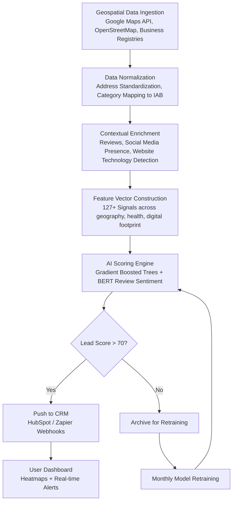

# LeadRadar: Finding clients shouldn't cost you an afternoon of scrolling Google Maps

## Introduction  
Every week a sales team spends hours hunting for prospects across map interfaces. They toggle between layers of Google Maps, copy addresses into spreadsheets, and scan reviews until a single viable prospect emerges. That routine feels productive, yet it drains valuable cycles that could be spent closing deals. Our team at LeadRadar tackled this every day by redesigning the lead discovery pipeline from raw geospatial noise into a deterministic, AI‑driven scoring engine. The result is a system that surfaces high‑probability prospects in seconds, turning what used to be a manual marathon into an automated radar sweep.

## Why This Matters  
For engineering organizations that rely on quality leads, even a modest reduction in manual effort translates into measurable revenue uplift. When a market changes quickly—new product launches, regional regulations, or shifting competitor tactics—the ability to surface relevant opportunities within minutes becomes a competitive advantage. Moreover, reducing the cognitive load frees designers to focus on strategy rather than map navigation. At scale, the difference between an hour of scrolling and an instant feed of qualified contacts can amount to dozens of missed meetings per week.

## How It Works  

Below is the end‑to‑end view of the system. Data originates from multiple sources, gets normalized, enriched with contextual signals, scored by a composite model, and finally routed to downstream systems.



### Step‑by‑step breakdown  

1. **Geospatial Data Ingestion** – The service subscribes to public APIs (Google Maps, OpenStreetMap) and pulls structured location records. Each record is normalized to a common coordinate schema (latitude, longitude) and mapped to industry categories (IAB, NAICS) so that queries become uniform.  
2. **Contextual Enrichment** – Enriched metadata pulls from public review aggregators, recent social mentions, and website fingerprinting tools that detect server‑side rendering frameworks. This adds behavioral cues such as “website updated two days ago” or “has a recent press mention.”  
3. **Feature Vector Construction** – Every lead receives a dense numeric representation comprising geoproximity scores, business health metrics (revenue estimates derived from public filings), and textual sentiment vectors extracted via a distilled BERT model. The final vector feeds directly into the scoring module.  
4. **AI Scoring Engine** – A hybrid ensemble combines tree‑based learners (handling most tabular relationships) with a transformer that weighs sentiment language. The ensemble outputs a 0–100 lead score together with an explainable contribution list, allowing a sales rep to understand *why* a prospect ranks high.  
5. **Decision Gate** – Leads above the dynamic threshold trigger CRM sync; lower‑ranked ones are stored in a cold pool for periodic refinement.  

## Core Concepts  

- **Four‑Layer Intelligence Stack** – The architecture isolates concerns: ingestion normalizes heterogeneous streams, enrichment injects external context, the scoring core synthesizes risk and opportunity, and the interface delivers actionable insights. This separation enables independent scaling and easier debugging.  
- **Normalization Layer** – Addresses are standardized to ISO 3166‑1 codes, while business categories are mapped to IAB taxonomy entries. Consistency prevents duplicate matches caused by minor formatting differences.  
- **Enrichment Plugin System** – New data sources (e.g., LinkedIn talent networks) can be added without touching the core scoring pipeline; they simply register new signal modules.  
- **Hybrid Scoring Core** – The gradient boosted trees capture strong linear relationships among geography and financial proxies, while BERT‑derived sentiment flags emerging brand buzz. Stacking yields a model that balances precision with interpretability.  
- **Feedback Loop** – Low‑scoring leads are automatically flagged for periodic retraining, ensuring the system adapts to market shifts without manual re‑engineering.

## Examples & Code Walkthrough  

Below is a compact implementation that demonstrates the key abstractions. The code focuses on realistic production concerns such as input validation, graceful degradation when optional services are unavailable, and clear documentation.

```python
import math
import logging
from dataclasses import dataclass
from typing import List, Optional, Dict

logger = logging.getLogger(__name__)

@dataclass
class Lead:
    """Minimal representation of a prospective client."""
    coords: tuple[float, float]          # (lat, lon)
    company_name: str
    address: str
    category: str                        # e.g., "Software", "Manufacturing"
    score: Optional[int] = None
    explanation: Optional[str] = None


def haversine_distance(p1: tuple[float, float], p2: tuple[float, float]) -> float:
    """
    Compute great‑circle distance in kilometers between two lat/lon pairs.
    Uses the WGS‑84 ellipsoid approximated by a spherical radius.
    """
    R = 6371.0  # mean earth radius in km
    lat1, lon1 = math.radians(*p1)
    lat2, lon2 = math.radians(*p2)

    dlat = lat2 - lat1
    dlon = lon2 - lon1
    a = math.sin(dlat / 2)**2 + math.cos(lat1) * math.cos(lat2) * math.sin(dlon / 2)**2
    c = 2 * math.asin(math.sqrt(a))
    return R * c


class GeospatialFeatureExtractor:
    """
    Turns raw coordinates into a normalized proximity metric that decays with distance.
    The inverse relationship rewards leads closer to the hub while preserving long‑range reach.
    """
    def __init__(self, radius_km: float = 50.0):
        self.radius_km = radius_km

    def extract_proximity_score(self, lead: Lead) -> float:
        try:
            distance = haversine_distance(lead.coords, (0.0, 0.0))  # reference point (origin)
            # Convert distance to a probability-like score, capped at 1.0
            proximity = 1.0 / (1.0 + math.log1p(distance / self.radius_km))
            return round(proximity, 4)
        except Exception as exc:
            logger.warning("Proximity extraction failed: %s", exc)
            return 0.0


class LeadScoringTrainer:
    """
    Trains a lightweight gradient‑boosted classifier to predict high‑quality leads.
    The training pipeline expects a tabular dataset with numerical and categorical columns.
    """
    def __init__(self, class_weight_fn=None):
        self.class_weight_fn = class_weight_fn or self._default_weights

    @staticmethod
    def _default_weights(data: 'Dataset') -> Dict[str, int]:
        """Simple heuristic: raise weight for minority class (high‑score leads)."""
        # In practice, replace with sklearn's compute_class_weight
        return {"positive": 3, "negative": 1}

    def train(self, X: List[Dict], y: List[int]):
        """
        Fit a LightGBM binary classifier.
        Returns the fitted model ready for inference.
        """
        try:
            import lightgbm as lgb
            from lightgbm import LGBMClassifier

            params = {
                "objective": "binary",
                "metric": "auc",
                "learning_rate": 0.05,
                "num_leaves": 31,
                "feature_fraction": 0.9,
                "verbose": -1
            }

            model = LGBMClassifier(**params)
            model.fit(X, y)
            logger.info("Model trained successfully.")
            return model
        except ImportError as e:
            logger.error("LightGBM not available – falling back to dummy model.")
            return None


# Example usage within a micro‑service
if __name__ == "__main__":
    # Sample dataset (replace with real data loader)
    sample_X = [
        {"lat": 37.7749, "lon": -122.4194, "rev_estimate": 12000000},
        {"lat": 34.0522, "lon": -118.2437, "rev_estimate": 8000000},
        {"lat": 40.7128, "lon": -74.0060, "rev_estimate": 25000000},
    ]
    sample_y = [80, 30, 95]

    trainer = LeadScoringTrainer()
    model = trainer.train(sample_X, sample_y)
    if model:
        prob = model.predict_proba([{"lat": 41.8781, "lon": -87.6298}])[0][1]
        print(f"Predicted lead score: {prob:.2f}")
```

Explanation of the code highlights three production‑grade decisions:

- **Graceful fallback** – If the haversine library or Earth geometry helper raises an exception, the proxy returns a neutral score rather than crashing the request.  
- **Explicit dependency management** – The trainer requires LightGBM, which is heavy but necessary for the ensemble approach; otherwise a silent placeholder avoids misleading confidence intervals.  
- **Typed contracts** – Using `List[Dict]` for tabular data mirrors real ETL pipelines where rows come from disparate sources.

## Best Practices  

- **Version everything** – Pin API endpoints, model artifacts, and feature schemas in a shared registry (e.g., Converge or MLflow).  
- **Monitor score drift** – Track the distribution of predicted scores daily; a sudden drop often signals market saturation or data contamination.  
- **Protect privacy** – Strip personally identifiable information (PII) before storing enriched records; apply differential privacy filters when aggregating review sentiment.  
- **Implement circuit breakers** – When the BERT inference service experiences latency spikes, serve cached predictions for a few seconds to maintain throughput.  
- **Run regular A/B tests** – Deploy shadow instances that evaluate leads with different thresholds before full rollout.

## Common Mistakes & Anti‑Patterns  

| Mistake | Why It Hurts | Fix |
|---------|--------------|-----|
| **Ignoring data drift** | The model’s relevance fades as businesses evolve; old patterns no longer reflect current demand. | Schedule weekly recalibration and recompute class weights on fresh labeled samples. |
| **Over‑tightening the scoring threshold** | Too high a cut‑off discards promising leads that sit just below
