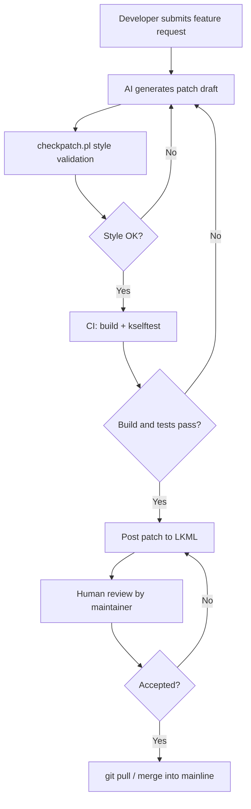

# Linus Torvalds on AI-assisted kernel contributions

## Introduction

A recent Lobste.rs thread reignited a familiar question: will Linus Torvalds accept AI-generated patches into the Linux kernel? The short answer is that he already has, implicitly. Torvalds has never cared whether a patch was typed by a human or suggested by a model. What he cares about is whether the patch is correct, follows kernel coding style, has a valid `Signed-off-by` line, and survives review on the Linux Kernel Mailing List (LKML).

The longer answer is more nuanced. AI can draft a diff in seconds, but it cannot take responsibility for a kernel panic six months down the road. The human review process—exemplified by Torvalds’ blunt but effective gatekeeping—remains the decisive filter. This article walks through how AI-assisted kernel contributions actually work, where they break down, and what a responsible workflow looks like in practice.

## Why This Matters

The Linux kernel is not a typical application codebase. It is written in C, compiled without exceptions, and expected to run on everything from embedded controllers to hyperscale cloud hosts. A single misplaced lock or an off-by-one error in a network driver can cause a system hang, a security vulnerability, or silent data corruption.

That makes AI-generated code especially risky in this domain. Large language models are excellent at pattern matching, but they do not understand memory ordering, RCU grace periods, or the interplay between `kmalloc` and slab allocators. They can produce code that compiles and passes a quick smoke test while introducing a race condition that only appears under load.

For maintainers, the real cost is not bad code—it is wasted time. Reviewing a poorly constructed AI patch consumes the same bandwidth as reviewing a good one. When maintainers spend an hour debunking a hallucinated `struct` definition, that is an hour not spent on actual subsystem development. The engineering challenge, therefore, is not to replace human reviewers with AI, but to ensure that anything reaching a maintainer has already been vetted by tooling and by the person submitting it.

## How It Works

An AI-assisted contribution pipeline treats the model as a draftsman, not an architect. The developer supplies intent and context; the model proposes a diff; automated tooling enforces style; continuous integration verifies compilation; and a human maintainer makes the final call.

Here is the flow:

The critical gates are steps C, E, and H. Step C uses the kernel’s own `scripts/checkpatch.pl` to reject style violations before a human ever sees them. Step E runs `make` and `kselftest` to catch compile errors and obvious regressions. Step H is where Linus Torvalds or a subsystem maintainer reads the patch, asks questions, and either accepts it or demands a revision.

The loop between B and I is important. If a maintainer rejects the patch, the developer can feed the reviewer’s comments back into the model and ask it to regenerate. The model does not get merged; the human does.

## Core Concepts

### Context injection
A model cannot generate a correct kernel patch without seeing the surrounding code. The pipeline must extract a relevant snippet from the target file and include it in the prompt. Without this context, the model will invent function names or use APIs that do not exist in the target kernel version.

### Coding style enforcement
The kernel has a strict style documented in `Documentation/process/coding-style.rst` and enforced by `scripts/checkpatch.pl`. AI output must be run through this tool. A patch that fails checkpatch is automatically rejected by most maintainers before they read the logic.

### Developer Certificate of Origin
Every kernel patch must include a `Signed-off-by` line certifying that the contributor has the right to submit the code under the kernel’s license. An AI cannot sign off on anything. The human developer assumes legal and technical responsibility.

### Review latency
Maintainers are volunteers or employees with limited time. Patches that arrive with obvious style errors or missing test results are ignored or rejected quickly. AI-assisted workflows should reduce the number of review cycles by catching errors locally first.

### Trust boundary
The trust boundary is not at the model; it is at the maintainer’s
