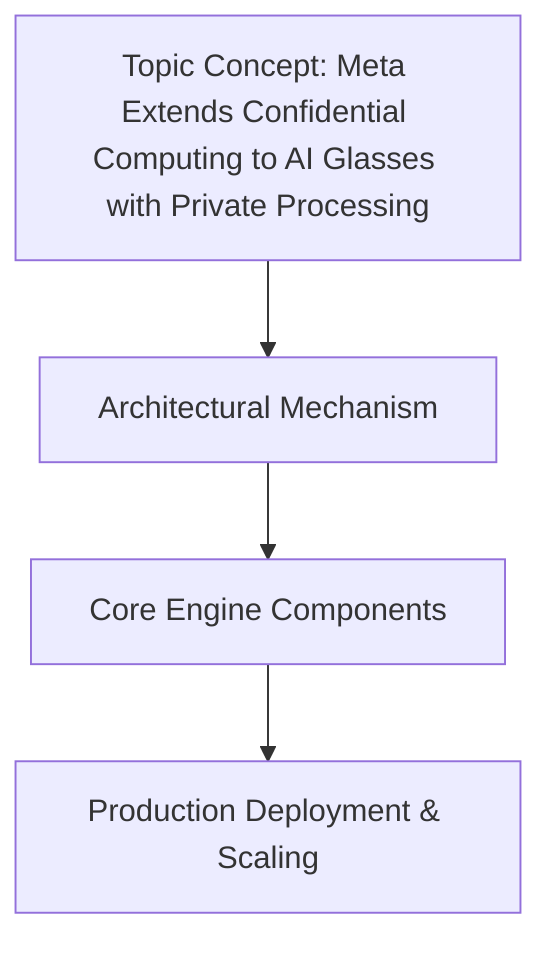

# Meta Extends Confidential Computing to AI Glasses with Private Processing

## Introduction
Meta's newest AR glasses embed a dedicated secure enclave that runs inference on raw camera and microphone streams without exposing the data to the host OS. The design forces all model execution to happen inside a hardware‑isolated trusted execution environment (TEE), and only encrypted results are sent to the cloud. This shift moves privacy guarantees from software policies to silicon‑level enforcement.

## Why This Matters
For engineers building AI features on wearables, the bottleneck is no longer just model size or battery life; it is the trust boundary between the device and the backend. Regulations such as GDPR and emerging biometric privacy laws treat raw sensor data as personal information. By offloading inference to a TEE, we can satisfy those regulations without sacrificing latency, because the model runs locally and only a small encrypted payload leaves the device. It also reduces the attack surface: even if the Android or iOS kernel is compromised, the raw frames never become visible.

## How It Works

The pipeline begins with the sensor subsystem pushing frames into a protected memory region that only the TEE can access. The device performs a remote attestation with the cloud, proving that the TEE is genuine and running the expected firmware.
