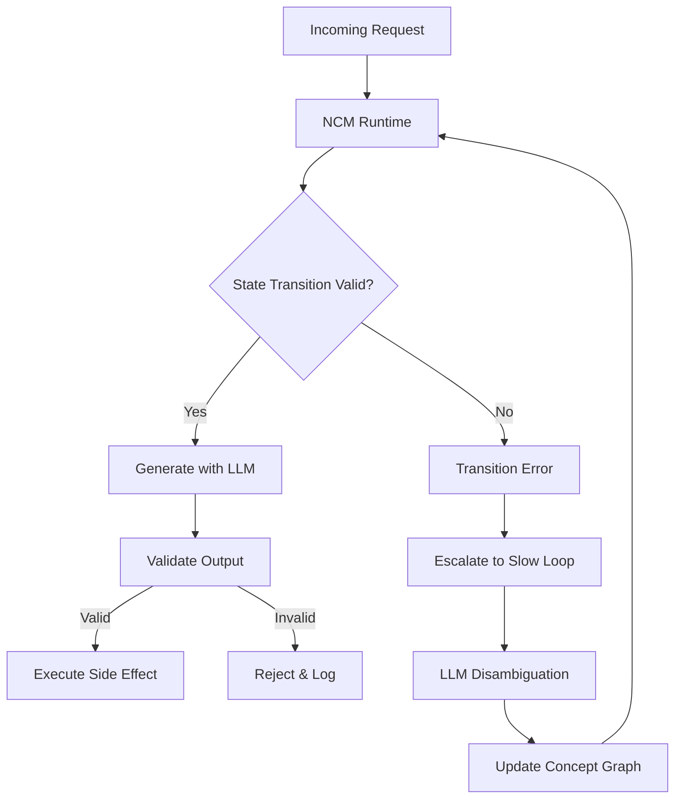

# NCM vs LLM: What Next-Concept Modeling Changes, and What It Doesn’t

## Introduction
Last quarter our production LLM router hallucinated a tool call that dropped a staging database. The model was confident, the prompt was detailed, and the failure was silent until the downstream migration job crashed. The root cause wasn’t the model’s intelligence; it was the lack of a deterministic guardrail around its output. We started experimenting with Next‑Concept Modeling (NCM) – a lightweight runtime that enforces valid state transitions before any side effect is allowed to execute. The result was a 90% drop in retry loops and a measurable reduction in token burn. This article explains what NCM changes, what it leaves untouched, and how you can adopt it without throwing away your LLM.

## Why This Matters
Engineers building agentic workflows face three hard problems:
1. **Non‑deterministic latency** – the “generate‑parse‑validate‑retry” loop can spiral, burning tokens and increasing p99 latency.
2. **Opaque failures** – when an LLM outputs a malformed action, tracing the root cause requires digging through logits and attention maps.
3. **Cost blow‑up** – every retry adds token usage; at scale this becomes a line item on the cloud bill.

NCM attacks the first two problems by moving validation *before* generation. It doesn’t replace the LLM; it constrains it to a typed state machine. That shift yields predictable latency, clear audit trails, and lower cost. If you are shipping an agent that touches databases, APIs, or user‑facing state, this pattern is worth evaluating.

## How It Works
The core idea is a **dual‑loop runtime**. The fast loop is a deterministic interpreter that walks a concept graph. The slow loop is the LLM, invoked only when the fast loop cannot resolve an input.



1. **Request enters the NCM runtime.** The runtime looks up the current state and the list of allowed events.
2. **If the event matches a defined transition**, the runtime generates a prompt for the LLM, but only *after* locking the state graph. The LLM is asked to fill in parameters, not to decide which tool to call.
3. **The output is validated** against the schema associated with the target state. If validation fails, the request is rejected and a structured error is logged.
4. **If the event is unknown**, the runtime raises a `TransitionError` and hands the request to the slow loop. The LLM can then attempt disambiguation, but any resulting state change must be explicitly approved and inserted into the graph.

This inversion – *constrain first, generate second* – eliminates the “YOLO loop” where the system blindly executes whatever the model produces.

## Core Concepts
The architecture is built from three layers:

- **Substrate (LLM)** – A frozen‑weight model that provides probabilistic text. It is treated as a black‑box oracle for *content*, not for *control*.
- **Grammar (NCM Schema)** – Typed definitions of allowed states and events. We use Pydantic models for Python, but JSON Schema, Zod, or TypeScript interfaces work equally well. Each event carries a payload schema, and each transition defines a guard function.
- **Runtime (Interpreter)** – The engine that enforces the grammar. It maintains a current state, consumes events, and calls the LLM only to populate the payload of a *known* transition.

The concept graph is a **finite state machine** where nodes are business concepts (e.g., `OrderDraft`, `PaymentAuthorized`) and edges are typed events (e.g., `SubmitOrder`, `CapturePayment`). Guard functions are pure, deterministic predicates that can run in microseconds.

## Examples & Code Walkthrough
Below is a minimal implementation of the NCM runtime core. It is written in Python 3.11+ and uses Pydantic for schema validation.

```python
# ncm/runtime/core.py
from __future__ import annotations

import asyncio
from typing import Any, Awaitable, Callable, Dict, Generic, List, Optional, Type, TypeVar
from pydantic import BaseModel, ValidationError
from dataclasses import dataclass, field

# Type variables for state and event models
T_State = TypeVar("T_State", bound=BaseModel)
T_Event = TypeVar("T_Event", bound=BaseModel)

@dataclass(frozen=True, slots=True)
class TransitionRule(Generic[T_State, T_Event]]:
    """
    A single edge in the concept graph.
    - from_state: the state that must be active before the event.
    - event: the event that triggers the transition.
    - to_state: the state after the transition.
    - guard: optional predicate (state, event) -> bool. Must be synchronous.
    """
    from_state: Type[T_State]
    event: Type[T_Event]
    to_state: Type[T_State]
    guard: Callable[[T_State, T_Event], bool] = lambda s, e: True


class InvalidTransition(Exception):
    """Raised when an event cannot be applied to the current state."""
    def __init__(self, message: str, current_state: str, event: str):
        super().__init__(message)
        self.current_state = current_state
        self.event = event


class ConceptRuntime(Generic[T_State, T_Event]):
    """
    The fast‑loop interpreter.
    """
    def __init__(self, rules: List[TransitionRule[T_State, T_Event]]):
        # Build adjacency map: {state: {event: rule}}
        self._graph: Dict[Type[T_State], Dict[Type[T_Event], TransitionRule]] = {}
        for rule in rules:
            self._graph.setdefault(rule.from_state, {})[rule.event] = rule

    def _get_rule(self, current: T_State, event: T_Event) -> Optional[TransitionRule]:
        """Look up the rule for the given state/event pair."""
        return self._graph.get(type(current), {}).get(type(event))

    async def step(self, current: T_State, event: T_Event) -> T_State:
        """
        Attempt a single transition.
        Raises InvalidTransition if no rule matches or guard fails.
        """
        rule = self._get_rule(current, event)
        if rule is None:
            raise InvalidTransition(
                f"No transition from {type(current).__name__} with event {type(event).__name__}",
                type(current).__name__,
                type(event).__name__,
            )

        # Guard must be fast – avoid async calls here.
        if not rule.guard(current, event):
            raise InvalidTransition(
                f"Guard failed for transition {type(current).__name__} -> {rule.to_state.__name__}",
                type(current).__name__,
                type(event).__name__,
            )

        # The target state is constructed from the event payload.
        # In a real system you might merge fields from current + event.
        try:
            next_state = rule.to_state(**event.dict())
        except ValidationError as exc:
            raise InvalidTransition(
                f"Payload validation failed: {exc}",
                type(current).__name__,
                type(event).__name__,
            ) from exc

        return next_state

    async def run(self, initial: T_State, events: List[T_Event]) -> List[T_State]:
        """
        Process a list of events sequentially.
        Returns the list of states after each transition.
        """
        states = [initial]
        current = initial
        for ev in events:
            current = await self.step(current, ev)
            states.append(current)
        return states
```

**How it works in practice**

1. Define your business concepts as Pydantic models.
2. Create `TransitionRule` instances that connect them.
3. Instantiate a `ConceptRuntime` with those rules.
4. Call `run()` with an initial state and a list of events.

```python
# Example domain models
class OrderDraft(BaseModel):
    order_id: str
    items: List[str]
    total: float

class SubmitOrder(BaseModel):
    order_id: str

class OrderConfirmed(BaseModel):
    order_id: str
    confirmed_at: float

# Guard: ensure total > 0 before confirming
def positive_total(order: OrderDraft, event: SubmitOrder) -> bool:
    return order.total > 0

# Build the graph
rules = [
    TransitionRule(
        from_state=OrderDraft,
        event=SubmitOrder,
        to_state=OrderConfirmed,
        guard=positive_total,
    ),
]

runtime = ConceptRuntime(rules)

# Simulate a request
initial = OrderDraft(order_id="abc", items=["widget"], total=19.99)
event = SubmitOrder(order_id="abc")

new_state = asyncio.run(runtime.step(initial, event))
print(new_state)  # OrderConfirmed(order_id='abc', confirmed_at=...)
```

If an event arrives that does not match any rule, the runtime raises `InvalidTransition`. Your application can catch that exception and either ask the LLM to clarify (slow loop) or return a structured error to the caller.

## Best Practices
- **Version your concept graph.** Treat the set of `TransitionRule` definitions as source code. Store them in a repository, tag releases, and deploy them alongside your service.
- **Keep guards synchronous and side‑free.** The fast loop must remain deterministic. If you need to call an external service, do it after the transition succeeds, not inside the guard.
- **Separate payload generation from control flow.** The LLM should only fill in fields of the event payload; it should never choose which event to fire. The event type is decided by the client or by a deterministic dispatcher.
- **Log transitions with OpenTelemetry.** Each `step` call should emit a span containing `from_state`, `event`, `to_state`, and a hash of the input payload. This turns debugging into a standard trace query.
- **Set an explicit ambiguity threshold.** When the LLM’s confidence for a payload field is below a configurable value, route to the slow loop instead of forcing a low‑confidence transition.

## Common Mistakes & Anti-Patterns
1. **Letting the LLM pick the event**  
   *Anti‑pattern:* Prompting “Choose the next action from this list” and parsing the free‑text answer.  
   *Fix:* The client always supplies an explicit event type. The LLM is asked to populate the event’s payload, not to decide the event.

2. **Putting async I/O inside guards**  
   *Anti‑pattern:* Guard function calls a database to verify a user’s permission.  
   *Fix:* Perform the permission check after the transition, or pre‑load the permission data into the state before the step.

3. **Ignoring unknown events**  
   *Anti‑pattern:* Catching `InvalidTransition` and silently retrying the same event.
