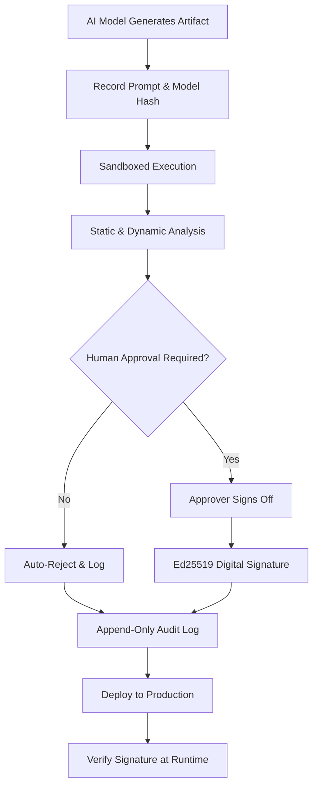

# Nobody will vouch for the answer

## Introduction

An LLM suggested a one-line fix for a race condition in our payment retry logic. It looked correct. It passed a quick smoke test. We merged it. Three days later, during peak traffic, the service started duplicating charges. When we opened the incident channel, the question was simple: who signed off on this? The answer was nobody. The model doesn’t take responsibility. The engineer who copy-pasted it didn’t write it. The vendor’s terms of service explicitly disclaim liability.

This is the accountability gap in AI-assisted engineering. Models generate code, configuration, and architectural recommendations, but they do not vouch for correctness. If you deploy AI-generated artifacts without an independent verification layer, you are shipping unverified code under your own name. This article describes how to build that verification layer: a vouch pipeline that treats AI output as untrusted input, executes it in isolation, validates it against policy, requires human attestation, and cryptographically signs the result before it ever reaches production.

## Why This Matters

AI-generated code is already inside your repositories. Developers use autocomplete, chat interfaces, and internal copilots to write Terraform modules, Kubernetes manifests, and business logic. The speed benefit is real, but so is the risk. A hallucinated API endpoint, an overly permissive IAM policy, or a subtle off-by-one error in a retry backoff can cause outages, data loss, or compliance violations.

From an engineering leadership perspective, the problem is not that AI writes bad code. Humans write bad code too. The problem is provenance. When a human writes a bad commit, there is a git author, a code review thread, and a CI pipeline to blame. When an AI writes it, there is no author to hold accountable, no review context unless you manufacture one, and no legal entity that will indemnify your production incident.

If you are subject to SOC 2, ISO 27001, or any internal change-management policy, “the AI suggested it” is not an acceptable control. You need a mechanism to prove that an AI-generated artifact was inspected, tested, and approved by a responsible party before deployment. That mechanism is what we call a vouch layer.

## How It Works

The vouch pipeline treats every AI-generated artifact as hostile until proven otherwise. It does not trust the model, the prompt, or the developer who requested the generation. Instead, it routes the artifact through a sequence of gates: sandboxed execution, static and dynamic analysis, human approval, cryptographic signing, and immutable logging.

Here is the flow:



Step by step:

1. **Capture provenance.** Before anything else, hash the exact prompt, model name, model version, and temperature. Store this with the generated artifact. If you cannot reproduce the generation, you cannot audit it.
2. **Sandboxed execution.** Run the artifact in an isolated process with no network, no filesystem write access outside a temporary directory, and strict CPU and memory limits. AI-generated code should never run with your production credentials.
3. **Analysis.** Run language-specific linters, security scanners, and a generated test suite against the artifact. For infrastructure-as-code, run policy checks (for example, Open Policy Agent rules) to catch wide-open security groups or missing encryption flags.
4. **Human gate.** For any artifact that touches production infrastructure, user data, or financial logic, require a named engineer to review and approve. The approval is not a rubber stamp; it is a legal and technical attestation that the reviewer understands the code.
5. **Sign.** Once approved, sign the artifact hash with an Ed25519 key held by your platform team. This binds the artifact to a specific approver and a specific point in time.
6. **Log.** Write the signed artifact, the approval metadata, and the signature to an append-only audit log. This log is your evidence during a postmortem or compliance audit.
7. **Runtime verification.** Your deployment system should refuse to run any artifact that lacks a valid signature from an approved key.

## Core Concepts

### Provenance

Provenance is the record of where an artifact came from and how it was produced. For AI outputs, provenance includes the model identifier, the exact prompt, generation parameters, and a content hash of the result. Without provenance, you cannot distinguish between two seemingly identical code snippets that were generated by different models or different prompts.

### Attestation

Attestation is a signed statement that a specific human reviewed and accepted an artifact. It shifts liability from the abstract “the AI wrote it” to a named engineer who verified the code. In our pipeline, attestation is inseparable from the digital signature.

### Sandbox

A sandbox is a restricted execution environment. AI-generated code must run inside one before it is trusted. This prevents a malicious or hallucinated artifact from exfiltrating credentials, scanning your internal network, or encrypting your disk.

### Immutable Audit Log

The audit log is append-only. Entries cannot be edited or deleted. If an incident occurs, you can query the log to see exactly which AI-generated artifact was deployed, who approved it, and when.

### Policy-as-Code

Policy-as-code means expressing organizational rules (no S3 buckets with public read access, no hardcoded secrets, maximum retry backoff of 30 seconds) as machine-checkable rules rather than human-readable documents. The vouch pipeline enforces these rules automatically.

## Examples & Code Walkthrough

Below is a production-oriented Python service that implements a minimal vouch pipeline for AI-generated Python functions. It is not a toy example; it includes sandboxing via resource limits, a policy engine, an approval gate, Ed25519 signing, and an append-only audit log.

```python
"""
vouch_service.py

A minimal attestation service for AI-generated code artifacts.
Intended for internal platform teams that need to verify LLM output
before it reaches production systems.
"""

from __future__ import annotations

import hashlib
import json
import os
import subprocess
import tempfile
import time
from dataclasses import dataclass, field
from pathlib import Path
from typing import Optional

from cryptography.exceptions import InvalidSignature
from cryptography.hazmat.primitives import hashes, serialization
from cryptography.hazmat.primitives.asymmetric import ed25519


class ArtifactRejected(Exception):
    """Raised when an artifact fails a pipeline gate."""


class SandboxViolation(Exception):
    """Raised when sandboxed execution exceeds limits or misbehaves."""


class ApprovalMissing(Exception):
    """Raised when a required human approval is not present."""


@dataclass
class AIArtifact:
    """Represents an artifact produced by an AI model."""

    content: str
    language: str
    prompt_hash: str
    model_name: str
    model_version: str
    generated_at: float = field(default_factory=time.time)
    artifact_hash: str = field(init=False)

    def __post_init__(self) -> None:
        # Content hash ensures we can detect any post-generation tampering.
        self.artifact_hash = hashlib.sha256(
            self.content.encode("utf-8")
        ).hexdigest()


@dataclass
class AttestationRecord:
    """Immutable record of a vetted artifact."""

    artifact_hash: str
    approver: str
    signature: str
    signed_at: float
    policy_results: dict[str, bool]


class SandboxRunner:
    """Executes untrusted code in a restricted subprocess."""

    def __init__(self, timeout_seconds: int = 30, max_memory_mb: int = 128) -> None:
        self.timeout_seconds = timeout_seconds
        self.max_memory_mb = max_memory_mb

    def _limit_resources(self) -> None:
        """Apply Unix resource limits before exec. Linux/macOS only."""
        import resource

        # Limit virtual memory and CPU time to prevent runaway AI code.
        max_bytes = self.max_memory_mb * 1024 * 1024
        resource.setrlimit(resource.RLIMIT_AS, (max_bytes, max_bytes))
        resource.setrlimit(resource.RLIMIT_CPU, (self.timeout_seconds, self.timeout_seconds))

    def run(self, code: str, language: str = "python") -> subprocess.CompletedProcess:
        if language != "python":
            raise ArtifactRejected(f"Unsupported language for sandbox: {language}")

        with tempfile.TemporaryDirectory(prefix="vouch_sandbox_") as tmpdir:
            script_path = Path(tmpdir) / "artifact.py"
            script_path.write_text(code, encoding="utf-8")

            try:
                result = subprocess.run(
                    ["python3", str(script_path)],
                    capture_output=True,
                    text=True,
                    timeout=self.timeout_seconds,
                    preexec_fn=self._limit_resources,
                    cwd=tmpdir,
                    env={"PATH": "/usr/bin:/bin", "HOME": tmpdir},
                )
            except subprocess.TimeoutExpired as exc:
                raise SandboxViolation(
                    f"Sandboxed execution exceeded {self.timeout_seconds}s"
                ) from exc

            if result.returncode != 0:
                raise SandboxViolation(
                    f"Artifact exited with code {result.returncode}: {result.stderr[:500]}
