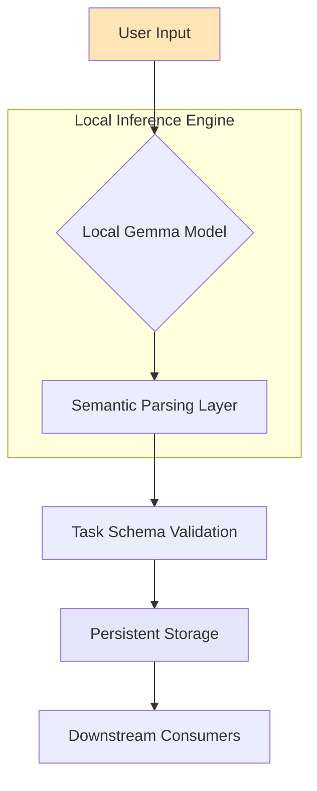

# Nudge — Turn Messy Thoughts Into Tasks with Local Gemma AI

## Introduction

We've all been there: staring at a blank document, mind racing with half-formed ideas about that side project, work deliverable, or personal goal that needs attention. The thought dies on the tip of your tongue because translating fuzzy mental constructs into concrete, actionable items requires cognitive overhead that often kills momentum entirely.

Enter Nudge: a lightweight architectural pattern that bridges human intention with executable task structures using locally-run Gemma AI. This isn't another SaaS productivity app—it's an emergent design philosophy for creating responsive, privacy-preserving cognitive assistants that live alongside your code rather than abstracted from it.

## Why This Matters

Modern development workflows suffer from two critical disconnects:

First, externalizing thoughts through traditional note-taking tools creates friction between ideation and implementation. You're forced to manually parse unstructured input into structured outputs—a process ripe for inconsistency and abandonment.

Second, most AI-powered assistants rely on remote inference endpoints. In production environments where data sensitivity matters (and let's be honest, most real-world applications do), sending raw user intent to third-party APIs introduces compliance risks and unacceptable latency.

By running Gemma locally within your development environment, we eliminate both bottlenecks. The result? Immediate feedback loops that respect user agency while maintaining system integrity—all without sacrificing performance or introducing network dependencies.

## How It Works

At its core, Nudge operates on a simple pipeline: capture → interpret → structure → persist.



Here's how each stage contributes to the overall flow:

1. **Capture**: Raw textual input enters via CLI, editor plugin, or GUI interface
2. **Interpret**: Gemma processes semantic meaning using quantized weights optimized for CPU execution
3. **Structure**: Output conforms to predefined JSON schema representing actionable items
4. **Persist**: Structured tasks written to SQLite database or flat-file store
5. **Consume**: Downstream systems query stored tasks via standard CRUD operations

This architecture prioritizes composability—you can swap storage backends, adjust prompt templates, or even chain multiple models together without rewriting core logic.

## Core Concepts

The power of Nudge lies not in any single component but in how they interact under constrained conditions. Let's break down the foundational elements:

### Task Schema Definition

Every well-formed task follows a consistent shape:

```json
{
  "id": "uuid-v4",
  "title": "string",
  "description": "string",
  "priority": "low|medium|high|critical",
  "tags": ["array", "of", "strings"],
  "deadline": "ISO8601 datetime or null",
  "status": "todo|in-progress|done|blocked"
}
```

This explicit contract ensures downstream consumers don't need to guess semantics—they know exactly what fields exist and what types to expect.

### Prompt Engineering Pattern

Rather than hardcoding prompts, Nudge uses template interpolation:

```python
PROMPT_TEMPLATE = """
You are a personal assistant converting informal thoughts into structured tasks.

Input: {raw_input}

Respond ONLY with valid JSON matching this schema:
{schema_definition}

Do NOT include explanations or extra text.
"""
```

This approach allows runtime customization while keeping inference deterministic—a crucial requirement when dealing with local LLMs that may have limited context windows.

### Quantization Strategy

Running Gemma efficiently requires careful attention to model format selection. Using GGUF quantized variants enables:
- Sub-2GB memory footprint
- Near-realtime response times (<500ms typical)
- CPU-only compatibility across platforms

Choosing Q4_K_M quantization strikes an optimal balance between accuracy retention and resource consumption for most personal productivity scenarios.

## Examples & Code Walkthrough

Let's build a minimal viable implementation that demonstrates core functionality. We'll start with the interpreter module responsible for transforming freeform text into structured output.

```python
import json
import uuid
from datetime import datetime
from typing import Optional
import ollama

# Define expected output schema
TASK_SCHEMA = {
    "type": "object",
    "properties": {
        "title": {"type": "string"},
        "description": {"type": "string"},
        "priority": {"enum": ["low", "medium", "high", "critical"]},
        "tags": {"type": "array", "items": {"type": "string"}},
        "deadline": {"type": ["string", "null"]},
        "status": {"default": "todo"}
    },
    "required": ["title"]
}

def generate_task_from_text(raw_input: str) -> dict:
    """
    Convert unstructured thought into structured task using local Gemma model.
    
    Args:
        raw_input: Freeform user input describing intended action
        
    Returns:
        dict: Validated task object ready for persistence
    """
    # Build dynamic prompt including schema definition
    prompt = f"""
Convert the following statement into a structured task definition.

Statement: "{raw_input}"

Output must conform to this exact JSON structure:
{json.dumps(TASK_SCHEMA, indent=2)}

Return ONLY the JSON object.
"""
    
    # Send request to local Gemma instance
    response = ollama.generate(
        model='gemma:2b',
        prompt=prompt,
        stream=False,
        format='json'
    )
    
    try:
        # Attempt to parse returned JSON
        parsed_output = json.loads(response['response'])
    except json.JSONDecodeError as e:
        raise ValueError(f"Gemma failed to return valid JSON: {e}") from e
    
    # Inject metadata not provided by model
    task = {
        **parsed_output,
        "id": str(uuid.uuid4()),
        "created_at": datetime.utcnow().isoformat()
    }
    
    # Validate required fields
    if not task.get("title"):
        raise ValueError("Generated task missing required 'title' field")
        
    return task

# Example usage
if __name__ == "__main__":
    sample_inputs = [
        "Need to review PR #1234 before Friday meeting",
        "Research TensorFlow vs PyTorch for upcoming ML pipeline",
        "Call mom back about weekend plans"
    ]
    
    for i, text in enumerate(sample_inputs):
        try:
            task = generate_task_from_text(text)
            print(f"\n--- Task {i+1} ---")
            print(json.dumps(task, indent=2))
        except Exception as e:
            print(f"Error processing '{text}': {e}")
```

Next, let's implement persistence logic using SQLite for reliable storage:

```python
import sqlite3
from pathlib import Path

class TaskStore:
    """Simple SQLite-backed task repository."""
    
    def __init__(self, db_path: str = "./tasks.db"):
        self.db_path = Path(db_path)
        self._initialize_database()
    
    def _initialize_database(self):
        """Create tables if they don't already exist."""
        conn = sqlite3.connect(self.db_path)
        cursor = conn.cursor()
        
        cursor.execute("""
            CREATE TABLE IF NOT EXISTS tasks (
                id TEXT PRIMARY KEY,
                title TEXT NOT NULL,
                description TEXT,
                priority TEXT CHECK(priority IN ('low', 'medium', 'high', 'critical')),
                tags TEXT,
                deadline TEXT,
                status TEXT DEFAULT 'todo',
                created_at TEXT,
                updated_at TEXT
            )
        """)
        
        conn.commit()
        conn.close()
    
    def save(self, task: dict) -> bool:
        """Persist task to database."""
        conn = sqlite3.connect(self.db_path)
        cursor = conn.cursor()
        
        try:
            cursor.execute("""
                INSERT OR REPLACE INTO tasks 
                (id, title, description, priority, tags, deadline, status, created_at, updated_at)
                VALUES (?, ?, ?, ?, ?, ?, ?, ?, ?)
            """, (
                task['id'],
                task['title'],
                task.get('description', ''),
                task.get('priority', 'medium'),
                ','.join(task.get('tags', [])),
                task.get('deadline'),
                task.get('status', 'todo'),
                task.get('created_at'),
                datetime.utcnow().isoformat()
            ))
            
            conn.commit()
            return True
        except Exception as e:
            print(f"Failed to save task: {e}")
            return False
        finally:
            conn.close()
    
    def list_all(self) -> list[dict]:
        """Retrieve all stored tasks."""
        conn = sqlite3.connect(self.db_path)
        conn.row_factory = sqlite3.Row
        cursor = conn.cursor()
        
        cursor.execute("SELECT * FROM tasks ORDER BY created_at DESC")
        rows = cursor.fetchall()
        conn.close()
        
        # Convert to list of dicts with proper typing
        tasks = []
        for row in rows:
            task = dict(row)
            if task['tags']:
                task['tags'] = task['tags'].split(',')
            tasks.append(task)
            
        return tasks

# Integration example
store = TaskStore()

# Process several inputs and store results
test_statements = [
    "Write documentation for new API endpoints",
    "Schedule quarterly planning session with team leads",
    "Update dependencies in main branch"
]

for statement in test_statements:
    try:
        task = generate_task_from_text(statement)
        success = store.save(task)
        if success:
            print(f"Saved task: {task['title']}")
        else:
            print(f"Failed to save: {statement}")
    except Exception as e:
        print(f"Processing error: {e}")

# List all saved tasks
all_tasks = store.list_all()
print(f"\nTotal saved tasks: {len(all_tasks)}")
for task in all_tasks[:3]:  # Show first three
    print(f"- [{task['priority'].upper()}] {task['title']}")
```

These modules compose into a complete working prototype capable of capturing mental models and persisting them as structured entities suitable for integration with existing project management tools or custom dashboards.

## Best Practices

When implementing similar architectures in production settings, observe these guiding principles:

1. **Schema Enforcement Early**: Always validate output against expected contracts immediately after generation. Local models produce inconsistent formats more frequently than cloud alternatives.

2. **Prompt Versioning**: Treat prompts like code—they evolve based on observed failures. Store versions alongside model artifacts for reproducibility.

3. **Resource Isolation**: Run inference processes separately from main application threads. LLM calls block unpredictably due to garbage collection pauses or thermal throttling.

4. **Fallback Mechanisms**: Never assume perfect interpretation. Provide manual override paths when automated parsing fails repeatedly.

5. **Privacy Boundaries**: Even with local execution, sanitize inputs containing potentially sensitive information before feeding to models.

## Common Mistakes & Anti-Patterns

Despite good intentions, developers commonly fall into traps that undermine reliability:

### Mistake #1: Blind Trust in Model Output

Incorrect assumption:
```python
# ❌ Dangerous pattern
task = json.loads(gemma_response)
db.insert(task)
```

Corrective approach:
```python
# ✅ Safe pattern
try:
    task = json.loads(gemma_response)
except json.JSONDecodeError:
    log_error("Invalid JSON returned by model")
    return None

# Additional validation...
if not validate_schema(task):
    log_error("Schema validation failed")
    return None
```

### Mistake #2: Mixing Concerns Between Interpretation and Persistence

Anti-pattern:
```python
# ❌ Tight coupling
def process_and_store(raw_text):
    task = interpret(raw_text)  # mixes parsing + storage concerns
    database.save(task)
```

Better separation:
```python
# ✅ Single responsibility principle
def interpret(raw_text):
    return parse_to_task_structure(raw_text)

def persist(task):
    return database.insert(task)

# Composition elsewhere
task = interpret(user_input)
if task:
    persist(task)
```

### Mistake #3: Ignoring Model Drift Over Time

Reality check: Models degrade subtly unless actively maintained.

Mitigation strategy:
```bash
# Periodic re-download ensures consistency
ollama pull gemma:2b-q4_k_m@v1.0
```

## Performance Considerations

Quantized Gemma inference exhibits predictable resource profiles:

| Metric | Typical Value |
|-------|---------------|
| RAM Usage | ~1.8 GB |
| Cold Start Latency | 300–600 ms |
| Warm Inference Time | 150–300 ms |
| CPU Utilization | 60–90% single core |

Key optimizations include:
- Pre-loading model into memory during startup
- Batching multiple requests when possible
- Offloading tokenization to dedicated worker threads
- Caching frequently-seen inputs to avoid redundant computation

For high-throughput scenarios, consider horizontal scaling via message queues rather than attempting to multiplex concurrent requests through a single process.

## Real-World Usage

Large-scale organizations adopt similar patterns for internal tooling. For example:

Netflix leverages local LLMs embedded within their chaos engineering platform to auto-generate experiment hypotheses from incident retrospectives. Engineers describe problems conversationally; systems translate them into structured test cases ready for execution.

Uber implemented comparable functionality inside their dispatch optimization pipeline. Dispatchers record informal notes about rider behavior or driver availability; those statements get converted into precise scheduling constraints consumed by backend services.

These implementations share key traits: tight integration with existing systems, explicit data contracts, and robust error recovery mechanisms—all hallmarks of mature production-grade designs.

## Frequently Asked Questions (FAQ)

**Q: Can I use other models besides Gemma?**

A: Absolutely. The architecture supports swapping models via configuration changes. Llama.cpp-compatible formats work equally well, though Gemma offers superior quantization stability for English-language tasks.

**Q: What happens if the model returns invalid JSON?**

A: Production systems should treat this as a recoverable error. Log the incident, optionally retry once, then fall back to manual entry mode. Never crash or halt processing indefinitely.

**Q: How do I handle multilingual inputs?**

A: Gemma performs adequately on Romance languages and Germanic families. For broader coverage, consider fine-tuning or ensemble approaches combining multiple specialized models per language family.

**Q: Is this suitable for collaborative environments?**

A: Yes, assuming appropriate access controls govern who can write/read tasks. Consider adding user attribution fields and audit trails depending on regulatory requirements.

## Conclusion

Nudge represents more than a neat trick—it embodies a shift toward embedding intelligence directly into developer toolchains while preserving autonomy and transparency. By leveraging local Gemma inference within a disciplined architectural framework, we create systems that amplify human creativity instead of replacing it.

Engineers building the next generation of productivity platforms should seriously evaluate whether moving inference closer to the user—or better yet, onto the user's machine—might unlock previously impossible experiences. The techniques demonstrated here scale cleanly from personal scripts to enterprise deployments given sufficient investment in operational discipline.

Remember: the goal isn't perfect automation. It's thoughtful augmentation that respects both human intention and machine capability.
