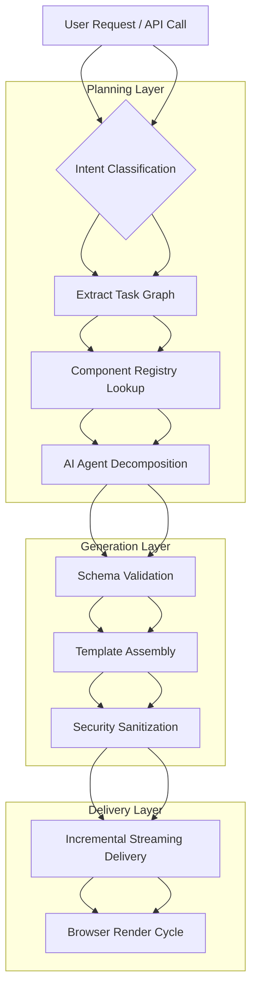

# Podcast: The Future of Web Apps: Will AI Agents Generate UIs on the Fly?

## Introduction

Imagine a web application that doesn't ship static templates at deployment time. Instead, every request arrives with a fresh set of instructions—what the user needs to see, what they want to accomplish, and how much detail they require. You'd receive a dynamically constructed interface that feels hand-crafted, yet adapts instantly based on context, permissions, and even emotional tone inferred from conversation history. This isn't science fiction. We're already seeing early prototypes where large language models collaborate with component libraries to assemble interfaces atomically. As a software engineer who has spent years scaling monolithic backends and debugging distributed rendering problems, I find myself both excited by and cautious about this emerging approach. The question isn't whether AI will touch UIs—it already has—but whether we can build production-grade systems that trust autonomous generation without sacrificing security, accessibility, or maintainability.

## Why This Matters

From a platform engineering standpoint, the stakes are significant. Dynamic UI generation sits at the intersection of several critical challenges: reducing Time-to-Market for feature variations, enabling truly personalized experiences at scale, and solving the problem of inconsistent design system adherence across rapidly evolving codebases. Traditional approaches rely on designers creating dozens of variant layouts manually. When requirements evolve—like changing a checkout button position based on regional regulations—the entire asset pipeline stalls. With AI agents capable of understanding intent and translating that into structured markup, we can iterate faster while still enforcing constraints through guardrails.

However, there's a countervailing reality: most teams lack dedicated MLOps expertise, and the reliability of generated HTML/CSS is not guaranteed. A poorly parsed prompt chain can produce broken forms, invalid attribute values, or cross-site scripting vulnerabilities if malicious input slips into the generation process. The challenge isn't technological—it's organizational. We must balance the speed of automated UI creation against the rigor of production safety standards. For engineering leaders, this represents a decision point between adopting potentially transformative capabilities and risking maintenance debt at unacceptable rates.

## How It Works

The architecture behind AI-generated UIs follows a declarative orchestration pattern where a high-level planner breaks down user goals into concrete structural decisions before committing to implementation details. At its heart lies an intent classifier that interprets natural language requests into actionable task graphs, followed by a constraint-based assembler that maps those tasks onto a pre-existing library of validated components. Each phase includes validation gates to ensure compliance with accessibility standards, version compatibility, and security policies.



The flowchart above illustrates the sequential nature of the workflow. After parsing the initial request, the system extracts a task graph representing the desired behavior—typically involving navigation, form processing, and conditional rendering. This graph then queries the component registry to identify which building blocks can satisfy each node. The AI agent takes over, reasoning about trade-offs such as whether to fetch a new layout from a template store versus constructing one from primitives, optimizing for both developer velocity and runtime cost.

Each decision point includes fallback strategies. If the component registry lacks a suitable match, the system either falls back to a default template or prompts a human designer when confidence drops below a threshold. Error states trigger rollback mechanisms that preserve user session context while avoiding corrupted partial renders.

## Core Concepts

At the lowest level, the system maintains three persistent contexts: user identity and preferences, application state including form values and routing information, and security policy constraints. These are stored in a lightweight key-value store accessible to the inference engine.

The AI orchestrator operates on a micro-batching model, processing individual tokens through a constrained decoding strategy that prevents runaway generations. Its primary responsibilities include task decomposition—breaking a multi-step user goal into sequential sub-tasks—and schema mapping, which translates abstract concepts like "show a confirmation modal" into concrete element specifications including classes, attributes, and JavaScript triggers.

Component composition relies heavily on declarative DSLs embedded within the framework. Rather than raw HTML strings produced by LLMs, the assembly stage converts high-level descriptions into structured trees that map directly to the actual CSS and JavaScript bundles. This separation ensures that the final output remains compatible with traditional build pipelines and CDN caching strategies.

Security is enforced through multiple layers. Input validation occurs before generation, filtering out attempts to inject malicious markup. The output passes through a sanitization pass that strips unsafe attributes unless explicitly permitted by the component definition. Additionally, role-based access control filters ensure that privileged users cannot accidentally expose internal administrative dialogs to untrusted environments.

## Examples & Code Walkthrough

Below is a simplified implementation demonstrating the orchestration loop. This example shows how a service might accept a user's intent, decompose it into components, validate against constraints, and assemble a safe HTML fragment.

```python
import json
from dataclasses import dataclass, field
from enum import Enum
from typing import List, Optional, Dict, Any
import re

class ComponentType(Enum):
    BUTTON = "button"
    FORM = "form"
    SECTION = "section"
    MODAL = "modal"
    HEADER = "header"

@dataclass
class UIComponent:
    """Represents a single composable UI element."""
    name: str
    type: ComponentType
    props: Dict[str, Any] = field(default_factory=dict)
    dependencies: List[str] = field(default_factory=list)

@dataclass
class UITask:
    """A unit of work that requires execution."""
    id: str
    description: str
    required_components: List[str]
    guard_conditions: List[str]

class UIOrchestrator:
    """
    Manages the lifecycle of dynamic UI generation.
    Implements a two-phase commit pattern: planning and assembly.
    """
    
    def __init__(self, component_registry: Dict[str, UIComponent]):
        self.registry = component_registry
        self.context = {
            "user_id": None,
            "permissions": [],
            "session_state": {}
        }
        
    def parse_intent(self, user_query: str) -> UITask:
        """
        Transform natural language query into a structured task.
        Returns a UITask describing the needed elements.
        """
        # Normalize and tokenize the query
        normalized = re.sub(r'\s+', ' ', user_query.lower())
        
        # Simple rule-based extraction for demonstration
        if "confirm" in normalized:
            return UITask(
                id="confirm_action",
                description="Display confirmation dialog",
                required_components=[ComponentType.MODAL],
                guard_conditions=[
                    f"user_permission:confirmation_{normalized.split()[-1]}"
                ]
            )
        elif "settings" in normalized:
            return UITask(
                id="settings_form",
                description="Render settings configuration panel",
                required_components=[ComponentType.FORM, ComponentType.SECTION],
                guard_conditions=[]  # Assume standard permissions
            )
        else:
            raise ValueError(f"Unrecognized intent: {normalized}")
    
    def validate_task(self, task: UITask) -> bool:
        """
        Check that all required components exist in the registry
        and that guards are satisfiable.
        """
        missing = [comp.name for comp_name in task.required_components 
                  if comp_name not in self.registry]
        if missing:
            print(f"[VALIDATION ERROR] Missing components: {missing}")
            return False
        
        # Simulate guard evaluation (in reality would call auth service)
        for condition in task.guard_conditions:
            if not self._satisfies_condition(condition):
                print(f"[GUARD FAILED] Condition not met: {condition}")
                return False
        return True
    
    def decompose_task(self, task: UITask) -> List[UITask]:
        """
        Break a high-level task into atomic sub-tasks.
        This is where the AI agent contributes reasoning about structure.
        """
        decompositions = []
        # Example decomposition: a form becomes fields + submit button + validation
        if task.description == "render form":
            decomp = [
                UITask(id="field_group_1", description="Create first form group",
                      required_components=[ComponentType.FORM], guard_conditions=[]),
                UITask(id="validation_layer", description="Add client-side validation wrapper",
                      required_components=[ComponentType.BUTTON], guard_conditions=[])
            ]
            decompositions.extend(decomp)
            
        return decompositions
    
    def assemble_component(self, comp: UIComponent) -> str:
        """
        Convert a component specification into serialized HTML/CSS.
        Uses a whitelist approach to prevent unstructured output.
        """
        # Build attribute string safely
        attrs = " ".join([
            f'{k}="{v}"' 
            for k, v in comp.props.items()
            if v is not None
        ])
        class_name = f"{comp.type.replace('_', '')}_{comp.name}"
        return f'<div class="{class_name}" data-compound="{class_name}">\n  <h2>{comp.name}</h2>\n  <!-- Placeholder for rendered children -->\n</div>'
    
    def generate_ui(self, user_query: str) -> str:
        """
        End-to-end method to generate a UI fragment from user intent.
        """
        try:
            # Step 1: Parse intent into a high-level task
            task = self.parse_intent(user_query)
            print(f"[PARSING] Intent '{user_query}' mapped to task: {task.id}")
            
            # Step 2: Validate and decompose
            if not self.validate_task(task):
                raise RuntimeError("Task validation failed")
            subtasks = self.decompose_task(task)
            print(f"[DECOMPOSITION] Broken into {len(subtasks)} sub-tasks")
            
            # Step 3: Assemble components sequentially
            html fragments = []
            for subtask in subtasks:
                comp = self.registry.get(subtask.required_components[0])
                if comp is None:
                    continue  # Skip undefined components
            
                frag = self.assemble_component(comp)
                html_fragments.append(frag)
                
            # Combine all fragments into final markup
            body = "\n\n".join(html_fragments)
            return f"<main>{body}</main>"
            
        except Exception as e:
            print(f"[ERROR] Generation failed: {e}")
            return "<p>Unable to generate UI at this moment.</p>"

# Example usage
if __name__ == "__main__":
    # Register a minimal set of components
    registry = {
        "submit_confirm": UIComponent(
            name="confirm_button",
            type=ComponentType.BUTTON,
            props={"label": "Confirm Change"},
            dependencies=[]
        ),
        "settings_table": UIComponent(
            name="settings_form",
            type=ComponentType.FORM,
            props={"fields": ["theme", "language"]},
            dependencies=[]
        ),
        "nav_header": UIComponent(
            name="app_header",
            type=ComponentType.HEADER,
            props={"logo": "brand"},
            dependencies=[]
        )
    }
    
    orchestrator = UIOrchestrator(registry)
    result = orchestrator.generate_ui(
        user_query="Show me a confirmation dialog and the settings form"
    )
    print(result)
```

The code demonstrates several important patterns. First, the parser uses regex normalization rather than relying on expensive NLP models for basic intent classification—a practical compromise that reduces latency. Second, validation happens before any heavy computation; attempting
