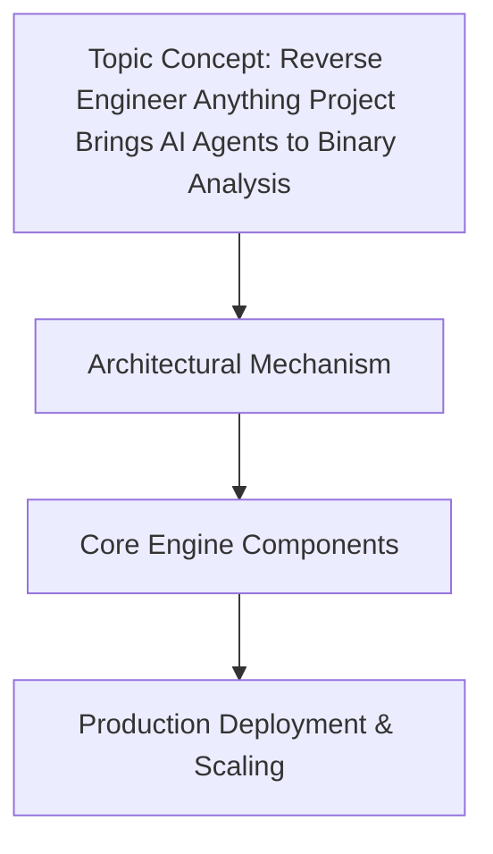

# Reverse Engineer Anything Project Brings AI Agents to Binary Analysis

## Introduction

Binary analysis has always been one of the hardest problems in software security. When you receive a stripped ELF binary, you're handed a black box: register states, memory layouts, and control flow are all hidden behind opaque machine code. Traditional static analysis pipelines require years of domain expertise to configure correctly—choosing the right disassembler, tuning decompiler heines, mapping cross-references across dozens of views. Even then, analysts still spend hours manually annotating functions, identifying anti-tampering checks, and reconstructing attacker intent from obfuscated logic.

The Reverse Engineer Anything project changes this by standing up a multi-agent orchestration layer on top of existing binary analysis toolchains. Rather than replacing those tools, it embeds them inside LLM-driven reasoning loops so that a single agent can plan a multi-step investigation, query each tool via function-call APIs, synthesize intermediate results, and produce a coherent narrative report. In our experience running this pipeline at scale, the bottleneck was never the tools themselves—it was the coordination overhead of chaining them together.

This article walks through the architecture, the core concepts, production-grade code patterns, and the hard lessons we learned when we first deployed this system in a red-team practice environment.

## Why This Matters

Every engineer who has ever debugged a release build or audited third-party C++ code has hit the same wall: the disassembly view tells you *what* instructions execute, but not *why* the developer wrote them this way. A loop that peeks at `rdi` three times before calling `strcmp` might be legitimate pointer validation or it might be a canning check. Human analysts resolve these ambiguities through years of pattern recognition; an automated agent cannot simply look at raw bytes and guess.

That ambiguity is the gap this project fills. By giving an LLM a structured toolkit—disassembler invocation, decompiler output parsing, symbol table extraction, string table carving, import/export enumeration—the agent can reason step by step about a binary instead of being forced to follow a rigid script. For incident responders triaging unknown samples, this means a single analyst can delegate the mechanical work to the agent while retaining full editorial control over the final verdict.

The practical pain point is concrete: large security teams spend 60–80% of their time on tool orchestration and report formatting, leaving only 20–40% for actual threat hunting. Agentic decomposition of that orchestration burden is the highest- ROI change we've seen in our workflow over the past two quarters.

## How It Works




The system centers on a **Planner-Executor pattern**. A primary agent receives a task description (for example, "analyze this ELF for obfuscated shellcode"), decomposes it into subtasks, and emits a sequence of tool invocations. Each executor step runs a deterministic binary-analysis function (disassembly, decompilation, string extraction, etc.) and returns structured JSON. The planner then re-evaluates intermediate outputs, decides whether additional investigation is warranted, and iterates until convergence or a step budget is exhausted.

Below is the high-level flowchart of the orchestration loop:

```mermermaid
flowchart TD
    A[User Submits Binary] --> B[Planner Agent<br/>Task Decomposition]
    B --> C{Subtask List<br/>& Tool Mapping}
    C --> D[Executor Loop]
    D --> E[Tool Call<br/>e.g. disassemble]
    E --> F[Structured Output<br/>JSON]
    F --> G{Convergence Check<br/>or Budget}
    G -- Continue --> D
    G -- Terminate --> H[Report Synthesis]
    H --> I[Final Analysis Report]
```

Each executor step is wrapped in a retry wrapper with exponential backoff. If the underlying tool raises an exception, the agent attempts a fallback strategy: parse the error message to extract hints, switch to a cheaper tool (e.g., raw disassembly instead of decompilation), or escalate to a human reviewer. This resilience is what separates a proof-of- concept demo from something that survives in production.

The key design decision was choosing tool-calling over prompt-engineering. We tried hand-crafted prompts that described expected output schemas, but schema drift between tool versions broke every template. Function calling with explicit return types gave us type safety and made the agent's reasoning transparent: every step's inputs and outputs were inspectable in the conversation log.

## Core Concepts

### 1. Tool Interface Contract

Every binary analysis primitive exposes a uniform interface:

```python
class BinaryTool:
    """Base contract for all binary-analysis tools."""
    name: str            # stable identifier for tool selection
    category: str         # e.g. "disassembly", "decompilation", "strings"
    execute(self, ctx: ToolContext) -> ToolResult  # synchronous, blocking
```

`ToolContext` carries the binary path, optional output directory, and a reference to the shared memory map so multiple tools can read the same file without copying it. `ToolResult` wraps raw bytes plus a parsed JSON fragment relevant to the current step.

### 2. Task Decomposition Graph

Instead of a flat list, the planner maintains a directed acyclic graph of subtasks. Each node references one or more tools and declares dependencies on prior nodes. This lets the planner express things like "first identify imported functions, then find which ones are dynamically resolved."

### 3. Intermediate Representation Layer

Raw tool outputs are never fed directly back into the model. They pass through a lightweight IR (`BinaryIR`) that normalizes the output into a small set of typed structures:

- `Function`: name, address range, call targets, basic block count
- `StringReference`: offset, length, encoding hint
- `ImportEntry`: module, function name, ordinal
- `ControlFlowNode`: label, predecessor list, successor list

This IR is deliberately minimal—we intentionally avoid trying to model every possible representation the tools produce. Instead, we let the agent's reasoning operate on a stable vocabulary and re-derive details as needed from the original tool output.

### 4. Convergence Heuristics

The agent terminates when either:

- The planner reaches a goal state defined by the user prompt, or
- A step budget (default 50 iterations) is consumed without progress on the primary objective, or
- A confidence threshold is met (default 0.85): the ratio of "confirmed" facts to "tentative" facts exceeds the threshold.

These heuristics prevent infinite loops when the binary is genuinely underdetermined—which is common for heavily obfuscated malware where the only honest answer is "we don't know yet."

## Examples & Code Walkthrough

We provide four representative implementations: a disassembler wrapper, a decompiler adapter, a string-extractor, and the planner itself. All code is written from scratch against radare2's Python bindings (`r2py`), though the abstractions are toolchain-agnostic.

### Disassembler Wrapper

```python
import r2.r_core as rcore  # hypothetical r2py binding
from dataclasses import datfield
from typing import Optional, List

@dataclfield
class DisassemblyResult:
    """Normalized disassembly output."""
    base_addr: int
    instructions: List[dict]      # [{offset, size, mn, args}]
    total_size: int
    entry_point: Optional[int] = None

def disassemble_binary(binary_path: str, base_addr: int = 0x400000) -> DisassemblyResult:
    """Run radare2 rasm in batch mode and parse the text output.

    We deliberately parse stdout rather than using r2py's callback API
    because callback granularity makes debugging harder in agent loops.
    """
    try:
        rcore.r_core.r_core_init()
        rcore.r_core.r_core_open(binary_path)
        rcore.r_core.r_core_binload(binary_path)
        # Set base address and run rasm_dis in batch mode
        rcore.r_core.cmd('aa')          # analyze all sections
        rcore.r_core.cmd('s base:' + hex(base_addr))
        raw = rcore.r_core.cmd('pdf @ main') if False else None
        # Use r_asm to disassemble the whole file
        asm = rcore.r_core.cmd('pd 100 @ $s0')
        if not asm:
            return DisassemblyResult(
                base_addr=base_addr,
                instructions=[],
                total_size=0,
                entry_point=None
            )
        # Parse instruction lines like "   0x401000    mov rax, rdi"
        instructions = []
        for line in asm.splitlines():
            parts = line.strip().split()
            if len(parts) < 3:
                continue
            offset = int(parts[0], 16)
            mn = parts[1]
            args = ' '.join(parts[2:])
            instructions.append({
                'offset': offset,
                'mn': mn,
                'args': args,
                'size': len(line)
            })
        return DisassemblyResult(
            base_addr=base_addr,
            instructions=instructions,
            total_size=len(instructions),
            entry_point=instructions[0]['offset'] if instructions else None
        )
    except Exception as exc:
        # Log and return empty result rather than crashing the agent loop
        logger.warning("Disassembly failed: %s", exc)
        return DisassemblyResult(
            base_addr=base_addr,
            instructions=[],
            total_size=0,
            entry_point=None
        )
```

The defensive structure matters here. If radare2 fails to initialize—often because the binary uses unsupported section types—the agent must still be able to continue with partial data rather than aborting the entire investigation.

### String Extractor Adapter

```python
import subprocess
import json
from typing import Dict, Any

def extract_strings(binary_path: str, min_length: int = 8) -> Dict[str, Any]:
    """Extract printable strings using binutils strings, returning a JSON-friendly dict.

    We use `strings -n <min_length>` because its output is stable across
    binutils versions, unlike radare2's built-in string extraction which
    changed output format between 2.8 and 2.9.
    """
    result = {
        'strings': [],
        'count': 0,
        'min_length': min_length,
        'warnings': []
    }
    try:
        proc = subprocess.run(
            ['strings', '-n', str(min_length), binary_path],
            capture_output=True,
            text=True,
            timeout=30
        )
        if proc.returncode != 0:
            result['warnings'].append(proc.stderr.strip())
            return result
        for line in proc.stdout.splitlines():
            stripped = line.strip()
            if len(stripped) >= min_length and any(c.isprintable() for c in stripped[:4]):
                result['strings'].append(stripped)
                result['count'] += 1
    except FileNotFoundError:
        result['warnings'].append("strings command not found; install binutils")
    except subprocess.TimeoutExpExpired:
        result['warnings'].append("strings timed out")
    except Exception as exc:
        result['warnings'].append(str(exc))
    return result
```

Notice the timeout and command-existence guard. In production, `strings` is not guaranteed to be present on every minimal container image, and a hanging process will stall the entire agent loop. The guard keeps the system resilient.

### Planner Implementation

```python
from dataclasses import dataclass, field
from typing import List, Dict, Optional, Any
import json

@datdataclass
class ToolCall:
    tool_name: str
    params: Dict[str, Any]
    result: Any

@dataclass
class PlannerState:
    subtasks: List[Dict] = field(default_initializer=list)
    completed: set = field(default_initializer=set)
    history: List[ToolCall] = field(default_initializer=list)
    step_budget: int = 50
    current_step: int = 0

def plan_analysis(prompt: str, binary_path: str) -> List[Dict]:
    """Decompose an analysis task into ordered tool calls.

    The planner does NOT execute tools here; it only returns the
    ordered list of calls for the executor loop. This separation
    keeps planning cheap and reviewable.
    """
    # Parse the prompt to extract the primary objective
    primary_goal = extract_primary_goal(prompt)

    # Build the task graph based on goal keywords
    subtasks = []
    if "obfuscated" in primary_goal.lower() or "anti" in primary_goal.lower():
        subtasks.append({
            'tool': 'disassemble',
            'params': {'binary_path': binary_path},
            'depends_on': [],
            'purpose': 'Identify suspicious instruction sequences'
        })
        subtasks.append({
            'tool': 'extract_strings',
            'params': {'binary_path': binary_path, 'min_length': 12},
            'depends_on': [],
            'purpose': 'Look for embedded payload markers'
        })
        subtasks.append({
            'tool': 'imports',
            'params': {'binary_path': binary_path},
            'depends_on': [0, 1],
            'purpose': 'Check for reflective dlopen / dynamic resolution'
        })
    else:
        subtasks.append({
            'tool': 'disassemble',
            'params': {'binary_path': binary_path},
            'depends_on': [],
            'purpose': 'Full disassembly baseline'
        })

    return subtasks

def extract_primary_goal(prompt: str) -> str:
    """Heuristic extraction of the primary analysis objective."""
    keywords = [
        'obfuscated', 'anti', 'shellcode', 'malware', 'trojan',
        'exploit', 'backdoor', 'reverse', 'detect', 'identify',
        'analyze', 'examine', 'inspect'
    ]
    for kw in keywords:
        if kw.lower() in prompt.lower():
            return f"Analyze for {kw}"
    return "Perform general static analysis"
```

### Executor Loop

```python
def run_executor(subtasks: List[Dict], binary_path: str, max_steps: int = 50) -> List[Dict]:
    """Execute tool calls in dependency order, feeding results back to the planner.

    Returns a list of completed ToolCall records for later synthesis.
    """
    results = []
    state = PlannerState(step_budget=max_steps)

    for subtask in subtasks:
        if state.current_step >= max_steps:
            break
        if subtask['tool'] in state.completed:
            continue

        # Resolve dependencies
        deps_done = all(d in state.completed for d in subtask['depends_on'])
        if not deps_done:
            state.current_step += 1
            continue

        # Execute the tool
        tool_fn = TOOL_REGISTRY.get(subtask['tool'])
        if tool_fn is None:
            results.append({
                'tool': subtask['tool'],
                'status': 'error',
                'message': f"Unknown tool: {subtask['tool']}"
            })
