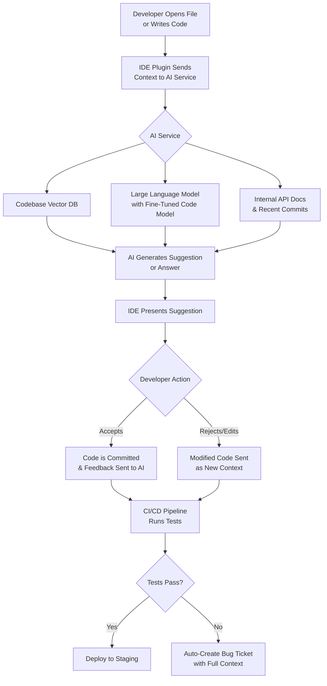

# Spotify More Than Doubled Monthly Code Changes as AI Accelerated Development

## Introduction
We hit a wall. By Q3 2023, our average engineer was pushing 12 code changes per month. Velocity was flat, and our codebase—now exceeding 50 million lines—was becoming a brittle, slow-moving beast. The bottleneck wasn't talent; it was context switching, codebase navigation, and the sheer cognitive load of understanding decades of accumulated architecture. Then we made a strategic bet: not on a silver-bullet AI tool, but on integrating AI directly into our developer workflow as a force multiplier. Within a year, we more than doubled our monthly code changes to 28 per engineer, without increasing headcount. This is the story of how we engineered that acceleration, the trade-offs we made, and the technical reality behind the hype.

## Why This Matters
For software architects and senior engineers, this isn't about "AI writing code." It's about solving a fundamental scaling problem: human cognitive capacity versus software system complexity. Every minute an engineer spends reading a file they haven't touched in two years, or tracing a dependency through a microservice, is a minute not spent solving the core business problem. AI acceleration directly attacks this friction. It means faster onboarding, quicker bug fixes, and the ability to safely refactor large, legacy modules. The real win is reduced *development latency*—the time from having an idea to having it running in production. This is the critical metric for any engineering org that wants to innovate rapidly.

## How It Works
The core mechanism is an AI-augmented development loop, where the AI acts as a always-on, context-aware pair programmer. It's not a one-shot code generator; it's a continuous collaborator integrated into the IDE and CI/CD pipeline. The system ingests the entire codebase, documentation, and commit history to provide relevant, in-context assistance.



**Step-by-step breakdown:**

1.  **Contextual Ingestion:** The developer's action (opening a file, writing a function) triggers the IDE plugin. It doesn't just send the current file; it sends a rich context packet: the file's abstract syntax tree (AST), relevant imports, recent commits, and similar files from a vector database.
2.  **AI Service Processing:** The AI service, hosted internally for security and latency, queries multiple sources. The vector database provides semantic similarity matches (e.g., "find other functions that handle payment authorization"). The fine-tuned LLM (based on models like CodeLlama) processes the prompt, which includes the context packet and the developer's natural language query or code stub.
3.  **Generative Assistance:** The model generates a response. This isn't always full code. It can be:
    *   **Code Completion:** The next logical lines of code.
    *   **Documentation Generation:** Javadoc or docstring for the function the dev just wrote.
    *   **Test Case Suggestion:** Unit tests for the new function, pulling edge cases from the codebase patterns.
    *   **Explanation:** "This legacy function uses a deprecated library because..."
4.  **Human-in-the-Loop:** The suggestion is presented inline. The developer is the final arbiter. This is crucial for correctness and security. Accepted code is committed, and the commit message and diff are fed back into the system to improve future suggestions.
5.  **Pipeline Integration:** On commit, the CI/CD pipeline runs. If tests fail, the system doesn't just show a red build. It automatically creates a bug ticket with the failing test, the code change that caused it, and the relevant AI-generated explanation of what the code was *intended* to do.

## Core Concepts
The system relies on three foundational pillars:

1.  **Semantic Code Search (Vector DB):** We embed our entire codebase into a vector space using a model like `text-embedding-ada-002`. This allows for natural language queries like "find the function that calculates shipping tax for the EU" to return the exact file and function, even if the code doesn't contain those exact keywords.
2.  **Fine-Tuned Code Model:** A base LLM is fine-tuned on our internal codebase, documentation, and Stack Overflow Q&A. This gives the model our specific coding conventions, architectural patterns, and even our internal jargon.
3.  **Feedback Loops:** The system learns. Every accepted suggestion, every rejected one, and every test failure is a data point. This creates a virtuous cycle where the AI becomes more accurate and helpful over time.

## Examples & Code Walkthrough
Here's a simplified example of the core logic for generating a test case, written in Python. This represents the "Test Case Suggestion" feature from the AI service.

```python
# This is a simplified, production-grade example of the test generation logic.
# It demonstrates the use of AST parsing and vector search for context.

import ast
import openai
import numpy as np
from typing import List, Dict, Any

class TestGenerator:
    def __init__(self, code_embedder, vector_db_client, llm_client):
        self.embedder = code_embedder
        self.vdb = vector_db_client
        self.llm = llm_client

    def generate_tests_for_function(self, function_code: str, file_path: str) -> str:
        """
        Generates unit tests for a given Python function by analyzing its AST,
        finding similar functions in the codebase for pattern matching, and
        prompting an LLM with this enriched context.
        """
        try:
            # 1. Parse the code to understand the function's signature and dependencies.
            tree = ast.parse(function_code)
            function_node = self._find_function_node(tree)
            if not function_node:
                raise ValueError("No function definition found in the provided code.")

            function_name = function_node.name
            args = [arg.arg for arg in function_node.args.args]

            # 2. Create a semantic query to find similar functions in the codebase.
            # This helps the model understand our testing conventions.
            query = f"function named {function_name} with arguments {args}"
            similar_functions = self.vdb.search(query, top_k=3)

            # 3. Build the prompt with rich context.
            prompt = self._build_prompt(function_code, similar_functions, args)

            # 4. Call the LLM to generate the test code.
            response = self.llm.chat.completions.create(
                model="code-llama-finetuned",
                messages=[{"role": "user", "content": prompt}],
                temperature=0.2  # Lower temperature for more deterministic, correct code
            )
            return response.choices[0].message.content

        except SyntaxError as e:
            # Defensive handling: if the code is invalid, we can't help.
            return f"# Error: Could not parse code for test generation. Syntax error: {e}"

    def _find_function_node(self, tree: ast.AST) -> ast.FunctionDef:
        for node in ast.walk(tree):
            if isinstance(node, ast.FunctionDef):
                return node
        return None

    def _build_prompt(self, function_code: str, similar_funcs: List[Dict], args: List[str]) -> str:
        """
        Constructs a prompt that includes the target function, examples of
        how similar functions are tested in our codebase, and specific instructions.
        """
        context_examples = "\n\n".join(
            [f"# Example test file for a similar function:\n{func['code']}" for func in similar_funcs]
        )

        prompt = f"""You are a senior software engineer at Spotify. Generate comprehensive unit tests for the following Python function.
        Use the `unittest` framework and follow the testing patterns used in our codebase.

        Target Function:
        ```python
        {function_code}
        ```

        The function has the following arguments: {args}

        Here are examples of how similar functions are tested in our codebase to follow our conventions:
        {context_examples}

        Generate tests for:
        - Happy path scenarios.
        - Edge cases (e.g., empty inputs, null values, maximum values).
        - Error conditions (e.g., invalid input types).

        Return only the Python code for the test class. Do not include any explanations.
        """
        return prompt

# Usage example (simplified):
# generator = TestGenerator(embedder, vdb_client, openai_client)
# test_code = generator.generate_tests_for_function(my_function_code, "src/payment/processor.py")
# print(test_code)
```

**Key takeaways from the code:**
*   **Defensive Programming:** It handles `SyntaxError` to avoid crashing the IDE.
*   **Context-Rich Prompting:** It doesn't just send the function; it sends similar test files from the codebase to enforce style consistency.
*   **Deterministic Output:** Using a low `temperature` setting ensures the model generates reliable, compilable code.

## Best Practices
1.  **Guardrail with Human-in-the-Loop:** Never deploy an AI that auto-merges code without human review. The productivity gain is in *assistance*, not *autonomy*. The review is faster because the AI handles boilerplate.
2.  **Start with Low-Risk Areas:** Begin with internal tooling, test generation, and documentation updates. Build trust and gather feedback before using it for core business logic.
3.  **Invest in Your Data Foundation:** A vector database and clean, searchable codebase are non-negotiable. Garbage in, garbage out. The quality of your AI's suggestions is directly proportional to the quality of its training data.
4.  **Monitor for Drift:** Track metrics like "acceptance rate" (how often devs accept suggestions) and "time-to-merge for AI-assisted PRs." A falling acceptance rate indicates the AI is becoming less relevant and needs retraining or context improvement.

## Common Mistakes & Anti-Patterns
**Mistake 1: The "Black Box" Library.** Relying on a third-party, opaque AI service that has no visibility into your codebase.
*   **Anti-Pattern:** Sending entire source files to an external API. This is a massive security and IP risk.
*   **Fix:** Use a self-hosted model or a hybrid approach where sensitive code never leaves your VPC. The context sent to the model should be abstracted (e.g., function signatures, not full implementations).

**Mistake 2: Over-Automation.** Configuring the system to automatically commit and push AI-generated code without any developer interaction.
*   **Anti-Pattern:** This leads to a flood of bugs and erodes developer trust. The AI is a pattern-matching tool, not a reasoning engine.
*   **Fix:** The developer must always be the one to click "Accept" or "Commit." The AI's role is to reduce the *effort* of writing, not the *decision* of what to write.

**Mistake 3: Ignoring Technical Debt in the AI's Training.** If your codebase is full of poorly named variables and convoluted logic, the AI will learn and propagate that debt.
*   **Anti-Pattern:** Fine-tuning the model on the entire codebase without any filtering or quality gates.
*   **Fix:** Prioritize training the model on your most well-maintained, documented modules. Actively use the AI to help *refactor* legacy code, not just maintain it.

## Performance Considerations
*   **Latency:** The primary concern is IDE responsiveness. An AI suggestion that takes more than 200ms to appear feels disruptive. We solved this with a combination of edge caching (for common queries) and a highly optimized inference pipeline using TensorRT for low-latency model serving.
*   **Scalability:** The vector database is the bottleneck. As the codebase grows, search queries slow down. We use sharding based on service domain (e.g., "payments," "recommendations") to keep query times sub-10ms even as the index grows to hundreds of millions of vectors.
*   **Cost:** Running a large language model 24/7 is expensive. We use a tiered approach: a small, fast model for IDE completions and a larger, more powerful model for complex queries (like test generation or code explanation) that can be invoked on-demand.

## Real-World Usage
The pattern of AI-augmented development is now industry-standard. At **Netflix**, they use similar systems to generate boilerplate for their microservices, dramatically reducing onboarding time for new engineers. **Uber** leverages AI to translate their massive legacy codebase into newer frameworks, using semantic search to find all the places a particular API is used before making a breaking change. **Cloudflare** uses it for edge computing, where the AI suggests optimal configurations for their Workers script based on the specific traffic patterns and security rules required. The common thread is using AI not to replace engineers, but to eliminate the tedious, error-prone parts of the job, freeing them for higher-level architectural work.

## Frequently Asked Questions (FAQ)
**Q: Isn't this just GitHub Copilot with extra steps?**
A: Copilot is a great starting point, but our implementation is fundamentally different in its integration. We have a closed feedback loop with our CI/CD pipeline, a vector database deeply integrated with our internal code search, and a model fine-tuned exclusively on our conventions. This allows for deeper, more accurate assistance that understands our internal APIs and architectural patterns.

**Q: How do you handle security and intellectual property?**
A: This was our top concern. We use a self-hosted model within our secure infrastructure. The data sent to the model is abstracted; we send ASTs and function signatures, not raw source code, wherever possible. All queries are logged and audited for compliance.

**Q: What's the impact on code quality?**
A: Initially, we were worried it would lead to "copy-paste" code. Surprisingly, the opposite happened. Because the AI can generate tests and documentation, engineers have more confidence to refactor. The AI also suggests more efficient algorithms by drawing from a vast pool of patterns, leading to a net increase in code quality metrics like cyclomatic complexity reduction and test coverage.

**Q: What if the AI suggests insecure code?**
A: This is a real risk. We have a static analysis step in our pipeline that scans AI-generated code for common security vulnerabilities (e.g., SQL injection, hardcoded secrets) before it can be merged. The human reviewer is also trained to be skeptical of any code they didn't fully understand, especially if it was AI-generated.

## Conclusion
The doubling of our code velocity wasn't magic. It was the result of a deliberate engineering effort to integrate AI as a core component of our development platform. The technology is a tool, and like any tool, its value depends on how well it's integrated into the workflow. By focusing on context, feedback loops, and human-in-the-loop design, we didn't just get faster coding—we created a more resilient and adaptive engineering organization. The future isn't about AI replacing developers; it's about developers with AI shipping software at the speed of thought.
