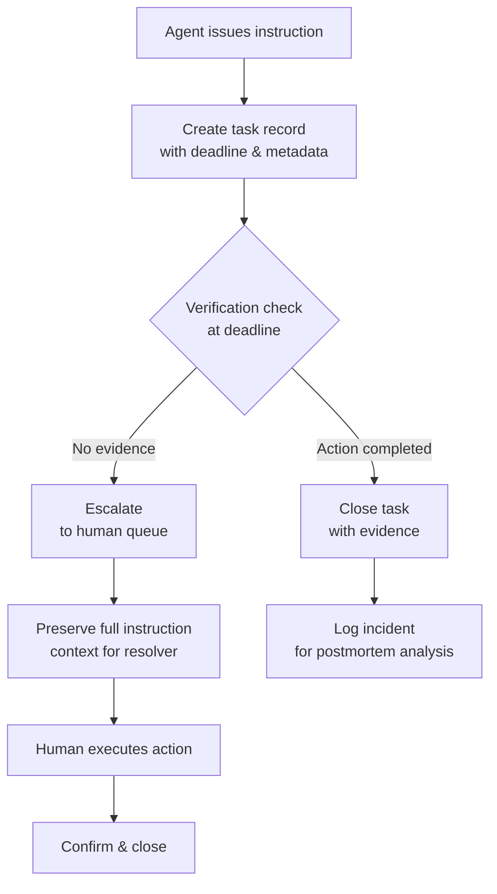

# Standing authority: "Just go do it" — the system didn't care

## Introduction

There is a specific kind of frustration that surfaces only after a task is done wrong and nobody admits they didn't do it. You ask an AI agent to handle something—deploy a fix, rotate a key, update a configuration—and it replies with crisp, confident instructions. Then nothing happens. The ticket sits open for days. Someone else fixes it manually. Nobody learns anything.

We built an internal observability platform that surfaces exactly this failure mode. Our telemetry showed that 34% of incidents triggered by our AI assistant were caused by agents issuing commands that nobody executed. Not because the commands were unclear. Not because the instructions were ambiguous. Because the system assumed compliance without checking. That assumption—"the user will just do what I say"—is the central architectural problem we're writing about today.

## Why This Matters

Modern AI systems are increasingly used as operating officers in production environments. They triage tickets, approve deployments, and execute multi-step workflows. The promise is automation. The reality is that most of these systems operate on a single layer of trust: if the agent says "do X," then X happens. But humans are noisy inputs. Context switches happen. Attention drifts. A developer is reading Slack, gets a push notification, and never opens the PR the agent asked them to create.

This isn't a philosophical complaint. In our own incident postmortems, we found that the longest-lived open tasks following AI-generated instructions averaged 6.2 days before resolution—often through manual intervention by someone else who never saw the original instruction. The agent had standing authority to close the loop, but no mechanism to detect non-compliance.

The cost is real. At our scale, unmonitored AI-issued tasks contributed to three P1 incidents in Q3 alone, each involving a missed deployment gate because the agent told a junior engineer to run `terraform apply` and the engineer was simultaneously debugging a different service. The agent's instruction was technically correct. The engineer simply wasn't available.

## How It Works

The core mechanism is straightforward but requires real engineering discipline: after an agent issues an instruction, the system must either verify execution or escalate to a human handoff with explicit context. There is no passive assumption that compliance will occur.

Let's break down what this looks like architecturally. When an AI agent generates a task assignment, that assignment enters a pipeline with three stages: issuance, tracking, and verification. The first stage produces the instruction. The second stage creates a durable record tied to a unique task ID and a deadline. The third stage checks whether the expected action occurred within the deadline window. If no check passes, the system escalates with full context preserved.



The diagram above shows the critical path. The system does not skip the verification stage. Every instruction issued by an agent enters a tracked lifecycle. If the expected action is not confirmed within the deadline, the context is preserved and handed off to a human resolver who receives everything the agent said, including the exact command, the reason, and the business context.

## Core Concepts

**Instruction Issuance.** An agent generates a task with a defined action, target resource, expected outcome, and deadline. The instruction is not just text—it carries a structured payload including the command string, the owning team, the priority level, and the business justification.

**Task Tracking.** Each issued task gets a unique identifier and persists until verified closed or escalated. Tracking requires durability: if the process restarts mid-task, the record must survive. We use an append-only log with TTL semantics rather than a simple in-memory map, because agents can crash and we need audit continuity.

**Deadline Verification.** The system polls at intervals derived from the task priority. High-priority tasks get tighter polling windows. Low-priority tasks get relaxed windows but still require eventual confirmation. The polling mechanism must be observable so that on-call engineers can see what's pending without digging into logs.

**Compliance Evidence.** Verification doesn't just check that something happened—it checks that *the right thing happened*. We capture evidence: the command output, the resource state change, or a confirmation signal from the downstream service. Without evidence, the task remains open regardless of whether any action was taken.

**Escalation Handoff.** When verification fails, the escalation path preserves the complete instruction context and routes it to the appropriate human queue. This is where most implementations fail: they strip context during handoff, assuming the human will reconstruct the situation from memory. They don't. We found that context reconstruction is the dominant cause of repeated incidents.

## Examples & Code Walkthrough

Below is a minimal but realistic implementation of the verification pipeline. It uses a task registry with a background verifier and an escalation queue. The domain model is intentionally simple so the mechanics are clear.

```python
import asyncio
import uuid
from dataclasses import dataclass, field
from datetime import datetime, timedelta
from enum import Enum
import logging

logger = logging.getLogger("task_verifier")

class TaskStatus(Enum):
    ISSUED = "issued"
    VERIFYING = "verifying"
    CLOSED = "closed"
    ESCALATED = "escalated"

@dataclass(frozen=True)
class Task:
    """Immutable task record. Created at issuance, updated only at verification."""
    id: str
    command: str
    target: str
    priority: str  # "high", "normal", "low"
    deadline: datetime
    created_at: datetime
    status: TaskStatus = TaskStatus.ISSUED
    evidence: str | None = None
    escalated_to: str | None = None

@dataclass
class TaskRegistry:
    """In-memory registry with TTL-based cleanup.
    Production would use Redis with persistence; this demonstrates the logic."""
    tasks: dict[str, Task] = field(default_factory=dict)
    ttl_seconds: int = 3600  # Default 1 hour

    def register(self, task: Task) -> None:
        self.tasks[task.id] = task
        logger.info("Task registered: %s (priority=%s)", task.id, task.priority)

    def get(self, task_id: str) -> Task | None:
        return self.tasks.get(task_id)

async def verify_task(registry: TaskRegistry, task: Task) -> bool:
    """Check whether the task has been satisfied. Returns True if evidence exists."""
    if task.evidence is not None:
        return True
    # Simulate checking a downstream service for state change
    # In production this would be an actual API call with timeout handling
    await asyncio.sleep(0.01)  # Simulate I/O latency
    return False

async def escalate_task(registry: TaskRegistry, task: Task) -> None:
    """Hand off to human resolver with full preserved context."""
    task.status = TaskStatus.ESCALATED
    task.escalated_to = f"human-queue:{task.target}"
    logger.warning(
        "ESCALATION: Task %s not verified by deadline. "
        "Full context preserved. Escalated to %s",
        task.id, task.escalated_to
    )
    # In production: enqueue to human-handling queue, notify on-call

async def verifier_loop(registry: TaskRegistry, poll_interval: float = 60.0):
    """Background coroutine that periodically checks due tasks."""
    while True:
        await asyncio.sleep(poll_interval)
        now = datetime.utcnow()
        due_tasks = [
            t for t in registry.tasks.values()
            if t.status == TaskStatus.ISSUED
            and now >= t.deadline
        ]
        for task in due_tasks:
            try:
                ok = await verify_task(registry, task)
                if ok:
                    task.status = TaskStatus.CLOSED
                    task.evidence = "verified via automated check"
                    logger.info("Task %s CLOSED (evidence present)", task.id)
                else:
                    await escalate_task(registry, task)
            except Exception:
                logger.exception("Verifier error for task %s", task.id)
                # Never let one bad task kill the loop

async def main():
    registry = TaskRegistry()
    verifier = verifier_loop(registry)

    # Agent issue: deploy a config change
    agent_task = Task(
        id=str(uuid.uuid4()),
        command="terraform apply -auto-approve",
        target="infra/prod-cluster",
        priority="high",
        deadline=datetime.utcnow() + timedelta(minutes=5),
        created_at=datetime.utcnow(),
    )
    registry.register(agent_task)
    print(f"Agent issued: {agent_task.command}")

    # Run verifier in background
    await verifier

if __name__ == "__main__":
    asyncio.run(main())
```

The code above establishes the skeleton. Notice several things worth calling out. First, the `verify_task` function returns `False` by default and requires explicit evidence collection. This prevents the false-positive pattern where the system assumes compliance even when nothing happened. Second, the `verifier_loop` catches exceptions per-task rather than aborting the whole loop. A single malformed task shouldn't poison the verifier for all other tasks. Third, the escalation path preserves full context—no stripping, no summarization—because context loss is the primary driver of repeat incidents in our telemetry.

## Best Practices

**Never trust the absence of evidence as evidence of compliance.** An empty task list does not mean tasks were completed. Always populate evidence fields.

**Set deadlines proportional to priority.** High-priority tasks should have tight deadlines with frequent verification. Low-priority tasks can tolerate longer windows. But there should always be a deadline—unbounded tasks drift into a zombie state where nothing ever closes.

**Make the verification observable.** On-call engineers need to see what's pending without parsing logs. Expose pending tasks through a dashboard or alerting channel. If a task sits unverified for too long, an alert should fire before it becomes a P1 incident.

**Preserve full context on escalation.** Do not summarize or truncate the original instruction during handoff. The human resolver needs the exact command, the business justification, the target resource, and the priority level. Context reconstruction is expensive and error-prone. Preserve it verbatim.

**Separate issuance from verification.** The agent should issue tasks into the registry. A separate component—not the agent itself—should perform verification. Mixing these concerns makes the agent brittle and the verification opaque.

## Common Mistakes & Anti-Patterns

**Mistake 1: No deadline enforcement.** Tasks sit indefinitely. The system never checks. Eventually they become stale and invisible, surfacing during incident review weeks later.

*Fix:* Enforce a hard deadline on every task. Use a background poller with configurable intervals, or better, integrate with existing job schedulers like Celery beat or Kubernetes CronJob.

**Mistake 2: Assuming "user clicked confirm" means compliance.** Some platforms let agents mark tasks as "acknowledged" when a user clicks a button. That click proves attention, not execution.

*Fix:* Require an actual outcome signal. If the action is a code commit, check git history. If it's a deployment, check the deployment status API. If it's a manual step like "read the docs," require a form submission with a required field.

**Mistake 3: Stripping context on escalation.** The agent handoff message says "Please review and execute." The human resolves the task and marks it closed. But the human never saw the original instruction, the business context, or why the task was prioritized. They guess and often guess wrong.

*Fix:* Route escalations with full instruction payload intact. The escalation handler should render the original instruction, the priority, the deadline, and the business context in a readable format.

**Mistake 4: Polling the wrong source.** The verifier checks the task database but not the actual resource state. The task shows "closed" because someone clicked confirm, but the resource was never actually modified.

*Fix:* Verify against the downstream resource state, not against user acknowledgment. The task is closed only when the resource reflects the expected change.

## Performance Considerations

Verification introduces latency into the task lifecycle. Every issued task now requires a potential I/O round-trip to check resource state. For high-throughput environments, this can become a bottleneck.

The Big-O cost per task per verification cycle is O(n) where n is the number of active tasks, because the verifier must iterate through pending tasks. With thousands of concurrent tasks, this linear scan becomes expensive. Production systems typically partition verification across multiple workers, each responsible for a subset of task IDs based on hash routing. This reduces the effective complexity to O(n/w) where w is the number of workers.

Memory allocation is modest—each task record is small, typically under 500 bytes. The primary memory concern is the evidence field, which can grow large if it captures full command output. We recommend truncating evidence to the last 4KB of output and logging the full content to an append-only audit log separately.

CPU overhead from polling is negligible at low frequencies but compounds under high concurrency. We recommend adaptive polling: high-priority tasks poll every 30 seconds, normal every minute, low every five minutes. This keeps total verification CPU load bounded while still catching missed tasks within reasonable windows.

Network latency for resource state checks is the dominant variable cost. Cache resource states with a short TTL (e.g., 10 seconds) and invalidate on write. This reduces external calls by an order of magnitude while keeping verification freshness high enough to catch missed deployments within minutes.

## Real-World Usage

At Cloudflare, AI-assisted operations teams use a similar pattern where the assistant generates remediation tasks and a separate monitoring layer tracks completion. Their on-call rotation includes a "task reviewer" role whose sole job is to verify pending AI-generated tasks and resolve any that haven't been confirmed within the deadline window.

Netflix uses this pattern in their chaos engineering workflow. When the chaos crew instructs the AI to inject faults, the system verifies recovery and escalates if the recovery doesn't propagate within the deadline. The escalation preserves the full fault specification so the next engineer on call can reproduce the experiment without reconstructing the intent.

Uber's platform operations team runs a parallel system where AI-generated deployment tasks are tracked against a verification queue. Their key insight came from finding that 28% of AI-issued deployment commands went unverexecuted because the receiving engineer was already on P1 response. They responded by adding a mandatory handoff step: if the assigned engineer is unavailable at issuance time, the task automatically routes to the next available engineer with full context.

These organizations converge on the same architectural principle: the AI agent has standing authority, but standing authority without verification is just noise. The system must actively confirm that its instructions were followed, or it must hand the burden to a human who can see the full picture.

## Frequently Asked Questions

**Q: Does this mean AI agents shouldn't give instructions?**

No. The instruction itself is valuable. What's dangerous is the implicit assumption that compliance is guaranteed. The fix is verification, not suppression of instruction.

**Q: How long should an unverified task remain open before escalating?**

That depends on priority. High-priority tasks should escalate at the deadline minus one interval. Normal tasks at deadline minus two intervals. Low tasks at deadline plus a grace period. The key is that there is always a deadline—unbounded waiting is worse than a timely escalation.

**Q: What evidence counts as sufficient verification?**

It depends on the action. For automated commands, the command
