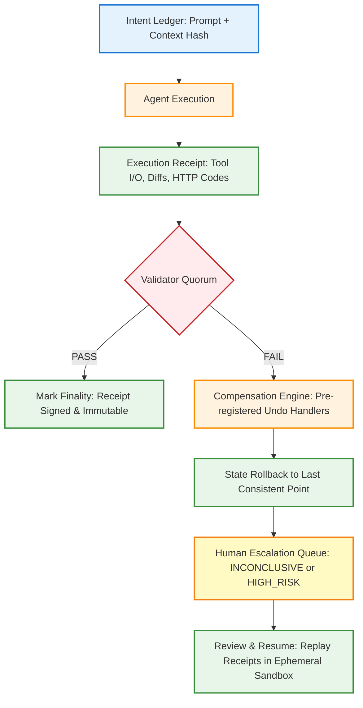

# Stop Trusting Your AI Agents to Tell You They Are "Done"

## Introduction

In the past twelve months, I've seen three separate production incidents where an AI agent reported `STATUS: COMPLETE` only for downstream systems to choke on partial state, violated schemas, or missing invariants. The common thread? We were treating a token probability distribution as a contract.

An LLM doesn't "complete" a task in the human sense. It emits the next most probable token given its context window, a temperature parameter, and whatever tooling it has available. When the model outputs a `function_calls` block or a JSON-wrapped summary, it's not certifying that side-effects persisted, invariants held, or that the system remains in a valid state. It's merely predicting that the sequence is complete.

The shift I advocate for—and the one this article articulates—is moving from "Agent Reported Status" to "Verifiable Finality." In practice, this means architecting your runtime so that "Done" is not a boolean returned from the model, but a cryptographically verifiable proof that execution finished, validated, and compensated if needed.

## Why This Matters

If you're building autonomous agents that mutate databases, write code, trigger webhooks, or modify infrastructure, the gap between "the agent thinks it's done" and "the system is actually consistent" is where incidents live. I've watched on-call pagers fire at 2:00 AM because an agent optimistically updated a vector store, reported success, and the primary database transaction rolled back due to a concurrent constraint violation.

The pain point is systemic: most frameworks default to a fire-and-forget model where the agent's final message is treated as ground truth. For ML platform leads and SREs, this is unacceptable. We need guarantees that map to the same rigor we apply to distributed transactions, database migrations, or CI pipelines. The cost of a false "done" isn't just a retry; it's corrupted data, broken user flows, and eroded trust in the entire automation layer.

## How It Works

At the heart of this approach is a protocol I call the **Receipts Protocol**. Borrowing from distributed systems patterns—two-phase commit, saga orchestration, idempotency keys—we adapt them for stochastic actors. The core idea: before an agent declares success, the system must have cryptographically recorded *what happened*, and then run deterministic validators against that record.

Below is the mermaid flowchart visualizing the core mechanism:

**Step-by-step:**

1. **Intent Ledger** – Before the agent touches any external system, we hash the prompt, attach the tool schema version, and store a unique `intentId`. This becomes the immutable anchor for everything that follows.
2. **Agent Execution** – The agent runs its loop, calling tools, generating code, or making API calls. Every mutating step emits an **Execution Receipt** (more on this in the code section).
3. **Validator Quorum** – Immediately after the agent finishes, we don't ask the agent for a status. Instead, we spin up deterministic validators: type checkers, schema registries, SQL linters, property-based test suites. They inspect the receipts, not the agent's summary.
4. **Finality or Compensation** – If the quorum passes, we cryptographically seal the receipt and mark the intent as final. If any validator fails, the compensation engine triggers registered rollback handlers, and the intent is either re-queued or escalated to a human reviewer.

## Core Concepts

### Intent Ledger
A append-only log (typically a Kafka topic or immutable DB table) keyed by `intentId`. Each entry stores:
- The original prompt and context hash
- Tool schema versions at execution time
- A timestamp and actor ID (agent instance or human trigger)
- A reference to the first execution receipt

### Execution Receipts
These are not status flags. They are content-addressed proof objects. A receipt for a `TOOL_INVOCATION` contains:
- The tool name and schema version
- Exact input payload sent
- Full stdout/stderr output
- HTTP response codes and body snippets
- A SHA-256 hash of the output, chained to the previous receipt via a Merkle DAG

The mere existence of a valid receipt IS the success signal. There is no `status: success` field; the receipt's cryptographic validity is the signal.

### Validator Quorum
A pipeline of deterministic, non-LLM checks run in parallel:
1. **Syntactic validation** – JSON schema compliance, TypeScript compilation, SQL syntax check.
2. **Semantic validation** – OpenAPI contract testing,
