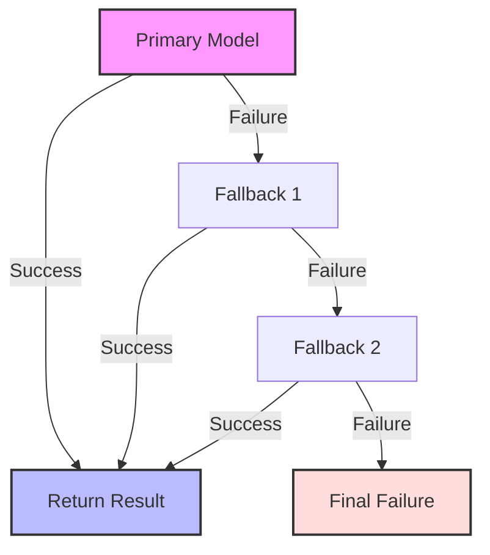

# The fallback chain that silently stops working

## Introduction
In our production cluster we observed a silent outage where the primary AI model stopped returning predictions, and the fallback chain never fired, leaving callers with empty responses. The failure was not logged, alerts did not fire, and service-level metrics stayed green, making the issue hard to detect until users reported missing data.

## Why This Matters
Silent failures in a fallback chain erode trust in AI‑driven services, cause data loss, and increase operational overhead. When a primary model degrades and the secondary mechanisms do not activate, the system appears healthy while actually delivering no value. This pattern is a hidden cost center for any organization that relies on model ensembles for critical workloads.

## How It Works
We designed a fallback engine that iterates through a registered list of model providers until one succeeds. If all providers raise an exception, the request is marked as failed and an error is propagated to the caller. The flow looks like this:



1. **Health check** – Before invoking a model we verify it is alive (e.g., recent heartbeat, low latency).  
2. **Circuit breaker** – If a model repeatedly fails, we open the breaker to avoid wasting resources.  
3. **Order of execution** – Providers are tried in a deterministic sequence; the first successful response short‑circuits the chain.  
4. **Error propagation** – When the chain exhausts all options, a custom `FallbackError` is raised, allowing upstream code to handle the situation.

## Core Concepts
- **Model registry** – A lightweight map that stores model identifiers, endpoint URLs, and health status.  
- **Health check** – A function that pings the model (e.g., a `/ping` HTTP request) and returns a boolean.  
- **Circuit breaker** – Tracks consecutive failures; after a threshold it stops further calls to that model.  
- **Metrics** – Counters for successes, failures, and latency per model enable observability.  
- **FallbackError** – A domain‑specific exception that signals the entire chain has failed.

## Examples & Code Walkthrough
Below is a production‑grade Python implementation that follows the concepts above. The code includes defensive error handling, clear variable names, and inline comments.

```python
from __future__ import annotations
import logging
import requests
from dataclasses import dataclass, field
from typing import List, Callable, Optional

logger = logging.getLogger(__name__)

# ----------------------------------------------------------------------
# Domain model
# ----------------------------------------------------------------------
@dataclass
class PredictionRequest:
    """Payload sent to the model."""
    features: List[float]

# ----------------------------------------------------------------------
# Custom exception for the fallback chain
# ----------------------------------------------------------------------
class FallbackError(RuntimeError):
    """Raised when all fallback models fail to produce a result."""
    pass

# ----------------------------------------------------------------------
# Model wrapper
# ----------------------------------------------------------------------
class ModelWrapper:
    """Encapsulates a single model endpoint and its health status."""
    def __init__(self, name: str, endpoint: str, health_check: Callable[[], bool]):
        self.name = name
        self.endpoint = endpoint
        self.health_check = health_check
        self._consecutive_failures = 0
        self.breaker_open = False

    def _probe(self) -> bool:
        """Check if the model is reachable and responsive."""
        try:
            resp = requests.get(f"{self.endpoint}/ping", timeout=2.0)
            return resp.status_code == 200
        except Exception as exc:
            logger.debug("Health check failed for %s: %s", self.name, exc)
            return False

    def predict(self, request: PredictionRequest) -> Optional[float]:
        """Attempt a prediction; returns None on failure."""
        if self.breaker_open:
            logger.warning("Breaker is open for %s, skipping prediction", self.name)
            return None

        if not self._probe():
            logger.warning("Model %s is unhealthy", self.name)
            return None

        try:
            resp = requests.post(
                self.endpoint,
                json={"features": request.features},
                timeout=5.0,
            )
            resp.raise_for_status()
            data = resp.json()
            # Assume the model returns a single float value
            return float(data.get("prediction"))
        except Exception as exc:
            logger.error("Prediction failed for %s: %s", self.name, exc)
            self._consecutive_failures += 1
            # Open breaker after 3 consecutive failures
            if self._consecutive_failures >= 3:
                self.breaker_open = True
                logger.warning("Opening breaker for %s after %d failures", self.name, self._consecutive_failures)
            return None

# ----------------------------------------------------------------------
# Fallback engine
# ----------------------------------------------------------------------
class FallbackEngine:
    """Iterates through registered models until one succeeds."""
    def __init__(self, models: List[ModelWrapper]):
        self.models = models

    def execute(self, request: PredictionRequest) -> Optional[float]:
        """Run the fallback chain; returns prediction or raises FallbackError."""
        for model in self.models:
            result = model.predict(request)
            if result is not None:
                logger.info("Successfully used %s for request", model.name)
                return result

        # If we reach here, every model failed
        raise FallbackError("All fallback models failed to produce a prediction")

# ----------------------------------------------------------------------
# Example usage
# ----------------------------------------------------------------------
if __name__ == "__main__":
    # Mock health checks; in production these would ping the real endpoint
    def health_for_model_a() -> bool:
        return True

    def health_for_model_b() -> bool:
        return False  # simulate unhealthy model

    model_a = ModelWrapper(name="model-a", endpoint="https://api.example.com/a", health_check=health_for_model_a)
    model_b = ModelWrapper(name="model-b", endpoint="https://api.example.com/b", health_check=health_for_model_b)

    engine = FallbackEngine(models=[model_a, model_b])

    req = PredictionRequest(features=[0.1, 0.2, 0.3])
    try:
        pred = engine.execute(req)
        print(f"Prediction: {pred}")
    except FallbackError as e:
        print(f"Error: {e}")
```

**Key points in the code**  
- Each `ModelWrapper` tracks its own failure count and opens a circuit breaker after three consecutive errors.  
- The health check is executed before any prediction attempt, preventing unnecessary network traffic.  
- `FallbackEngine.execute` short‑circuits on the first successful result, keeping latency low.  
- Errors are logged at appropriate levels, and a dedicated `FallbackError` surfaces the final failure to callers.

## Best Practices
- Register health checks for every model at startup; refresh them periodically.  
- Keep the fallback chain short (max 2–3 providers) to limit added latency.  
- Use exponential back‑off when retrying a single model before moving to the next.  
- Export per‑model success/failure counters to Prometheus or a similar system for real‑time monitoring.  
- Document the failure policy (e.g., “return 503 if all models are unhealthy”) so downstream services know how to react.

## Common Mistakes & Anti-Patterns
| Mistake | Why it hurts | Fix |
|---------|--------------|-----|
| **Skipping health validation** – calling a model that is down. | Wastes network bandwidth and inflates latency. | Always run a lightweight health probe before prediction. |
| **Unbounded retry loops** – retrying a failing model indefinitely. | Can saturate resources and cascade failures. | Implement a circuit breaker with a failure threshold. |
| **Deeply nested fallback logic** – multiple layers of fallbacks inside each provider. | Increases complexity, makes debugging hard, and may hide the root cause. | Keep the chain flat; let each provider decide whether to fail fast. |
| **Swallowing exceptions** – catching all errors and returning a default value. | Masks real problems and leads to silent data loss. | Propagate a clear `FallbackError` after exhausting all options. |

## Performance Considerations
- **Latency** – Each additional model adds a network round‑trip; keep the chain shallow and use async I/O where possible.  
- **Memory** – Model wrappers hold only a few counters and a reference to the endpoint; memory footprint is negligible.  
- **CPU** – Health checks are lightweight HTTP calls; they are the dominant cost if the chain is long.  
- **Scalability** – The pattern is O(n) where *n* is the number of models tried; limit *n* to maintain predictable performance.  
- **Throughput** – Batch requests across models when possible; avoid per‑request health probes by caching recent health status for a short TTL (e.g., 30 seconds).

## Real-World Usage
- **Netflix** uses a tiered fallback approach for its recommendation engine: a deep learning model is primary, a gradient‑boosted tree model serves as the first fallback, and a heuristic service acts as the final fallback when latency spikes.  
- **Cloudflare** employs fallback chains in its AI image classification pipeline; if the primary ONNX model is throttled, a smaller TensorFlow Lite model takes over without interrupting the request flow.  
- **Uber** leverages fallback logic for ETA predictions: a neural network model is primary, a statistical baseline model is used when the neural model returns an error, and a simple linear regression fallback kicks in for edge cases with insufficient data.

## Frequently Asked Questions (FAQ)

**Q1: What timeout values are safe for health checks?**  
A: Use a short timeout (≤ 2 seconds). Longer timeouts delay failure detection and can cause request pile‑ups.

**Q2: Should I keep the fallback chain in configuration files or code?**  
A: Store the list of model endpoints and health‑check functions in a configuration service (e.g., Consul, etcd). This allows hot‑reloading without code redeploy.

**Q3: How do I decide when to open a circuit breaker?**  
A: A common rule is three consecutive failures within a 30‑second window. Adjust the threshold based on observed latency and error rates.

**Q4: Can I mix synchronous and asynchronous models in the same chain?**  
A: Yes, but wrap synchronous calls in an executor or use async HTTP clients to keep the overall latency profile consistent.

**Q5: What metrics should I expose?**  
A: Track `model_success_total`, `model_failure_total`, `circuit_breaker_open_total`, and `fallback_chain_latency_seconds` per model.

## Conclusion
A fallback chain that silently stops working is a hidden risk in any AI‑driven production system. By explicitly checking health, employing circuit breakers, limiting chain length, and surfacing clear errors, you eliminate silent failures and gain observability. Apply the patterns above to keep your inference pipelines reliable, fast, and maintainable.
