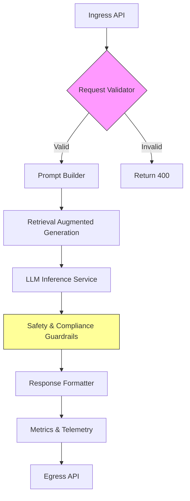

# The Hard Part of AI Agents for Marketing Platforms Isn’t the Model. It’s Everything Around It

## Introduction
When we first added a language model to our marketing automation stack, the model itself was the easiest piece. The real work began once we tried to make the agent reliable, observable, and compliant in a production environment. This article walks through the system concerns that dwarf the model choice: orchestration, data pipelines, safety guards, and operability.

## Why This Matters
Engineers often assume that swapping in a newer LLM will solve performance or quality gaps. In practice, the model contributes only a fraction of the total latency and failure surface. Bottlenecks appear in prompt assembly, external data retrieval, rate‑limit handling, and audit logging. Ignoring these pieces leads to unpredictable costs, privacy violations, and hard‑to‑debug outages that erode trust in AI‑driven campaigns.

## How It Works
An AI agent for a marketing platform is less a monolithic model call and more a coordinated pipeline. The core flow looks like this:



**Step‑by‑step breakdown**

1. **Ingress API** – A thin HTTP layer that authenticates the caller (often an internal service or a webhook) and performs basic schema validation.  
2. **Request Validator** – Checks for required fields, enforces size limits, and scrubs any personally identifiable information (PII) that should not reach the model.  
3. **Prompt Builder** – Combines a base template with dynamic variables (customer segment, product catalog snippet, recent interaction history). Templates are version‑controlled and stored separately from code.  
4. **Retrieval Augmented Generation (RAG)** – Queries a vector store or a feature store for relevant documents (e.g., product descriptions, policy docs). The retrieved passages are injected into the prompt to ground the model in factual data.  
5. **LLM Inference Service** – Calls the chosen model provider via an async client. We wrap the call with a circuit‑breaker and a token‑budget checker to avoid runaway costs.  
6. **Safety & Compliance Guardrails** – Runs a series of regex‑based and ML‑based detectors for hate speech, brand‑unsafe content, and regulatory disclosures. If a violation is found, we either rewrite the response or fall back to a canned message.  
7. **Response Formatter** – Structures the final output (JSON payload with fields like `copy`, `confidence_score`, `safety_flags`).  
8. **Metrics & Telemetry** – Emits counters for latency, token usage, guardrail triggers, and error rates to our observability stack.  
9. **Egress API** – Returns the formatted response to the caller, completing the request‑response cycle.

## Core Concepts
- **Orchestrator** – The service that wires together the steps above, handles retries, and manages timeouts.  
- **Prompt Store** – A Git‑backed repository of Jinja2‑style templates; each template carries a version number and a set of allowed variables.  
- **Feature / Retrieval Layer** – Provides low‑latency access to structured data (e.g., user profiles) and unstructured data (e.g., product embeddings).  
- **Guardrail Engine** – Pluggable modules that can be toggled via feature flags without redeploying the agent.  
- **Observability Pipeline** – Structured logs, distributed traces, and metrics that let us correlate a model call with business outcomes (click‑through rate, conversion).  
- **Cost Controller** – Tracks token consumption per tenant and enforces quotas to prevent surprise bills.

## Examples & Code Walkthrough
Below is a simplified but production‑ready Python implementation of the agent’s core loop. It demonstrates defensive programming, async I/O, and clear separation of concerns.

```python
import asyncio
import logging
from dataclasses import dataclass
from typing import List, Optional

import aiohttp
import jinja2
from tenacity import retry, stop_after_attempt, wait_exponential

# ----------------------------------------------------------------------
# Configuration objects (in real code these would come from a config service)
# ----------------------------------------------------------------------
@dataclass
class LLMSettings:
    endpoint: str
    api_key: str
    model: str
    max_tokens: int = 256
    temperature: float = 0.7

@dataclass
class GuardrailConfig:
    block_hate: bool = True
    require_disclaimer: bool = False

# ----------------------------------------------------------------------
# Helper: Prompt rendering
# ----------------------------------------------------------------------
env = jinja2.Environment(loader=jinja2.DictLoader({
    "marketing_copy": """
    You are a copywriter for {{ brand_name }}.
    Write a short promotional message for {{ product_name }} targeting {{ segment }}.
    Use the following facts: {{ facts | join('. ') }}.
    Include the required legal disclaimer.
    """
}))

def render_template(template_name: str, **context) -> str:
    tmpl = env.get_template(template_name)
    return tmpl.render(**context)

# ----------------------------------------------------------------------
# Agent core
# ----------------------------------------------------------------------
class MarketingAgent:
    def __init__(
        self,
        llm: LLMSettings,
        guardrails: GuardrailConfig,
        session: Optional[aiohttp.ClientSession] = None,
    ):
        self.llm = llm
        self.guardrails = guardrails
        self.session = session or aiohttp.ClientSession()
        self.logger = logging.getLogger(__name__)

    async def close(self):
        await self.session.close()

    @retry(
        reraise=True,
        stop=stop_after_attempt(3),
        wait=wait_exponential(multiplier=1, min=2, max=10),
    )
    async def _call_llm(self, prompt: str) -> str:
        payload = {
            "model": self.llm.model,
            "prompt": prompt,
            "max_tokens": self.llm.max_tokens,
            "temperature": self.llm.temperature,
        }
        headers = {"Authorization": f"Bearer {self.llm.api_key}"}
        async with self.session.post(
            self.llm.endpoint, json=payload, headers=headers, timeout=30
        ) as resp:
            if resp.status != 200:
                text = await resp.text()
                raise RuntimeError(f"LLM error {resp.status}: {text}")
            data = await resp.json()
            return data.get("text", "").strip()

    def _apply_guardrails(self, text: str) -> str:
        if self.guardrails.block_hate and self._contains_hate(text):
            self.logger.warning("Blocked hateful output")
            return "[Content blocked by safety policy]"
        if self.guardrails.require_disclaimer and "DISCLAIMER" not in text.upper():
            self.logger.info("Appending required disclaimer")
            return text + "\n\nDISCLAIMER: This is a marketing message."
        return text

    @staticmethod
    def _contains_hate(text: str) -> bool:
        # Placeholder: in production use a dedicated model or regex list
        bad = ["hate", "violence", "illegal"]
        return any(word in text.lower() for word in bad)

    async def handle_request(
        self,
        brand_name: str,
        product_name: str,
        segment: str,
        facts: List[str],
    ) -> dict:
        # 1. Build prompt
        prompt = render_template(
            "marketing_copy",
            brand_name=brand_name,
            product_name=product_name,
            segment=segment,
            facts=facts,
            require_disclaimer=self.guardrails.require_disclaimer,
        )
        self.logger.debug("Rendered prompt: %s", prompt[:200])

        # 2. Call LLM with retry logic
        try:
            raw_response = await self._call_llm(prompt)
        except Exception as exc:
            self.logger.error("LLM call failed after retries: %s", exc)
            raise

        # 3. Apply safety guards
        safe_response = self._apply_guardrails(raw_response)

        # 4. Assemble final payload
        result = {
            "copy": safe_response,
            "prompt_used": prompt,
            "safety_flags": {
                "hate_blocked": self.guardrails.block_hate and self._contains_hate(safe_response),
                "disclaimer_added": self.guardrails.require_disclaimer and "DISCLAIMER" in safe_response.upper(),
            },
        }
        self.logger.info("Completed request for %s/%s", brand_name, product_name)
        return result
```

**What the snippet shows**

- **Defensive retries** via `tenacity` with exponential backoff.  
- **Timeout** on the HTTP call to avoid hanging workers.  
- **Separation of concerns**: prompt rendering, LLM invocation, guardrail application.  
- **Structured logging** at each stage for traceability.  
- **Feature‑flag‑style guardrails** that can be flipped without code changes.  

## Best Practices
1. **Isolate model calls** behind a thin service layer with circuit‑breaker and bulkhead patterns.  
2. **Version prompts** alongside code; treat them as configuration artifacts.  
3. **Enforce token budgets** per request and per tenant to control cost.  
4. **Log inputs and outputs** (with PII redaction) for audit and debugging.  
5. **Run guardrails as pluggable middleware** so they can be updated independently of the model.  
6. **Use async I/O** throughout to keep thread usage low under concurrent load.  
7. **Expose metrics** (latency, token count, guardrail triggers) to a monitoring system early.  
8. **Test with adversarial inputs** to verify safety filters before deploying to prod.

## Common Mistakes & Anti-Patterns
| Mistake | Why it hurts | Fix |
|---------|--------------|-----|
| **Hard‑coding prompts in source** | Makes A/B testing impossible and couples copy changes to deploys. | Store prompts in a Git‑backed template service; load at startup. |
| **Ignoring token limits** | Leads to truncated outputs or provider errors, causing 500s. | Count tokens before sending; truncate or summarize if over limit. |
| **Blocking the event loop on LLM calls** | Under load, latency spikes and request queues grow. | Use an async HTTP client (`aiohttp` or `httpx`) and `await` the call. |
| **Skipping PII scrubbing before the model** | Risks leaking personal data into model outputs and logs. | Run a scrubber on all user‑provided fields; replace with placeholders. |
| **No fallback when guardrails fire** | Users receive error messages instead of usable copy. | Provide a deterministic canned response or route to a human‑in‑the‑loop queue. |

## Performance Considerations
- **Latency**: The dominant contributors are network round‑trip to the LLM provider and retrieval from the feature store. Keeping both services in the same region reduces RTT to ~30‑50 ms.  
- **CPU**: Prompt rendering and guardrail checks are lightweight (<1 ms per request). The LLM call is I/O bound, not CPU bound.  
- **Memory**: Each request holds the prompt (~few KB) and the model response; we stream the response to avoid large in‑memory buffers.  
- **Scalability**: Because the agent is stateless aside from config, we can horizontally scale pods behind a load balancer. The main scaling limit is the LLM provider’s rate quota; we mitigate this with client‑side throttling and token‑bucket regulators.  
- **Cost**: Token usage grows linearly with prompt length and response length. Caching frequent prompt‑response pairs (e.g., for seasonal promotions) can cut costs by 20‑30 % without sacrificing freshness.

## Real-World Usage
- **Netflix** employs a similar pipeline for generating personalized thumbnail copy; they separate prompt templating from the model and run a suite of brand‑safety filters before serving any text.  
- **Uber’s** marketing team uses an agent that pulls real‑time trip and pricing data from their feature store to compose dynamic ad copy; they enforce a strict token budget to keep costs predictable.  
- **Cloudflare** runs an internal content‑moderation agent that augments LLMs with regex‑based detectors and a fallback to human reviewers, mirroring the guardrail approach described here.  

These organizations treat the model as a replaceable component; the real engineering effort goes into the orchestration, data feeds, safety layers, and observability that surround it.

## Frequently Asked Questions (FAQ)
**Q: Do I need to fine‑tune the model for marketing copy?**  
A: Not necessarily. Most quality gains come from better prompt engineering and retrieval augmentation. Fine‑tune only if you observe systematic style gaps that prompting cannot fix.

**Q: How do I handle model version upgrades without breaking existing prompts?**  
A: Keep prompts version‑agnostic where possible; when a new model requires a change, create a new prompt version and route traffic via a feature flag. Run a canary period to compare outputs.

**Q: What’s a safe way to log model inputs for debugging without violating privacy?**  
A: Strip or hash any PII before logging. Keep a separate, secured audit log that retains the raw data for a limited time and is accessible only to authorized personnel.

**Q: Should I use a synchronous
