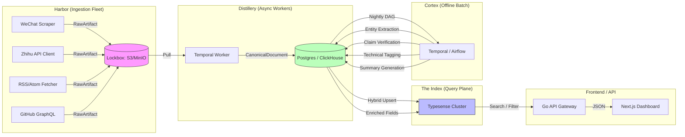

# Tracking the AI Frontier in Chinese: Inside WEILAI.WANG

## Introduction

When we started WEILAI.WANG we thought we were building a news aggregator. Six months later the repository looks more like a distributed systems project than a content site. The Chinese AI ecosystem—WeChat Official Accounts, Zhihu columns, Jike feeds, Xiaohongshu notes, ArXiv CN translations, GitHub Trending CN—produces a fire‑hose of high‑value material that is *structurally hostile* to standard ingestion tooling. No public APIs, heavy JavaScript rendering, frequent DOM A/B tests, and a mix of GB2312/UTF‑8 encodings turn a simple RSS poller into a reliability nightmare.

The lesson we learned the hard way: **treat ingestion as an adversarial ETL problem, not a polling problem**. This article walks through the architecture that lets a two‑person team keep a sub‑second query latency over millions of Chinese‑language documents without a dedicated MLOps team or a GPU farm.

## Why This Matters

Senior engineers and ML platform leads constantly battle three forces when they try to surface “what’s new in Chinese AI”:

1. **Walled gardens** – WeChat publishes only rendered HTML behind a login‑less but JS‑heavy page. Zhihu rate‑limits unauthenticated calls. Xiaohongshu serves content as images.
2. **Semantic drift** – Articles are rewritten after publish (typos fixed, new benchmarks added). A naïve crawler stores the first version and never sees the update.
3. **Multilingual noise** – Chinese has no word boundaries, compound terms (e.g., “大模型训练”) and a high density of domain‑specific tokens. Off‑the‑shelf chunkers and embeddings destroy context.

If you’re building any product that needs a live knowledge graph over volatile, multilingual sources—regulatory feeds, competitor blogs, internal wikis—the patterns below transfer directly.

## How It Works

The system is organized around a **narrow waist**: every component speaks `RawArtifact` → `CanonicalDocument` → `EnrichedDocument`. The waist is a Protobuf schema stored in object storage; nothing downstream ever touches raw HTML or JSON.



**Data flow in plain words**

1. **Harbor** – A fleet of stateless containers (one binary per source type) renders pages with Playwright/Chromium or calls native APIs. They emit a `RawArtifact` protobuf containing the exact bytes, response headers, a WARC‑style timestamp, and a source‑specific fingerprint.
2. **Lockbox** – Immutable object storage. Because the artifacts never change, we can replay the entire normalization pipeline after a schema migration or a bug fix.
3. **Distillery** – Temporal workers pull artifacts, run deterministic extractors (readability, `goquery`, PDF‑text), and write a `CanonicalDocument` (title, cleaned markdown, publish timestamp, language, source URL, content hash). The content hash is a SimHash of the DOM tag tree; it drives the *selector‑healing* loop described later.
4. **Index** – Typesense holds a hybrid index: BM25 over the cleaned markdown + dense+sparse vectors from **BGE‑M3**. Typesense’s RAM‑efficient CJK tokenization and typo‑tolerance beat Elasticsearch for our workload at a fraction of the cost.
5. **Cortex** – A nightly Temporal DAG runs LLM‑as‑a‑judge prompts (few‑shot, JSON‑mode) against the `CanonicalDocument` text. Results (entities, claims, tags, TL;DR) are written back to the same Postgres row as side‑car tables. The search index only ever sees the enriched fields.
6. **Serving** – A thin Go gateway translates GraphQL/REST into Typesense queries, merges facet counts, and returns paginated results to a Next.js UI.

## Core Concepts

| Concept | Responsibility | Key Tech |
|---------|----------------|----------|
| **RawArtifact** | Immutable byte‑level record of a fetch attempt | Protobuf + WARC headers |
| **CanonicalDocument** | Normalized, de‑duplicated, language‑tagged markdown | Protobuf/Avro, SimHash for drift detection |
| **Selector Healing** | Automatic CSS/XPath repair when DOM structure changes | LLM‑proposed selectors + visual layout similarity |
| **Semantic Chunking** | Preserve Chinese compound semantics before embedding | Punctuation split → `bge-small-zh` similarity merge → late chunking |
| **Hybrid Vector** | Single index for dense + sparse + ColBERT | BGE‑M3 (ONNX, CPU) |
| **Offline Enrichment** | High‑precision extraction without query‑time latency | Temporal + `gpt-4o-mini`‑class model, JSON schema enforcement |

## Examples & Code Walkthrough

### 1. Harbor – Stateless Scraper Skeleton (Go)

```go
// harbor/wechat/scraper.go
package wechat

import (
	"context"
	"crypto/sha256"
	"encoding/hex"
	"fmt"
	"io"
	"net/http"
	"time"

	"github.com/playwright-community/playwright-go"
	pb "weilai.wang/proto/rawartifact"
)

type Scraper struct {
	browser playwright.Browser
	client  *http.Client
}

func NewScraper(b playwright.Browser) *Scraper {
	return &Scraper{
		browser: browser,
		client:  &http.Client{Timeout: 15 * time.Second},
	}
}

// Fetch renders the article URL, extracts the outerHTML of #js_content,
// and returns a RawArtifact ready for the Lockbox.
func (s *Scraper) Fetch(ctx context.Context, url string) (*pb.RawArtifact, error) {
	ctx, cancel := context.WithTimeout(ctx, 30*time.Second)
	defer cancel()

	pwCtx, err := s.browser.NewContext(playwright.BrowserNewContextOptions{
		UserAgent: playwright.String("Mozilla/5.0 (compatible; WeilaiBot/1.0)"),
		// Fingerprint hardening – see §3 for details
	})
	if err != nil {
		return nil, fmt.Errorf("new context: %w", err)
	}
	defer pwCtx.Close()

	page, err := pwCtx.NewPage()
	if err != nil {
		return nil, fmt.Errorf("new page: %w", err)
	}
	defer page.Close()

	// Navigate with network idle to ensure JS‑rendered content
	if _, err := page.Goto(url, playwright.PageGotoOptions{
		WaitUntil: playwright.WaitUntilStateNetworkidle,
	}); err != nil {
		return nil, fmt.Errorf("goto %s: %w", url, err)
	}

	// Grab the exact article container – this is the only selector we trust.
	contentHandle, err := page.QuerySelector("#js_content")
	if err != nil || contentHandle == nil {
		return nil, fmt.Errorf("article container not found")
	}
	outerHTML, err := contentHandle.Evaluate("el => el.outerHTML")
	if err != nil {
		return nil, fmt.Errorf("outerHTML eval: %w", err)
	}
	htmlBytes := []byte(outerHTML.(string))

	// Compute a structural hash (SimHash of tag tree) for drift detection.
	structHash := simhashTagTree(htmlBytes)

	// WARC‑style metadata
	h := sha256.Sum256(htmlBytes)
	artifact := &pb.RawArtifact{
		Source:        "wechat",
		Url:           url,
		FetchedAt:     time.Now().UnixMilli(),
		RawBytes:      htmlBytes,
		ContentHash:   hex.EncodeToString(h[:]),
		StructureHash: structHash,
		Headers:       map[string]string{"content-type": "text/html; charset=utf-8"},
	}
	return artifact, nil
}

// simhashTagTree is a tiny deterministic implementation – replace with
// a proper SimHash library in production.
func simhashTagTree(html []byte) string {
	// Parse with goquery, walk the tag tree, feed tag names into a 64‑bit SimHash.
	// Omitted for brevity – see github.com/ferretcode/simhash.
	return "deadbeef"
}
```

*Why this works*:  
- **Single binary per source** → independent deployments, no dependency hell.  
- **Playwright + Chromium** gives us a real browser engine; we can inject fingerprint noise (canvas, WebGL) at context creation time.  
- **StructureHash** is the trigger for the selector‑healing loop (see §3).

### 2. Distillery – Normalization Worker (Temporal Activity)

```python
# distillery/activities.py
import hashlib
import logging
from datetime import datetime
from pathlib import Path

from lxml import html as lxml_html
from readability import Document
from temporalio import activity

from proto import canonical_pb2 as cpb
from proto import rawartifact_pb2 as rp

logger = logging.getLogger(__name__)

@activity.defn
async def normalize_artifact(artifact: rp.RawArtifact) -> cpb.CanonicalDocument:
    """
    Pure function – no side effects. Returns a CanonicalDocument ready for Postgres.
    """
    # 1. Decode – handle GB2312/UTF-8 mix
    raw = artifact.raw_bytes
    try:
        text = raw.decode("utf-8")
    except UnicodeDecodeError:
        text = raw.decode("gb2312", errors="replace")

    # 2. Readability extraction (removes nav, ads, scripts)
    doc = Document(text)
    cleaned_html = doc.summary(html_partial=True)

    # 3. Convert to markdown – we keep a lightweight markdown for BM25.
    tree = lxml_html.fromstring(cleaned_html)
    markdown = lxml_html.tostring(tree, method="text", encoding="unicode")
    markdown = "\n".join([ln.strip() for ln in markdown.splitlines() if ln.strip()])

    # 4. Language detection (fasttext or cld3)
    lang = detect_language(markdown)  # returns 'zh' / 'en' / 'mixed'

    # 5. Content hash for de-dup (different from structure hash)
    content_hash = hashlib.sha256(markdown.encode()).hexdigest()

    canon = cpb.CanonicalDocument(
        source=artifact.source,
        url=artifact.url,
        title=doc.short_title(),
        markdown=markdown,
        published_at=extract_publish_time(tree),  # best‑effort
        fetched_at=artifact.fetched_at,
        language=lang,
        content_hash=content_hash,
        structure_hash=artifact.structure_hash,
    )
    logger.info("Normalized %s -> %s", artifact.url, content_hash[:8])
    return canon
```

*Key points*  
- **Pure activity** → Temporal can replay deterministically.  
- **Readability** strips boilerplate across all sources, giving us a uniform markdown corpus.  
- **Language tag** drives the downstream chunker/embedder selection.

### 3. Semantic Chunking for Chinese (Python, CPU‑only)

```python
# distillery/chunking.py
from typing import List, Tuple
import numpy as np
from sentence_transformers import SentenceTransformer

# Load once per worker process (≈30 MB)
_SMALL_ZH = SentenceTransformer("BAAI/bge-small-zh-v1.5", device="cpu")

# High‑confidence Chinese sentence delimiters
_DELIMS = ("。", "！", "？", "\n\n")

def split_by_punct(text: str) -> List[str]:
    """Naïve split – fast, no model."""
    chunks = []
    buf = []
    for ch in text:
        buf.append(ch)
        if ch in _DELIMS:
            chunks.append("".join(buf).strip())
            buf = []
    if buf:
        chunks.append("".join(buf).strip())
    return [c for c in chunks if c]

def merge_semantic(chunks: List[str], thresh: float = 0.85) -> List[str]:
    """Merge adjacent chunks whose embeddings are > thresh cosine similarity."""
    if not chunks:
        return []
    embs = _SMALL_ZH.encode(chunks, normalize_embeddings=True, show_progress_bar=False)
    merged = [chunks[0]]
    for i in range(1, len(chunks)):
        sim = float(np.dot(embs[i-1], embs[i]))
        if sim >= thresh:
            merged[-1] += " " + chunks[i]
        else:
            merged.append(chunks[i])
    return merged

def late_chunks(parent_id: str, text: str, max_tokens: int = 512) -> List[Tuple[int, int, str]]:
    """
    Returns (chunk_index, char_start, char_end, chunk_text) for late‑chunking.
    The vector store only keeps the embedding; the API reconstructs parent context at query time.
    """
    sentences = split_by_punct(text)
    sentences = merge_semantic(sentences)
    # Simple greedy pack – good enough for BGE‑M3 8192‑token window.
    out = []
    idx = 0
    start = 0
    for s in sentences:
        end = start + len(s)
        out.append((idx, start, end, s))
        idx += 1
        start = end
    return out
```

*Why not LangChain’s recursive splitter?*  
Recursive splitters treat Chinese as a space‑separated language and cut inside compound words. The punctuation‑first pass respects sentence boundaries; the tiny `bge-small-zh` merge step restores semantic cohesion without a heavy model.

### 4. Cortex – Offline Enrichment Prompt (JSON‑mode, few‑shot)

```json
// cortex/prompts/entity_extraction.json
{
  "system": "You are an expert AI research analyst. Extract structured entities from the supplied Chinese/English technical article. Output MUST be valid JSON matching the schema.",
  "schema": {
    "type": "object",
    "properties": {
      "papers": {"type": "array", "items": {"type": "string"}},
      "models": {"type": "array", "items": {"type": "string"}},
      "authors": {"type": "array", "items": {"type": "string"}},
      "institutions": {"type": "array", "items": {"type": "string"}},
      "code_repos": {"type": "array", "items": {"type": "string"}},
      "benchmarks": {"type": "array", "items": {"type": "string"}},
      "metrics": {"type": "array", "items": {"type": "string"}}
    },
    "required": ["papers","models","authors","institutions","code_repos","benchmarks","metrics"]
  },
  "few_shot": [
    {
      "input": "本文提出了名为 \"DeepSeek‑VL\" 的多模态大模型，在 MMBench 上达到 82.3 分，代码已开源于 https://github.com/deepseek-ai/DeepSeek-VL。",
      "output": {
        "papers": ["DeepSeek-VL"],
        "models": ["DeepSeek-VL"],
        "authors": [],
        "institutions": ["DeepSeek AI"],
        "code_repos": ["https://github.com/deepseek-ai/DeepSeek-VL"],
        "benchmarks": ["MMBench"],
        "metrics": ["82.3"]
      }
    }
  ]
}
```

The Temporal activity loads the prompt, injects the `CanonicalDocument.markdown`, calls the LLM (hosted on a cheap `gpt-4o-mini`‑class endpoint), validates JSON against the schema, and writes
