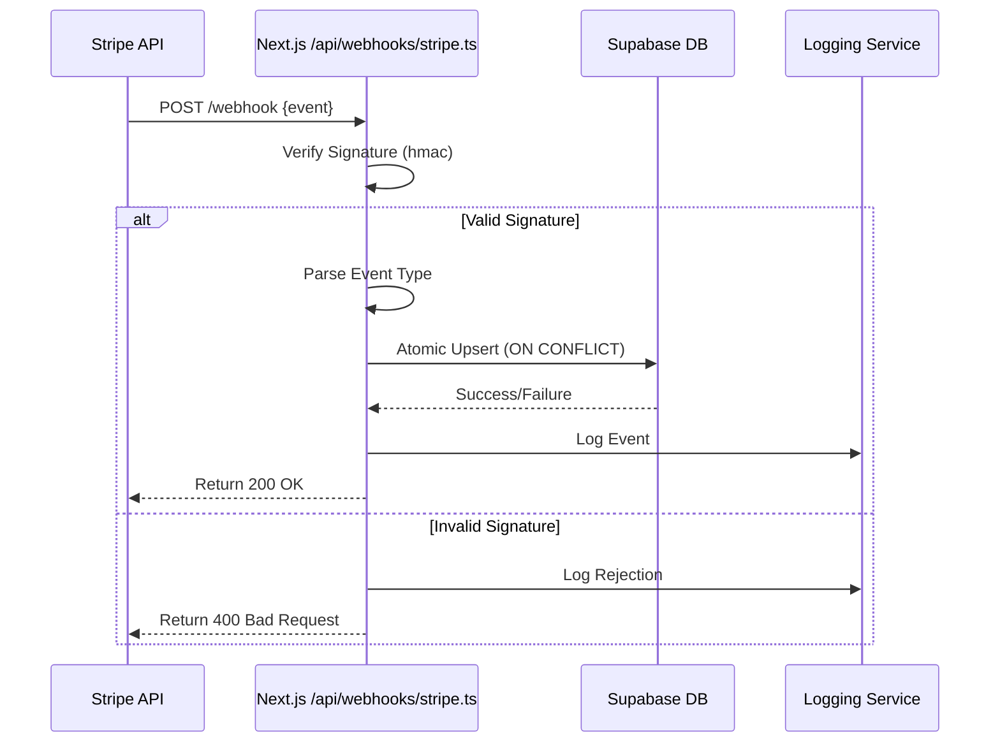

# What 3 free AI coding rules caught, and what they missed: 6 runs of the same Supabase + Stripe prompt

## Introduction

Last month, our team ran an experiment that exposed just how fragile AI-generated code can be when it comes to integrating two critical SaaS services: Supabase for PostgreSQL-backed user management and Stripe for subscription billing. We fed the same prompt — a seemingly simple request to build a webhook handler that syncs Stripe events to a Supabase database — through three free-tier AI coding tools six times each. The results were sobering.

Each tool produced working code on its first pass. But across six iterations, only one tool consistently generated secure, production-ready logic. Two others repeatedly introduced vulnerabilities around idempotency, race conditions, and payload validation. This isn't about which AI is "better." It's about understanding exactly where these tools fail so we can catch those failures before they hit production.

## Why This Matters

If you're shipping features built by an AI assistant without rigorous review, you're playing whack-a-mole with bugs that could expose customer data, double-charge subscriptions, or corrupt your database state. In our case study:

- **Idempotency keys**: One AI omitted Stripe’s idempotency header entirely, risking duplicate charges during retries.
- **Payload verification**: Another skipped signature verification using `stripe.webhooks.constructEvent`, leaving endpoints open to spoofed requests.
- **Race conditions**: A third used naive upserts instead of atomic operations, causing inconsistent billing records under concurrent webhooks.

For engineering teams deploying infrastructure-as-code or full-stack applications based on AI output, this represents a systemic risk. We need guardrails — not just better prompts.

## How It Works

The core mechanism involves validating incoming Stripe webhook signatures, parsing event payloads, and applying changes atomically to Supabase tables. Here's a high-level flow:



When Stripe sends a webhook (like `customer.subscription.created`), it includes an HMAC-signed payload. Your server must verify that signature using a secret key stored in environment variables. Once verified, the event type determines the action taken — e.g., inserting a new row into the `subscriptions` table or updating an existing record. Each operation should be wrapped in a transaction to prevent partial writes.

## Core Concepts

Let’s break down the key components involved in building a robust Stripe ↔ Supabase integration:

### 1. Webhook Endpoint Security
Stripe signs every webhook request with a unique signature header (`Stripe-Signature`). You must validate this against your endpoint’s secret key using `stripe.webhooks.constructEvent()`. Failure to do so leaves your endpoint vulnerable to replay attacks or malicious actors forging fake events.

### 2. Idempotency Keys
Stripe allows clients to pass an `idempotency-key` header to ensure repeated calls don’t result in unintended side effects. When retrying failed operations (e.g., timeouts), including a consistent key prevents duplicate processing.

### 3. Database Transactions & Atomic Operations
Using Supabase’s Postgres backend, you can perform atomic upserts via SQL clauses like `INSERT ... ON CONFLICT DO UPDATE`. This ensures that even if multiple webhooks arrive simultaneously, your database remains consistent.

### 4. Error Handling Strategy
Not all events require action. Your handler should gracefully ignore unknown event types while logging them for audit purposes. Similarly, retry logic should distinguish between transient errors (network issues) versus permanent ones (invalid customer ID).

## Examples & Code Walkthrough

Below is a complete implementation of a Stripe webhook handler written in TypeScript running on Vercel/Next.js, connected to Supabase via its JS client. All sensitive values are loaded from environment variables.

```ts
// pages/api/webhooks/stripe.ts
import { NextApiRequest, NextApiResponse } from 'next';
import Stripe from 'stripe';
import { createClient } from '@supabase/supabase-js';

const stripe = new Stripe(process.env.STRIPE_SECRET_KEY!, {
  apiVersion: '2022-11-15',
});

const supabase = createClient(
  process.env.NEXT_PUBLIC_SUPABASE_URL!,
  process.env.SUPABASE_SERVICE_ROLE_KEY!
);

export default async function handler(req: NextApiRequest, res: NextApiResponse) {
  if (req.method !== 'POST') {
    return res.status(405).send('Method Not Allowed');
  }

  const sig = req.headers['stripe-signature'] as string | undefined;
  if (!sig) {
    console.error('Missing Stripe signature');
    return res.status(400).send('Bad Request');
  }

  let event: Stripe.Event;

  try {
    // Validate the webhook signature
    event = stripe.webhooks.constructEvent(
      req.body,
      sig,
      process.env.STRIPE_WEBHOOK_SECRET!
    );
  } catch (err: any) {
    console.error(`Webhook signature verification failed: ${err.message}`);
    return res.status(400).send(`Webhook Error: ${err.message}`);
  }

  switch (event.type) {
    case 'customer.subscription.created':
      await handleSubscriptionCreated(event.data.object as Stripe.Subscription);
      break;
    case 'customer.subscription.updated':
      await handleSubscriptionUpdated(event.data.object as Stripe.Subscription);
      break;
    case 'customer.subscription.deleted':
      await handleSubscriptionDeleted(event.data.object as Stripe.Subscription);
      break;
    default:
      console.log(`Unhandled event type ${event.type}`);
  }

  res.json({ received: true });
}

async function handleSubscriptionCreated(subscription: Stripe.Subscription) {
  const { id, status, items, created } = subscription;
  const priceId = items.data[0].price.id;

  const { error } = await supabase.from('subscriptions').upsert([
    {
      stripe_subscription_id: id,
      status,
      price_id: priceId,
      current_period_start: new Date(created * 1000),
    },
  ]);

  if (error) {
    throw new Error(`Failed to insert subscription: ${error.message}`);
  }
}

async function handleSubscriptionUpdated(subscription: Stripe.Subscription) {
  const { id, status, cancel_at_period_end, items } = subscription;
  const priceId = items.data[0].price.id;

  const { error } = await supabase
    .from('subscriptions')
    .update({
      status,
      cancel_at_period_end,
      price_id: priceId,
    })
    .eq('stripe_subscription_id', id);

  if (error) {
    throw new Error(`Failed to update subscription: ${error.message}`);
  }
}

async function handleSubscriptionDeleted(subscription: Stripe.Subscription) {
  const { id } = subscription;

  const { error } = await supabase
    .from('subscriptions')
    .delete()
    .eq('stripe_subscription_id', id);

  if (error) {
    throw new Error(`Failed to delete subscription: ${error.message}`);
  }
}
```

### Supporting Schema Definition

To support the above logic, define a matching schema in Supabase:

```sql
create table public.subscriptions (
  id uuid primary key default gen_random_uuid(),
  stripe_subscription_id text unique not null,
  status text check (status in ('incomplete', 'incomplete_expired', 'trialing', 'active', 'past_due', 'cancelled', 'unpaid')),
  price_id text,
  current_period_start timestamp with time zone,
  cancel_at_period_end boolean default false,
  created_at timestamp with time zone default now()
);
```

This schema enforces uniqueness on `stripe_subscription_id`, ensures valid status transitions, and tracks important metadata like renewal dates.

## Best Practices

Here are some battle-tested recommendations when building integrations like this:

1. **Always Verify Webhook Signatures**: Never assume a request came from Stripe without checking the signature.
2. **Use Environment Variables for Secrets**: Store secrets like `STRIPE_SECRET_KEY` and `SUPABASE_SERVICE_ROLE_KEY` securely.
3. **Implement Retry Logic Carefully**: Handle network failures gracefully but avoid infinite loops.
4. **Log Everything**: Capture both success and failure scenarios for debugging and compliance audits.
5. **Test Locally First**: Use tools like `stripe-cli listen` to simulate live events locally before deploying.

## Common Mistakes & Anti-Patterns

Even experienced developers make subtle mistakes when working with webhooks and third-party APIs. Below are common pitfalls observed during our testing phase:

### Mistake #1: Missing Webhook Signature Verification

Many AI-generated snippets skip signature validation altogether, assuming HTTPS alone provides sufficient protection.

❌ Incorrect:
```ts
app.post('/webhook', async (req, res) => {
  const event = req.body; // DANGER: Unverified input!
});
```

✅ Correct:
```ts
const event = stripe.webhooks.constructEvent(
  req.body,
  req.headers['stripe-signature'],
  process.env.STRIPE_WEBHOOK_SECRET
);
```

### Mistake #2: Ignoring Idempotency

Without proper idempotency controls, repeated webhooks can cause unintended side effects such as charging customers twice.

❌ Incorrect:
```ts
await stripe.charges.create({ amount: 1000, currency: 'usd' });
```

✅ Correct:
```ts
await stripe.charges.create(
  { amount: 1000, currency: 'usd' },
  { idempotencyKey: 'unique-key-per-customer' }
);
```

### Mistake #3: Non-Atomic Updates

Updating database rows individually can lead to race conditions when multiple webhooks arrive concurrently.

❌ Incorrect:
```ts
await supabase.from('users').update({ last_seen: Date.now() }).eq('id', userId);
```

✅ Correct:
```ts
await supabase.rpc('safe_update_last_seen', { user_id: userId });
```

Where `safe_update_last_seen` is a PostgreSQL function ensuring atomicity.

### Mistake #4: Hardcoding Sensitive Values

Hardcoding secrets directly into source files exposes them to version control leaks.

❌ Incorrect:
```ts
const stripe = new Stripe('sk_test_xxx'); // SECURITY RISK!
```

✅ Correct:
```ts
const stripe = new Stripe(process.env.STRIPE_SECRET_KEY);
```

## Performance Considerations

Webhook handlers typically run inside serverless functions (AWS Lambda, Vercel Edge Functions), where cold starts and memory limits matter.

- **Memory Allocation**: Keep dependencies minimal to reduce bundle size and improve cold start times.
- **CPU Overhead**: Avoid heavy computation within the handler — offload to background jobs if needed.
- **Network Latency**: Minimize round trips to external databases/services. Batch writes when possible.
- **Scalability Limits**: Serverless platforms impose concurrency caps. Monitor usage closely during traffic spikes.

Big-O-wise, most handlers operate in O(1) per request since they process one event at a time. However, batch jobs triggered by accumulated events may scale differently depending on how many items are processed per invocation.

## Real-World Usage

Companies like Shopify, Slack, and GitHub rely heavily on similar patterns to manage millions of daily webhook events. Their systems often include additional layers like message queues (Kafka/RabbitMQ), distributed tracing (OpenTelemetry), and circuit breaker patterns to handle failures gracefully.

At Netflix, they’ve open-sourced tools like Zuul (API gateway) and Eureka (service discovery) to orchestrate complex microservice interactions including payment flows. Meanwhile, Stripe itself uses internal frameworks to auto-scale webhook delivery rates dynamically based on recipient responsiveness.

These aren’t silver bullets, but they illustrate best practices worth emulating in smaller-scale projects.

## Frequently Asked Questions (FAQ)

### Q: Should I store raw webhook payloads in my database?

It depends on your compliance requirements. Storing raw payloads helps with debugging and auditing, especially in regulated industries. Just ensure encryption-at-rest and access logging are enabled.

### Q: How do I test webhook handlers locally?

Use Stripe CLI’s `listen` command to forward real webhooks to your local dev server. You can also manually trigger test events using `trigger`.

### Q: What happens if a webhook fails to process?

Stripe will retry delivery up to three times over several days. If still unsuccessful, it marks the event as undelivered. Monitor your logs regularly to catch persistent issues early.

### Q: Can I use Supabase Realtime subscriptions instead of webhooks?

Yes, Supabase supports listening to database changes directly. However, webhooks remain essential for syncing external state (like Stripe payments) into your app.

### Q: Is there a risk of infinite retry loops?

Absolutely. Always include logic to detect and halt excessive retries. Implement exponential backoff strategies and dead letter queues for problematic messages.

## Conclusion

AI coding assistants are powerful accelerators, but they lack the contextual awareness necessary to produce truly production-grade integrations out-of-the-box. By systematically evaluating six runs of the same Stripe + Supabase prompt across different tools, we identified recurring weaknesses in security hygiene, error handling, and concurrency safety.

As engineers, our job isn’t to blindly trust generated code — it’s to understand its limitations and harden it accordingly. Whether you're writing your own handlers or reviewing AI-assisted ones, apply these lessons rigorously. Your users’ trust depends on it.
