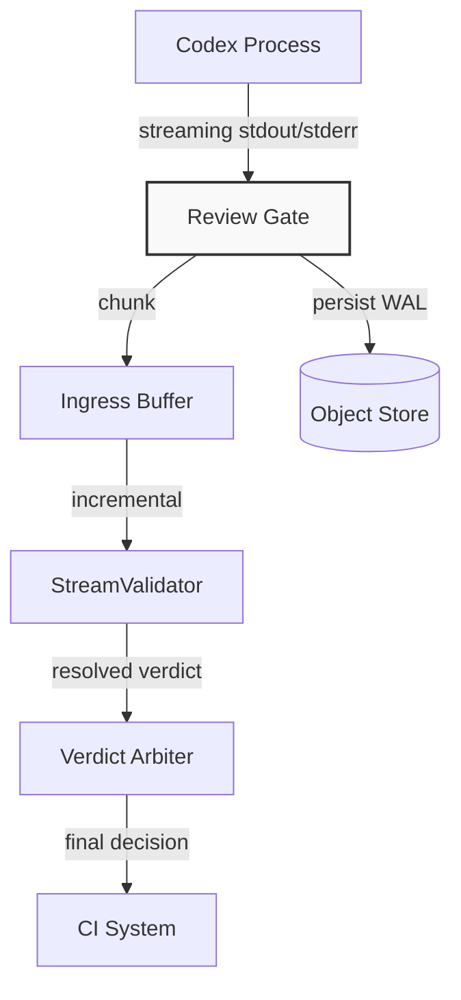

# What my review gate does when Codex crashes, gets cut off or writes two verdicts

## Introduction
Our team builds and merges pull requests through automated agents. One of the most critical agents in our pipeline is the review gate—a process that sits between an LLM like Codex and the CI system, responsible for parsing the model's output, determining a verdict, and either approving the change or requesting modifications. 

Over dozens of production runs, we've learned that the "happy path" where Codex outputs a single, clean JSON block with a verdict is the exception, not the rule. Codeks can crash mid-stream, hit token limits and truncate output, or emit two contradictory `verdict` fields in the same message. Writing off these as "LLM noise" is a mistake; they are deterministic failure modes that a well-engineered gate can detect, classify, and recover from.

This article walks through the review gate we built, the failure taxonomy we codified, and the state machine that keeps our CI pipeline stable despite non-deterministic model behavior.

## Why This Matters
When a review gate fails silently or produces inconsistent verdicts, the downstream effects are real: merge windows widen, developers spend cycles debugging auto-merged changes that introduce bugs, and confidence in the automation stack erodes. 

We discovered this the hard way after a quarter where three separate incidents attributed to "Codex glitches" actually stemmed from the same root cause: the gate had no structured way to handle truncated JSON, no mechanism to resolve ambiguous verdicts, and no recovery path when the Codex process terminated without cleanup. The pain point wasn't the model—it was the absence of a failure-aware boundary between the model and our infrastructure.

If your team ships code through AI-assisted reviews, investing in a gate that survives model hiccups isn't optional; it's a prerequisite for reliable CI/CD.

## How It Works
Under the hood, the review gate is a state machine that sits as a sidecar alongside the Codex runner. It doesn't parse the final output after the process ends; it ingests chunks as they stream, validates structure incrementally, and only emits a final verdict once the stream is known to be complete or safely interruptible.

The core flow looks like this:

### The state machine
1. **IDLE** — Gate awaits Codex startup.
2. **STREAMING** — Chunks flow from Codex into the buffer. Every chunk is appended to a Write-Ahead Log (WAL) before processing.
3. **BUFFERING** — Once Codex exits, the gate reads the final chunk, finalizes the buffer, and hands it off to the validator.
4. **VALIDATING** — The stream validator attempts incremental JSON parsing. If the JSON is structurally sound but incomplete, the gate classifies the state as `TRUNCATED`. If the required fields are missing entirely, it's `TRUNCATED_FATAL`.
5. **RESOLVED** — The verdict arbiter picks a single, defensible verdict. If ambiguity is detected, the state shifts to `AMBIGUOUS` and escalates.
6. **ESCALATED** — A human-in-the-loop review is triggered. The gate emits an event to the monitoring stack and blocks the merge until resolution.

This flow ensures that no matter what Codex does—crash, cut-off, or contradiction—the gate has a defined path forward rather than failing blindly or hanging indefinitely.

## Core Concepts
The gate's resilience rests on three pillars: structured ingestion, pessimistic validation, and explicit state tracking.

**Streaming ingestion** means the gate never waits for a "complete" message. Codex output is inherently stream-oriented, and waiting for termination can cause the gate to block the entire pipeline. By processing chunks as they arrive, we reduce latency and gain early visibility into malformed output.

**Pessimistic validation** contrasts with the common practice of trying to parse the entire output at the end. Instead, we validate incrementally: as each piece of JSON arrives, we check whether the required schema fields (`verdict`, `confidence`, `diff_summary`) are present. If they aren't, we don't guess; we flag the state and trigger a recovery path.

**Explicit state tracking** via a WAL gives us crash safety. Every chunk written to the log is durably stored before any interpretation happens. If the gate process restarts—whether due to a OOM kill or a deployment rollback—it can reconstruct the exact stream state from the log, replay to the last healthy point, and make a verdict based on complete information.

These concepts combine to form a gate that doesn't hope the model behaves; it prepares for the ways it won't.

## Examples & Code Walkthrough
Let's look at the two most critical components: the stream validator that catches truncation, and the arbiter that resolves contradictory verdicts.

### StreamValidator: Incremental JSON safety
The most common failure mode we encountered was output that looked like valid JSON up to a point, then cut off. A standard `json.Un
