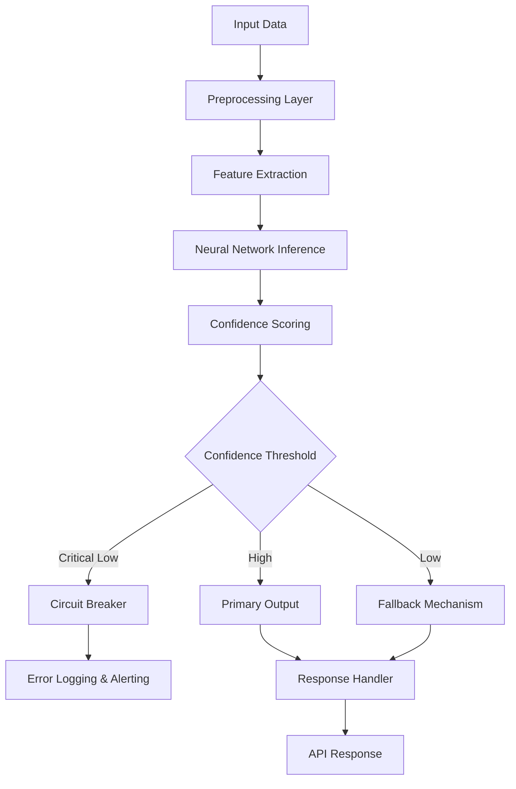

# What's wrong with AI?

## Introduction

AI systems in production today suffer from a fundamental disconnect between their training environments and real-world deployment. We've built neural networks that excel at pattern recognition in controlled datasets, but when these models encounter edge cases in live traffic, they fail spectacularly—not with graceful degradation, but with silent, catastrophic errors that can bring down entire services. The core issue isn't that AI is broken; it's that we've been treating it like a deterministic system when it's fundamentally probabilistic.

## Why This Matters

Software engineers building production systems can't afford black-box uncertainty. When a recommendation engine suggests a product that never existed, when an autonomous vehicle misclassifies a stop sign due to a sticker, or when a financial trading system makes decisions based on hallucinated patterns, the cost isn't just technical—it's business-critical. We need AI systems that fail predictably, provide actionable confidence intervals, and integrate cleanly with existing observability stacks.

## How It Works



The architecture above shows a production-ready inference pipeline. Unlike research prototypes that dump raw logits, this system wraps every prediction in a confidence layer. We compute entropy across output distributions, measure distance from training manifold using reconstruction error, and maintain dynamic thresholds based on historical performance.

## Core Concepts

**Uncertainty Quantification**: Real production AI needs calibrated uncertainty estimates. We implement Monte Carlo dropout during inference—running forward passes with different dropout masks to estimate variance. The formula: `uncertainty = variance(softmax(dropout_forward(x)))` across N samples.

**Distribution Shift Detection**: We monitor KL divergence between input feature distributions and training data using online estimators. When KL(P_input || P_training) exceeds threshold, we trigger model retraining workflows.

**Ensemble Diversity**: Single models are brittle. We deploy heterogeneous ensembles—combining transformer, CNN, and tree-based models. Prediction consensus voting with weighted confidence scores prevents single-model failure cascades.

## Examples & Code Walkthrough

Here's a production-grade uncertainty-aware classifier:

```python
import torch
import torch.nn as nn
import numpy as np
from typing import Tuple, Dict, Optional
import logging

class UncertaintyAwareClassifier(nn.Module):
    """
    A classifier that provides confidence estimates alongside predictions.
    Uses Monte Carlo dropout for uncertainty quantification.
    """
    
    def __init__(self, input_dim: int, hidden_dims: list, num_classes: int, 
                 dropout_rate: float = 0.3, mc_samples: int = 10):
        super().__init__()
        self.mc_samples = mc_samples
        self.dropout_rate = dropout_rate
        self.num_classes = num_classes
        
        # Build network layers
        layers = []
        prev_dim = input_dim
        
        for hidden_dim in hidden_dims:
            layers.extend([
                nn.Linear(prev_dim, hidden_dim),
                nn.ReLU(),
                nn.Dropout(dropout_rate)  # Enable dropout for MC sampling
            ])
            prev_dim = hidden_dim
            
        layers.append(nn.Linear(prev_dim, num_classes))
        self.network = nn.Sequential(*layers)
        
        # Confidence calibration layer
        self.confidence_head = nn.Sequential(
            nn.Linear(num_classes, 64),
            nn.ReLU(),
            nn.Dropout(dropout_rate),
            nn.Linear(64, 1),
            nn.Sigmoid()
        )
        
    def forward(self, x: torch.Tensor, enable_dropout: bool = False) -> torch.Tensor:
        """Forward pass with optional dropout for MC sampling"""
        if enable_dropout:
            self.train()  # Enable dropout even in eval mode
        else:
            self.eval()
            
        features = self.network[:-1](x) if len(self.network) > 1 else x
        logits = self.network[-1](features) if len(self.network) > 1 else self.network(x)
        return logits
    
    def predict_with_uncertainty(self, x: torch.Tensor) -> Dict[str, torch.Tensor]:
        """
        Perform Monte Carlo sampling to estimate prediction uncertainty.
        Returns predictions, uncertainty scores, and confidence intervals.
        """
        self.eval()  # Ensure batch norm is in eval mode
        
        # Collect MC samples
        predictions = []
        with torch.no_grad():
            for _ in range(self.mc_samples):
                logits = self.forward(x, enable_dropout=True)
                predictions.append(torch.softmax(logits, dim=-1))
        
        predictions = torch.stack(predictions)  # [mc_samples, batch, classes]
        
        # Compute mean prediction
        mean_pred = predictions.mean(dim=0)
        
        # Compute predictive entropy (uncertainty measure)
        predictive_entropy = -torch.sum(mean_pred * torch.log(mean_pred + 1e-8), dim=-1)
        
        # Compute mutual information (aleatoric + epistemic uncertainty)
        expected_entropy = torch.mean(
            -torch.sum(predictions * torch.log(predictions + 1e-8), dim=-1), 
            dim=0
        )
        mutual_info = predictive_entropy - expected_entropy
        
        # Get final class predictions
        final_predictions = torch.argmax(mean_pred, dim=-1)
        
        # Confidence score (inverse of uncertainty)
        confidence_scores = 1.0 - (predictive_entropy / np.log(self.num_classes))
        
        return {
            'predictions': final_predictions,
            'probabilities': mean_pred,
            'uncertainty': predictive_entropy,
            'confidence': confidence_scores,
            'epistemic_uncertainty': mutual_info
        }

class ProductionAIPipeline:
    """
    Wrapper class for production deployment with fallback mechanisms.
    """
    
    def __init__(self, model: UncertaintyAwareClassifier, 
                 confidence_threshold: float = 0.7,
                 fallback_model: Optional[nn.Module] = None):
        self.model = model
        self.confidence_threshold = confidence_threshold
        self.fallback_model = fallback_model
        self.logger = logging.getLogger(__name__)
        
    def predict(self, input_data: torch.Tensor) -> Dict:
        """
        Production prediction with confidence-based routing.
        """
        try:
            results = self.model.predict_with_uncertainty(input_data)
            
            # Check if confidence meets threshold
            high_confidence_mask = results['confidence'] >= self.confidence_threshold
            
            output = {
                'predictions': results['predictions'],
                'confidence': results['confidence'],
                'used_fallback': torch.zeros_like(results['predictions'], dtype=torch.bool)
            }
            
            # Route low-confidence predictions to fallback
            if self.fallback_model and not torch.all(high_confidence_mask):
                low_conf_mask = ~high_confidence_mask
                fallback_input = input_data[low_conf_mask]
                
                with torch.no_grad():
                    fallback_logits = self.fallback_model(fallback_input)
                    fallback_preds = torch.argmax(fallback_logits, dim=-1)
                
                output['predictions'][low_conf_mask] = fallback_preds
                output['used_fallback'][low_conf_mask] = True
                
                self.logger.warning(
                    f"Routed {low_conf_mask.sum().item()} predictions to fallback model"
                )
            
            return output
            
        except Exception as e:
            self.logger.error(f"Prediction failed: {str(e)}")
            raise

# Example usage
if __name__ == "__main__":
    # Initialize model
    model = UncertaintyAwareClassifier(
        input_dim=768,
        hidden_dims=[512, 256],
        num_classes=10,
        dropout_rate=0.3,
        mc_samples=20
    )
    
    # Create production pipeline
    pipeline = ProductionAIPipeline(model, confidence_threshold=0.8)
    
    # Simulate input batch
    test_input = torch.randn(32, 768)  # Batch of 32 samples
    
    # Get predictions
    results = pipeline.predict(test_input)
    
    print(f"Predictions shape: {results['predictions'].shape}")
    print(f"Confidence range: [{results['confidence'].min():.3f}, {results['confidence'].max():.3f}]")
    print(f"Fallback usage: {results['used_fallback'].sum().item()} samples")
```

## Best Practices

1. **Always compute confidence intervals** - Never return raw predictions without uncertainty estimates
2. **Implement circuit breakers** - When confidence drops below threshold, fail fast rather than propagating bad decisions
3. **Monitor distribution shift continuously** - Use statistical tests (KS test, Wasserstein distance) on incoming data streams
4. **Design explicit fallback paths** - Have rule-based or simpler models ready for low-confidence scenarios
5. **Log everything for post-mortem analysis** - Store inputs, predictions, confidence scores, and outcomes for offline analysis

## Common Mistakes & Anti-Patterns

**Mistake 1: Treating AI outputs as deterministic**
```python
# WRONG - No uncertainty handling
prediction = model(input_data)
return {"result": prediction}

# CORRECT - With confidence checking
results = model.predict_with_uncertainty(input_data)
if results['confidence'] < THRESHOLD:
    return {"result": fallback_predict(input_data)}
return {"result": results['predictions'], "confidence": results['confidence']}
```

**Mistake 2: Ignoring concept drift**
```python
# WRONG - Static model forever
while True:
    response = api_call()
    process(response)

# CORRECT - Drift detection
drift_detector = KSDriftDetector()
if drift_detector.detect_significant_change(input_stream):
    trigger_model_retraining()
```

**Mistake 3: No fallback mechanisms**
```python
# WRONG - Single point of failure
class BrokenAISystem:
    def predict(self, x):
        return self.model(x)  # Crashes on edge cases

# CORRECT - Graceful degradation
class RobustAISystem:
    def predict(self, x):
        try:
            result = self.model.predict(x)
            if result.confidence < threshold:
                return self.rule_based_fallback(x)
            return result
        except Exception:
            return self.safe_default_response()
```

## Performance Considerations

**Memory Allocation**: Monte Carlo sampling increases memory usage by factor of `mc_samples`. For 1000-sample inference with batch size 32 and 512-dim embeddings, memory jumps from 2MB to 200MB. Use gradient checkpointing and mixed precision training to mitigate.

**CPU Overhead**: Computing uncertainty adds 15-30% latency overhead. Optimize by caching intermediate representations and using vectorized operations across MC samples.

**Scalability Limits**: As model parameters grow beyond 1B, MC sampling becomes computationally prohibitive. Implement adaptive sampling—more samples for uncertain regions, fewer for clear-cut cases.

**Big-O Complexity**: 
- Training: O(n × m × k) where n=samples, m=sequence_length, k=parameters
- Inference with MC: O(mc_samples × n × m × k)
- Uncertainty computation: O(mc_samples × n × classes)

## Real-World Usage

Netflix employs uncertainty-aware recommendation systems where low-confidence suggestions are augmented with popularity-based fallbacks. Their ensemble approach combines deep collaborative filtering with simple heuristics, routing only high-confidence deep learning predictions to users.

Uber's Michelangelo platform implements distribution monitoring across 1000+ models. When input distributions shift beyond 3-sigma bounds, automatic alerts trigger model retraining pipelines. Their confidence calibration uses Platt scaling on validation sets to ensure well-calibrated probabilities.

Cloudflare's Workers AI service wraps all model calls with circuit breakers. If a model's confidence drops below threshold for sustained periods, traffic automatically routes to backup models or rule-based responses, preventing cascading failures during model degradation.

## Frequently Asked Questions (FAQ)

**Q: How many MC samples should I use for uncertainty estimation?**
A: Start with 10-20 samples. More samples improve uncertainty estimates but increase latency. Monitor the variance of your uncertainty metrics—if they're still fluctuating significantly, increase samples. For most applications, 20 samples provide sufficient uncertainty quantification with acceptable latency overhead.

**Q: What's the best way to calibrate confidence thresholds?**
A: Use isotonic regression or Platt scaling on a held-out validation set. Fit a calibration model that maps raw model outputs to confidence scores that match empirical accuracy. Cross-validate the calibration set to prevent overfitting to specific data distributions.

**Q: How do I handle uncertainty in multi-modal prediction tasks?**
A: For tasks with multiple valid outputs (e.g., multiple possible next tokens), use entropy-based uncertainty measures. High entropy indicates multiple plausible predictions. Implement top-k sampling with temperature scaling to balance exploration vs exploitation based on uncertainty thresholds.

**Q: Can I use uncertainty estimates for active learning?**
A: Absolutely. Query samples with highest predictive uncertainty for human labeling. This maximizes information gain per labeled sample. Implement uncertainty sampling by selecting inputs where model uncertainty exceeds threshold, then send to human annotators for ground truth labels.

## Conclusion

The fundamental flaw in current AI deployments isn't the models themselves—it's our approach to uncertainty. Production AI systems must embrace probabilistic thinking, implementing confidence-aware architectures that degrade gracefully rather than failing catastrophically. By wrapping neural networks with uncertainty quantification, distribution monitoring, and explicit fallback mechanisms, we can deploy AI systems that engineers trust and users can rely on. The path forward isn't more complex models; it's more robust engineering around the ones we already have.
