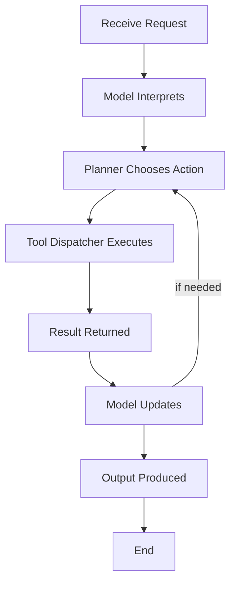

# Why AI Agents Fail in Production: The Hidden Challenges Beyond Prompt Engineering

## Introduction
When we first rolled out an autonomous assistant for our internal ticket system, it seemed magical. Within weeks, latency spikes and silent failures exposed deep architectural gaps that prompt engineering alone could not fix.

## Why This Matters
In our production cluster we saw agents behave unpredictably, and the root cause was not the prompt but the missing timeout and unbounded context. Agents are being marketed as plug‑and‑play services, yet in production they introduce new failure modes that affect latency, cost, and reliability. Understanding these hidden challenges helps teams avoid costly outages.

## How It Works
At a high level an agent consists of four interacting pieces: a language model that interprets the request, a planner that selects actions, a tool dispatcher that executes external calls, and a feedback loop that refines the output. In our ticket routing system we used this structure to decide between a database lookup and an external API call. The model receives a prompt that includes the current state, decides on the next step, and returns structured data that the planner consumes. The planner may invoke one or more tools, such as a database query or an HTTP request, and then feeds the result back into the model for the next iteration.



## Core Concepts
The agent maintains a mutable context object that holds the conversation history, the current plan, and any intermediate results. The context is represented as a list of dictionaries, each containing a role identifier, a message payload, and optional metadata such as timestamps. A tool registry maps names to callable objects that handle authentication, request shaping, and response parsing. The governing principle is to keep the decision loop short; each iteration should resolve a single sub‑goal before moving on.

## Examples & Code Walkthrough
```python
import json
import time
from typing import List, Dict, Any, Callable

# Simple in‑memory tool registry
class ToolRegistry:
    def __init__(self):
        self.tools: Dict[str, Callable] = {}

    def register(self, name: str, fn: Callable):
        """Register a callable under a unique name."""
        self.tools[name] = fn

    def execute(self, name: str, **kwargs) -> Any:
        """Invoke a registered tool; raise if missing."""
        if name not in self.tools:
            raise KeyError(f"Tool {name} not registered")
        return self.tools[name](**kwargs)

# Example tool: run a parametrized SQL query against a mock DB
def mock_db_query(sql: str, params: List[Any]) -> List[Dict[str, Any]]:
    """Pretend to execute a query and return dummy rows."""
    # In real code this would use psycopg2 or asyncpg
    return [{"id": i, "value": f"row_{i}"} for i in range(len(params))]

# Agent implementation
class Agent:
    def __init__(self, registry: ToolRegistry, model_callable: Callable):
        """
        Initialize the agent.

        Args:
            registry: Tool registry for external calls.
            model_callable: Function that receives a prompt string and returns a dict
                with keys 'action' (str) and 'params' (list).
        """
        self.registry = registry
        self.model = model_callable
        self.context: List[Dict[str, Any]] = []  # conversation history

    def add_message(self, role: str, content: str):
        """Append a message to the context."""
        self.context.append({"role": role, "content": content})

    def run(self, initial_prompt: str, max_steps: int = 5) -> str:
        """
        Execute the agent loop.

        Args:
            initial_prompt: The user request.
            max_steps: Safety guard to avoid infinite loops.
        """
        self.add_message("user", initial_prompt)
        for step in range(max_steps):
            # Ask the model what to do next
            response = self.model(self._build_prompt())
            action = response.get("action")
            params = response.get("params", [])
            if not action:
                return "No action decided"

            # Execute the chosen tool
            try:
                result = self.registry.execute(action, **dict(zip(["param1","param2"], params[:2])))
            except Exception as exc:
                # Log and decide to retry or abort
                print(f"Tool error: {exc}")
                return f"Failed to execute {action}: {exc}"

            # Record the outcome
            self.add_message("assistant", f"Executed {action} with params {params}")
            self.add_message("tool", json.dumps(result))

            # Re‑invoke model with updated context
            response = self.model(self._build_prompt())
            if response.get("action") == "stop":
                break

        # Return final answer extracted from the last assistant message
        final_msg = next((msg["content"] for msg in reversed(self.context) if msg["role"] == "assistant"), "No answer")
        return final_msg

    def _build_prompt(self) -> str:
        """Create a simple prompt from the current context."""
        lines = ["You are an agent that decides which tool to call."]
        for msg in self.context:
            prefix = "User: " if msg["role"] == "user" else "Assistant: "
            lines.append(f"{prefix}{msg['content']}")
        return "\n".join(lines)

# Example usage
if __name__ == "__main__":
    registry = ToolRegistry()
    registry.register("db_query", mock_db_query)

    # Dummy model that always asks for a DB query on the first step,
    # then returns a final message.
    def dummy_model(prompt: str) -> dict:
        # Very naive logic for illustration only
        if "first" in prompt.lower():
            return {"action": "db_query", "params": [1, 2, 3]}
        else:
            return {"action": "stop", "params": []}

    agent = Agent(registry, dummy_model)
    answer = agent.run("Give me the first three rows")
    print("Result:", answer)
```

## Best Practices
1. Pin the model version in your deployment manifest; avoid floating tags that pull newer releases without testing.  
2. Use structured output (JSON) from the model and validate schema before invoking tools.  
3. Enforce per‑call timeouts and automatic retries with exponential backoff.  
4. Keep the context window bounded; prune older messages once a token threshold is reached.  
5. Instrument latency and token counters; set alerts when usage spikes.

## Common Mistakes & Anti-Patterns
1. **Unvalidated model output** – assuming the model will always return the expected field names leads to runtime crashes. Fix: validate the JSON schema before using the values.

```python
def safe_execute(tool_name, **kwargs):
    try:
        return tool_registry.execute(tool_name, **kwargs)
    except KeyError as e:
        # Log and fallback to a safe default
        logger.warning(f"Missing tool {tool_name}: {e}")
        return None
```

2. **Ignoring latency budgets** – letting a tool call block the main thread can cause request timeouts. Fix: wrap calls in an async executor with a timeout.

```python
import asyncio

async def run_with_timeout(coro, timeout=5):
    try:
        return await asyncio.wait_for(coro, timeout=timeout)
    except asyncio.TimeoutError:
        logger.error("Tool call timed out")
        raise
```

3. **Storing full conversation history without limits** – large contexts increase memory use and cost. Fix: truncate the context after reaching a token ceiling.

```python
def trim_context(context, max_tokens=4000):
    # Simple heuristic: drop oldest messages until token count is acceptable
    while sum(len(msg["content"].split()) for msg in context) > max_tokens and len(context) > 2:
        context.pop(0)
    return context
```

4. **Exposing internal tool APIs without authentication** – allows malicious actors to abuse your services. Fix: enforce API keys or OAuth scopes on each registered tool.

## Performance Considerations
The agent’s CPU cost grows linearly with the number of tokens processed in each inference. Memory usage is dominated by the context list; each message adds a copy of its payload. Network latency adds up when the model contacts remote inference endpoints, and each tool call introduces its own round‑trip. In practice, keep the per‑step token count below 2 000 to stay within typical latency budgets, and design the tool registry to reuse connections.

## Real-World Usage
Netflix runs agents to generate dynamic video thumbnails, using a short‑lived planner that selects image‑processing tools. Uber employs agents for real‑time pricing decisions, caching model outputs to reduce inference latency. Cloudflare leverages agents at the edge to route requests based on content type, limiting each step to a single lightweight tool call.

## Frequently Asked Questions (FAQ)
**Q1:** How do I prevent the model from looping endlessly?  
**A:** Impose a maximum step count and a timeout per step; abort and return a clear error if exceeded.

**Q2:** Can I use a smaller model to reduce cost?  
**A:** Yes, but verify that the smaller model meets the accuracy requirements for your decision logic; otherwise you may see higher error rates.

**Q3:** What monitoring metrics are essential?  
**A:** Track token consumption, inference latency, error rates per tool, and queue depth for asynchronous calls.

**Q4:** How do I handle failures from external tools?  
**A:** Wrap each tool call in a retry decorator with exponential backoff and a circuit‑breaker to avoid cascading failures.

**Q5:** Is it safe to expose the agent as a public API?  
**A:** Only behind authentication and rate limiting; never expose raw model weights or internal tool implementations.

## Conclusion
Agents are powerful but they introduce hidden architectural responsibilities that go far beyond crafting a good prompt. By treating the model as one component of a larger, observable system, you can mitigate latency spikes, control costs, and keep failures from surfacing in production. We recommend that teams adopt these practices to avoid common pitfalls.
