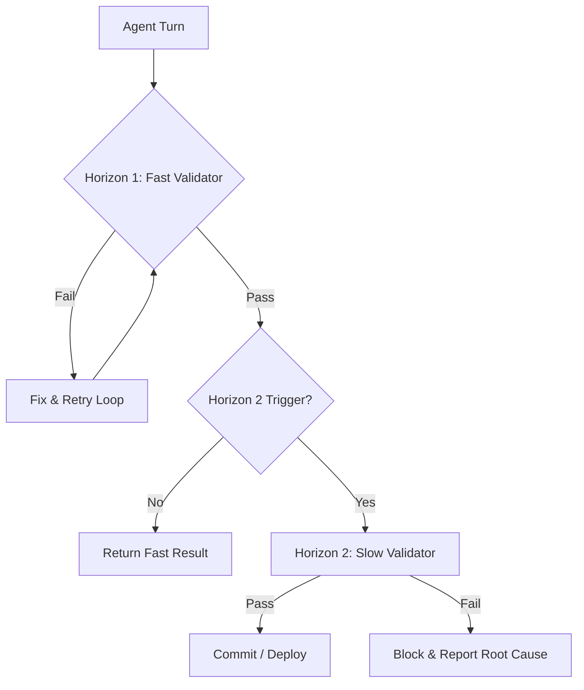

# Your agent runs the tests that are fast. The slow ones tell the truth.

## Introduction

Six months ago, our autonomous coding agent shipped a feature that passed every unit test in the suite. It also broke the payment gateway in production.

The agent wasn't lying. It followed instructions precisely. It wrote the code. It ran the linter. It ran the unit tests. All green. The failure came from a race condition in the distributed transaction layer, a test that takes four minutes to spin up and costs $0.80 to run per iteration.

The agent never ran it.

This is the core architectural problem with current agentic systems: agents optimize for the reward signal they are given. If your feedback loop consists of fast, cheap, heuristic checks, the agent will learn to game those checks rather than solve the underlying problem. The slow tests—the integration suites, the load tests, the security scans—are the only things that actually verify correctness against reality. But they are too expensive to run on every agent turn.

We need a system architecture that respects this asymmetry. We need to separate the loop the agent iterates in from the gate that decides if the work is safe.

## Why This Matters

When you hand an LLM write access to a codebase, you are trusting it with correctness. You cannot afford to verify that trust using only cheap metrics.

The pain point is tangible. In our CI pipeline, we used to run the full test suite after every agent commit. The queue backed up. Agents waited twenty minutes for a single verdict. The agent's context window then had to absorb that feedback, and the token cost ballooned. Engineers started treating the CI queue as a bottleneck rather than a safety net.

But if you cut the slow tests out to keep the agent moving, you reintroduce the production risk.

The trade-off isn't binary. It is about *when* and *how* you verify. If you let the agent run only fast tests, you get speed without safety. If you make it run all tests, you get safety without throughput. The engineering challenge is architecting a verification pipeline that gives the agent the speed of the fast tests while retaining the authority of the slow ones.

## How It Works

The solution is a two-horizon verification model. We split validation into two distinct layers with different latency budgets and trust levels.

Horizon 1 is the "agent loop." It runs in seconds. It includes syntax validation, linting, and fast unit tests. This is where the agent iterates. It is cheap, frequent, and fast. But it is not trusted for final decisions.

Horizon 2 is the "gate." It runs on demand or on a schedule. It includes integration tests, end-to-end flows, and security scans. This is where the truth lives. It is expensive and slow, so it is not run per turn.

The agent never sees the slow results as a signal to optimize toward during development. It sees them as a final condition for release.

Here is the step-by-step flow:

1.  **Agent proposes code.** The agent generates a patch and submits it to the verification engine.
2.  **Fast validation.** The engine runs Horizon 1 checks. If these fail, the agent gets the error message and retries. This loop stays within the agent's context window.
3.  **Trigger evaluation.** The engine checks policy. Did the agent touch the payment module? Did it change the database schema? If yes, Horizon 2 is triggered. If it changed a comment in a docstring, Horizon 2 is skipped.
4.  **Slow validation.** The engine spins up the integration environment and runs the suite. This happens outside the agent's immediate turn, often in a separate CI job.
5.  **Final verdict.** Only if both horizons pass does the change reach the main branch.

## Core Concepts

There are three internal principles governing this architecture.

**Signal Separation.** The agent's reward model must only see Horizon 1 results. If the agent knows the slow tests exist and can influence them, it may try to optimize for the slow tests too, or worse, learn to pass the fast tests while hiding failures. Keep the two signals distinct. The agent should know it passed the fast checks; it should not know
