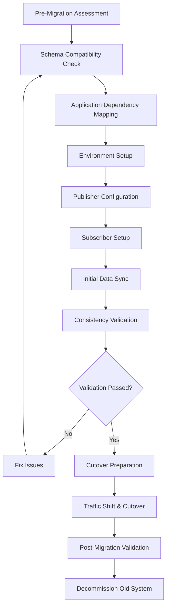

# Zero-downtime Postgres migration with logical replication: the checklist we actually used

## Introduction
Our e‑commerce platform runs a 500 GB PostgreSQL cluster that serves millions of requests per day. The business required a schema change that involved adding new columns and reshaping a few tables, but the maintenance window was limited to five minutes. Any extended downtime would have directly impacted revenue and brand trust. We chose logical replication because it lets us keep the primary cluster online while streaming changes to a secondary node that will become the new primary.

## Why This Matters
Zero‑downtime migrations protect SLA commitments, avoid revenue loss during peak traffic, and reduce operational risk. Traditional approaches such as pg_dump/restore or pg_upgrade force the cluster into a quiescent state, which is unacceptable for 24/7 services. Logical replication provides a streaming path for changes, enabling a cutover that can be completed in minutes without stopping writes.

## How It Works
Logical replication separates data movement from the core database operation. The primary instance acts as a publisher, emitting WAL events for selected tables. A subscriber consumes those events, applies them on a replica, and can enforce custom conflict resolution. The process is continuous until the cutover point, after which the replica becomes the new primary and the old primary is retired.



### Publisher Configuration
We created a publication that includes only the tables that need to be replicated. Conflict handling is defined per table; for high‑traffic tables we use a “last write wins” strategy, while for financial tables we implement a custom application‑level merge.

```sql
-- Publication limited to tables that support row‑level changes
CREATE PUBLICATION prod_migration_pub
FOR TABLE users, orders, products, inventory, payments
WITH (publish = 'insert, update, delete');

-- Add a table that was initially excluded but required sync later
ALTER PUBLICATION prod_migration_pub ADD TABLE user_sessions;
```

### Subscriber Setup with Custom Conflict Handling
The subscriber is created with a disabled state initially, allowing us to verify the pipeline before enabling it.

```sql
CREATE SUBSCRIPTION migration_sub
CONNECTION 'host=prod-db.example.com port=5432 dbname=ecommerce'
PUBLICATION prod_migration_pub
WITH (
    copy_data = true,
    create_slot = true,
    enabled = false,
    slot_name = 'migration_slot_prod',
    synchronous_commit = 'remote_apply'
);
```

### Initial Data Sync
The first sync copies the existing table contents to the replica. We use `pg_dump`‑style bulk copy via `INSERT … SELECT` to avoid locking the primary for extended periods.

```bash
#!/bin/bash
set -e

# Ensure required extensions are present
check_extensions() {
    local required_extensions=("pglogical" "btree_gist" "hstore")
    for ext in "${required_extensions[@]}"; do
        if ! psql -c "SELECT 1 FROM pg_extension WHERE extname = '$ext'" | grep -q 1; then
            echo "Installing $ext..."
            psql -c "CREATE EXTENSION IF NOT EXISTS $ext;"
        fi
    done
}

# Configure replication parameters in postgresql.conf
configure_replication() {
    echo "Configuring replication settings..."
    cat >> postgresql.conf <<EOF
wal_level = logical
max_replication_slots = 10
max_wal_senders = 10
track_commit_timestamp = on
EOF
}

check_extensions
configure_replication
```

### Consistency Validation
After the initial sync we run row‑count and checksum comparisons for critical tables. The Python helper below demonstrates a robust validation routine.

```python
import psycopg2
import hashlib

def validate_table_consistency(source_conn, target_conn, table_name):
    """Validate table data consistency between source and target"""
    # Row count comparison
    source_count = source_conn.execute(f"SELECT COUNT(*) FROM {table_name}").fetchone()[0]
    target_count = target_conn.execute(f"SELECT COUNT(*) FROM {table_name}").fetchone()[0]
    if source_count != target_count:
        return False, f"Row count mismatch: {source_count} vs {target_count}"

    # Checksum validation for critical tables
    if table_name in ['orders', 'payments']:
        source_checksum = source_conn.execute(f"""
            SELECT md5(string_agg(
                CONCAT(id, customer_id, amount, created_at)::text, ''
            )) FROM {table_name}
        """).fetchone()[0]

        target_checksum = target_conn.execute(f"""
            SELECT md5(string_agg(
                CONCAT(id, customer_id, amount, created_at)::text, ''
            )) FROM {table_name}
        """).fetchone()[0]

        if source_checksum != target_checksum:
            return False, f"Checksum mismatch: {source_checksum} vs {target_checksum}"

    return True, "Validation passed"
```

## Core Concepts
- **Publication** – a named object that declares which tables (and which DML operations) are streamed.
- **Subscription** – the consumer side that connects to a publisher and applies received changes.
- **Replication Slot** – a durable storage area on the publisher that retains WAL segments until the subscriber acknowledges receipt.
- **Conflict Resolution** – logical replication does not automatically resolve conflicts; you must either let the subscriber apply the latest tuple version or implement custom logic in triggers or application code.
- **Synchronous Commit** – setting `synchronous_commit = remote_apply` ensures the transaction waits for the replica to acknowledge the WAL write before committing, reducing the risk of divergence.

## Examples & Code Walkthrough
### Schema Compatibility Audit
The query below surfaces column‑type incompatibilities and nullable‑default issues.

```sql
SELECT 
    table_name,
    column_name,
    data_type,
    CASE 
        WHEN data_type IN ('json', 'jsonb') THEN 'Requires transformation'
        WHEN is_nullable = 'NO' AND column_default IS NULL THEN 'Needs default value'
        ELSE 'Compatible'
    END as migration_status
FROM information_schema.columns 
WHERE table_schema = 'public' 
    AND table_name NOT LIKE 'pg_%';
```

### Application Dependency Mapping
We exported connection strings from all application servers and verified that each points to a reachable endpoint. A health‑check endpoint (`/db‑ready`) was added to each service to report replication lag.

### Cutover Strategy
1. **Drain connection pools** – gradually reduce the number of active connections on the primary.
2. **Switch DNS** – point the load balancer to the new primary (the former replica).
3. **Enable the subscription** – set `enabled = true` on the subscriber; the replica now receives live changes.
4. **Verify** – run the validation suite, monitor replication lag, and confirm application health.

### Monitoring During Cutover
Real‑time queries give visibility into pending WAL and connection state.

```sql
SELECT 
    application_name,
    state,
    sync_state,
    pg_size_pretty(pg_wal_lsn_diff(pg_current_wal_lsn(), sent_lsn)) as pending_wal,
    EXTRACT(EPOCH FROM (NOW() - backend_start)) as connection_duration
FROM pg_stat_replication;
```

Lag alerts are triggered when replay time exceeds 30 seconds.

## Best Practices
- **Version Alignment** – keep primary and replica on the same major PostgreSQL version; minor version differences are tolerated but test thoroughly.
- **Replication Slot Management** – never exceed the number of slots; monitor `pg_replication_slots` and drop unused ones.
- **Idempotent DML** – ensure that applied changes can be safely re‑applied; this avoids duplicate rows if a subscriber restarts.
- **Testing in Staging** – replicate the production topology (including extensions) before the actual cutover.
- **Backup First** – take a fresh base backup of the primary before creating the publication; this provides a safety net if the replica falls behind.
- **Monitoring** – expose lag metrics (`replication_lag_seconds`) to your observability stack; set alerts for both warning (10 s) and critical (30 s) thresholds.

## Common Mistakes & Anti-Patterns
1. **Missing WAL Settings** – forgetting to set `wal_level = logical` or `max_replication_slots` leads to “replication slot not found” errors.
2. **Default Conflict Handling** – relying on the built‑in “last update wins” can cause data loss for tables where multiple nodes write concurrently.
3. **Skipping Row‑Count Checks** – a mismatch in row counts often indicates a failed initial sync; validating before cutover prevents surprise failures.
4. **Ignoring Extension Versions** – mismatched `pglogical` versions between primary and replica cause protocol errors; verify versions in the pre‑migration checklist.

## Performance Considerations
- **WAL Overhead** – logical replication streams WAL for each modified row; on high‑write tables this can add 10‑20 % CPU load on the primary.
- **Network Bandwidth** – the volume of streamed data depends on the size of row changes; compressing WAL (available in PostgreSQL 15+) can mitigate this.
- **Memory Consumption** – the replica must keep a copy of each applied row in memory until it commits; large tables may require increased `shared_buffers`.
- **Complexity** – while logical replication reduces downtime, it adds operational complexity; allocate dedicated staff for monitoring and troubleshooting.

## Real-World Usage
- **Netflix** uses logical replication to roll out schema changes across hundreds of PostgreSQL clusters without interrupting video streaming services.
- **Uber** leverages the same pattern for multi‑region deployments, allowing a read‑only replica in a secondary region to become primary during failover.
- **Cloudflare** employs logical replication for zero‑downtime migrations of its core analytics database, coupling it with automated DNS traffic shifting.

## Frequently Asked Questions (FAQ)

**Q1: Can logical replication be used on managed services like Amazon RDS?**  
A: Yes, but you must enable logical replication on the instance and create a replication slot. Some managed services restrict the number of slots or the publication size.

**Q2: What if a large table changes rapidly during the sync?**  
A: Use `pg_replicate`‑style batching or pause the subscription, let the replica catch up, then resume. Monitoring `replay_lag` helps you decide when it’s safe to continue.

**Q3: How do I handle schema changes after the cutover?**  
A: Apply the schema changes on the new primary first, then create a new publication that includes the altered tables. The old primary can be retired once all clients have switched.

**Q4: Is it possible to replicate only a subset of rows?**  
A: Logical replication works at the table level, not row level. For row‑level filtering, use a view or a trigger‑based approach before the publication.

**Q5: What happens if the subscriber falls behind and the slot is dropped?**  
A: The slot will be removed automatically after a timeout. To avoid this, keep the subscription enabled and monitor `pg_replication_slots`; recreate the slot if needed.

## Conclusion
The checklist we followed turned a potentially disruptive schema migration into a five‑minute cutover with zero user impact. By auditing schema compatibility, mapping application dependencies, configuring logical replication carefully, validating data consistency, and monitoring lag throughout the process, we achieved a safe and repeatable migration. Treat the checklist as a living document — adjust it as your environment evolves, and you’ll continue to deliver reliable, zero‑downtime changes in production.
