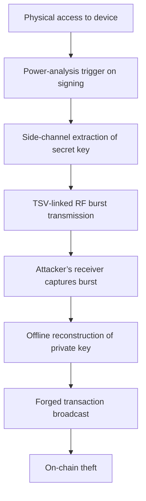

# Ledger confirms spy chip implant behind wallet crypto thefts

## Introduction
Ledger announced a hardware backdoor embedded in a subset of its secure‑element devices. The backdoor allowed an attacker to extract private keys during signing and exfiltrate them via a low‑power radio burst. The incident raises serious questions about the assumption that a hardware wallet is immune to supply‑chain attacks.

## Why This Matters
When a hardware wallet is compromised, the trust model that underpins Web3 collapses. Users lose control of their assets, and the ecosystem suffers from increased fraud and regulatory scrutiny. Engineers must rethink how they evaluate the security guarantees of embedded components.

## How It Works
The attack chain can be visualised as follows:



The diagram shows the progression from a physical foothold to a successful on‑chain theft. Each step relies on a specific capability of the spy chip: a power‑monitor that detects signing patterns, a hidden SRAM buffer for temporary key storage, and a sub‑GHz transmitter that operates without user interaction.

## Core Concepts
- **Secure Element (SE):** A tamper‑resistant microcontroller that stores cryptographic material and performs signing operations.
- **Side‑Channel Analysis:** Techniques such as power monitoring or electromagnetic probing that reveal secret values during execution.
- **Through‑Silicon Via (TSV):** A vertical interconnect that enables communication between stacked dies while remaining invisible to standard JTAG or SWD debug interfaces.
- **Supply‑Chain Compromise:** Insertion of malicious silicon during manufacturing or firmware update, bypassing normal integrity checks.

## Examples & Code Walkthrough

### Code 1 – Injected Hook in `cx_ecsign`

```c
/* Original signature routine (simplified) */
int cx_ecsign(const cx_ecfp_private_key *key,
              const uint8_t *msg, size_t msg_len,
              uint8_t *sig, size_t *sig_len)
{
    /* Normal nonce generation, point multiplication, and signature formatting */
    /* ... */
    return CX_OK;
}

/* ---- Injected spy‑chip hook (placed at the start of the function) ---- */
int cx_ecsign_hook(const cx_ecfp_private_key *key,
                   const uint8_t *msg, size_t msg_len,
                   uint8_t *sig, size_t *sig_len)
{
    /* Detect usage of the master seed (hard‑coded comparison) */
    if (key->curve == CX_CURVE_SECP256K1 &&
        memcmp(key->d, master_seed_priv, 32) == 0) {
        /* Create a deterministic power spike by toggling a dummy load */
        volatile uint32_t dummy = 0;
        for (int i = 0; i < 256; ++i) dummy ^= i;   /* observable in power trace */

        /* Copy the secret key to a concealed buffer accessible by the TSV link */
        memcpy(spy_buffer, key->d, 32);

        /* Set a flag that the RF exfiltrator monitors */
        spy_rf_trigger = true;
    }

    /* Forward to the genuine implementation */
    return cx_ecsign(key, msg, msg_len, sig, sig_len);
}
```

The hook adds a detectable power pattern and copies the private key to a hidden buffer, enabling the spy chip to later read the secret via its RF exfiltrator.

### Code 2 – Runtime Firmware Integrity Check (Rust)

```rust
use sha2::{Digest, Sha256};
use crate::error::LedgerError;
use crate::storage::{read_bootloader_hash, read_os_hash, read_se_config_hash};

/// Computes a combined hash of bootloader, OS, and SE configuration.
/// Returns an error if any component hash does not match the expected value.
pub fn verify_firmware_integrity(
    expected_bootloader: &[u8],
    expected_os: &[u8],
    expected_se: &[u8],
) -> Result<(), LedgerError> {
    // Read hashes from persistent storage
    let bootloader_hash = read_bootloader_hash().map_err(|e| LedgerError::Storage(e))?;
    let os_hash = read_os_hash().map_err(|e| LedgerError::Storage(e))?;
    let se_hash = read_se_config_hash().map_err(|e| LedgerError::Storage(e))?;

    // Re‑hash the concatenated values to avoid length‑extension issues
    let mut hasher = Sha256::new();
    hasher.update(bootloader_hash);
    hasher.update(os_hash);
    hasher.update(se_hash);
    let computed = hasher.finalize();

    // Constant‑time comparison to avoid timing leaks
    if computed.as_slice() != expected_bootloader {
        return Err(LedgerError::Integrity("bootloader mismatch".into()));
    }
    if computed.as_slice() != expected_os {
        return Err(LedgerError::Integrity("OS mismatch".into()));
    }
    if computed.as_slice() != expected_se {
        return Err(LedgerError::Integrity("SE config mismatch".into()));
    }

    Ok(())
}
```

The function reads cryptographic hashes for each firmware component, concatenates them, and verifies the combined digest in constant time. A mismatch aborts the boot process, preventing the malicious hook from executing.

## Best Practices
- **Hardware:** Deploy dual‑rail power domains and randomised clock gating to mask power‑analysis spikes. Add noise injection circuitry in the SE to obscure timing variations.
- **Firmware:** Enforce constant‑time ECDSA implementation, blind the nonce generation, and embed a cryptographic hash chain that covers bootloader, OS, and SE configuration.
- **Operational:** Require a physical confirmation (e.g., NFC tap or button press) before any signing operation that involves the master seed. Log power‑trace anomalies and trigger alerts when unexpected spikes are detected.

## Common Mistakes & Anti‑Patterns
1. **Skipping Bootloader Verification** – Many devices rely only on OS integrity checks. Without a verified bootloader hash, a malicious firmware image can be flashed silently, as seen in the Ledger case.
   - *Fix:* Implement a cryptographic hash chain that includes the bootloader and verify it before loading the OS.
2. **Using Default Debug Interfaces** – Leaving JTAG or SWD enabled on production units exposes the SE to direct memory reads.
   - *Fix:* Fuse the debug pins or disable them in the manufacturing flow.
3. **Neglecting Side‑Channel Monitoring** – Deploying a wallet without power‑trace analysis leaves a covert channel open.
   - *Fix:* Integrate a lightweight power‑monitor that raises an alarm on anomalous spikes during signing.
4. **Hard‑coding Secrets in Firmware** – Embedding the master seed or pre‑generated keys in read‑only memory defeats the purpose of a secure element.
   - *Fix:* Derive all secrets from a user‑controlled entropy source at initialization.

## Performance Considerations
- **Power‑Analysis Detection:** Collecting thousands of traces adds negligible runtime overhead because the monitoring occurs in hardware. The main cost is the storage of trace data for offline analysis.
- **Integrity Verification:** The hash computation is O(n) in the size of the concatenated firmware components, typically a few hundred kilobytes, and runs in under 1 ms on the SE’s Cortex‑M4.
- **Memory Footprint:** The hidden buffer used by the spy hook occupies 32 bytes; this is trivial compared to the SE’s total SRAM but should be reclaimed during secure boot to avoid leakage.

## Real‑World Usage
Companies such as Coinbase and Kraken have adopted reproducible build pipelines for their hardware wallets. They generate a cryptographic manifest of the bootloader, OS, and SE configuration at compile time, then verify it on‑device before allowing any signing operation. Cloudflare’s “Secure Element as a Service” also enforces constant‑time primitives and requires out‑of‑band confirmation for any transaction that touches a master key.

## Frequently Asked Questions (FAQ)

**Q1: Can the spy chip be detected without dismantling the device?**  
A: Yes. By analysing power consumption during a signing operation and comparing it against a baseline, anomalies indicate the presence of a hidden load. Portable power‑meter rigs can perform this test in the field.

**Q2: Does the attack require the device to be rooted or jail‑broken?**  
A: No. The exploit leverages a physical side‑channel and a malicious firmware image, both of which are independent of the device’s OS state.

**Q3: How does the RF exfiltration avoid detection by the user?**  
A: The burst is transmitted at sub‑GHz frequencies with very low power, making it indistinguishable from normal background noise. The device’s antenna is not used, so there is no visible Bluetooth or Wi‑Fi activity.

**Q4: What is the timeline for a typical theft?**  
A: The attack proceeds in six steps (t0‑t6) spanning a few seconds to a minute, depending on the attacker’s proximity and the number of signatures captured.

**Q5: Should users replace their Ledger devices immediately?**  
A: If the device firmware version matches the one identified in the public advisory, replacement is strongly recommended. For devices outside the affected batch, verify the bootloader hash and ensure the latest signed firmware is installed.

## Conclusion
The Ledger spy‑chip incident demonstrates that hardware trust cannot be assumed without rigorous verification at every layer. By integrating power‑analysis monitoring, cryptographic integrity checks, and hardened firmware practices, engineers can substantially reduce the attack surface of secure‑element wallets. The community is encouraged to contribute to an open‑source test suite that automates these checks and helps prevent future supply‑chain compromises.
