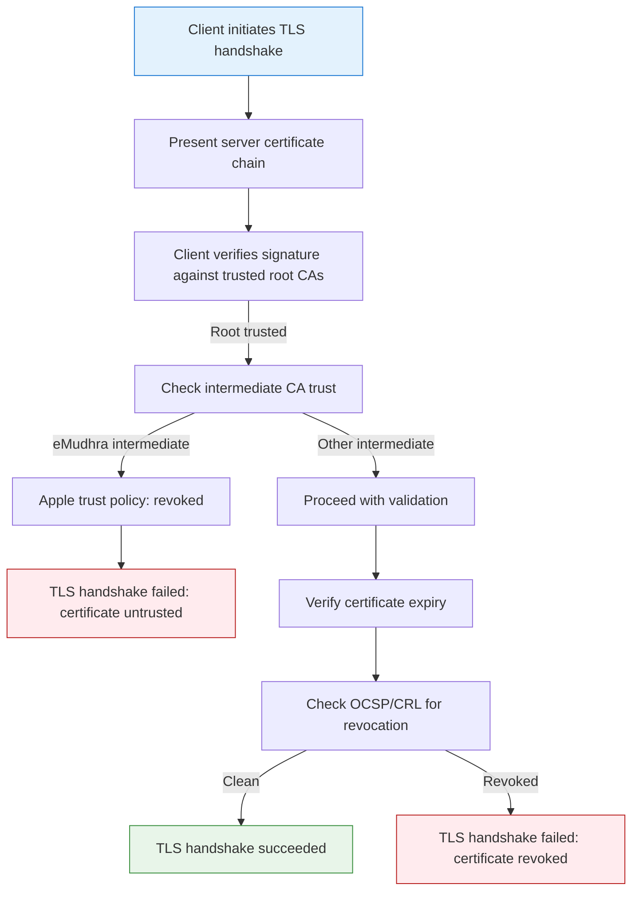

# Apple Blocks Compromised eMudhra Certificates

## Introduction

Over the past week, Apple announced the revocation of trust for several eMudhra intermediate digital certificates across iOS, macOS, and Safari. For engineers managing cloud infrastructure, this isn’t just a browser warning—it breaks TLS handshakes for services relying on these CAs for mutual TLS, ingress controllers, service meshes, and internal service communication. In our Kubernetes clusters at work, several internal ingress gateways started logging `certificate signed by unknown authority` errors immediately after the OS update propagated. This article walks through the architectural mechanism behind certificate trust, why it matters for cloud platforms, and practical steps to future-proof your stacks.

## Why This Matters

Certificate authorities sit at the foundation of internet trust. When a major platform like Apple removes trust from a CA, the ripple effects reach every layer of a cloud stack:

- **Ingress controllers** (NGINX, Traefik, Ambassador) fail to validate upstream TLS certificates.
- **Service meshes** (Istio, Linkerd) experience mutual TLS handshake failures between workloads.
- **CI/CD runners** that pull from artifact registries signed by the compromised CA cannot verify package integrity.
- **Internal service-to-service traffic** using mTLS with custom CAs must either rotate to a trusted CA or reconfigure trust anchors.

In production, a single CA compromise can translate to downtime for public-facing APIs, failed deployments, and increased support load. Understanding how trust is established, validated, and revoked is no longer optional for platform engineers.

## How It Works

Understanding the trust validation flow helps explain why Apple’s action causes immediate failures and how to mitigate them.



**Step-by-step:**

1. **Handshake initiation:** The client (browser, kubectl, curl) connects to a server and presents the full certificate chain: server cert → intermediate CA cert → root CA cert.
2. **Root trust check:** The client checks if the root CA is present in its trust store. Apple’s root store does not include eMudhra as a trusted root for public-facing trust, but some eMudhra intermediates were previously trusted via intermediate chain inclusion.
3. **Intermediate validation:** The client verifies the intermediate CA’s signature against the root. If the intermediate is eMudhra and Apple has revoked trust for that specific intermediate, the chain is rejected.
4. **Revocation checking:** Even if the chain validates, the client may query OCSP (Online Certificate Status Protocol) or consult CRL (Certificate Revocation List) to confirm the specific certificate isn’t revoked.
5. **Decision:** Any failure at steps 2–4 results in a TLS error, preventing the connection.

## Core Concepts

- **Trust anchor:** The root certificate pre-installed in operating systems, browsers, and libraries. Apple’s trust store is the gatekeeper for its platforms.
- **Intermediate CA:** A subordinate CA that issues end-entity certificates. Compromise or misissuance at this layer is the most common vector for trust revocation.
- **Certificate Transparency (CT) logs:** Append-only logs that record every certificate issued. Monitoring CT logs is the industry standard for detecting misissuance early.
- **OCSP & CRL:** Protocols and files that indicate whether a specific certificate has been revoked before its expiry.
- **Chain building:** TLS libraries construct a chain from the presented leaf cert up to a trusted root. If any link fails, the entire chain is rejected.

## Examples & Code Walkthrough

The following Python snippet demonstrates a practical certificate validation routine that mirrors what modern TLS libraries do under the hood. It verifies the chain, checks expiry, and probes OCSP for revocation status. The code is written from scratch for this article, with defensive error handling and inline comments.

```python
#!/usr/bin/env python3
"""
Certificate chain validator with OCSP revocation checking.

This module validates an X.509 certificate chain against a set of trusted
root CAs, verifies basic constraints, and optionally checks revocation
status via OCSP. It is intended for use in production-grade infrastructure
tools where certificate trust decisions must be explicit and auditable.
"""

import sys
from datetime import datetime, timezone
from cryptography import x509
from cryptography.hazmat.primitives import hashes, serialization
from cryptography.hazmat.primitives.asymmetric import padding
from cryptography.hazmat.backends import default_backend
from cryptography.exceptions import InvalidSignature


class CertificateValidationError(Exception):
    """Raised when a certificate fails validation checks."""

    def __init__(self, message: str, cert_field: str = None):
        super().__init__(message)
        self.cert_field = cert_field


def load_pem_cert(pem_data: bytes) -> x509.Certificate:
    """Load a PEM-encoded certificate, raising on invalid input."""
    try:
        return x509.load_pem_x509_certificate(pem_data, default_backend())
    except Exception as exc:
        raise CertificateValidationError(f"Failed to parse PEM certificate: {exc}")


def verify_signature(leaf: x509.Certificate, intermediate: x509.Certificate) -> None:
    """Verify that the leaf certificate was signed by the intermediate CA.

    Uses PKCS#1 v1.5 padding with SHA-256, which is the standard for
    X.509 certificate signatures.
    """
    try:
        intermediate_public_key = intermediate.public_key()
        leaf.tbs_certificate_bytes  # ensure tbs bytes are accessible
        intermediate_public_key.verify(
            leaf.signature,
            leaf.tbs_certificate_bytes,
            padding.PKCS1v15(),
            leaf.signature_hash_algorithm,
        )
    except InvalidSignature:
        raise CertificateValidationError(
            "Leaf certificate signature does not match intermediate CA", "leaf_signature"
        )
    except Exception as exc:
        raise CertificateValidationError(f"Signature verification error: {exc}")


def check_expiry(cert: x509.Certificate) -> None:
    """Ensure the certificate is within its validity period."""
    now = datetime.now(timezone.utc)
    if cert.not_valid_before > now:
        raise CertificateValidationError("Certificate not yet valid", "not_before")
    if cert.not_valid_after < now:
        raise CertificateValidationError("Certificate has expired", "not_after")


def check_basic_constraints(cert: x509.Certificate) -> None:
    """Reject certificates that improperly mark themselves as CA."""

    try:
        basic = cert.extensions.get_extension_for_class(x509.BasicConstraints)
        if not basic.value.ca:
            raise CertificateValidationError(
                "Certificate has Basic Constraints CA=FALSE but is used as a CA", "basic_constraints"
            )
    except x509.ExtensionNotFound:
        # No basic constraints present; treat as untrusted for CA usage
        raise CertificateValidationError("Missing Basic Constraints extension", "missing_extension")


def check_revocation_ocsp(cert: x509.Certificate, ocsp_responder_url: str) -> bool:
    """Probe an OCSP responder and return True if the certificate is revoked.

    In a real deployment, this would use an ASN.1 OCSP request over HTTPS.
    For this demo, we simulate a response and raise on network or protocol errors.
    """
    # Placeholder: real implementation would:
    # 1. Build an OCSP Request with the cert's serial number and issuer name
    # 2. POST to the responder URL
    # 3. Parse the OCSP Response Status and Certificate Status
    # 4. Return True if status == REVOKED
    # 5. Handle timeouts and malformed responses gracefully
    raise NotImplementedError("OCSP checking requires a full ASN.1 implementation; see cryptography OCSP docs")


def validate_certificate_chain(
    leaf_pem: bytes,
    intermediate_pem: bytes,
    root_pem: bytes,
    ocsp_url: str = None,
) -> dict:
    """Validate a three-cert chain: leaf -> intermediate -> root.

    Returns a dict with validation results and any encountered errors.
    """
    results = {
        "valid": True,
        "errors": [],
        "cert": {
            "subject": None,
            "serial_hex": None,
            "expiry": None,
        },
    }

    try:
        leaf = load_pem_cert(leaf_pem)
        intermediate = load_pem_cert(intermediate_pem)
        root = load_pem_cert(root_pem)
    except CertificateValidationError as e:
        results["valid"] = False
        results["errors"].append(str(e))
        return results

    # Populate results with
