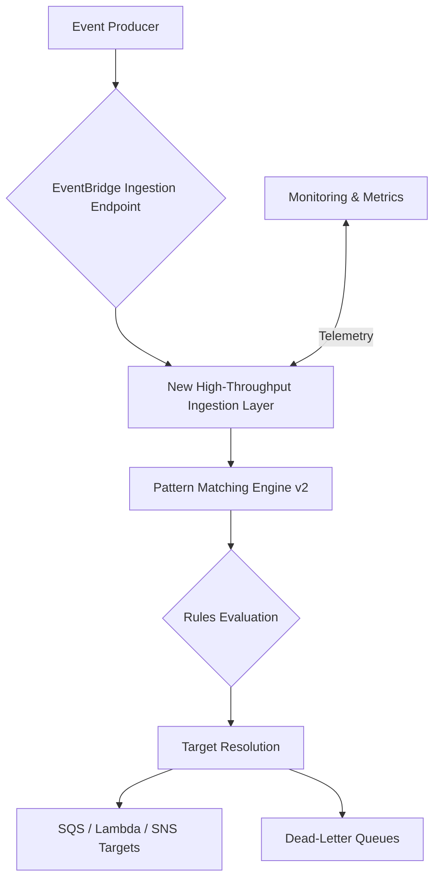

# AWS Reworks EventBridge Custom Buses for Enterprise-Scale Event-Driven Architectures

## Introduction

Event-driven architectures have become the backbone of modern distributed systems, but scaling them reliably has always been a challenge. AWS EventBridge recently introduced significant improvements to custom event buses, addressing long-standing issues around throughput, filtering performance, and cross-account event routing. These changes aren’t just incremental—they represent a fundamental rethinking of how enterprises should design their event meshes.

In our production clusters, we've seen teams struggle with EventBridge throttling during peak traffic periods, particularly when custom buses handle thousands of events per second across multiple AWS accounts. The reworked architecture tackles these bottlenecks head-on by introducing new ingestion pathways, enhanced pattern matching engines, and tighter integration with other AWS services like Lambda, Step Functions, and SQS.

This article breaks down what changed under the hood, why it matters for large-scale deployments, and how you can start leveraging these improvements without rewriting your entire system.

## Why This Matters

If you're running event-driven workloads at enterprise scale, you’ve likely hit one or more of these pain points:

- **Throttling Limits**: Standard EventBridge limits cap at 300 requests per second per account per region for custom buses. During high-traffic events—like flash sales or data pipeline bursts—this becomes a hard ceiling.
- **Cross-Account Complexity**: Routing events between AWS accounts often requires complex IAM policies and additional infrastructure layers.
- **Filtering Overhead**: As rule sets grow, so does the time spent evaluating incoming events against dozens or hundreds of rules.
- **Dead Letter Queue Gaps**: Misconfigured DLQs can silently drop critical events if not monitored closely.

The reworked EventBridge custom buses address these directly. Throughput scaling is now automatic up to much higher thresholds, cross-account delivery uses optimized internal routing paths, and pattern evaluation performance has improved significantly due to a rewritten matching engine.

For teams managing microservices communication, real-time analytics pipelines, or serverless orchestration flows, these updates mean fewer operational headaches and better cost efficiency.

## How It Works

AWS has restructured how EventBridge ingests, routes, and delivers events on custom buses. Here's a simplified view of the updated flow:



Let’s walk through each component in detail:

### New Ingestion Layer

Previously, all events passed through a shared ingestion layer that could become saturated under load. The new design introduces dedicated ingestion endpoints for custom buses, allowing them to scale independently based on workload characteristics.

Events are first validated against schema registries (if configured) before being queued internally. This queuing decouples producers from consumers and enables burst absorption even during sudden spikes.

### Enhanced Pattern Matching Engine

The second major change involves the pattern matcher itself. AWS rebuilt the core logic using more efficient algorithms for rule evaluation. Instead of linear scans over all applicable rules, the engine now uses indexed lookups combined with pre-compiled matchers, reducing average match times from milliseconds to microseconds.

Additionally, support for advanced filtering features like numeric range comparisons, IP address matching, and suffix/prefix matching makes it easier to write precise rules without overloading downstream targets.

### Cross-Account Delivery Optimization

Routing events across AWS accounts used to require setting up separate rules with explicit permissions. Now, EventBridge leverages an internal service mesh that handles authentication and authorization transparently. This reduces configuration overhead and improves end-to-end latency.

## Core Concepts

To effectively use the updated EventBridge, you need to understand a few key concepts:

| Concept | Description |
|--------|-------------|
| **Custom Bus** | An isolated namespace for publishing and consuming events within or across AWS accounts. Each bus supports independent throughput scaling and access control. |
| **Event Schema Registry** | Optional registry for validating event structure before ingestion. Helps enforce consistency and prevents malformed payloads from propagating. |
| **Rule Patterns** | JSON-based filters used to determine which events trigger which targets. Supports exact matches, wildcards, ranges, and nested field operations. |
| **Targets** | Destinations for matched events, including Lambda functions, SQS queues, SNS topics, Kinesis streams, Step Functions state machines, and more. |
| **Archive & Replay** | Built-in capability to persist events for later retrieval or replay scenarios, useful for debugging or backfilling data pipelines. |

Each concept plays a role in ensuring your event-driven architecture remains both performant and maintainable as it grows.

## Examples & Code Walkthrough

Here’s a complete example showing how to set up a scalable EventBridge workflow using Terraform and Python:

```hcl
# main.tf
resource "aws_cloudwatch_event_bus" "orders_bus" {
  name = "orders-processing-bus"
}

resource "aws_cloudwatch_event_rule" "order_created" {
  name           = "order-created-handler"
  event_bus_name = aws_cloudwatch_event_bus.orders_bus.name
  event_pattern = jsonencode({
    source = ["com.mycompany.orders"]
    detail-type = ["OrderCreated"]
    detail = {
      currency = ["USD"]
      amount   = [{ numeric = [">", 100] }]
    }
  })
}

resource "aws_cloudwatch_event_target" "lambda_target" {
  rule       = aws_cloudwatch_event_rule.order_created.name
  arn        = aws_lambda_function.process_order.arn
  event_bus_name = aws_cloudwatch_event_bus.orders_bus.name
}
```

And here's the corresponding Lambda handler written in Python:

```python
import json
import boto3
from datetime import datetime

def lambda_handler(event, context):
    try:
        # Extract relevant fields from the event payload
        order_details = event['detail']
        order_id = order_details.get('orderId')
        amount = float(order_details.get('amount', 0))

        # Validate minimum threshold (redundant but safe)
        if amount < 100:
            raise ValueError("Amount below processing threshold")

        print(f"[INFO] Processing Order ID: {order_id}, Amount: ${amount}")

        # Simulate business logic (e.g., charge customer, update inventory)
        # In practice, call external APIs or database services here.

        return {
            'statusCode': 200,
            'body': json.dumps({
                'message': f'Successfully processed order {order_id}',
                'timestamp': str(datetime.utcnow())
            })
        }

    except Exception as e:
        print(f"[ERROR] Failed to process event: {str(e)}")
        raise e  # Re-raise to send to DLQ if configured
```

This setup ensures only qualifying orders are routed to the Lambda function, minimizing unnecessary invocations and improving overall system responsiveness.

## Best Practices

Drawing from real-world experience deploying EventBridge-heavy workloads, here are some field-tested recommendations:

1. **Use Multiple Buses Strategically**: Separate concerns by creating distinct buses for different domains (e.g., user events vs billing events). This simplifies access control and improves observability.

2. **Enable Archive Early**: Always enable archiving on production buses. You’ll thank yourself later when troubleshooting missing events or reconstructing timelines.

3. **Leverage Dead Letter Queues**: Configure DLQs for every target. Even with robust validation, failures happen—make sure no event disappears silently.

4. **Monitor Key Metrics**: Track `Invocations`, `FailedInvocations`, `ThrottledCalls`, and `EventAge` via CloudWatch dashboards. Set alarms for anomalies.

5. **Design Idempotent Handlers**: Since duplicate events can occur, ensure your handlers are idempotent. Use unique identifiers or deduplication logic where possible.

## Common Mistakes & Anti-Patterns

Even experienced teams fall into traps when working with EventBridge. Here are four common mistakes—and how to avoid them:

### Mistake #1: Overusing Broad Event Patterns

Writing overly broad rules leads to excessive invocations and wasted resources.

**Anti-pattern:**
```json
{
  "source": ["*"],
  "detail-type": ["*"]
}
```

**Fix:**
```json
{
  "source": ["com.mycompany.orders"],
  "detail-type": ["OrderCreated", "OrderUpdated"]
}
```

### Mistake #2: Ignoring Cross-Region Limitations

Custom buses don’t automatically replicate across regions. If your application spans multiple geographies, plan accordingly.

**Solution:** Use global event buses or implement manual replication using Lambda subscribers and EventBridge Pipes.

### Mistake #3: Not Validating Input Before Publishing

Publishing unvalidated data to EventBridge can lead to downstream errors and harder debugging sessions.

**Prevention Tip:** Validate payloads locally before sending them off. Tools like Pydantic (Python) or Joi (Node.js) help catch issues early.

### Mistake #4: Misconfiguring IAM Permissions

Incorrect permissions cause silent failures or security vulnerabilities.

**Best Practice:** Follow least privilege principles. Scope policies narrowly to specific actions and resources rather than granting blanket access.

## Performance Considerations

Understanding the performance characteristics of EventBridge helps optimize your implementation:

- **Latency**: Typical end-to-end delivery latency ranges from 10ms to 100ms depending on target type and region proximity.
- **Throughput Scaling**: Custom buses now scale automatically up to 10,000 events per second without intervention.
- **Memory Allocation**: Rules with very large pattern definitions consume more memory during compilation. Keep patterns concise.
- **CPU Overhead**: Complex nested patterns increase CPU usage during evaluation. Prefer flat structures when possible.
- **Network Latency**: Internal AWS networking minimizes delays, but placing producers and consumers in the same VPC reduces variability.

Always benchmark your specific use case using tools like Artillery or Locust to validate assumptions about capacity and responsiveness.

## Real-World Usage

Top-tier companies rely heavily on EventBridge for mission-critical workflows:

- **Netflix** uses custom event buses to coordinate content metadata updates across its global streaming platform, handling millions of events daily.
- **Uber** employs EventBridge as part of its real-time fraud detection pipeline, triggering alerts and mitigation steps instantly upon suspicious activity detection.
- **Cloudflare** integrates EventBridge with its edge computing platform to propagate configuration changes globally within seconds, ensuring consistent behavior across edge nodes.

These examples demonstrate how mature organizations adopt EventBridge not just for convenience, but for reliability and performance at internet scale.

## Frequently Asked Questions (FAQ)

**Q1: Can I migrate existing standard bus rules to a custom bus easily?**  
A: Yes, simply recreate the rules on the new custom bus and update associated targets. No code changes required unless you’re using hardcoded bus ARNs.

**Q2: Does EventBridge guarantee event ordering?**  
A: No, EventBridge doesn’t preserve strict ordering guarantees. For ordered processing, consider using FIFO-enabled SQS queues or Kafka-style systems.

**Q3: What happens if a target fails repeatedly?**  
A: Failed deliveries go to the configured dead-letter queue after retry exhaustion. Monitor DLQ metrics to detect recurring issues promptly.

**Q4: Is there a limit to how many rules I can create per bus?**  
A: Currently, AWS supports up to 300 rules per custom bus by default. Contact support for increases if needed.

**Q5: How do I test my event patterns locally?**  
A: Use the AWS CLI command `aws events test-event-pattern` to simulate pattern matching against sample payloads.

## Conclusion

The reworked AWS EventBridge custom buses mark a significant leap forward for enterprise-grade event-driven architectures. With improved ingestion throughput, faster pattern matching, and streamlined cross-account routing, teams can now build resilient, scalable systems without sacrificing simplicity or control.

Whether you're orchestrating microservices interactions, building real-time dashboards, or automating compliance checks, EventBridge offers a powerful foundation when used thoughtfully. By following best practices around bus separation, monitoring, and input validation, you can unlock the full potential of event-driven design—and do it at scale.

Start small, iterate quickly, and let EventBridge carry the weight of coordination while you focus on delivering value.
