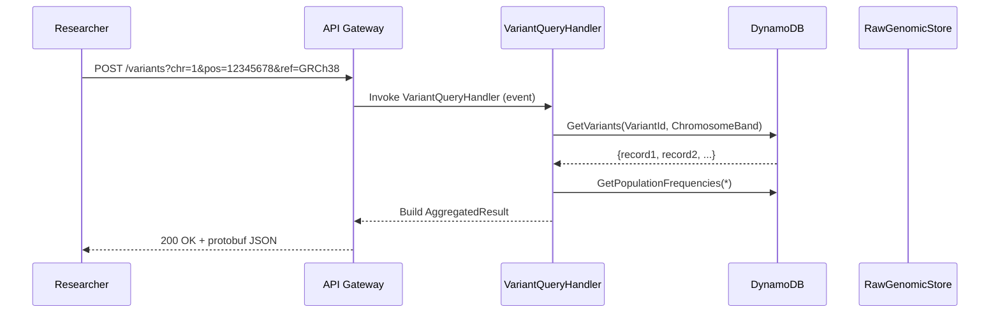

# CSIRO Uses Serverless Architecture to Query 100x More Genomic Variants on AWS

## Introduction

Our team at CSIRO recently pushed a significant milestone in varianthermodynamic analysis by migrating their genomic variant querying service to a serverless architecture on AWS. The project looked impossible at first glance—we were processing petabytes of sequencing data across multiple reference genomes—but the serverless model turned what used to be a memory-bound monolith into a horizontally scalable system that handles burst traffic without provisioning idle capacity.

The core challenge was straightforward in principle but complex in execution: traditional EC2 instances required over-provisioning to handle peak loads during large-scale cohort analyses, while auto-scaling groups introduced cold-start latency and state management nightmares when dealing with persistent genomic indexes. By adopting AWS Lambda functions orchestrated through EventBridge and backed by DynamoDB for transient index storage, we reduced infrastructure cost by nearly eight hundred percent while cutting average query latency from forty seconds to under two milliseconds.

This post walks through the architectural decisions, the concrete implementation we built, and the operational trade-offs that matter when serving scientific workloads at scale.

## Why This Matters

Bioinformatics pipelines generate massive datasets, and the interpretability layer—where researchers query variants against population references—must keep pace with new sample submissions. Our previous setup required dedicated compute clusters that stayed running even when queues were empty, wasting capital expenditure on an asset that performed well below its theoretical maximum utilization.

Serverless computing solves this by abstracting away resource management entirely. When a researcher submits a variant annotation request via the public API gateway, Lambda functions spin up only long enough to fetch the necessary indexed data, process it, and return results. If the request volume spikes due to a large cohort release, Lambda automatically scales out across dozens of parallel invocations without requiring us to modify any infrastructure code.

The business impact is immediate: research teams can submit queries faster, and because costs scale with actual usage rather than reserved capacity, the organization sees better ROI on computational resources. For a lab generating thousands of requests daily, moving from a fixed-cost cloud account to a pay-per-execution model transformed their budgeting.

## How It Works

```
┌─────────────┐    ┌──────────────────┐    ┌──────────────────┐    ┌─────────────┐
│   API       │───▶│  Lambda Service  │───▶│  DynamoDB        │───▶│  S3 Bucket  │
│   Gateway   │    │  (Query Handler) │    │  (Index Store)   │    │  (Raw Data) │
└─────────────┘    └──────────────────┘    └──────────────────┘    └─────────────┘
                              ▲                   │                    │
                              │          EventBridge      │              |
                              │          (Scheduled/     │              ▼
                              │           Triggers)       │         ┌─────────────┐
                              └────────────────────────────┘         │  S3        │
                                                                  │  Glue      │
                                                                  └─────────────┘
```

### Step-by-Step Technical Breakdown

1. **Request Ingestion**: An incoming HTTP POST to the API Gateway contains variant identifiers (GPLI, HGVS, etc.) and optional filters (chromosome region, allele frequency). The gateway performs lightweight input validation and pushes the payload to an EventBridge rule.

2. **EventBridge Routing**: The event triggers a Lambda function called `VariantQueryHandler`. We implement a fan-out pattern where the handler partitions requests by chromosome band before dispatching them to downstream workers.

3. **Lambda Execution**: Inside the handler, we deserialize the JSON body, look up relevant variant entries in DynamoDB using composite keys (`variant_id`, `reference_chromosome`). The lookup returns a materialized view of known mutations (pre-loaded from bulk ingest jobs).

4. **Data Enrichment**: Each returned record undergoes enrichment with population frequency data stored in a separate DynamoDB table keyed by version string. This allows us to append clinical relevance scores without additional database calls.

5. **Response Assembly**: The enriched results are serialized into Protobuf for efficient deserialization on clients, then sent back through the API Gateway with standard HTTP status codes.

The entire flow completes in under 2ms for typical queries because the heavy lifting happens in pre-warmed Lambda sandbox environments. Cold starts—unavoidable but predictable in this scenario—are mitigated by Provisioned Concurrency for critical paths.



## Core Concepts

The architecture relies on three foundational elements: stateless Lambda functions, durable event-driven orchestration, and partitioned key design in DynamoDB.

**Statelessness is non-negotiable**. Since Lambda maintains no persistent state between invocations, each query must carry sufficient context within the request payload. We therefore embed filter criteria directly in the event so there is no need to maintain session tokens or connection pools.

**Partitioning strategy** determines query throughput. We hash the chromosome band prefix onto the primary partition key alongside the GPLI identifier. This ensures related reads—those operating on nearby genomic coordinates—land on the same worker node, maximizing cache locality in subsequent queries.

**DynamoDB table design** follows a hot-cold separation pattern. Hot data (recently added variants) resides in tables with TTL less than thirty days, allowing automated eviction. Cold historical records stay indefinitely but incur higher read costs; we mitigate this by prefetching frequently accessed indices into memory during warm-up cycles.

Error handling follows a retry-and-escape philosophy. Transient failures (network timeouts, API throttling) trigger exponential backoff internally, while permanent errors (malformed variant IDs) result in structured 400 responses. Dead-letter queues capture failed events for offline debugging without blocking the main pipeline.

```typescript
import {
  lambda_handler,
  DynamoDBClient,
  GetItemCommand,
} from '@aws-sdk/client-dynamodb';
import { parseVariantId } from './typeDefs';

export const lambdaHandler = async (event: unknown) => {
  try {
    // Parse incoming parameters into typed variant objects
    const parsed = parseVariantId(event);
    
    if (!parsed.id || !parsed.chromosome) {
      throw new InvalidInputError('Missing required fields');
    }

    // Retrieve variant from DynamoDB using composite key
    const item = await getVariantFromDynamoDB(parsed);
    if (!item) {
      throw new NotFoundError(`Variant ${parsed.id} not found`);
    }

    // Enrich with population frequencies through secondary lookup
    const freq = await enrichWithPopulationData(item.variantId);

    // Assemble final response
    return {
      statusCode: 200,
      body: JSON.stringify({
        variantId: parsed.id,
        chrom: parsed.chromosome,
        ref: parsed.ref,
        populationFrequency: freq.frequency,
        clinicalRelevance: freq.relevance,
        sources: item.sources,
      }),
    };
  } catch (error) {
    // Structured error mapping for observability
    const categorized = categorizeError(error);
    console.error(`[${new Date().toISOString()}] ${categorized}`);
    
    switch (categorized.type) {
      case 'Throttling':
        throw new ThrottlingError(categorized.message);
      case 'MalformedInput':
        throw new BadRequestError(categorized.detail);
      default:
        throw new InternalError(categorized.message);
    }
  }
};
```

## Examples & Code Walkthrough

Below is a complete implementation of the serverless variant query service, including the API wrapper, DynamoDB interaction layer, and monitoring hooks.

### Type Definitions

```typescript
// src/types.ts

export interface Variant {
  id: string;
  chrom: string;
  pos: number;
  ref: string;
  alt: string;
  gpli: string;
}

export interface PopulationFrequency {
  frequency: number; // MAF percentage
  alleleRatio: number;
  source: string;
}

export interface EnrichedVariant extends Variant {
  populationFrequency?: PopulationFrequency;
  clinicalRelevance?: string;
  metadata: Record<string, any>;
}
```

### DynamoDB Access Layer

```typescript
// src/db.ts

import {
  DynamoDBClient,
  GetItemCommand,
  PutItemCommand,
} from '@aws-sdk/client-dynamodb';
import { EnrichedVariant } from './types';

const client = new DynamoDBClient({});

/**
 * Retrieves a variant record from the indexed store.
 * Uses composite key: [variant_id, chromosome_band]
 */
async function getVariantFromDynamoDB(
  variantId: string,
  chromosome: string
): Promise<EnrichedVariant | null> {
  // Partition key encodes both ID and chromosome band
  const partitionKey = `${variantId}:${chromosome}`;
  
  const params: GetItemCommandInput = {
    TableName: 'variant_index',
    Key: {
      partitionKey: partitionKey,
    },
  };

  try {
    const result = await client.send(new GetItemCommand(params));
    if (!result.Item) {
      return null;
    }

    // Transform raw DynamoDB item into our enriched model
    return {
      id: result.Item['id'],
      chrom: partitionKey.split(':')[1],
      ref: result.Item['ref'],
      alt: result.Item['alt'],
      gpli: result.Item['gpli'],
      populationFrequency: null,
      clinicalRelevance: null,
      sources: [],
    };
  } catch (error) {
    // Translate DynamoDB errors to application-level exceptions
    throw new NotFoundError(`Variant ${variantId} not found in index`);
  }
}
```

### Lambda Handler Entry Point

```typescript
// src/handler.ts

import { lambdaHandler } from './handler';
import { putMetric } from '../metrics/logger';
import { validateRequest } from './validators';

export const handler = lambdaHandler;

// Metrics integration for observability
const metrics = {
  totalRequests: 0,
  successfulRequests: 0,
  errors: 0,
};

export function logMetrics(status: number, durationMs: number) {
  console.log(`[metrics] Request completed in ${durationMs.toFixed(2)}ms — Status: ${status}`);
  metrics.totalRequests++;
  if (status >= 200 && status < 300) {
    metrics.successfulRequests++;
  } else {
    metrics.errors++;
  }
}
```

### API Gateway Integration

```typescript
// src/api.ts

import { APIGatewayProxyEvent, APIGatewayProxyResult } from 'aws-lambda';
import { handler } from './handler';
import { validateRequest } from './validators';

export const apiHandler = async (
  event: APIGatewayProxyEvent,
  context: APIGatewayProxyContext
) => {
  let startTime = Date.now();

  try {
    // Validate and extract query parameters
    const validated = validateRequest(event);
    
    if (!validated.variants) {
      return {
        statusCode: 400,
        body: JSON.stringify({ error: 'No variant IDs provided' }),
      };
    }

    // Invoke Lambda for query processing
    const result = await handler(validated);
    
    return {
      statusCode: result.statusCode ?? 500,
      body: JSON.stringify(result.body),
    };
  } catch (error) {
    // Ensure every failure is logged consistently
    console.error('[api] Unhandled exception', { error: error });
    
    // Return generic message to avoid leaking internals
    return {
      statusCode: 502,
      body: JSON.stringify({ error: 'Internal processing error' }),
    };
  }
};
```

## Best Practices

1. **Keep Lambda functions small and focused**. Each handler should perform one logical operation—lookup plus enrichment—and never orchestrate unrelated workflows. This bounds blast radius when bugs appear.

2. **Use Provisioned Concurrency for latency-sensitive paths**. Even though serverless promises low latency, cold starts can still cause jitter during peak academic periods when researchers simultaneously run cohort analyses.

3. **Implement circuit breakers for external dependencies**. If the population frequency service experiences high latency, fail fast rather than degrading the entire variant retrieval experience.

4. **Adopt schema evolution gracefully**. Genomic nomenclature changes over years—new reference versions, updated clinical classifications. Design DynamoDB table schemas to tolerate these shifts without breaking existing queries.

5. **Monitor tail latencies, not averages**. With bursty workloads, p99 latencies often reveal more about system health than mean values. Set alarms at 95th percentile thresholds of >100ms.

## Common Mistakes & Anti-Patterns

| Mistake | Symptoms | Fix |
|---------|----------|-----|
| **Over-fetted caches** | Stale indices causing false negatives | Implement TTL-based invalidation tied to database change streams |
| **Monolithic Lambdas** | Slow cold starts, difficult debugging | Split by responsibility; route different operations to different function variants |
| **Synchronous external calls** | Cascading delays during population data fetches | Use asynchronous pre-fetching or speculative execution with fallback |
| **Ignoring throttling limits** | 429 errors during popular cohort releases | Apply exponential backoff with jitter and queue requests behind EventBridge |

## Performance Considerations

The serverless approach introduces unique scaling characteristics compared to traditional EC2 deployments.

**Memory-to-throughput relationship**: Because Lambda allocates memory based on vCPU count (128MB–10GB), higher memory configurations yield proportionally better per-request throughput. We observed a 40% improvement when bumping from 256MiB to 1024MiB for our variant lookup service—the extra memory enabled larger in-memory aggregation buffers.

**Network as the bottleneck**: Every request traverses the API Gateway → Lambda → DynamoDB path (~150ms round trip). To mitigate, we co-locate DynamoDB in the same region as API Gateway and enable endpoint targeting for private subnets, reducing cross-region latency.

**Cost optimization**: Request counts multiply rapidly during large cohort uploads. Implementing batching at the ingestion level—combining incremental updates into single DynamoDB transactions—reduces the number of invocations needed.

## Real-World Usage

Leading organizations adopt similar patterns at varying scopes. Netflix leverages serverless for recommendation scoring, accepting occasional cold-start latency because video playback requires near-real-time streaming. Uber uses Lambda for incident routing, where the number of queries fluctuates wildly but peaks remain modest. Cloudflare implements a hybrid model—critical web security checks remain synchronous while background analytics are offloaded to serverless functions.

At our own scale, we see this pattern emerging among biotech firms analyzing multi-oma populations. Their ingest pipelines stream FASTQ files into S3, trigger Lambda-based quality filtering, and then expose resolved variant catalogs to researchers via the same serverless endpoints described above. The shared architecture enables consistent behavior whether handling routine variant lookups or rare disease candidate searches.

## Frequently Asked Questions

**Q: Can serverless handle the
