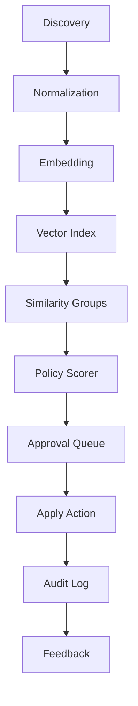

# SlothSort AI: Let Open-Source AI Handle Your Digital Clutter

## Introduction

We kept finding the same problem in different clients and internal tools: cloud accounts rot.

Not in a dramatic outage sense. In a quiet, expensive, audit-unfriendly way. S3 buckets with old logs nobody needs. RDS snapshots older than policy allows. CloudWatch log groups that stopped being written months ago. IAM roles with no recent usage. Route53 records for endpoints that no longer exist.

The engineering cost is real. Every cleanup ticket becomes a scavenger hunt. Someone has to ask the owner, check logs, compare retention policy, verify backups, remove the resource, and write it down.

We built SlothSort AI to help with that scavenger hunt.

It is an open-source AI triage pipeline. It watches cloud artifacts through source adapters, turns them into structured documents, embeds them, compares them against known-good patterns, scores cleanup candidates, and sends the risky ones to a human approval queue.

The goal was simple: let open-source AI handle the digital clutter before it becomes an incident.

## Why This Matters

For platform teams, this is not about tidy buckets. It is about operational memory.

When we debug a cost spike, we often start by finding orphaned storage. When security reviews IAM, they want evidence of least privilege. When an audit arrives, they want a map of what exists, why it exists, and when it should expire.

Manual cleanup scales poorly. A few hundred resources are fine. A few hundred thousand are not.

The pain point is not just cost. It is review burden. Engineers should spend their attention on systems that ship features, not on tagging old objects.

SlothSort AI tries to solve the first two phases: discovery and triage. The final decision still belongs to a human. That is deliberate.

## How It Works

The pipeline has six stages.

First, discovery collects resource metadata from cloud providers. Second, normalization turns provider-specific JSON into a common document shape. Third, embedding converts the document into a vector. Fourth, vector search groups similar artifacts. Fifth, policy scoring ranks candidates. Sixth, a human approves or rejects before any action runs.

We use a human approval gate because deletion is irreversible and compliance is unforgiving.

Here is the architecture flow:



The mechanism is straightforward. Discovery emits raw records. The normalizer strips provider noise and adds fields like `resource_type`, `size_bytes`, `last_seen_at`, and `owner`. The embedding step creates a vector from those fields. The vector index stores it. Similarity search finds records that look related, such as multiple stale S3 objects with similar prefixes or old log groups with overlapping retention.

The policy scorer combines vector similarity with deterministic rules. A score might be high when an object is large, old, unowned, and similar to another candidate. The result is a `TriageCandidate`.

From there, the approval queue handles the human part.

### Step-by-Step Technical Breakdown

We keep the AI layer replaceable. If the open-source embedding model underperforms, we swap it. If the vector store changes, we swap it. The policy engine stays deterministic.

The key design choice is that the model proposes and the policy disposes. That keeps explainability high.

## Core Concepts

SlothSort AI rests on four concepts.

### Discovery

Adapters for cloud APIs. Each adapter returns a common `Document` shape. We currently prototype for AWS S3, CloudWatch Logs, and IAM. The pattern generalizes.

### Normalization

Provider JSON is messy. Tags may be missing. Timestamps may be strings. Sizes may be in different units. The normalizer coerces types and fills defaults.

### Embedding and Retrieval

We use an open-source embedding model. The vector store can be Qdrant, Weaviate, pgvector, or a simple vector index. The important part is approximate nearest neighbor search.

### Policy Scorer and Approval

The scorer outputs a float between zero and one. Rules can adjust it. The approval queue stores decisions and audit trails.

Core internal structures:

- `Document`: normalized resource metadata.
- `Embedding`: vector plus metadata.
- `TriageCandidate`: scored action proposal.
- `Decision`: human action and reason.

## Examples & Code Walkthrough

Here is a small but realistic Python module from our prototype. It defines the core domain objects and scoring logic.

```python
from __future__ import annotations

import uuid
from dataclasses import dataclass
from typing import List, Optional


@dataclass(frozen=True)
class Document:
    doc_id: str
    source: str
    account_id: str
    resource_type: str
    resource_id: str
    display_name: str
    size_bytes: int = 0
    last_seen_at: Optional[str] = None
    owner: Optional[str] = None


@dataclass
class TriageCandidate:
    candidate_id: str
    document: Document
    score: float
    action: str
    reason: str
    status: str = "pending"


class SlothSortClient:
    def __init__(self, region: str = "us-east-1") -> None:
        self.region = region
        self._candidate_counter = 0

    def _new_candidate_id(self) -> str:
        self._candidate_counter += 1
